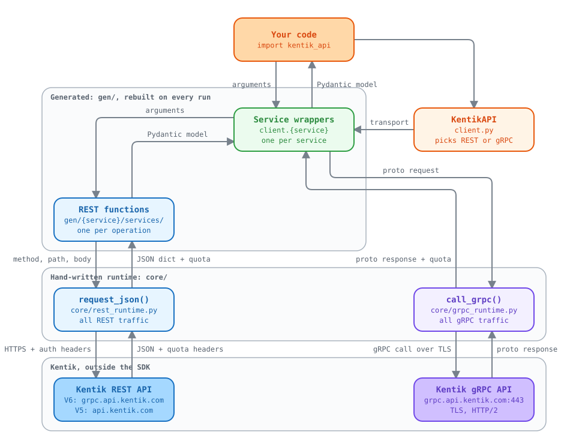

<!-- HAND-WRITTEN: not modified by [`uv run poe generate`](pyproject.toml). Edit directly. -->

# Kentik Community Python SDK

A type-safe Python client for the Kentik API v6, generated from
Kentik's public OpenAPI v3 schema.

## What this is

The SDK is not hand-written.
[`scripts/generate_sdk.py`](scripts/generate_sdk.py) generates it from the
[Kentik API Public Schema](https://github.com/kentik/api-schema-public).
The pipeline fixes common OpenAPI generator bugs, removes schema-version
prefixes from class names, and generates architecture diagrams.

The diagram below shows how a call moves through the SDK. Each hop is a
call going down and its answer coming back up. The hand-written runtime
survives every regeneration. [`uv run poe generate`](pyproject.toml) wipes
and rebuilds the generated code, and redraws this diagram.

<picture>
  <source media="(prefers-color-scheme: dark)" srcset="./docs/assets/architecture-overview-dark.svg">
  <source media="(prefers-color-scheme: light)" srcset="./docs/assets/architecture-overview-light.svg">
  
</picture>

An interactive version, and the module dependency graph, are on the
[SDK Runtime Architecture](docs/sphinx/sdk_runtime_architecture.md) page of
the Sphinx docs. To build the docs, run `uv run poe docs-build` and open
`docs/build/html/sdk_runtime_architecture.html`.

## Staying current with the Kentik API

Kentik changes its API continuously. A generator builds this SDK, so one
command adopts a new schema:

```bash
uv run poe sync-schema   # regenerate from the newest schema and move the pin in schema.lock
```

If upstream renames a public name, the run stops with `NameDriftError`.
Then update [`public_names.json`](public_names.json) and run the command again.

One run propagates a change through every layer at once: models, REST
functions, per-operation error classes, gRPC stubs, the typed client
attribute, the reference docs, and the test suite. Nobody maintains an
endpoint by hand, so a run cannot miss an endpoint or leave one half-wired.

The arrival of the RBUX Focus Scope API shows the shape of a typical
run. It took one command and no hand-written code:

| Layer | Produced by the run |
| --- | --- |
| Models and services | 26 files under [`gen/rbux/`](src/kentik_api/gen/rbux/README.md), covering all five declared operations |
| Client surface | `client.rbux` mounted on `KentikAPI`, fully typed and autocompleting |
| Transports | Both REST and gRPC paths for every operation |
| Errors | Per-operation error classes for each status code the schema declares |
| Docs | A service reference page, plus service counts refreshed repo-wide |
| Tests | 40 cases, auto-discovered rather than written (1855 to 1894 passing) |

The generated and end-to-end suites derive their test cases from the
generated code ([`tests/_discovery.py`](tests/_discovery.py)). A new
endpoint thus arrives with tests against every response status that the
schema declares. Coverage cannot fall behind the API.

The same run also added a new optional field to an existing `deviceconf`
response model. An additive change needs no migration. A breaking change
shows immediately as a failing test, not as a surprise at runtime in
production.

## Installation

```bash
pip install -U "kentik-api>=2"
```

The SDK requires Python 3.12 or later.

## Authentication

Create `.env` in your project root:

```bash
KENTIK_EMAIL=you@example.com
KENTIK_API_TOKEN=your_api_token
```

`KentikAPI()` reads these values without writing them into the process
environment. You can also pass the credentials as arguments. Then they can
stay in an encrypted store such as [sops](https://github.com/getsops/sops).
See [`docs/sphinx/authentication.md`](docs/sphinx/authentication.md) for all
credential sources.

## Transport selection

The SDK supports both REST and gRPC transports.

```python
from kentik_api.client import KentikAPI

client = KentikAPI(protocol="rest")  # REST transport (default)
client = KentikAPI(protocol="grpc")  # gRPC transport
```

Both transports return the same Pydantic response models. REST routes calls
through [`src/kentik_api/core/rest_runtime.py`](src/kentik_api/core/rest_runtime.py).
gRPC routes calls through the compiled proto stubs in `gen/<service>/pb/` and
[`src/kentik_api/core/grpc_runtime.py`](src/kentik_api/core/grpc_runtime.py).
See [`docs/sphinx/guides/grpc.md`](docs/sphinx/guides/grpc.md) for the full gRPC guide.

## Documentation

All documentation is in [`docs/`](docs/README.md):

| Guide | Content |
| --- | --- |
| [`docs/sphinx/guides/quickstart.md`](docs/sphinx/guides/quickstart.md) | First call in 5 minutes |
| [`docs/sphinx/guides/rest.md`](docs/sphinx/guides/rest.md) | REST transport deep-dive |
| [`docs/sphinx/guides/grpc.md`](docs/sphinx/guides/grpc.md) | gRPC transport and sequence diagrams |
| [`docs/sphinx/authentication.md`](docs/sphinx/authentication.md) | Credential sources, and keeping them encrypted |
| [`docs/sphinx/guides/error_handling.md`](docs/sphinx/guides/error_handling.md) | Exception hierarchy |
| [`docs/sphinx/guides/rate_limiting.md`](docs/sphinx/guides/rate_limiting.md) | Quota headers and the limits no header shows |
| [`docs/sphinx/guides/rest-vs-grpc.md`](docs/sphinx/guides/rest-vs-grpc.md) | Choosing a transport |
| [`docs/sphinx/guides/migrating-from-1x.md`](docs/sphinx/guides/migrating-from-1x.md) | Moving from kentik-api 1.x |
| [`docs/sphinx/guides/generation.md`](docs/sphinx/guides/generation.md) | SDK regeneration workflow |

Run [`uv run poe docs`](pyproject.toml) to build the full Sphinx HTML reference from
[`docs/sphinx/`](docs/sphinx/README.md).

## Examples

Runnable scripts are in [`examples/`](examples/README.md). Each service there
has a `rest.py` and a `grpc.py` side by side.

```bash
uv run python -m examples.device.rest   # REST
uv run python -m examples.device.grpc   # gRPC
```

## Contributing

### Prerequisites

- Python 3.12 or later
- [uv](https://github.com/astral-sh/uv), the package manager
- Git

These tools work the same on Windows, macOS, and Linux. Every project task
runs as `uv run poe <task>`. To list the tasks, run `uv run poe`. You do not
need Make.

### Development setup

```bash
git clone https://github.com/kentik/community_sdk_python.git
cd community_sdk_python
uv sync
```

### Generating the SDK

```bash
uv run poe generate --local   # from local ../api-schema-public/ checkout
uv run poe generate           # fetch the schema at the commit in schema.lock
uv run poe sync-schema        # fetch the newest schema and update schema.lock
uv run poe all                # generate + test
```

See [`scripts/README.md`](scripts/README.md) for generator internals and
[`docs/sphinx/guides/generation.md`](docs/sphinx/guides/generation.md) for the full workflow.

> [!WARNING]
> `uv run poe generate` does not write release notes. If the run ends with
> `⚠️ API SURFACE CHANGED`, update [`CHANGELOG.md`](CHANGELOG.md) and run
> `uv run poe check-changelog --since HEAD` before you commit. The steps are in
> [Update the release notes after every regeneration](docs/sphinx/guides/generation.md#update-the-release-notes-after-every-regeneration).

### Testing

```bash
uv run poe test           # full mocked suite
uv run poe test-e2e       # opt-in live tests, REST transport (needs .env)
uv run poe test-e2e-grpc  # opt-in live tests, gRPC transport (needs .env)
```

See [`tests/README.md`](tests/README.md) for the full test-layer breakdown.

### Code quality

```bash
uv run poe lint          # ruff check + format, rumdl check (Markdown)
uv run poe typecheck     # ty
```

## Open-source libraries

This SDK uses these open-source libraries:

| Library | License | Author / Maintainer |
| --- | --- | --- |
| [python-dotenv](https://github.com/theskumar/python-dotenv) | BSD-3-Clause | Saurabh Kumar, Bertrand Bonnefoy-Claudet |
| [googleapis-common-protos](https://github.com/googleapis/google-cloud-python) | Apache 2.0 | Google LLC |
| [grpcio](https://grpc.io) | Apache 2.0 | The gRPC Authors |
| [httpx](https://www.python-httpx.org) | BSD-3-Clause | Tom Christie / encode |
| [pydantic](https://docs.pydantic.dev) | MIT | Samuel Colvin et al. |

These tools produce the generated code in [`src/kentik_api/gen/`](src/kentik_api/gen/README.md):

| Tool | License | Author |
| --- | --- | --- |
| [openapi-python-generator](https://github.com/MarcoMuellner/openapi-python-generator) | MIT | Marco Müllner |
| [grpcio-tools](https://grpc.io) | Apache 2.0 | The gRPC Authors |

## Acknowledgements

This project is a ground-up rewrite of the original
[kentik-api v1.x SDK](https://github.com/kentik/community_sdk_python/tree/v1.0.7).
[Martin Machacek](https://github.com/mmac-m3a) at Kentik created and
maintained that SDK.
