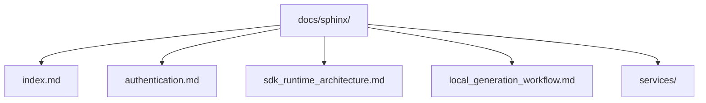

<!-- HAND-WRITTEN prose, except the `kentik-gen` marker blocks, which [`uv run poe generate`](../../pyproject.toml) rewrites. Fix those in scripts/generation/docs_rendering.py. -->

# Documentation Source

Sphinx source for the Kentik Community Python SDK. Build with [`uv run poe docs`](../../pyproject.toml);
output lands in `docs/build/html/`.

## Structure



## Pages

| File | Description |
| --- | --- |
| [index.md](index.md) | Sphinx root toctree |
| [authentication.md](authentication.md) | Credential sources (arguments, environment, `.env`), and keeping them encrypted |
| [sdk_runtime_architecture.md](sdk_runtime_architecture.md) | Module dependency graph and runtime flow |
| [local_generation_workflow.md](local_generation_workflow.md) | How to regenerate the SDK from the OpenAPI schema |
| [services/](services/README.md) | One page per Kentik API service (<!-- kentik-gen:service-count -->43<!-- /kentik-gen:service-count --> total) |

## Building

```bash
uv run poe docs                # build Sphinx HTML → docs/build/html/
uv run poe generate            # regenerate service .md pages from the OpenAPI schema
uv run poe generate --local    # use the local ../api-schema-public/ checkout
```
