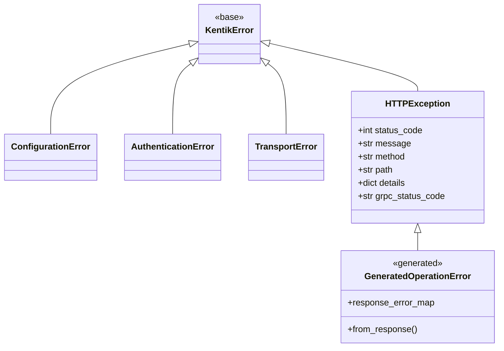

<!-- HAND-WRITTEN: not modified by [`uv run poe generate`](../../../pyproject.toml). Edit directly. -->

# Error Handling Guide

The SDK uses one exception hierarchy for both REST and gRPC transports.
To handle any SDK failure, catch the base class `KentikError`. For finer
control, catch a specific subclass.

## Exception hierarchy



| Exception | When raised |
| --- | --- |
| `ConfigurationError` | `KentikAPI(...)` gets missing or empty credentials, an unknown region or protocol, or a timeout that is not a positive number. A gRPC call gets an unknown body key or enum name, or an `api_config_override` that `with_timeout()` did not build. A call runs after `close()`. |
| `AuthenticationError` | The API rejects the credentials: a REST 401 or a gRPC `UNAUTHENTICATED` status |
| `TransportError` | No response arrived: connection failure, timeout, or a gRPC `CANCELLED`, `DEADLINE_EXCEEDED`, or `UNAVAILABLE` status. A gRPC response larger than the receive limit also raises `TransportError`. |
| `HTTPException` | The API responded with a fault. Both transports raise the operation's generated class, such as `ListError` from `client.device.list`. A subclass exists for each status that the schema declares, such as `ListUnexpectedError` for the `default` response. gRPC sets `grpc_status_code` as well. A success status whose body the SDK cannot use (not JSON, JSON `null`, or the wrong shape) raises a plain `HTTPException` with status 502 |

Every exception carries a `rate_limit` attribute with the quota the API
reported on the failing call, or `None` when no response arrived. See the
[rate limiting guide](rate_limiting.md). `except KentikError:` catches every API,
authentication, configuration, and transport failure. Two errors are outside
it. A REST path argument of `""`, `"."` or `".."` raises `ValueError`. A gRPC
client whose proto modules fail to import raises `NotImplementedError`.

The SDK defines all these classes in
[`src/kentik_api/errors/__init__.py`](https://github.com/kentik/community_sdk_python/blob/main/src/kentik_api/errors/__init__.py).

## Catching errors

```python
from kentik_api.client import KentikAPI
from kentik_api.errors import (
    AuthenticationError,
    HTTPException,
    KentikError,
    TransportError,
)

client = KentikAPI(protocol="rest")  # or protocol="grpc": same exceptions

try:
    response = client.device.list()
except AuthenticationError as exc:
    print(f"Bad credentials: {exc}")
except HTTPException as exc:
    print(f"HTTP {exc.status_code} on {exc.method} {exc.path}: {exc.message}")
    print(f"Details: {exc.details}")
except TransportError as exc:
    print(f"Network error: {exc}")
except KentikError as exc:
    print(f"Other SDK error: {exc}")
```

If the server explains an error with a `google.rpc.Status`,
`exc.details["rpc_status"]` holds it on either transport. An example is the
list of fields that a `BadRequest` rejects. The status has `code`, `message`,
and `details`. Each entry in `details` names its type in `@type`.

## gRPC status codes

[`call_grpc()`](https://github.com/kentik/community_sdk_python/blob/main/src/kentik_api/core/grpc_runtime.py)
classifies every non-OK gRPC status explicitly. If the API returned a status,
the exception keeps it unchanged in `grpc_status_code`, next to the equivalent
HTTP status. If no response arrived, the SDK does not invent an HTTP status.

| gRPC status | Exception | `status_code` |
| --- | --- | --- |
| `UNAUTHENTICATED` | `AuthenticationError` | none |
| `INVALID_ARGUMENT`, `FAILED_PRECONDITION`, `OUT_OF_RANGE` | `HTTPException` | 400 |
| `PERMISSION_DENIED` | `HTTPException` | 403 |
| `NOT_FOUND` | `HTTPException` | 404 |
| `ALREADY_EXISTS`, `ABORTED` | `HTTPException` | 409 |
| `RESOURCE_EXHAUSTED` | `HTTPException` | 429 |
| `RESOURCE_EXHAUSTED` from a response over the receive limit (40 MiB) | `TransportError` | none |
| `UNKNOWN`, `INTERNAL`, `DATA_LOSS` | `HTTPException` | 500 |
| `UNIMPLEMENTED` | `HTTPException` | 501 |
| `CANCELLED`, `DEADLINE_EXCEEDED`, `UNAVAILABLE` | `TransportError` | none |
| any code the SDK does not recognize | `TransportError`, naming the code | none |

A deadline bounds every gRPC call: 60 seconds unless `KentikAPI` gets
`timeout` or `grpc_deadline`. An unresponsive server therefore raises
`TransportError` instead of blocking forever. If the stub raises an exception
that is not a gRPC error, for example on a malformed request message, the
exception propagates unchanged.

## Runnable example

[`examples/common/error_handling.py`](https://github.com/kentik/community_sdk_python/blob/main/examples/common/error_handling.py)
shows error handling on both transports:

```bash
uv run python examples/common/error_handling.py        # REST
uv run python examples/common/error_handling.py grpc   # gRPC
```
