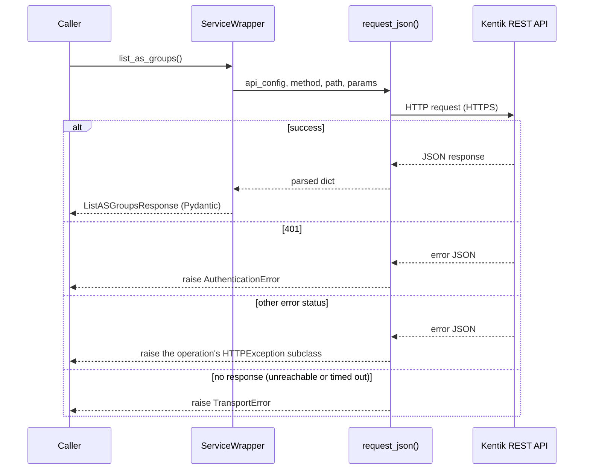
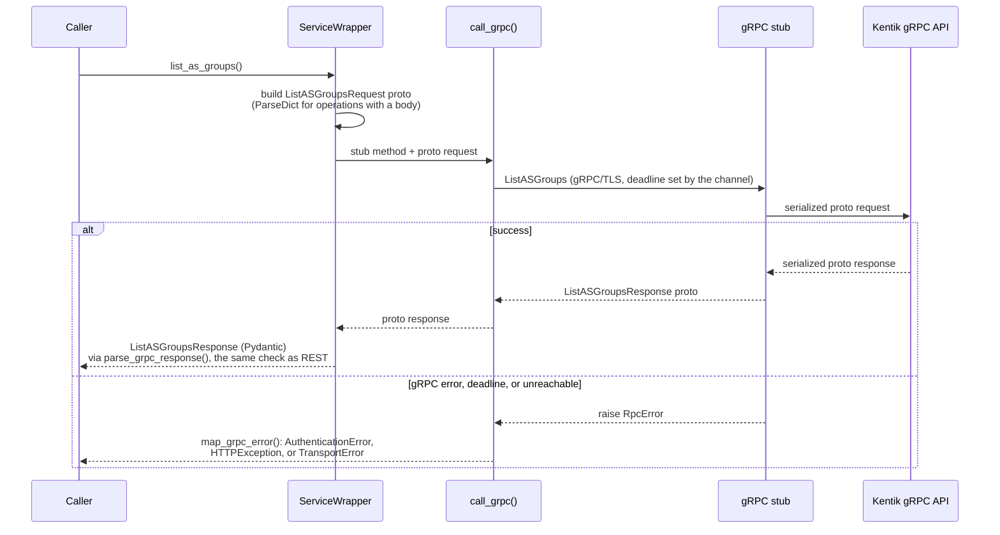

<!-- HAND-WRITTEN prose, except the `kentik-gen` marker blocks, which [`make generate`](../../../Makefile) rewrites. Fix those in scripts/generation/docs_rendering.py. -->

# gRPC Transport Guide

The SDK supports both REST and gRPC transports. Both return the same Pydantic
response models. This guide explains the gRPC transport: how it works, how it
differs from REST, and how to use it.

## Instantiate the client

Pass `protocol="grpc"` to use gRPC:

```python
from kentik_api.client import KentikAPI

client = KentikAPI(protocol="grpc")
```

Every service method call works the same as REST:

<!-- kentik-gen:grpc-usage-example -->
```python
from kentik_api.client import KentikAPI

client = KentikAPI(protocol="grpc")
response = client.as_group.list_as_groups()
print(response)  # ListASGroupsResponse
```
<!-- /kentik-gen:grpc-usage-example -->

## REST vs gRPC: call flow comparison

### REST call flow

<!-- kentik-gen:rest-callflow-diagram -->

<!-- /kentik-gen:rest-callflow-diagram -->

The REST path routes every call through
[`request_json()`](../../../src/kentik_api/core/rest_runtime.py) in
[`core/rest_runtime.py`](../../../src/kentik_api/core/rest_runtime.py).

### gRPC call flow

<!-- kentik-gen:grpc-callflow-diagram -->

<!-- /kentik-gen:grpc-callflow-diagram -->

The gRPC path uses:

1. `build_grpc_request()` in
   [`core/grpc_runtime.py`](../../../src/kentik_api/core/grpc_runtime.py) to
   build the proto request the way grpc-gateway transcodes the REST call. The
   body becomes the request, or the field the RPC's HTTP rule names. Each path
   and query argument sets the field that its HTTP rule placeholder or wire
   name gives: `get_device(deviceid=...)` sets `id`. It uses
   [`ParseDict`](https://googleapis.dev/python/protobuf/latest/) from
   `google.protobuf.json_format`.
2. A compiled gRPC stub (in `gen/<service>/pb/`) to make the call.
3. [`MessageToDict`](https://googleapis.dev/python/protobuf/latest/) to convert
   the proto response back to a dict.
4. `model_validate` to build the Pydantic response model.
5. [`call_grpc()`](../../../src/kentik_api/core/grpc_runtime.py) in
   [`core/grpc_runtime.py`](../../../src/kentik_api/core/grpc_runtime.py) to
   normalize gRPC errors to the SDK exception hierarchy.

## Why the two transports return identical models

Kentik keeps the REST and gRPC schemas in sync. Both use the same field names
(camelCase in JSON, snake_case in proto fields). `MessageToDict` by default
produces camelCase keys, which match the `validation_alias` on every Pydantic
model field. No remapping is needed.

## Error handling

The same failure raises the same exception type on both transports: rejected
credentials raise `AuthenticationError`, and a call with no response raises
`TransportError`. [`map_grpc_error()`](../../../src/kentik_api/core/grpc_runtime.py)
classifies every non-OK gRPC status. It is a pure function, so the whole table
is tested without a live channel. [`call_grpc()`](../../../src/kentik_api/core/grpc_runtime.py)
invokes the stub and delegates the classification to it. See
[error_handling.md](error_handling.md) for the full status table.

Every call has a deadline: 60 seconds unless `KentikAPI` gets `timeout` or
`grpc_deadline`. `GrpcTransport` applies it with a channel interceptor, so an
unresponsive server raises `TransportError` instead of blocking forever.

## Runnable gRPC examples

Each service in [examples/](https://github.com/kentik/community_sdk_python/blob/main/examples/README.md) has a `grpc.py` file:

- [`examples/device/grpc.py`](../../../examples/device/grpc.py) — list devices
- [`examples/user/grpc.py`](../../../examples/user/grpc.py) — list users
- [`examples/label/grpc.py`](../../../examples/label/grpc.py) — list labels
- [`examples/site/grpc.py`](../../../examples/site/grpc.py) — list sites
- [`examples/alerting/grpc.py`](../../../examples/alerting/grpc.py) — list alerts
- [`examples/synthetics/grpc.py`](../../../examples/synthetics/grpc.py) — list tests
