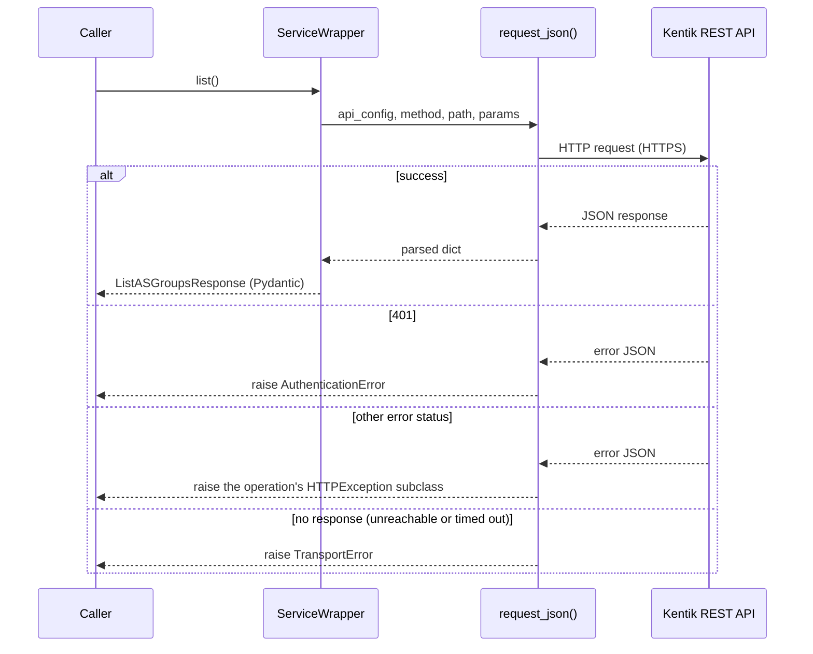
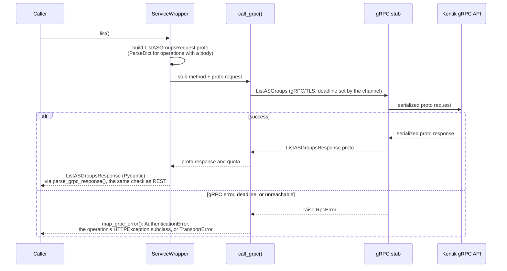

<!-- HAND-WRITTEN prose, except the `kentik-gen` marker blocks, which [`uv run poe generate`](../../../pyproject.toml) rewrites. Fix those in scripts/generation/docs_rendering.py. -->

# gRPC Transport Guide

The SDK supports both REST and gRPC transports. Both return the same Pydantic
response models. This guide explains the gRPC transport: how it works, how it
differs from REST, and how to use it.

## Instantiate the client

To use gRPC, pass `protocol="grpc"`:

```python
from kentik_api.client import KentikAPI

client = KentikAPI(protocol="grpc")
```

Every service method call works the same as REST:

<!-- kentik-gen:grpc-usage-example -->
```python
from kentik_api.client import KentikAPI

client = KentikAPI(protocol="grpc")
response = client.as_group.list()
print(response)  # ListASGroupsResponse
```
<!-- /kentik-gen:grpc-usage-example -->

## REST vs gRPC: call flow comparison

### REST call flow

<!-- kentik-gen:rest-callflow-diagram -->

<!-- /kentik-gen:rest-callflow-diagram -->

The REST path sends every call through
[`request_json()`](https://github.com/kentik/community_sdk_python/blob/main/src/kentik_api/core/rest_runtime.py) in
[`core/rest_runtime.py`](https://github.com/kentik/community_sdk_python/blob/main/src/kentik_api/core/rest_runtime.py).

### gRPC call flow

<!-- kentik-gen:grpc-callflow-diagram -->

<!-- /kentik-gen:grpc-callflow-diagram -->

The gRPC path uses these parts:

1. `build_grpc_request()` in
   [`core/grpc_runtime.py`](https://github.com/kentik/community_sdk_python/blob/main/src/kentik_api/core/grpc_runtime.py)
   builds the proto request the way
   [grpc-gateway](https://github.com/grpc-ecosystem/grpc-gateway) transcodes
   the REST call. The body becomes the request, or the field that the HTTP rule
   of the RPC names. Each path and query argument sets the field that its HTTP
   rule placeholder or wire name gives: `device.get(deviceid=...)` sets `id`.
   It uses [`ParseDict`](https://googleapis.dev/python/protobuf/latest/) from
   `google.protobuf.json_format`. An unknown body key or enum name raises
   `ConfigurationError`. On a PATCH call, the SDK fills an empty
   `update_mask` from the body fields you set, as grpc-gateway does.
2. A compiled gRPC stub (in `gen/<service>/pb/`) makes the call.
3. [`MessageToDict`](https://googleapis.dev/python/protobuf/latest/) converts
   the proto response back to a dict.
4. `parse_grpc_response()` builds the Pydantic response model. It runs the
   same check as REST. A response that the model rejects raises
   `HTTPException` with status 502.
5. [`call_grpc()`](https://github.com/kentik/community_sdk_python/blob/main/src/kentik_api/core/grpc_runtime.py) in
   [`core/grpc_runtime.py`](https://github.com/kentik/community_sdk_python/blob/main/src/kentik_api/core/grpc_runtime.py)
   converts gRPC errors to the SDK exception hierarchy.

## Why the two transports return identical models

Kentik keeps the REST and gRPC schemas in sync. Both use the same field names
(camelCase in JSON, snake_case in proto fields). By default, `MessageToDict`
produces camelCase keys. These keys match the `validation_alias` on every
Pydantic model field, so the SDK needs no remapping.

## Error handling

The same failure raises the same exception type on both transports: rejected
credentials raise `AuthenticationError`, and a call with no response raises
`TransportError`. [`map_grpc_error()`](https://github.com/kentik/community_sdk_python/blob/main/src/kentik_api/core/grpc_runtime.py)
classifies every non-OK gRPC status. It is a pure function (no I/O and no side
effects), so the tests cover the whole table without a live channel.
[`call_grpc()`](https://github.com/kentik/community_sdk_python/blob/main/src/kentik_api/core/grpc_runtime.py)
calls the stub and gives the classification to `map_grpc_error()`. For the
full status table, see the [error handling guide](error_handling.md).

Every call has a deadline: 60 seconds unless `KentikAPI` gets `timeout` or
`grpc_deadline`.
[`GrpcTransport`](https://github.com/kentik/community_sdk_python/blob/main/src/kentik_api/transports/grpc_client.py)
applies it with a channel interceptor (a hook that runs on every call of the
channel). An unresponsive server therefore raises `TransportError` instead of
blocking forever. For `alerting`, `audit`, `custom_application`,
`custom_dimension`, `plan`, and `saved_filter`, the server fails every call
that carries a deadline. For these services, the SDK sends no deadline and
cancels the call itself when the deadline passes.

The SDK accepts gRPC responses up to 40 MiB. A larger response raises
`TransportError`, not a 429. To raise the limit, pass
`grpc_options=[("grpc.max_receive_message_length", N)]` to `KentikAPI`.

## Runnable gRPC examples

Each of these folders in
[examples/](https://github.com/kentik/community_sdk_python/blob/main/examples/README.md)
has a `grpc.py` file:

- [`examples/device/grpc.py`](https://github.com/kentik/community_sdk_python/blob/main/examples/device/grpc.py): list devices
- [`examples/user/grpc.py`](https://github.com/kentik/community_sdk_python/blob/main/examples/user/grpc.py): list users
- [`examples/label/grpc.py`](https://github.com/kentik/community_sdk_python/blob/main/examples/label/grpc.py): list labels
- [`examples/site/grpc.py`](https://github.com/kentik/community_sdk_python/blob/main/examples/site/grpc.py): list sites
- [`examples/alerting/grpc.py`](https://github.com/kentik/community_sdk_python/blob/main/examples/alerting/grpc.py): list alerts
- [`examples/synthetics/grpc.py`](https://github.com/kentik/community_sdk_python/blob/main/examples/synthetics/grpc.py): list tests
