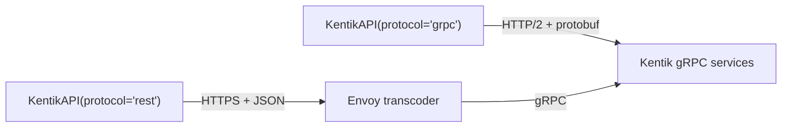

<!-- HAND-WRITTEN: not modified by [`make generate`](../../../Makefile). Edit directly. -->

# REST vs gRPC

`KentikAPI(protocol="rest")` and `KentikAPI(protocol="grpc")` give the same
service methods, and both return the same Pydantic models. This guide explains
where the two transports differ and how to choose one.

## Choosing a transport

Use REST unless you have a reason not to. The two transports behave the same
in most ways that matter, and REST covers every operation.

| Workload | Use | Why |
| --- | --- | --- |
| One-off script | REST | Every operation works. |
| CI or automation job | REST | A new operation in the job never raises `NotImplementedError`. |
| Sustained polling | Either | The per-endpoint quota is the limit, and both transports share it. |
| Long-running service | Either | Check first that gRPC covers every operation the service calls. |
| Debugging an API problem | REST | You can read the body and reproduce the call with curl. |

This guide does not cover payload size, general speed, or behavior behind a
proxy. None of the three was measured, so no advice here depends on them.

## What is the same on both transports

| Behavior | Detail |
| --- | --- |
| Return type | The same Pydantic model, with equal contents. |
| Errors | The same exception class for the same failure. See the [error handling guide](error_handling.md). |
| Connection | One client keeps one connection (REST) or one channel (gRPC) and reuses it. |
| Timeout | Every call has one: 60 seconds by default, set with `timeout`. |
| Quota | One budget per endpoint, shared by both transports. |

The client is the unit to reuse on both transports. The first call on a new
client pays for the TCP connection and the TLS handshake. In a measured run of
five `list_devices` calls, the first call took 1.5 s on REST and 1.2 s on gRPC.
Later calls took 0.86 s and 0.76 s on average. Five calls is too few to rank
the transports, but it shows that a new client for each call adds hundreds of
milliseconds.

## How each transport works

| | REST | gRPC |
| --- | --- | --- |
| Protocol | HTTP/1.1 | HTTP/2 |
| Body | JSON (`application/json`) | Protobuf (`application/grpc`) |
| Readable without tools | Yes | No. Field numbers replace field names. |
| Reproduce with curl | Yes | No. `grpcurl` can, with the `.proto` files. |
| Runtime entry point | [`request_json()`](../../../src/kentik_api/core/rest_runtime.py) | [`call_grpc()`](../../../src/kentik_api/core/grpc_runtime.py) |

Each service method checks the transport once. On gRPC, the method converts
the request to a protobuf message, calls the stub through `call_grpc()`, and
converts the response back into the same Pydantic model that REST returns.

### Deadlines

A gRPC channel stays open for as long as the client lives, and gRPC's own
default is to wait forever. The SDK adds the client's deadline to every gRPC
call that has none, in
[`GrpcTransport`](../../../src/kentik_api/transports/grpc_client.py). A call
to a server that accepts the connection and never answers raises
`TransportError` at the deadline. To give one slow call more time, on either
transport:

```python
result = client.device.list_devices(
    api_config_override=client.api_config.with_timeout(300),
)
```

Keep the 60-second default or raise it. An unthrottled `list_devices` call
returns in about 0.6 s. Past Kentik's soft limit, the API delays each response
by up to 1.5 s and does not return an error, so a short timeout turns
throttling into a `TransportError`.

### Errors that only gRPC has

`except KentikError:` catches every API, authentication, configuration, and
transport failure on both transports. It does not catch `NotImplementedError`,
which only gRPC raises (see below). Several gRPC codes share one HTTP status,
so an `HTTPException` from gRPC also keeps the original code in
`grpc_status_code`. For example, `ABORTED` and `ALREADY_EXISTS` both give
status 409.

## Both transports reach the same services

Kentik's REST API is a transcoding layer in front of the gRPC services. An
Envoy proxy receives each REST request, converts it to a gRPC call, and
converts the gRPC response back to JSON. Every REST response carries the
evidence:

| Response header | What it shows |
| --- | --- |
| `server: envoy` | An Envoy proxy answered the request. |
| `grpc-status` | The status code of the gRPC call behind the REST call. |
| `grpc-message` | The error text of that gRPC call, when it failed. |



The two transports therefore share one quota. Kentik allows 60 requests per
60 seconds for each endpoint, and a REST call and a gRPC call to the same
endpoint take from the same 60. In a measured run that alternated between
the transports, the remaining quota fell by one on each call: 59, 58, 57, 56,
55, 54. A change of transport does not give you more requests. See the
[rate limiting guide](rate_limiting.md) for the quota headers and the limits
that no header shows.

## What gRPC covers

REST covers every operation the SDK has. gRPC covers most of them:

| Measure | Count |
| --- | --- |
| Services with a wrapper on the client | 35 |
| Services with no wrapper | 6 |
| Wrapper operations | 233 |
| Operations with a gRPC translation | 198 |
| Operations that are REST only | 35 |

The generator gives an operation a gRPC translation when it finds a gRPC
method with the same name as the REST operation. The 35 REST-only operations
are in seven services:

| Service | REST-only operations |
| --- | --- |
| `mkp` | 14 of 14 |
| `kagent` | 8 of 28 |
| `interface` | 4 of 6 |
| `alerting` | 3 of 37 |
| `ktbgp` | 3 of 3 |
| `network_class` | 2 of 2 |
| `audit` | 1 of 3 |

The six services with no wrapper are `core`, `deviceconf`, `diagnostic`,
`kptr`, `monitoring`, and `net`. The SDK has models and proto stubs for them,
but no methods on the client, on either transport. The OpenAPI schema declares
no REST paths for them, and the SDK generates its wrappers from those paths.

### When gRPC raises `NotImplementedError`

On `protocol="grpc"`, a service method raises `NotImplementedError` in two
cases. The two have different causes and different fixes:

| Message | Cause | What to do |
| --- | --- | --- |
| `gRPC translation for <Operation> is not yet implemented.` | The operation is one of the 35 REST-only operations. | Call it through a `protocol="rest"` client. |
| `gRPC proto dependencies not installed for <service> service` | The service's compiled proto modules failed to import when the client started. | Repair the installation. Every other method of that service raises the same error. |

The first case is fixed and predictable: the same operations raise it on
every run. The second case depends on the environment.

A program that needs both transports can hold two clients:

```python
from kentik_api.client import KentikAPI

with (
    KentikAPI(protocol="grpc") as grpc_client,
    KentikAPI(protocol="rest") as rest_client,
):
    groups = grpc_client.as_group.list_as_groups()
    packages = rest_client.mkp.package_list()
```
