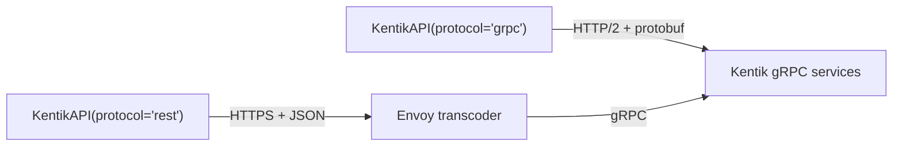

<!-- HAND-WRITTEN: not modified by [`make generate`](../../../Makefile). Edit directly. -->

# REST vs gRPC

<!-- DRAFT (feature 003): the mechanism and trade-off sections (T072) wait
on learn/findings.md (T071). Remove `orphan: true` and add this page to the
toctree in index.md when T075 lands. -->

`KentikAPI(protocol="rest")` and `KentikAPI(protocol="grpc")` give the same
service methods, and both return the same Pydantic models. This guide explains
where the two transports differ and how to choose one.

## Both transports reach the same services

Kentik's REST API is a transcoding layer in front of the gRPC services. An
Envoy proxy receives each REST request, converts it to a gRPC call, and
converts the gRPC response back to JSON. Every REST response carries the
evidence:

| Response header | What it shows |
| --- | --- |
| `server: envoy` | An Envoy proxy answered the request. |
| `grpc-status` | The status code of the gRPC call behind the REST call. |
| `grpc-message` | The error text of that gRPC call, when it failed. |



The two transports therefore share one quota. Kentik allows 60 requests per
60 seconds for each endpoint, and a REST call and a gRPC call to the same
endpoint take from the same 60. In a measured run that alternated between
the transports, the remaining quota fell by one on each call: 59, 58, 57, 56,
55, 54. A change of transport does not give you more requests. See the
[rate limiting guide](rate_limiting.md) for the quota headers and the limits
that no header shows.

## What gRPC covers

REST covers every operation the SDK has. gRPC covers most of them:

| Measure | Count |
| --- | --- |
| Services with a wrapper on the client | 35 |
| Services with no wrapper | 6 |
| Wrapper operations | 233 |
| Operations with a gRPC translation | 198 |
| Operations that are REST only | 35 |

The generator gives an operation a gRPC translation when it finds a gRPC
method with the same name as the REST operation. The 35 REST-only operations
are in seven services:

| Service | REST-only operations |
| --- | --- |
| `mkp` | 14 of 14 |
| `kagent` | 8 of 28 |
| `interface` | 4 of 6 |
| `alerting` | 3 of 37 |
| `ktbgp` | 3 of 3 |
| `network_class` | 2 of 2 |
| `audit` | 1 of 3 |

The six services with no wrapper are `core`, `deviceconf`, `diagnostic`,
`kptr`, `monitoring`, and `net`. The SDK has models and proto stubs for them,
but no methods on the client, on either transport. The OpenAPI schema declares
no REST paths for them, and the SDK generates its wrappers from those paths.

### When gRPC raises `NotImplementedError`

On `protocol="grpc"`, a service method raises `NotImplementedError` in two
cases. The two have different causes and different fixes:

| Message | Cause | What to do |
| --- | --- | --- |
| `gRPC translation for <Operation> is not yet implemented.` | The operation is one of the 35 REST-only operations. | Call it through a `protocol="rest"` client. |
| `gRPC proto dependencies not installed for <service> service` | The service's compiled proto modules failed to import when the client started. | Repair the installation. Every other method of that service raises the same error. |

The first case is fixed and predictable: the same operations raise it on
every run. The second case depends on the environment.

A program that needs both transports can hold two clients:

```python
from kentik_api.client import KentikAPI

with (
    KentikAPI(protocol="grpc") as grpc_client,
    KentikAPI(protocol="rest") as rest_client,
):
    groups = grpc_client.as_group.list_as_groups()
    packages = rest_client.mkp.package_list()
```

<!-- T072: add "How each transport works" and "Choosing a transport" here,
each claim tied to a line in learn/findings.md. -->
