<!-- HAND-WRITTEN: not modified by [`uv run poe generate`](../../../pyproject.toml). Edit directly. -->

# REST vs gRPC

`KentikAPI(protocol="rest")` and `KentikAPI(protocol="grpc")` give the same
service methods, and both return the same Pydantic models. This guide explains
where the two transports differ and how to choose one.

## Choosing a transport

Use REST unless you have a reason to use gRPC. The two transports behave the
same in most ways that matter, and REST covers every operation.

| Workload | Use | Why |
| --- | --- | --- |
| One-off script | REST | Every operation works. |
| CI or automation job | REST | A new operation in the job never raises `NotImplementedError`. |
| Sustained polling | Either | The per-endpoint quota is the limit, and both transports share it. |
| Long-running service | Either | Both transports cover every operation. Pick by the other rows in this guide. |
| Debugging an API problem | REST | You can read the body and reproduce the call with curl. |

This guide does not cover payload size, general speed, or behavior behind a
proxy. The project did not measure these three, so no advice here depends on
them.

## What is the same on both transports

| Behavior | Detail |
| --- | --- |
| Return type | The same Pydantic model, with equal contents. |
| Errors | The same exception class for the same failure. See the [error handling guide](error_handling.md). |
| Connection | One client keeps one connection (REST) or one channel (gRPC) and reuses it. |
| Timeout | Every call has one: 60 seconds by default, set with `timeout`. |
| Quota | One budget per endpoint, shared by both transports. |

Reuse one client for many calls, on both transports. The first call on a new
client pays for the TCP connection and the TLS handshake. In a measured run of
five `device.list` calls, the first call took 1.5 s on REST and 1.2 s on gRPC.
Later calls took 0.86 s and 0.76 s on average. Five calls are too few to rank
the transports. The run shows that a new client for each call adds hundreds of
milliseconds.

## How each transport works

| | REST | gRPC |
| --- | --- | --- |
| Protocol | HTTP/1.1 | HTTP/2 |
| Body | JSON (`application/json`) | Protobuf (`application/grpc`) |
| Readable without tools | Yes | No. Field numbers replace field names. |
| Reproduce with curl | Yes | No. `grpcurl` can, with the `.proto` files. |
| Runtime entry point | [`request_json()`](https://github.com/kentik/community_sdk_python/blob/main/src/kentik_api/core/rest_runtime.py) | [`call_grpc()`](https://github.com/kentik/community_sdk_python/blob/main/src/kentik_api/core/grpc_runtime.py) |

Each service method checks the transport once. On gRPC, the method converts
the request to a protobuf message and calls the stub through `call_grpc()`.
It then converts the response into the same Pydantic model that REST returns.

### Deadlines

A gRPC channel stays open while the client lives. By default, gRPC waits
forever for an answer.
[`GrpcTransport`](https://github.com/kentik/community_sdk_python/blob/main/src/kentik_api/transports/grpc_client.py)
adds the deadline of the client to every gRPC call that has none. A call to a
server that accepts the connection and never answers raises `TransportError`
at the deadline. To give one slow call more time, on either transport, use
`with_timeout()`:

```python
result = client.device.list(
    api_config_override=client.api_config.with_timeout(300),
)
```

Keep the 60-second default or raise it. An unthrottled `device.list` call
returns in about 0.6 s. Past Kentik's soft limit, the API delays each response
by up to 1.5 s and does not return an error. A short timeout therefore turns
throttling into a `TransportError`.

### Errors that only gRPC has

`except KentikError:` catches every API, authentication, configuration, and
transport failure on both transports. It does not catch `NotImplementedError`,
which only gRPC raises (see below). Several gRPC codes share one HTTP status,
so an `HTTPException` from gRPC also keeps the original code in
`grpc_status_code`. For example, `ABORTED` and `ALREADY_EXISTS` both give
status 409.

## Both transports reach the same services

Kentik's REST API is a transcoding layer in front of the gRPC services: a
layer that converts each REST call into a gRPC call. An Envoy proxy receives
each REST request and converts it to a gRPC call. It then converts the gRPC
response back to JSON. Three headers on every REST response show this:

| Response header | What it shows |
| --- | --- |
| `server: envoy` | An Envoy proxy answered the request. |
| `grpc-status` | The status code of the gRPC call behind the REST call. |
| `grpc-message` | The error text of that gRPC call, when it failed. |

```mermaid
%%{init: {"fontFamily": "ui-monospace, SFMono-Regular, Menlo, monospace", "flowchart": {"curve": "step", "nodeSpacing": 30, "rankSpacing": 70, "wrappingWidth": 400}}}%%
flowchart LR
  rest("KentikAPI(protocol='rest')<br/>HTTPS + JSON"):::blueSrc
  grpc("KentikAPI(protocol='grpc')<br/>HTTP/2 + protobuf"):::violetSrc

  subgraph kentik["Kentik API"]
    envoy("Envoy transcoder<br/>JSON to gRPC and back"):::blue
    svc("Kentik gRPC services<br/>one quota per endpoint"):::hub
  end

  rest --> envoy
  envoy -->|"JSON response"| rest
  envoy -->|"gRPC call"| svc
  svc -->|"gRPC response"| envoy
  grpc --> svc
  svc -->|"protobuf response"| grpc

  classDef blueSrc fill:#a5d8ff,stroke:#1971c2,color:#1864ab
  classDef blue fill:#e7f5ff,stroke:#1971c2,color:#1864ab
  classDef violetSrc fill:#d0bfff,stroke:#7048e8,color:#5f3dc4
  classDef hub fill:#f8f9fa,stroke:#495057,color:#212529
  classDef blueSrc,blue,violetSrc,hub stroke-width:2px,rx:10px
  style kentik fill:none,stroke:#868e96,stroke-width:2px
  linkStyle default stroke-width:2px,stroke-linecap:round,stroke-linejoin:round
```



The two transports therefore share one quota. Kentik allows 60 requests per
60 seconds for each endpoint. A REST call and a gRPC call to the same endpoint
take from the same 60. In a measured run that alternated between the
transports, the remaining quota fell by one on each call: 59, 58, 57, 56, 55,
54. A change of transport does not give you more requests. See the
[rate limiting guide](rate_limiting.md) for the quota headers and the limits
that no header shows.

## What gRPC covers

REST covers every operation the SDK has. gRPC covers every V6 operation:

| Measure | Count |
| --- | --- |
| Services with a wrapper on the client | 37 |
| Services with no wrapper | 6 |
| Wrapper operations | 240 |
| Operations with a gRPC translation | 234 |
| V5 operations (`client.v5`), REST only | 6 |

The generator gives an operation a gRPC translation when an RPC declares the
same HTTP rule as the REST operation: the same proto service, HTTP verb, and
path. Every V6 operation in the current schema has such an RPC. The V5
endpoints exist only on REST, so `client.v5` sends its calls over REST on a
`protocol="grpc"` client too. See [V5 query and batch calls](v5.md).

The six services with no wrapper are `core`, `deviceconf`, `diagnostic`,
`kptr`, `monitoring`, and `net`. The SDK has models and proto stubs for them,
but no methods on the client, on either transport. The OpenAPI schema declares
no REST paths for them, and the SDK generates its wrappers from those paths.

### When gRPC raises `NotImplementedError`

On `protocol="grpc"`, a service method raises `NotImplementedError` in two
cases. The two have different causes and different fixes:

| Message | Cause | What to do |
| --- | --- | --- |
| `gRPC translation for <Operation> is not yet implemented.` | No RPC declares the operation's HTTP rule. No operation in the current schema is in this state. | Call it through a `protocol="rest"` client. |
| `gRPC proto modules for <service> service failed to import: <cause>` | The service's compiled proto modules failed to import when the client started. The cause names the import error, or a descriptor-pool conflict. | Repair the installation. Every other method of that service raises the same error. |

The first case is fixed and predictable: a schema change adds or removes it,
not the run. The second case depends on the environment.

A program that needs both transports can hold two clients:

```python
from kentik_api.client import KentikAPI

with (
    KentikAPI(protocol="grpc") as grpc_client,
    KentikAPI(protocol="rest") as rest_client,
):
    groups = grpc_client.as_group.list()
    packages = rest_client.mkp.package_list()
```
