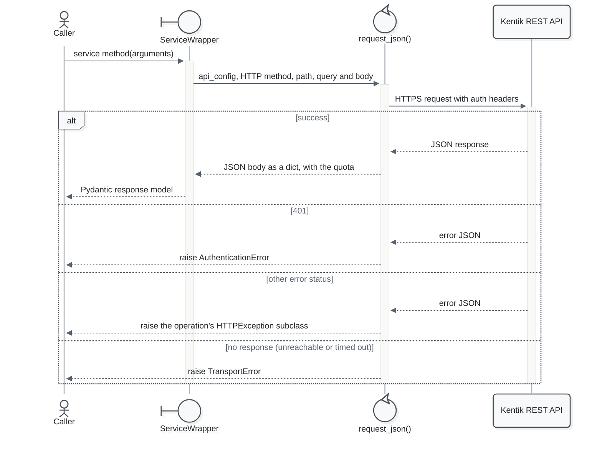

<!-- HAND-WRITTEN prose, except the `kentik-gen` marker blocks, which [`uv run poe generate`](../../../pyproject.toml) rewrites. Fix those in scripts/generation/docs_rendering.py. -->

# REST Transport Guide

REST is the default transport. It supports every operation of the SDK.

## Instantiate the client

```python
from kentik_api.client import KentikAPI

client = KentikAPI(protocol="rest")  # loads credentials from .env
```

For credential setup, see the [Quick Start](quickstart.md).

## Call any service method

Each generated service is an attribute of the client:

<!-- kentik-gen:list-methods-example -->
```python
response = client.as_group.list()
response = client.asset_tags.list_tag_keys()
response = client.audit.list_events()
```
<!-- /kentik-gen:list-methods-example -->

All methods return Pydantic v2 models. Optional list fields use
`Optional[List[Optional[Model]]]`, as the OpenAPI schema declares them. Before
you iterate over such a list, remove the `None` items:

```python
devices = [d for d in (response.devices or []) if d is not None]
```

## Passing request bodies

Methods that take a request body expect a Pydantic model:

<!-- kentik-gen:request-body-example -->
```python
from kentik_api.gen.alerting.models import AlertAutoAckServiceListRequest

response = client.alerting.auto_ack_list(data=AlertAutoAckServiceListRequest())
```
<!-- /kentik-gen:request-body-example -->

## Regions

To use a Kentik region other than the default, pass `region`:

```python
client = KentikAPI(protocol="rest", region="eu")
```

## Timeouts and proxies

A numeric `timeout` or `rest_timeout` is a total deadline for the whole call.
An `httpx.Timeout` bounds each phase and each read separately.
A total deadline is cooperative: the SDK checks it after the response
headers and each chunk arrive. A blocking operation can finish after the
deadline. The SDK does not force an interruption at an exact instant.

Timeout settings are read-only. The SDK copies a supplied `httpx.Timeout`
and returns a detached copy from `client.api_config.rest_timeout`.
A change to either object does not change the active settings.
To change the timeout of one call, use `client.api_config.with_timeout(...)`.
The copy shares the original connection, credentials, and quota tracking.

The REST transport uses `HTTP_PROXY`, `HTTPS_PROXY`, `ALL_PROXY` and
`NO_PROXY`.

A success status with a body that is not JSON, or that does not match the
model, raises `HTTPException` with status 502.

## Request flow



Every REST operation goes through the one `request_json()` function.
[`src/kentik_api/core/rest_runtime.py`](https://github.com/kentik/community_sdk_python/blob/main/src/kentik_api/core/rest_runtime.py)
holds the implementation.

## Runnable examples

- [`examples/device/rest.py`](https://github.com/kentik/community_sdk_python/blob/main/examples/device/rest.py)
- [`examples/user/rest.py`](https://github.com/kentik/community_sdk_python/blob/main/examples/user/rest.py)
- [`examples/label/rest.py`](https://github.com/kentik/community_sdk_python/blob/main/examples/label/rest.py)
- [`examples/site/rest.py`](https://github.com/kentik/community_sdk_python/blob/main/examples/site/rest.py)
- [`examples/alerting/rest.py`](https://github.com/kentik/community_sdk_python/blob/main/examples/alerting/rest.py)
- [`examples/synthetics/rest.py`](https://github.com/kentik/community_sdk_python/blob/main/examples/synthetics/rest.py)
