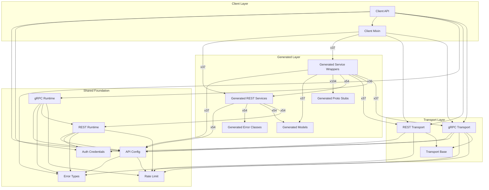

<!-- AUTO-GENERATED: scripts/generation/docs_rendering.py, _generate_runtime_architecture_docs() -->
<!-- Rebuilt on every `uv run poe generate`. Do not edit by hand. -->

# SDK Runtime Architecture

This page explains how core runtime modules and generated services connect at runtime.

## Runtime Flow

1. `kentik_api.client.KentikAPI` reads credentials and selects transport.
2. `kentik_api.client_mixin.KentikClientMixin` mounts generated service wrappers.
3. Wrapper classes in `kentik_api.gen.<service>.services.<service>` delegate
   to generated REST functions.
4. Generated REST services use `kentik_api.core.api_config` and `kentik_api.core.rest_runtime`.
5. Generated wrappers on a gRPC transport call `kentik_api.core.grpc_runtime`
   instead, against the compiled proto stubs in `kentik_api.gen.<service>.pb`.
6. Runtime failures are normalized into `kentik_api.errors` and generated
   service-local error classes.

## Module Dependency Graph

## Reading The Graph

- `Client API` and `Client Mixin` are the orchestration entrypoints.
- `Generated Service Wrappers` are transport-aware facades exposed as `client.<service>`.
- `Generated REST Services` host operation functions generated from OpenAPI schemas.
- `Generated Proto Stubs` are the protoc-compiled modules that wrappers call on a gRPC transport.
- `API Config`, `REST Runtime`, `gRPC Runtime`, and `Error Types` form the shared runtime foundation.

## Services Without A Wrapper

Wrapper generation is driven by REST paths in the OpenAPI schema. A Service
whose schema declares no paths produces models and proto stubs but no
wrapper, so it is not mounted on the client. That is intentional: REST
operations are this SDK's contract, and proto-driven wrapper generation is
deliberately out of scope.

6 Services are in that state today: `core`, `deviceconf`, `diagnostic`, `kptr`, `monitoring`, `net`.

Some of these declare gRPC RPCs upstream but carry no `google.api.http`
annotation, which is why no path reaches the schema. Those cases are an
upstream schema gap, not an SDK limitation, and they resolve here
automatically once the annotation is added.

## REST-Only Services

These Services come from the local schema base, `schema/openapi/`:
hand-maintained descriptions of endpoints that upstream does not publish.
Every client mounts them on a REST transport to their own host, so a
client created with `protocol="grpc"` sends their calls over REST too: `v5`.
