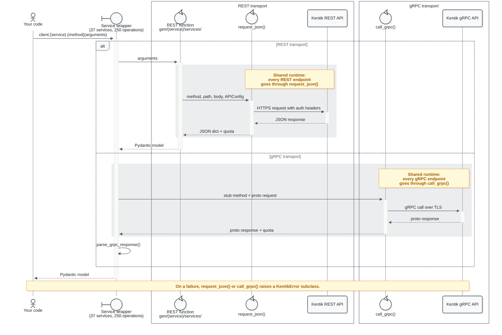

<!-- AUTO-GENERATED: scripts/generation/docs_rendering.py, _generate_runtime_architecture_docs() -->
<!-- Rebuilt on every `uv run poe generate`. Do not edit by hand. -->

# SDK Runtime Architecture

This page shows how a call moves through the SDK, and how the hand-written
runtime modules and the generated services depend on each other.

## Call Path

Each method call on `client.<service>` takes one of two paths. The transport
that the client uses selects the path. Both paths return the same Pydantic
models and raise the same exception types.



1. `kentik_api.client.KentikAPI` reads the credentials and selects the transport.
2. `kentik_api.client_mixin.KentikClientMixin` mounts one generated service
   wrapper per service.
3. On a REST transport, a wrapper calls the generated REST function in
   `kentik_api.gen.<service>.services`. That function calls `request_json()`
   in `kentik_api.core.rest_runtime`, with the shared `APIConfig`.
4. On a gRPC transport, a wrapper calls `call_grpc()` in
   `kentik_api.core.grpc_runtime`, with the compiled proto stubs in
   `kentik_api.gen.<service>.pb`.
5. Both runtimes turn each failure into a `kentik_api.errors` type, or into
   the error class that the service generates for that operation.

## Module Dependencies

The SDK splits into the parts below. Select one to see what it imports and what
imports it. The generator reads the imports from the source on every run.

```{raw} html
<div class="kx">
<div class="chips" role="group" aria-label="Show one path" data-paths-for="deps-svg"></div>
<figure>
<div class="diagram explorer"><svg id="deps-svg" viewBox="0 0 900 690" role="img" aria-label="Module dependencies: KentikAPI at the top imports the service wrappers and the transports. They import the runtimes, the models and the proto stubs, down to the shared foundation." xmlns="http://www.w3.org/2000/svg"><defs><marker id="deps-ah" viewBox="0 0 10 10" refX="8.5" refY="5" markerWidth="7" markerHeight="7" orient="auto-start-reverse"><path d="M0,0 L10,5 L0,10 z" class="ah"/></marker><marker id="deps-ah-hi" viewBox="0 0 10 10" refX="8.5" refY="5" markerWidth="7" markerHeight="7" orient="auto-start-reverse"><path d="M0,0 L10,5 L0,10 z" class="ah-hi"/></marker></defs><g transform="translate(20,0)"><g class="edge data" data-seg="client_wrap" data-links="client>wrap"><path d="M430,102 V170" data-route="M430,102 V170" class="wire arrow" marker-end="url(#deps-ah)"/><text x="438" y="140" class="elabel" text-anchor="start">wrappers</text></g><g class="edge data" data-seg="client_tr" data-links="client>tr"><path d="M530,66 L710,66 Q720,66 720,76 L720,170" data-route="M530,66 H720 V170" class="wire arrow" marker-end="url(#deps-ah)"/><text x="625" y="58" class="elabel" text-anchor="middle">transports</text></g><g class="edge data" data-seg="wrap_tr" data-links="wrap>tr"><path d="M530,206 H620" data-route="M530,206 H620" class="wire arrow" marker-end="url(#deps-ah)"/><text x="575" y="198" class="elabel" text-anchor="middle">transport</text></g><g class="edge data" data-seg="wrap_rest" data-links="wrap>rest"><path d="M330,206 L150,206 Q140,206 140,216 L140,310" data-route="M330,206 H140 V310" class="wire arrow" marker-end="url(#deps-ah)"/><text x="235" y="198" class="elabel" text-anchor="middle">REST functions</text></g><g class="edge data" data-seg="wrap_models" data-links="wrap>models"><path d="M430,242 V310" data-route="M430,242 V310" class="wire arrow" marker-end="url(#deps-ah)"/><text x="422" y="290" class="elabel" text-anchor="end">models</text></g><g class="edge data" data-seg="wrap_pb" data-links="wrap>pb"><path d="M510,242 L510,251 Q510,260 519,260 L680,260 Q690,260 690,270 L690,310" data-route="M510,242 V260 H690 V310" class="wire arrow" marker-end="url(#deps-ah)"/><text x="698" y="290" class="elabel" text-anchor="start">proto stubs</text></g><g class="edge data" data-seg="wrap_cg" data-links="wrap>cg"><path d="M480,242 L480,280 Q480,290 490,290 L565,290 Q575,290 575,300 L575,476 Q575,486 585,486 L620,486" data-route="M480,242 V290 H575 V486 H620" class="wire arrow" marker-end="url(#deps-ah)"/><text x="583" y="400" class="elabel" text-anchor="start">call_grpc()</text></g><g class="edge data" data-seg="rest_models" data-links="rest>models"><path d="M240,346 H330" data-route="M240,346 H330" class="wire arrow" marker-end="url(#deps-ah)"/><text x="285" y="338" class="elabel" text-anchor="middle">models</text></g><g class="edge data" data-seg="rest_rj" data-links="rest>rj"><path d="M140,382 V450" data-route="M140,382 V450" class="wire arrow" marker-end="url(#deps-ah)"/><text x="148" y="420" class="elabel" text-anchor="start">request_json()</text></g><g class="edge data" data-seg="cg_rj" data-links="cg>rj"><path d="M620,506 H240" data-route="M620,506 H240" class="wire arrow" marker-end="url(#deps-ah)"/><text x="439" y="498" class="elabel" text-anchor="middle">parsing</text></g><g class="edge data" data-seg="rj_base" data-links="rj>base"><path d="M140,522 L140,616 Q140,626 150,626 L330,626" data-route="M140,522 V626 H330" class="wire arrow" marker-end="url(#deps-ah)"/><text x="148" y="570" class="elabel" text-anchor="start">APIConfig, auth</text></g><g class="edge data" data-seg="cg_base" data-links="cg>base"><path d="M720,522 L720,600 Q720,610 710,610 L530,610" data-route="M720,522 V610 H530" class="wire arrow" marker-end="url(#deps-ah)"/><text x="728" y="570" class="elabel" text-anchor="start">APIConfig, errors</text></g><g class="edge data" data-seg="tr_base" data-links="tr>base"><path d="M820,206 L850,206 Q860,206 860,216 L860,630 Q860,640 850,640 L530,640" data-route="M820,206 H860 V640 H530" class="wire arrow" marker-end="url(#deps-ah)"/><text x="852" y="420" class="elabel" text-anchor="end">APIConfig, auth</text></g><g class="node fam-orange src " data-id="client" tabindex="0" role="button" aria-label="Select KentikAPI client"><rect x="330" y="30" width="200" height="72" rx="14"/><text x="430.0" y="54.0" class="nm">KentikAPI</text><text x="430.0" y="71.0" class="ft">client.py</text><text x="430.0" y="88.0" class="ft">client_mixin.py</text></g><g class="node fam-green proc " data-id="wrap" tabindex="0" role="button" aria-label="Select Service wrappers"><rect x="330" y="170" width="200" height="72" rx="14"/><text x="430.0" y="194.0" class="nm">Service wrappers</text><text x="430.0" y="211.0" class="ft">client.{service}</text><text x="430.0" y="228.0" class="ft">one per service</text></g><g class="node fam-violet proc " data-id="tr" tabindex="0" role="button" aria-label="Select Transports"><rect x="620" y="170" width="200" height="72" rx="14"/><text x="720.0" y="194.0" class="nm">Transports</text><text x="720.0" y="211.0" class="ft">transports/</text><text x="720.0" y="228.0" class="ft">REST and gRPC</text></g><g class="node fam-green proc " data-id="rest" tabindex="0" role="button" aria-label="Select REST functions and error classes"><rect x="40" y="310" width="200" height="72" rx="14"/><text x="140.0" y="334.0" class="nm">REST functions</text><text x="140.0" y="351.0" class="ft">gen/{service}/services/</text><text x="140.0" y="368.0" class="ft">+ error classes</text></g><g class="node fam-green proc " data-id="models" tabindex="0" role="button" aria-label="Select Models"><rect x="330" y="310" width="200" height="72" rx="14"/><text x="430.0" y="334.0" class="nm">Models</text><text x="430.0" y="351.0" class="ft">gen/{service}/models/</text><text x="430.0" y="368.0" class="ft">Pydantic v2</text></g><g class="node fam-green proc " data-id="pb" tabindex="0" role="button" aria-label="Select Proto stubs"><rect x="620" y="310" width="200" height="72" rx="14"/><text x="720.0" y="334.0" class="nm">Proto stubs</text><text x="720.0" y="351.0" class="ft">gen/{service}/pb/</text><text x="720.0" y="368.0" class="ft">protoc output</text></g><g class="node fam-neutral hub " data-id="rj" tabindex="0" role="button" aria-label="Select request_json()"><rect x="40" y="450" width="200" height="72" rx="14"/><text x="140.0" y="474.0" class="nm">request_json()</text><text x="140.0" y="491.0" class="ft">core/rest_runtime.py</text><text x="140.0" y="508.0" class="ft">all REST traffic</text></g><g class="node fam-neutral hub " data-id="cg" tabindex="0" role="button" aria-label="Select call_grpc()"><rect x="620" y="450" width="200" height="72" rx="14"/><text x="720.0" y="474.0" class="nm">call_grpc()</text><text x="720.0" y="491.0" class="ft">core/grpc_runtime.py</text><text x="720.0" y="508.0" class="ft">all gRPC traffic</text></g><g class="node fam-neutral hub " data-id="base" tabindex="0" role="button" aria-label="Select Shared foundation"><rect x="330" y="590" width="200" height="72" rx="14"/><text x="430.0" y="614.0" class="nm">Shared foundation</text><text x="430.0" y="631.0" class="ft">APIConfig, auth,</text><text x="430.0" y="648.0" class="ft">KentikError, RateLimit</text></g></g></svg></div>
<figcaption>Start at KentikAPI at the top. Each arrow points from a part to a part that it imports. Select a part: moving lines show what it uses, and bold lines show what uses it. Every part also imports the shared foundation, but the diagram draws that only for the runtimes and the transports.</figcaption>
</figure>
<div class="legend" aria-hidden="true"><span><svg viewBox="0 0 34 10"><line x1="2" y1="5" x2="32" y2="5" stroke="var(--wire-hi)" stroke-linecap="round" stroke-width="3"/></svg>what uses the selected part</span><span><svg viewBox="0 0 34 10"><line x1="2" y1="5" x2="32" y2="5" stroke="var(--wire-hi)" stroke-linecap="round" stroke-width="3" stroke-dasharray="9 7"/></svg>what the selected part uses</span></div>
<div class="detail" data-detail-for="deps-svg" aria-live="polite"></div>
<script type="application/json" id="diagram-data">{"deps-svg": {"select": "client", "parts": {"client": {"title": "KentikAPI client", "role": "The starting point. Reads the credentials, picks the transport, and mounts every wrapper.", "facts": ["Source: client.py, client_mixin.py", "Imports Shared foundation (3), REST functions and error classes (37), Transports (4), Service wrappers (37)"], "stops": "Expected: nothing in the SDK can be called."}, "wrap": {"title": "Service wrappers", "role": "Send each call to the REST function or to call_grpc(), for the transport in use.", "facts": ["Source: gen/{service}/services/{service}.py", "Imports Shared foundation (37), call_grpc() (36), Models (37), Proto stubs (108), REST functions and error classes (55), Transports (74)", "Imported by KentikAPI client (37)"], "stops": "Expected: the client does not mount that service, on either transport."}, "tr": {"title": "Transports", "role": "RestTransport holds the APIConfig. GrpcTransport holds the TLS channel and the default deadline.", "facts": ["Source: transports/base.py, transports/rest_client.py, transports/grpc_client.py", "Imports Shared foundation (6)", "Imported by KentikAPI client (4), Service wrappers (74)"], "stops": "Expected: the client cannot be built, on either transport."}, "rest": {"title": "REST functions and error classes", "role": "One function per operation. Each one calls request_json() with its own error class.", "facts": ["Source: gen/{service}/services/, gen/{service}/error/", "Imports Shared foundation (98), Models (96), request_json() (55)", "Imported by KentikAPI client (37), Service wrappers (55)"], "stops": "Expected: REST calls fail for that service. gRPC calls through the same wrapper keep working."}, "models": {"title": "Models", "role": "The request and response models of every operation. They import nothing else in the SDK.", "facts": ["Source: gen/{service}/models/", "Imported by REST functions and error classes (96), Service wrappers (37)"], "stops": "Expected: the REST functions and the wrappers of that service do not import, so it does not mount."}, "pb": {"title": "Proto stubs", "role": "The modules that protoc compiles. Wrappers call them on a gRPC transport.", "facts": ["Source: gen/{service}/pb/", "Imported by Service wrappers (108)"], "stops": "Expected: gRPC calls for that service raise NotImplementedError. REST calls keep working."}, "rj": {"title": "request_json()", "role": "The one function that sends REST traffic: auth headers, quota, and errors.", "facts": ["Source: core/rest_runtime.py", "Imports Shared foundation (4)", "Imported by call_grpc() (1), REST functions and error classes (55)"], "stops": "Expected: every REST call fails. gRPC calls fail too, because they parse responses with it."}, "cg": {"title": "call_grpc()", "role": "The one function that sends gRPC traffic: deadline, quota, and errors.", "facts": ["Source: core/grpc_runtime.py", "Imports Shared foundation (3), request_json() (1)", "Imported by Service wrappers (36)"], "stops": "Expected: every gRPC call fails. REST calls keep working."}, "base": {"title": "Shared foundation", "role": "APIConfig, the auth headers, the KentikError hierarchy and RateLimit. Every other part imports it.", "facts": ["Source: core/api_config.py, auth/, errors/, core/rate_limit.py", "Imported by call_grpc() (3), KentikAPI client (3), REST functions and error classes (98), request_json() (4), Transports (6), Service wrappers (37)"], "stops": "Expected: nothing in the SDK imports, so every call fails."}}, "links": {"cg>base": "3 import statements", "cg>rj": "1 import statements", "client>tr": "4 import statements", "client>wrap": "37 import statements", "rest>models": "96 import statements", "rest>rj": "55 import statements", "rj>base": "4 import statements", "tr>base": "6 import statements", "wrap>cg": "36 import statements", "wrap>models": "37 import statements", "wrap>pb": "108 import statements", "wrap>rest": "55 import statements", "wrap>tr": "74 import statements"}, "paths": {"rest": {"label": "REST call", "family": "blue", "title": "What a REST call uses", "text": "KentikAPI calls a wrapper. The wrapper calls the REST function, which builds the request with the models and sends it with request_json().", "links": ["client>wrap", "wrap>rest", "rest>models", "rest>rj", "rj>base"]}, "grpc": {"label": "gRPC call", "family": "violet", "title": "What a gRPC call uses", "text": "KentikAPI calls a wrapper. The wrapper builds the proto request with the stubs and sends it with call_grpc(), which parses the answer into the same models as REST.", "links": ["client>wrap", "wrap>pb", "wrap>models", "wrap>cg", "cg>rj", "cg>base"]}, "setup": {"label": "Client setup", "family": "orange", "title": "What building the client uses", "text": "KentikAPI builds one transport from the APIConfig and gives it to every wrapper that it mounts.", "links": ["client>tr", "client>wrap", "wrap>tr", "tr>base"]}}, "words": {"from": "Used by", "to": "Uses"}}}</script>
</div>
```

The table lists each module group, and the groups that it imports, with the
number of import statements.

| Group | Layer | Source | Imports from | Role |
| --- | --- | --- | --- | --- |
| Client API | Client Layer | `client.py` | API Config (1), Auth Credentials (1), Client Mixin (1), Error Types (1), REST Transport (1), gRPC Transport (1) | `KentikAPI`: reads the credentials and selects the transport. |
| Client Mixin | Client Layer | `client_mixin.py` | Generated REST Services (37), Generated Service Wrappers (37), REST Transport (1), gRPC Transport (1) | Mounts each service wrapper as `client.<service>`. |
| Auth Credentials | Shared Foundation | `auth/` | nothing in the SDK | Builds the Kentik auth headers for REST and for gRPC. |
| API Config | Shared Foundation | `core/api_config.py` | Error Types (1), Rate Limit (1) | `APIConfig`: base URL, credentials, TLS, timeouts, and the shared HTTP client. |
| REST Runtime | Shared Foundation | `core/rest_runtime.py` | API Config (1), Auth Credentials (1), Error Types (1), Rate Limit (1) | `request_json()`: the one function that sends REST traffic. |
| gRPC Runtime | Shared Foundation | `core/grpc_runtime.py` | API Config (1), Error Types (1), REST Runtime (1), Rate Limit (1) | `call_grpc()`: the one function that sends gRPC traffic. |
| Rate Limit | Shared Foundation | `core/rate_limit.py` | nothing in the SDK | `RateLimit`: the quota that each response reports. |
| Error Types | Shared Foundation | `errors/` | nothing in the SDK | The shared exception hierarchy under `KentikError`. |
| Transport Base | Transport Layer | `transports/base.py` | nothing in the SDK | The base class of both transports. |
| REST Transport | Transport Layer | `transports/rest_client.py` | API Config (1), Rate Limit (1), Transport Base (1) | `RestTransport`: holds the `APIConfig` for REST calls. |
| gRPC Transport | Transport Layer | `transports/grpc_client.py` | API Config (1), Auth Credentials (1), Error Types (1), Rate Limit (1), Transport Base (1) | `GrpcTransport`: the TLS channel, with auth and the default deadline. |
| Generated Service Wrappers | Generated Layer | `gen/{service}/services/{service}.py` | API Config (37), Generated Models (37), Generated Proto Stubs (108), Generated REST Services (55), REST Transport (37), gRPC Runtime (36), gRPC Transport (37) | Send each call to the REST function or to the gRPC stub, for the transport in use. |
| Generated REST Services | Generated Layer | `gen/{service}/services/` | API Config (55), Generated Error Classes (55), Generated Models (55), REST Runtime (55) | One function per operation in the OpenAPI schema. Each function calls `request_json()`. |
| Generated Models | Generated Layer | `gen/{service}/models/` | nothing in the SDK | Pydantic request and response models. |
| Generated Error Classes | Generated Layer | `gen/{service}/error/` | Error Types (43), Generated Models (41) | One error class per operation, picked by the response status. |
| Generated Proto Stubs | Generated Layer | `gen/{service}/pb/` | nothing in the SDK | The modules that protoc compiles. Wrappers call them on a gRPC transport. |

## Services Without A Wrapper

The REST paths in the OpenAPI schema drive wrapper generation. If the schema
of a Service declares no paths, the generator writes its models and proto
stubs but no wrapper, and the client does not mount it. This is intentional.
REST operations are the contract of this SDK. Wrapper generation from protos
is out of scope.

6 Services are in that state today: `core`, `deviceconf`, `diagnostic`, `kptr`, `monitoring`, `net`.

Some of these Services declare gRPC RPCs upstream, but the RPCs have no
`google.api.http` annotation, so no path reaches the schema. That is a gap
in the upstream schema, not in the SDK. If upstream adds the annotation, the
next run generates the wrapper.

## REST-Only Services

These Services come from the local schema base, `schema/openapi/`. It holds
descriptions, maintained by hand, of endpoints that upstream does not publish.
Each client mounts these Services on a REST transport to their own host. A
client with `protocol="grpc"` also sends their calls over REST: `v5`.
