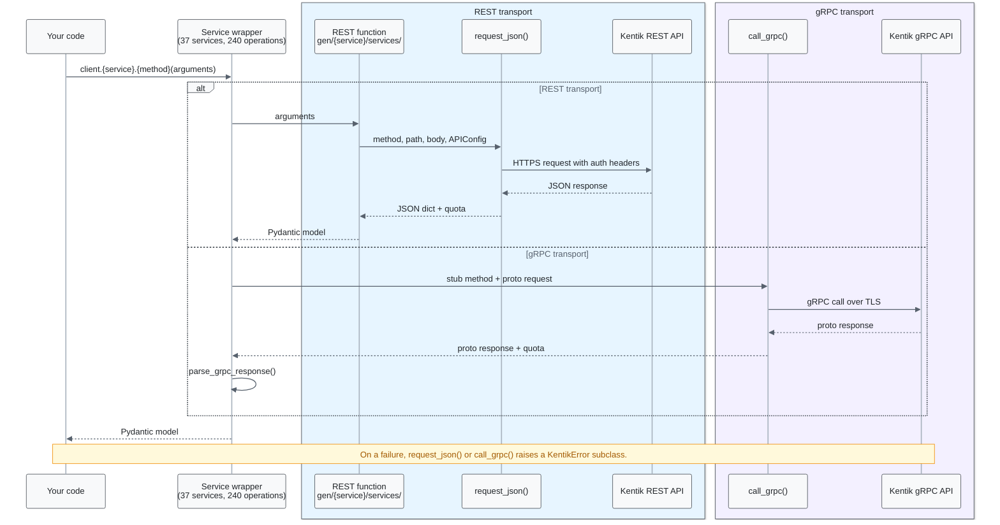
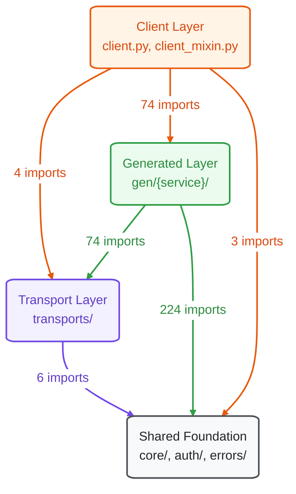

<!-- AUTO-GENERATED: scripts/generation/docs_rendering.py, _generate_runtime_architecture_docs() -->
<!-- Rebuilt on every `uv run poe generate`. Do not edit by hand. -->

# SDK Runtime Architecture

This page shows how a call moves through the SDK, and how the hand-written
runtime modules and the generated services depend on each other.

## Call Path

Each method call on `client.<service>` takes one of two paths. The transport
that the client uses selects the path. Both paths return the same Pydantic
models and raise the same exception types.

1. `kentik_api.client.KentikAPI` reads the credentials and selects the transport.
2. `kentik_api.client_mixin.KentikClientMixin` mounts one generated service
   wrapper per service.
3. On a REST transport, a wrapper calls the generated REST function in
   `kentik_api.gen.<service>.services`. That function calls `request_json()`
   in `kentik_api.core.rest_runtime`, with the shared `APIConfig`.
4. On a gRPC transport, a wrapper calls `call_grpc()` in
   `kentik_api.core.grpc_runtime`, with the compiled proto stubs in
   `kentik_api.gen.<service>.pb`.
5. Both runtimes turn each failure into a `kentik_api.errors` type, or into
   the error class that the service generates for that operation.

## Module Dependencies

The SDK has a client layer, a generated layer, a transport layer, and a shared
foundation. Each arrow points from a layer to a layer that it imports, and the
number counts the import statements. The generator reads the imports from the
source on every run.

The table lists each module group in a layer, and the groups that it imports,
with the number of import statements.

| Group | Layer | Source | Imports from | Role |
| --- | --- | --- | --- | --- |
| Client API | Client Layer | `client.py` | API Config (1), Auth Credentials (1), Client Mixin (1), Error Types (1), REST Transport (1), gRPC Transport (1) | `KentikAPI`: reads the credentials and selects the transport. |
| Client Mixin | Client Layer | `client_mixin.py` | Generated REST Services (37), Generated Service Wrappers (37), REST Transport (1), gRPC Transport (1) | Mounts each service wrapper as `client.<service>`. |
| Auth Credentials | Shared Foundation | `auth/` | nothing in the SDK | Builds the Kentik auth headers for REST and for gRPC. |
| API Config | Shared Foundation | `core/api_config.py` | Error Types (1), Rate Limit (1) | `APIConfig`: base URL, credentials, TLS, timeouts, and the shared HTTP client. |
| REST Runtime | Shared Foundation | `core/rest_runtime.py` | API Config (1), Auth Credentials (1), Error Types (1), Rate Limit (1) | `request_json()`: the one function that sends REST traffic. |
| gRPC Runtime | Shared Foundation | `core/grpc_runtime.py` | API Config (1), Error Types (1), REST Runtime (1), Rate Limit (1) | `call_grpc()`: the one function that sends gRPC traffic. |
| Rate Limit | Shared Foundation | `core/rate_limit.py` | nothing in the SDK | `RateLimit`: the quota that each response reports. |
| Error Types | Shared Foundation | `errors/` | nothing in the SDK | The shared exception hierarchy under `KentikError`. |
| Transport Base | Transport Layer | `transports/base.py` | nothing in the SDK | The base class of both transports. |
| REST Transport | Transport Layer | `transports/rest_client.py` | API Config (1), Rate Limit (1), Transport Base (1) | `RestTransport`: holds the `APIConfig` for REST calls. |
| gRPC Transport | Transport Layer | `transports/grpc_client.py` | API Config (1), Auth Credentials (1), Error Types (1), Rate Limit (1), Transport Base (1) | `GrpcTransport`: the TLS channel, with auth and the default deadline. |
| Generated Service Wrappers | Generated Layer | `gen/{service}/services/{service}.py` | API Config (37), Generated Models (37), Generated Proto Stubs (104), Generated REST Services (54), REST Transport (37), gRPC Runtime (36), gRPC Transport (37) | Send each call to the REST function or to the gRPC stub, for the transport in use. |
| Generated REST Services | Generated Layer | `gen/{service}/services/` | API Config (54), Generated Error Classes (54), Generated Models (54), REST Runtime (54) | One function per operation in the OpenAPI schema. Each function calls `request_json()`. |
| Generated Models | Generated Layer | `gen/{service}/models/` | nothing in the SDK | Pydantic request and response models. |
| Generated Error Classes | Generated Layer | `gen/{service}/error/` | Error Types (43), Generated Models (41) | One error class per operation, picked by the response status. |
| Generated Proto Stubs | Generated Layer | `gen/{service}/pb/` | nothing in the SDK | The modules that protoc compiles. Wrappers call them on a gRPC transport. |

## Services Without A Wrapper

The REST paths in the OpenAPI schema drive wrapper generation. If the schema
of a Service declares no paths, the generator writes its models and proto
stubs but no wrapper, and the client does not mount it. This is intentional.
REST operations are the contract of this SDK. Wrapper generation from protos
is out of scope.

6 Services are in that state today: `core`, `deviceconf`, `diagnostic`, `kptr`, `monitoring`, `net`.

Some of these Services declare gRPC RPCs upstream, but the RPCs have no
`google.api.http` annotation, so no path reaches the schema. That is a gap
in the upstream schema, not in the SDK. If upstream adds the annotation, the
next run generates the wrapper.

## REST-Only Services

These Services come from the local schema base, `schema/openapi/`. It holds
descriptions, maintained by hand, of endpoints that upstream does not publish.
Each client mounts these Services on a REST transport to their own host. A
client with `protocol="grpc"` also sends their calls over REST: `v5`.
