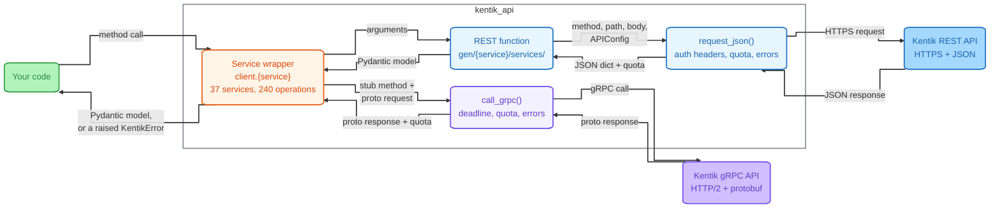
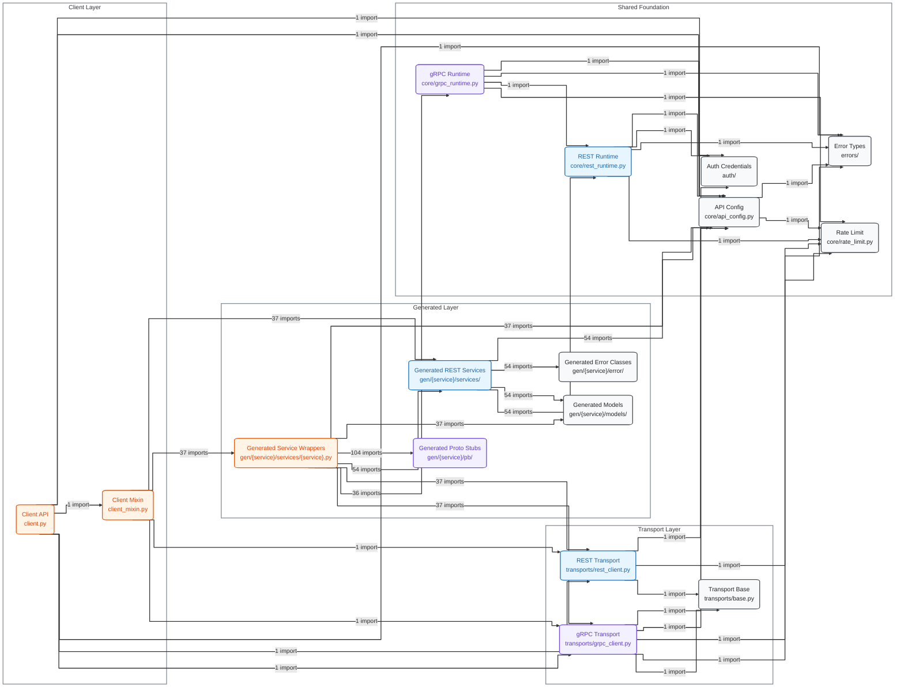

<!-- AUTO-GENERATED: scripts/generation/docs_rendering.py, _generate_runtime_architecture_docs() -->
<!-- Rebuilt on every `uv run poe generate`. Do not edit by hand. -->

# SDK Runtime Architecture

This page shows how a call moves through the SDK, and how the hand-written
runtime modules and the generated services depend on each other.

## Call Path

Each method call on `client.<service>` takes one of two paths. The transport
that the client uses selects the path. Both paths return the same Pydantic
models and raise the same exception types.

1. `kentik_api.client.KentikAPI` reads the credentials and selects the transport.
2. `kentik_api.client_mixin.KentikClientMixin` mounts one generated service
   wrapper per service.
3. On a REST transport, a wrapper calls the generated REST function in
   `kentik_api.gen.<service>.services`. That function calls `request_json()`
   in `kentik_api.core.rest_runtime`, with the shared `APIConfig`.
4. On a gRPC transport, a wrapper calls `call_grpc()` in
   `kentik_api.core.grpc_runtime`, with the compiled proto stubs in
   `kentik_api.gen.<service>.pb`.
5. Both runtimes turn each failure into a `kentik_api.errors` type, or into
   the error class that the service generates for that operation.

## Module Dependency Graph

Each arrow points from a module group to a group that it imports. A number
on an arrow counts the import statements. The generator reads the imports
from the source on every run. Colors match the call path: blue is REST,
violet is gRPC, orange is the client and its wrappers, and gray is shared.

| Group | Source | Role |
| --- | --- | --- |
| Client API | `client.py` | `KentikAPI`: reads the credentials and selects the transport. |
| Client Mixin | `client_mixin.py` | Mounts each service wrapper as `client.<service>`. |
| Generated Service Wrappers | `gen/{service}/services/{service}.py` | Send each call to the REST function or to the gRPC stub, for the transport in use. |
| Generated REST Services | `gen/{service}/services/` | One function per operation in the OpenAPI schema. Each function calls `request_json()`. |
| Generated Models | `gen/{service}/models/` | Pydantic request and response models. |
| Generated Error Classes | `gen/{service}/error/` | One error class per operation, picked by the response status. |
| Generated Proto Stubs | `gen/{service}/pb/` | The modules that protoc compiles. Wrappers call them on a gRPC transport. |
| API Config | `core/api_config.py` | `APIConfig`: base URL, credentials, TLS, timeouts, and the shared HTTP client. |
| REST Runtime | `core/rest_runtime.py` | `request_json()`: the one function that sends REST traffic. |
| gRPC Runtime | `core/grpc_runtime.py` | `call_grpc()`: the one function that sends gRPC traffic. |
| Error Types | `errors/` | The shared exception hierarchy under `KentikError`. |

## Services Without A Wrapper

The REST paths in the OpenAPI schema drive wrapper generation. If the schema
of a Service declares no paths, the generator writes its models and proto
stubs but no wrapper, and the client does not mount it. This is intentional.
REST operations are the contract of this SDK. Wrapper generation from protos
is out of scope.

6 Services are in that state today: `core`, `deviceconf`, `diagnostic`, `kptr`, `monitoring`, `net`.

Some of these Services declare gRPC RPCs upstream, but the RPCs have no
`google.api.http` annotation, so no path reaches the schema. That is a gap
in the upstream schema, not in the SDK. If upstream adds the annotation, the
next run generates the wrapper.

## REST-Only Services

These Services come from the local schema base, `schema/openapi/`. It holds
descriptions, maintained by hand, of endpoints that upstream does not publish.
Each client mounts these Services on a REST transport to their own host. A
client with `protocol="grpc"` also sends their calls over REST: `v5`.
