<!-- AUTO-GENERATED: scripts/generation/endpoint_docs.py, render_endpoint_docs() -->
<!-- Rebuilt on every `make generate`. Do not edit by hand. -->

# Alerting Service

## Overview

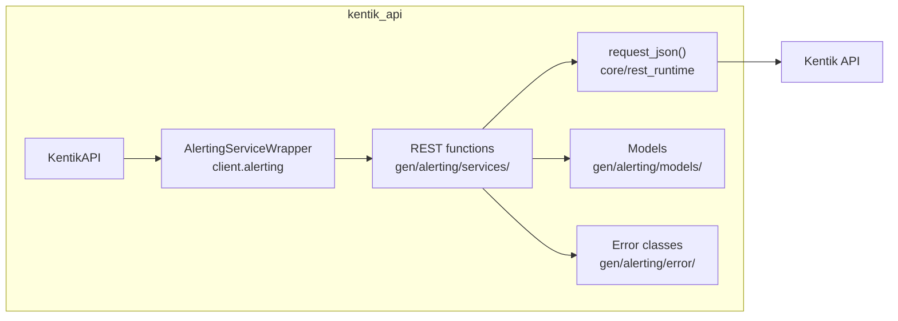

## Endpoints

### AlertService

#### `POST` `/v202505/alerts`

List Alerts

Returns an array of alert objects that contain information about individual alerts.

**REST transport**

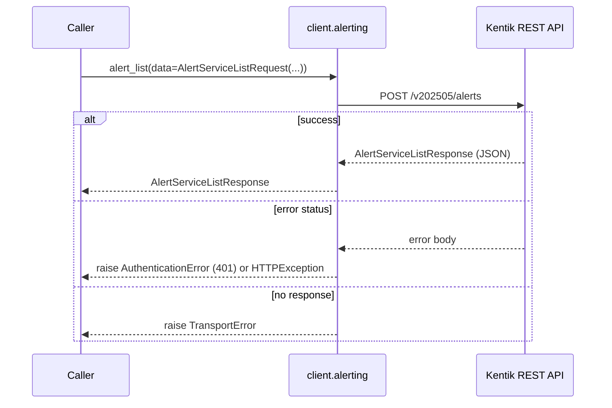

**gRPC transport**

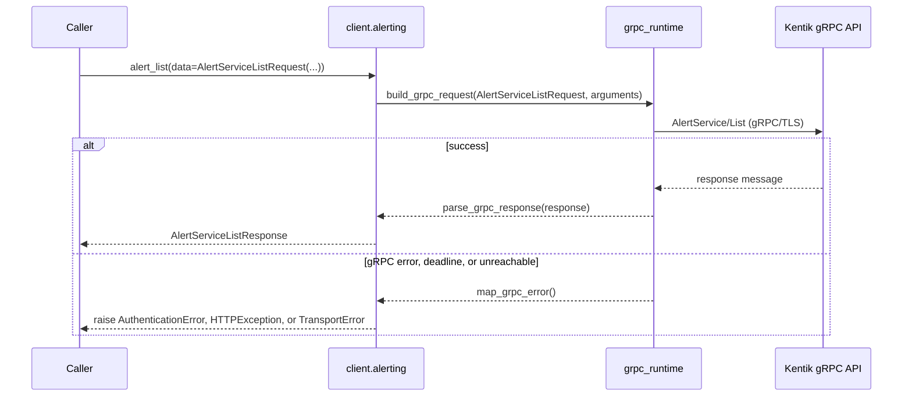

##### Parameters

| Name | In | Type | Required |
| --- | --- | --- | --- |
| `data` | body | `AlertServiceListRequest` | Yes |

##### Responses

| Status | Description | Model |
| --- | --- | --- |
| 200 | A successful response. | `AlertServiceListResponse` |
| default | An unexpected error response. | `rpcStatus` |

##### Example

```python
from kentik_api.client import KentikAPI
from kentik_api.gen.alerting.models import AlertServiceListRequest

# Both transports work: protocol="rest" (default) or protocol="grpc".
client = KentikAPI(protocol="rest")  # loads KENTIK_EMAIL/KENTIK_API_TOKEN from .env
response = client.alerting.alert_list(
    data=AlertServiceListRequest(...),
)
```

---

#### `POST` `/v202505/alerts/clear`

Clear Alerts

Clears alerts.

**REST transport**

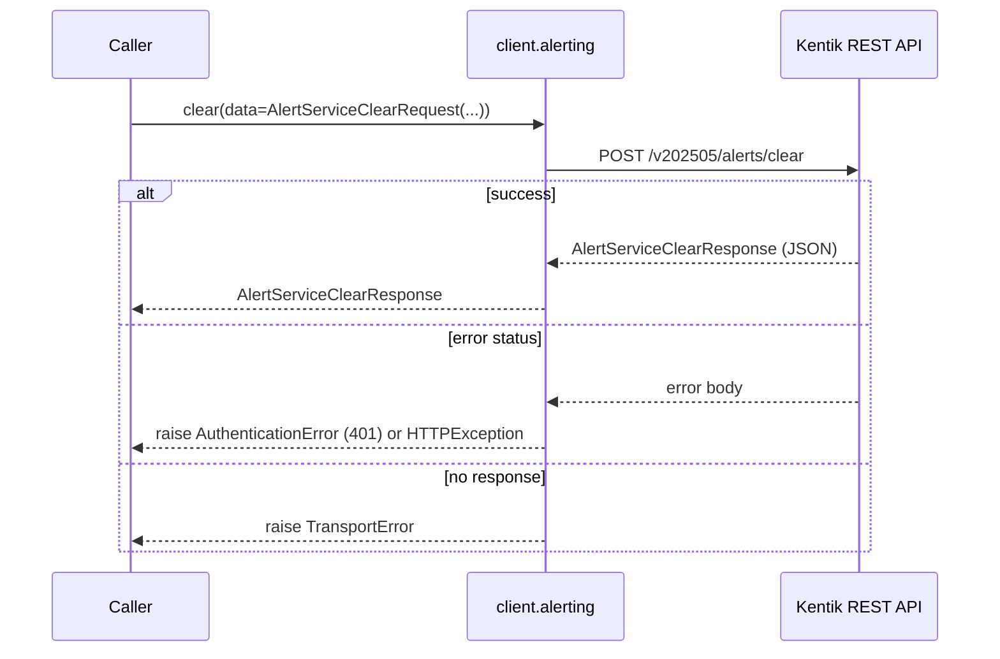

**gRPC transport**

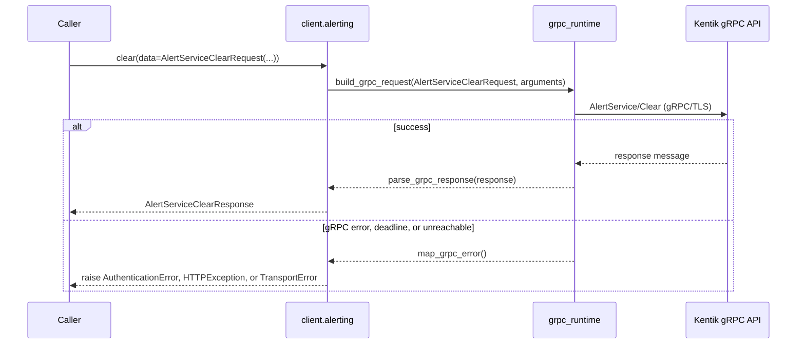

##### Parameters

| Name | In | Type | Required |
| --- | --- | --- | --- |
| `data` | body | `AlertServiceClearRequest` | Yes |

##### Responses

| Status | Description | Model |
| --- | --- | --- |
| 200 | A successful response. | `AlertServiceClearResponse` |
| default | An unexpected error response. | `rpcStatus` |

##### Example

```python
from kentik_api.client import KentikAPI
from kentik_api.gen.alerting.models import AlertServiceClearRequest

# Both transports work: protocol="rest" (default) or protocol="grpc".
client = KentikAPI(protocol="rest")  # loads KENTIK_EMAIL/KENTIK_API_TOKEN from .env
response = client.alerting.clear(
    data=AlertServiceClearRequest(...),
)
```

---

#### `GET` `/v202505/alerts/{alertId}/comments`

List Alert Comments

Returns all comments for an alert.

**REST transport**

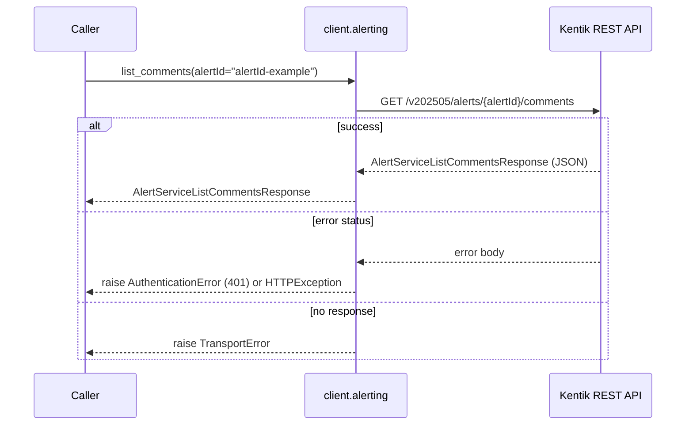

**gRPC transport**

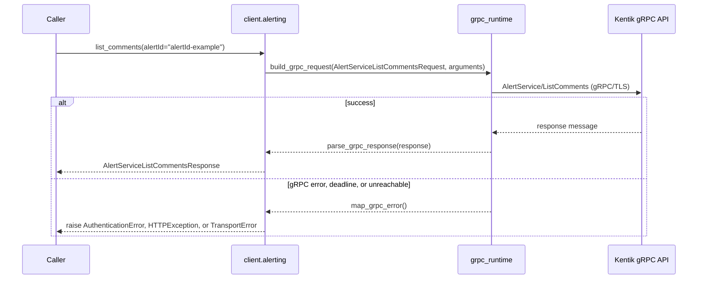

##### Parameters

| Name | In | Type | Required |
| --- | --- | --- | --- |
| `alertId` | path | `string` | Yes |

##### Responses

| Status | Description | Model |
| --- | --- | --- |
| 200 | A successful response. | `AlertServiceListCommentsResponse` |
| default | An unexpected error response. | `rpcStatus` |

##### Example

```python
from kentik_api.client import KentikAPI

# Both transports work: protocol="rest" (default) or protocol="grpc".
client = KentikAPI(protocol="rest")  # loads KENTIK_EMAIL/KENTIK_API_TOKEN from .env
response = client.alerting.list_comments(
    alertId="alertId-example",
)
```

---

#### `POST` `/v202505/alerts/{alertId}/comments`

Add Alert Comment

Adds a comment to an alert.

**REST transport**

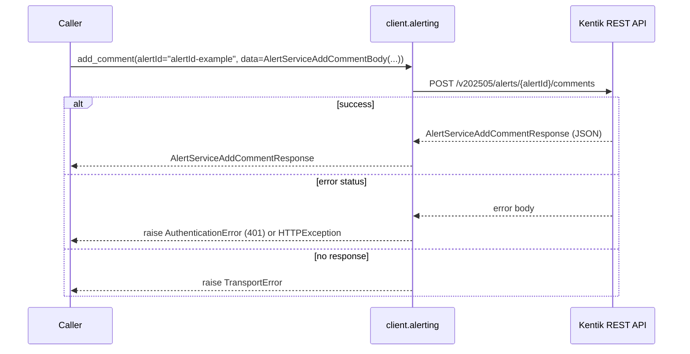

**gRPC transport**

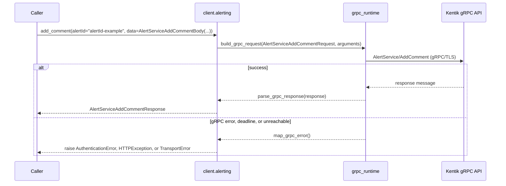

##### Parameters

| Name | In | Type | Required |
| --- | --- | --- | --- |
| `alertId` | path | `string` | Yes |
| `data` | body | `AlertServiceAddCommentBody` | Yes |

##### Responses

| Status | Description | Model |
| --- | --- | --- |
| 200 | A successful response. | `AlertServiceAddCommentResponse` |
| default | An unexpected error response. | `rpcStatus` |

##### Example

```python
from kentik_api.client import KentikAPI
from kentik_api.gen.alerting.models import AlertServiceAddCommentBody

# Both transports work: protocol="rest" (default) or protocol="grpc".
client = KentikAPI(protocol="rest")  # loads KENTIK_EMAIL/KENTIK_API_TOKEN from .env
response = client.alerting.add_comment(
    alertId="alertId-example",
    data=AlertServiceAddCommentBody(...),
)
```

---

#### `PUT` `/v202505/alerts/{alertId}/external-context`

Set External Context for Alert

Add or replace external context

**REST transport**


**gRPC transport**

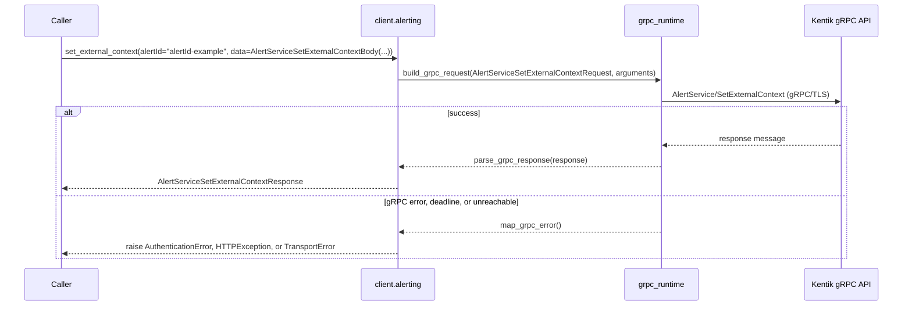

##### Parameters

| Name | In | Type | Required |
| --- | --- | --- | --- |
| `alertId` | path | `string` | Yes |
| `data` | body | `AlertServiceSetExternalContextBody` | Yes |

##### Responses

| Status | Description | Model |
| --- | --- | --- |
| 200 | A successful response. | `AlertServiceSetExternalContextResponse` |
| default | An unexpected error response. | `rpcStatus` |

##### Example

```python
from kentik_api.client import KentikAPI
from kentik_api.gen.alerting.models import AlertServiceSetExternalContextBody

# Both transports work: protocol="rest" (default) or protocol="grpc".
client = KentikAPI(protocol="rest")  # loads KENTIK_EMAIL/KENTIK_API_TOKEN from .env
response = client.alerting.set_external_context(
    alertId="alertId-example",
    data=AlertServiceSetExternalContextBody(...),
)
```

---

#### `GET` `/v202505/alerts/{id}`

Get Alert

Returns an alert object that contains information about an individual alert.

**REST transport**

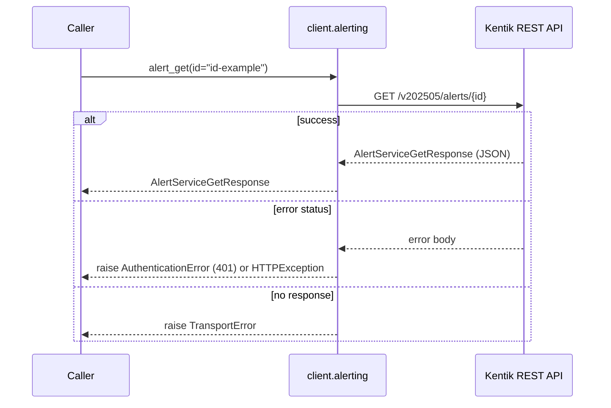

**gRPC transport**


##### Parameters

| Name | In | Type | Required |
| --- | --- | --- | --- |
| `id` | path | `string` | Yes |

##### Responses

| Status | Description | Model |
| --- | --- | --- |
| 200 | A successful response. | `AlertServiceGetResponse` |
| default | An unexpected error response. | `rpcStatus` |

##### Example

```python
from kentik_api.client import KentikAPI

# Both transports work: protocol="rest" (default) or protocol="grpc".
client = KentikAPI(protocol="rest")  # loads KENTIK_EMAIL/KENTIK_API_TOKEN from .env
response = client.alerting.alert_get(
    id="id-example",
)
```

---

#### `POST` `/v202505/alerts/{id}/ack`

Ack Alert

Acknowledges an alert.

**REST transport**

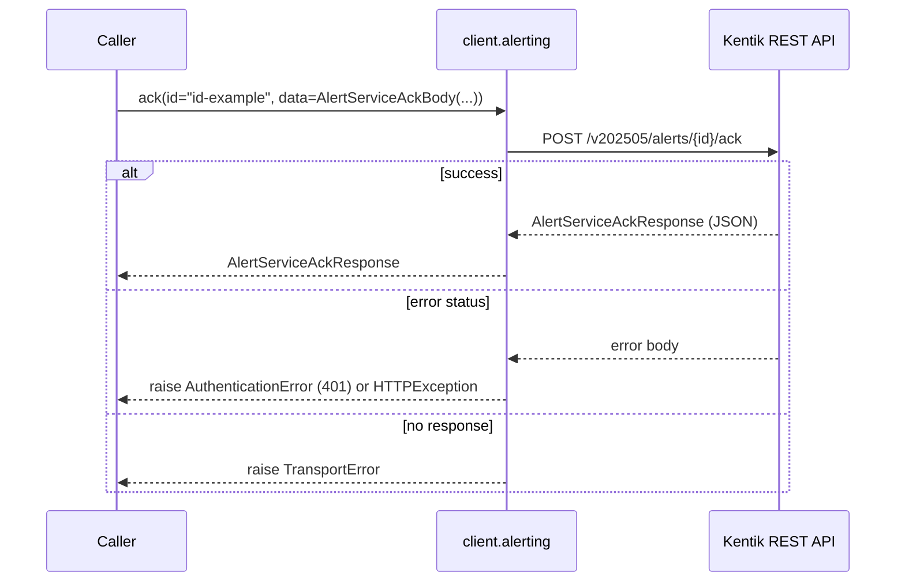

**gRPC transport**

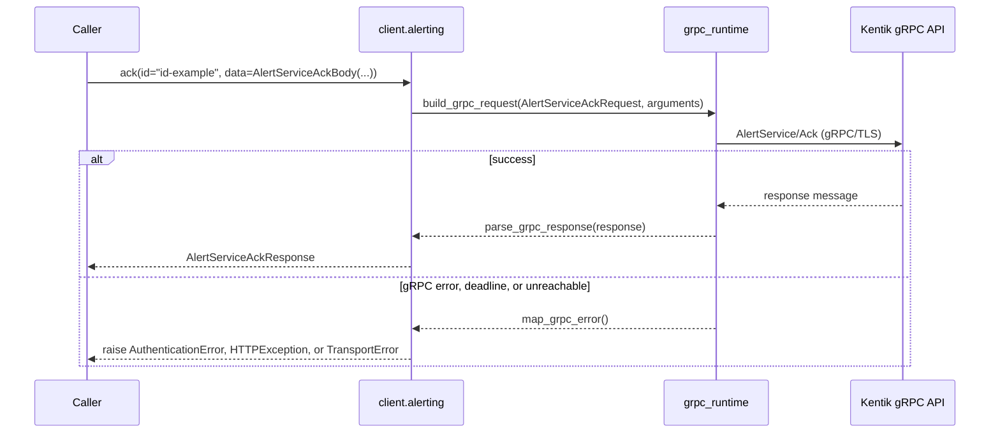

##### Parameters

| Name | In | Type | Required |
| --- | --- | --- | --- |
| `id` | path | `string` | Yes |
| `data` | body | `AlertServiceAckBody` | Yes |

##### Responses

| Status | Description | Model |
| --- | --- | --- |
| 200 | A successful response. | `AlertServiceAckResponse` |
| default | An unexpected error response. | `rpcStatus` |

##### Example

```python
from kentik_api.client import KentikAPI
from kentik_api.gen.alerting.models import AlertServiceAckBody

# Both transports work: protocol="rest" (default) or protocol="grpc".
client = KentikAPI(protocol="rest")  # loads KENTIK_EMAIL/KENTIK_API_TOKEN from .env
response = client.alerting.ack(
    id="id-example",
    data=AlertServiceAckBody(...),
)
```

---

#### `POST` `/v202505/alerts/{id}/unack`

UnAck Alert

Unacknowledges an alert (removes the acknowledgement).

**REST transport**

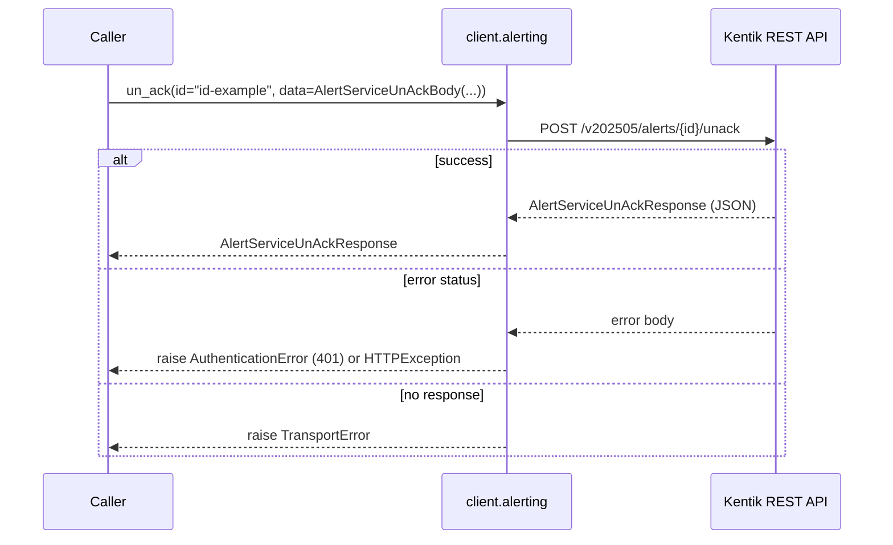

**gRPC transport**

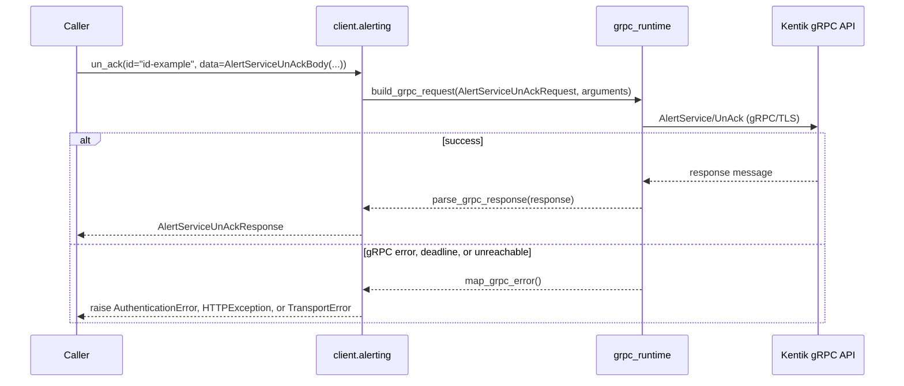

##### Parameters

| Name | In | Type | Required |
| --- | --- | --- | --- |
| `id` | path | `string` | Yes |
| `data` | body | `AlertServiceUnAckBody` | Yes |

##### Responses

| Status | Description | Model |
| --- | --- | --- |
| 200 | A successful response. | `AlertServiceUnAckResponse` |
| default | An unexpected error response. | `rpcStatus` |

##### Example

```python
from kentik_api.client import KentikAPI
from kentik_api.gen.alerting.models import AlertServiceUnAckBody

# Both transports work: protocol="rest" (default) or protocol="grpc".
client = KentikAPI(protocol="rest")  # loads KENTIK_EMAIL/KENTIK_API_TOKEN from .env
response = client.alerting.un_ack(
    id="id-example",
    data=AlertServiceUnAckBody(...),
)
```

### AlertAutoAckService

#### `POST` `/v202505/alerts/ack/auto`

Create Auto-Ack

Creates a new auto-ack configuration.

**REST transport**

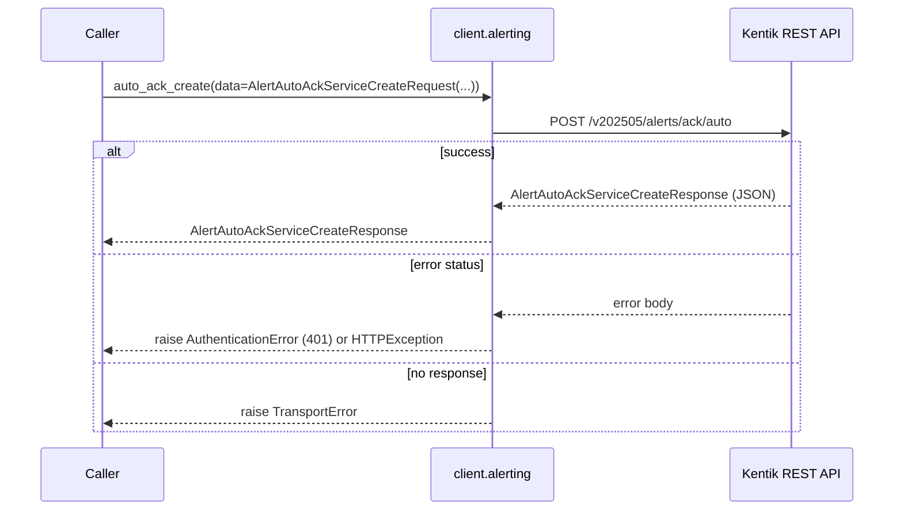

**gRPC transport**

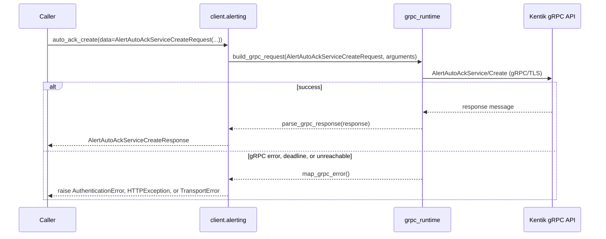

##### Parameters

| Name | In | Type | Required |
| --- | --- | --- | --- |
| `data` | body | `AlertAutoAckServiceCreateRequest` | Yes |

##### Responses

| Status | Description | Model |
| --- | --- | --- |
| 200 | A successful response. | `AlertAutoAckServiceCreateResponse` |
| default | An unexpected error response. | `rpcStatus` |

##### Example

```python
from kentik_api.client import KentikAPI
from kentik_api.gen.alerting.models import AlertAutoAckServiceCreateRequest

# Both transports work: protocol="rest" (default) or protocol="grpc".
client = KentikAPI(protocol="rest")  # loads KENTIK_EMAIL/KENTIK_API_TOKEN from .env
response = client.alerting.auto_ack_create(
    data=AlertAutoAckServiceCreateRequest(...),
)
```

---

#### `POST` `/v202505/alerts/ack/auto/list`

List Auto-Acks

Returns a list of auto-ack configurations.

**REST transport**

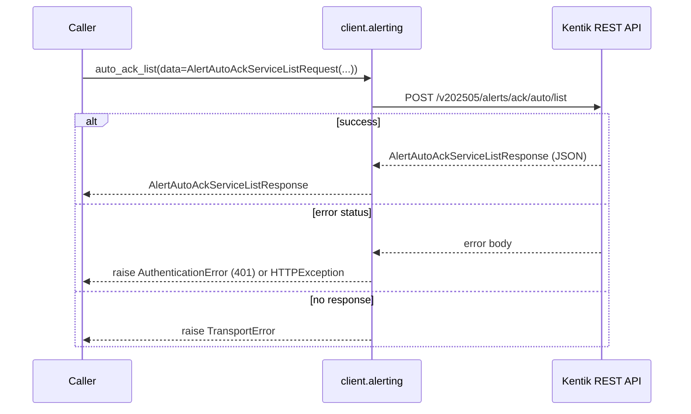

**gRPC transport**

```mermaid
sequenceDiagram
    participant C as Caller
    participant W as client.alerting
    participant R as grpc_runtime
    participant API as Kentik gRPC API

    C->>W: auto_ack_list(data=AlertAutoAckServiceListRequest(...))
    W->>R: build_grpc_request(AlertAutoAckServiceListRequest, arguments)
    R->>API: AlertAutoAckService/List (gRPC/TLS)
    alt success
        API-->>R: response message
        R-->>W: parse_grpc_response(response)
        W-->>C: AlertAutoAckServiceListResponse
    else gRPC error, deadline, or unreachable
        R-->>W: map_grpc_error()
        W-->>C: raise AuthenticationError, HTTPException, or TransportError
    end
```

##### Parameters

| Name | In | Type | Required |
| --- | --- | --- | --- |
| `data` | body | `AlertAutoAckServiceListRequest` | Yes |

##### Responses

| Status | Description | Model |
| --- | --- | --- |
| 200 | A successful response. | `AlertAutoAckServiceListResponse` |
| default | An unexpected error response. | `rpcStatus` |

##### Example

```python
from kentik_api.client import KentikAPI
from kentik_api.gen.alerting.models import AlertAutoAckServiceListRequest

# Both transports work: protocol="rest" (default) or protocol="grpc".
client = KentikAPI(protocol="rest")  # loads KENTIK_EMAIL/KENTIK_API_TOKEN from .env
response = client.alerting.auto_ack_list(
    data=AlertAutoAckServiceListRequest(...),
)
```

---

#### `GET` `/v202505/alerts/ack/auto/{autoAck.id}`

Get Auto-Ack

Returns an auto-ack configuration.

**REST transport**

```mermaid
sequenceDiagram
    participant C as Caller
    participant W as client.alerting
    participant API as Kentik REST API

    C->>W: auto_ack_get(autoAckid="autoAckid-example")
    W->>API: GET /v202505/alerts/ack/auto/{autoAck.id}
    alt success
        API-->>W: AlertAutoAckServiceGetResponse (JSON)
        W-->>C: AlertAutoAckServiceGetResponse
    else error status
        API-->>W: error body
        W-->>C: raise AuthenticationError (401) or HTTPException
    else no response
        W-->>C: raise TransportError
    end
```

**gRPC transport**

```mermaid
sequenceDiagram
    participant C as Caller
    participant W as client.alerting
    participant R as grpc_runtime
    participant API as Kentik gRPC API

    C->>W: auto_ack_get(autoAckid="autoAckid-example")
    W->>R: build_grpc_request(AlertAutoAckServiceGetRequest, arguments)
    R->>API: AlertAutoAckService/Get (gRPC/TLS)
    alt success
        API-->>R: response message
        R-->>W: parse_grpc_response(response)
        W-->>C: AlertAutoAckServiceGetResponse
    else gRPC error, deadline, or unreachable
        R-->>W: map_grpc_error()
        W-->>C: raise AuthenticationError, HTTPException, or TransportError
    end
```

##### Parameters

| Name | In | Type | Required |
| --- | --- | --- | --- |
| `autoAckid` | path | `string` | Yes |

##### Responses

| Status | Description | Model |
| --- | --- | --- |
| 200 | A successful response. | `AlertAutoAckServiceGetResponse` |
| default | An unexpected error response. | `rpcStatus` |

##### Example

```python
from kentik_api.client import KentikAPI

# Both transports work: protocol="rest" (default) or protocol="grpc".
client = KentikAPI(protocol="rest")  # loads KENTIK_EMAIL/KENTIK_API_TOKEN from .env
response = client.alerting.auto_ack_get(
    autoAckid="autoAckid-example",
)
```

---

#### `PATCH` `/v202505/alerts/ack/auto/{autoAck.id}`

Replace Auto-Ack

Replaces an auto-ack configuration.

**REST transport**

```mermaid
sequenceDiagram
    participant C as Caller
    participant W as client.alerting
    participant API as Kentik REST API

    C->>W: auto_ack_replace(autoAckid="autoAckid-example", data=AlertAutoAckServiceReplaceBody(...))
    W->>API: PATCH /v202505/alerts/ack/auto/{autoAck.id}
    alt success
        API-->>W: AlertAutoAckServiceReplaceResponse (JSON)
        W-->>C: AlertAutoAckServiceReplaceResponse
    else error status
        API-->>W: error body
        W-->>C: raise AuthenticationError (401) or HTTPException
    else no response
        W-->>C: raise TransportError
    end
```

**gRPC transport**

```mermaid
sequenceDiagram
    participant C as Caller
    participant W as client.alerting
    participant R as grpc_runtime
    participant API as Kentik gRPC API

    C->>W: auto_ack_replace(autoAckid="autoAckid-example", data=AlertAutoAckServiceReplaceBody(...))
    W->>R: build_grpc_request(AlertAutoAckServiceReplaceRequest, arguments)
    R->>API: AlertAutoAckService/Replace (gRPC/TLS)
    alt success
        API-->>R: response message
        R-->>W: parse_grpc_response(response)
        W-->>C: AlertAutoAckServiceReplaceResponse
    else gRPC error, deadline, or unreachable
        R-->>W: map_grpc_error()
        W-->>C: raise AuthenticationError, HTTPException, or TransportError
    end
```

##### Parameters

| Name | In | Type | Required |
| --- | --- | --- | --- |
| `autoAckid` | path | `string` | Yes |
| `data` | body | `AlertAutoAckServiceReplaceBody` | Yes |

##### Responses

| Status | Description | Model |
| --- | --- | --- |
| 200 | A successful response. | `AlertAutoAckServiceReplaceResponse` |
| default | An unexpected error response. | `rpcStatus` |

##### Example

```python
from kentik_api.client import KentikAPI
from kentik_api.gen.alerting.models import AlertAutoAckServiceReplaceBody

# Both transports work: protocol="rest" (default) or protocol="grpc".
client = KentikAPI(protocol="rest")  # loads KENTIK_EMAIL/KENTIK_API_TOKEN from .env
response = client.alerting.auto_ack_replace(
    autoAckid="autoAckid-example",
    data=AlertAutoAckServiceReplaceBody(...),
)
```

---

#### `DELETE` `/v202505/alerts/ack/auto/{autoAck.id}`

Delete Auto-Ack

Deletes an auto-ack configuration.

**REST transport**

```mermaid
sequenceDiagram
    participant C as Caller
    participant W as client.alerting
    participant API as Kentik REST API

    C->>W: auto_ack_delete(autoAckid="autoAckid-example")
    W->>API: DELETE /v202505/alerts/ack/auto/{autoAck.id}
    alt success
        API-->>W: AlertAutoAckServiceDeleteResponse (JSON)
        W-->>C: AlertAutoAckServiceDeleteResponse
    else error status
        API-->>W: error body
        W-->>C: raise AuthenticationError (401) or HTTPException
    else no response
        W-->>C: raise TransportError
    end
```

**gRPC transport**

```mermaid
sequenceDiagram
    participant C as Caller
    participant W as client.alerting
    participant R as grpc_runtime
    participant API as Kentik gRPC API

    C->>W: auto_ack_delete(autoAckid="autoAckid-example")
    W->>R: build_grpc_request(AlertAutoAckServiceDeleteRequest, arguments)
    R->>API: AlertAutoAckService/Delete (gRPC/TLS)
    alt success
        API-->>R: response message
        R-->>W: parse_grpc_response(response)
        W-->>C: AlertAutoAckServiceDeleteResponse
    else gRPC error, deadline, or unreachable
        R-->>W: map_grpc_error()
        W-->>C: raise AuthenticationError, HTTPException, or TransportError
    end
```

##### Parameters

| Name | In | Type | Required |
| --- | --- | --- | --- |
| `autoAckid` | path | `string` | Yes |

##### Responses

| Status | Description | Model |
| --- | --- | --- |
| 200 | A successful response. | `AlertAutoAckServiceDeleteResponse` |
| default | An unexpected error response. | `rpcStatus` |

##### Example

```python
from kentik_api.client import KentikAPI

# Both transports work: protocol="rest" (default) or protocol="grpc".
client = KentikAPI(protocol="rest")  # loads KENTIK_EMAIL/KENTIK_API_TOKEN from .env
response = client.alerting.auto_ack_delete(
    autoAckid="autoAckid-example",
)
```

### MitigationsService

#### `GET` `/v202505/mitigations`

List Mitigations

Returns a list of mitigations.

**REST transport**

```mermaid
sequenceDiagram
    participant C as Caller
    participant W as client.alerting
    participant API as Kentik REST API

    C->>W: mitigations_list()
    W->>API: GET /v202505/mitigations
    alt success
        API-->>W: MitigationsServiceListResponse (JSON)
        W-->>C: MitigationsServiceListResponse
    else error status
        API-->>W: error body
        W-->>C: raise AuthenticationError (401) or HTTPException
    else no response
        W-->>C: raise TransportError
    end
```

**gRPC transport**

```mermaid
sequenceDiagram
    participant C as Caller
    participant W as client.alerting
    participant R as grpc_runtime
    participant API as Kentik gRPC API

    C->>W: mitigations_list()
    W->>R: build_grpc_request(MitigationsServiceListRequest, arguments)
    R->>API: MitigationsService/List (gRPC/TLS)
    alt success
        API-->>R: response message
        R-->>W: parse_grpc_response(response)
        W-->>C: MitigationsServiceListResponse
    else gRPC error, deadline, or unreachable
        R-->>W: map_grpc_error()
        W-->>C: raise AuthenticationError, HTTPException, or TransportError
    end
```

##### Parameters

| Name | In | Type | Required |
| --- | --- | --- | --- |
| `paginationlimit` | query | `string (uint64)` | No |
| `paginationoffset` | query | `string (uint64)` | No |
| `paginationincludeTotalCount` | query | `boolean` | No |
| `filterscreatedAtstart` | query | `string (date-time)` | No |
| `filterscreatedAtend` | query | `string (date-time)` | No |
| `filtersmitigationIds` | query | `string[]` | No |
| `filtersalarmIds` | query | `string[]` | No |
| `filtersstates` | query | `string[]` | No |
| `filtersplatformIds` | query | `string[]` | No |
| `filtersmethodIds` | query | `string[]` | No |
| `filtersipCidrs` | query | `string[]` | No |
| `filtersipCidrPattern` | query | `string` | No |
| `filterstypes` | query | `string[]` | No |

##### Responses

| Status | Description | Model |
| --- | --- | --- |
| 200 | A successful response. | `MitigationsServiceListResponse` |
| default | An unexpected error response. | `rpcStatus` |

##### Example

```python
from kentik_api.client import KentikAPI

# Both transports work: protocol="rest" (default) or protocol="grpc".
client = KentikAPI(protocol="rest")  # loads KENTIK_EMAIL/KENTIK_API_TOKEN from .env
response = client.alerting.mitigations_list()
```

---

#### `POST` `/v202505/mitigations`

Create Mitigation

Creates a new manual mitigation.

**REST transport**

```mermaid
sequenceDiagram
    participant C as Caller
    participant W as client.alerting
    participant API as Kentik REST API

    C->>W: mitigations_create(data=MitigationsServiceCreateRequest(...))
    W->>API: POST /v202505/mitigations
    alt success
        API-->>W: MitigationsServiceCreateResponse (JSON)
        W-->>C: MitigationsServiceCreateResponse
    else error status
        API-->>W: error body
        W-->>C: raise AuthenticationError (401) or HTTPException
    else no response
        W-->>C: raise TransportError
    end
```

**gRPC transport**

```mermaid
sequenceDiagram
    participant C as Caller
    participant W as client.alerting
    participant R as grpc_runtime
    participant API as Kentik gRPC API

    C->>W: mitigations_create(data=MitigationsServiceCreateRequest(...))
    W->>R: build_grpc_request(MitigationsServiceCreateRequest, arguments)
    R->>API: MitigationsService/Create (gRPC/TLS)
    alt success
        API-->>R: response message
        R-->>W: parse_grpc_response(response)
        W-->>C: MitigationsServiceCreateResponse
    else gRPC error, deadline, or unreachable
        R-->>W: map_grpc_error()
        W-->>C: raise AuthenticationError, HTTPException, or TransportError
    end
```

##### Parameters

| Name | In | Type | Required |
| --- | --- | --- | --- |
| `data` | body | `MitigationsServiceCreateRequest` | Yes |

##### Responses

| Status | Description | Model |
| --- | --- | --- |
| 200 | A successful response. | `MitigationsServiceCreateResponse` |
| default | An unexpected error response. | `rpcStatus` |

##### Example

```python
from kentik_api.client import KentikAPI
from kentik_api.gen.alerting.models import MitigationsServiceCreateRequest

# Both transports work: protocol="rest" (default) or protocol="grpc".
client = KentikAPI(protocol="rest")  # loads KENTIK_EMAIL/KENTIK_API_TOKEN from .env
response = client.alerting.mitigations_create(
    data=MitigationsServiceCreateRequest(...),
)
```

---

#### `GET` `/v202505/mitigations/actions`

Get Available Actions

Returns available actions for mitigations.

**REST transport**

```mermaid
sequenceDiagram
    participant C as Caller
    participant W as client.alerting
    participant API as Kentik REST API

    C->>W: available_actions()
    W->>API: GET /v202505/mitigations/actions
    alt success
        API-->>W: MitigationsServiceAvailableActionsResponse (JSON)
        W-->>C: MitigationsServiceAvailableActionsResponse
    else error status
        API-->>W: error body
        W-->>C: raise AuthenticationError (401) or HTTPException
    else no response
        W-->>C: raise TransportError
    end
```

**gRPC transport**

```mermaid
sequenceDiagram
    participant C as Caller
    participant W as client.alerting
    participant R as grpc_runtime
    participant API as Kentik gRPC API

    C->>W: available_actions()
    W->>R: build_grpc_request(MitigationsServiceAvailableActionsRequest, arguments)
    R->>API: MitigationsService/AvailableActions (gRPC/TLS)
    alt success
        API-->>R: response message
        R-->>W: parse_grpc_response(response)
        W-->>C: MitigationsServiceAvailableActionsResponse
    else gRPC error, deadline, or unreachable
        R-->>W: map_grpc_error()
        W-->>C: raise AuthenticationError, HTTPException, or TransportError
    end
```

##### Responses

| Status | Description | Model |
| --- | --- | --- |
| 200 | A successful response. | `MitigationsServiceAvailableActionsResponse` |
| default | An unexpected error response. | `rpcStatus` |

##### Example

```python
from kentik_api.client import KentikAPI

# Both transports work: protocol="rest" (default) or protocol="grpc".
client = KentikAPI(protocol="rest")  # loads KENTIK_EMAIL/KENTIK_API_TOKEN from .env
response = client.alerting.available_actions()
```

---

#### `GET` `/v202505/mitigations/{action}`

Get Mitigation

Returns a mitigation.

**REST transport**

```mermaid
sequenceDiagram
    participant C as Caller
    participant W as client.alerting
    participant API as Kentik REST API

    C->>W: mitigations_get(action="action-example")
    W->>API: GET /v202505/mitigations/{action}
    alt success
        API-->>W: MitigationsServiceGetResponse (JSON)
        W-->>C: MitigationsServiceGetResponse
    else error status
        API-->>W: error body
        W-->>C: raise AuthenticationError (401) or HTTPException
    else no response
        W-->>C: raise TransportError
    end
```

**gRPC transport**

```mermaid
sequenceDiagram
    participant C as Caller
    participant W as client.alerting
    participant R as grpc_runtime
    participant API as Kentik gRPC API

    C->>W: mitigations_get(action="action-example")
    W->>R: build_grpc_request(MitigationsServiceGetRequest, arguments)
    R->>API: MitigationsService/Get (gRPC/TLS)
    alt success
        API-->>R: response message
        R-->>W: parse_grpc_response(response)
        W-->>C: MitigationsServiceGetResponse
    else gRPC error, deadline, or unreachable
        R-->>W: map_grpc_error()
        W-->>C: raise AuthenticationError, HTTPException, or TransportError
    end
```

##### Parameters

| Name | In | Type | Required |
| --- | --- | --- | --- |
| `action` | path | `string` | Yes |

##### Responses

| Status | Description | Model |
| --- | --- | --- |
| 200 | A successful response. | `MitigationsServiceGetResponse` |
| default | An unexpected error response. | `rpcStatus` |

##### Example

```python
from kentik_api.client import KentikAPI

# Both transports work: protocol="rest" (default) or protocol="grpc".
client = KentikAPI(protocol="rest")  # loads KENTIK_EMAIL/KENTIK_API_TOKEN from .env
response = client.alerting.mitigations_get(
    action="action-example",
)
```

---

#### `POST` `/v202505/mitigations/{action}`

Act on Mitigation

Performs an action on one or more mitigations.

**REST transport**

```mermaid
sequenceDiagram
    participant C as Caller
    participant W as client.alerting
    participant API as Kentik REST API

    C->>W: act(action="action-example", data=MitigationsServiceActBody(...))
    W->>API: POST /v202505/mitigations/{action}
    alt success
        API-->>W: MitigationsServiceActResponse (JSON)
        W-->>C: MitigationsServiceActResponse
    else error status
        API-->>W: error body
        W-->>C: raise AuthenticationError (401) or HTTPException
    else no response
        W-->>C: raise TransportError
    end
```

**gRPC transport**

```mermaid
sequenceDiagram
    participant C as Caller
    participant W as client.alerting
    participant R as grpc_runtime
    participant API as Kentik gRPC API

    C->>W: act(action="action-example", data=MitigationsServiceActBody(...))
    W->>R: build_grpc_request(MitigationsServiceActRequest, arguments)
    R->>API: MitigationsService/Act (gRPC/TLS)
    alt success
        API-->>R: response message
        R-->>W: parse_grpc_response(response)
        W-->>C: MitigationsServiceActResponse
    else gRPC error, deadline, or unreachable
        R-->>W: map_grpc_error()
        W-->>C: raise AuthenticationError, HTTPException, or TransportError
    end
```

##### Parameters

| Name | In | Type | Required |
| --- | --- | --- | --- |
| `action` | path | `string` | Yes |
| `data` | body | `MitigationsServiceActBody` | Yes |

##### Responses

| Status | Description | Model |
| --- | --- | --- |
| 200 | A successful response. | `MitigationsServiceActResponse` |
| default | An unexpected error response. | `rpcStatus` |

##### Example

```python
from kentik_api.client import KentikAPI
from kentik_api.gen.alerting.models import MitigationsServiceActBody

# Both transports work: protocol="rest" (default) or protocol="grpc".
client = KentikAPI(protocol="rest")  # loads KENTIK_EMAIL/KENTIK_API_TOKEN from .env
response = client.alerting.act(
    action="action-example",
    data=MitigationsServiceActBody(...),
)
```

---

#### `GET` `/v202505/mitigations/{id}/actions`

Get Available Actions for Mitigation

Returns available actions for a specific mitigation.

**REST transport**

```mermaid
sequenceDiagram
    participant C as Caller
    participant W as client.alerting
    participant API as Kentik REST API

    C->>W: available_actions_for_mitigation(id="id-example")
    W->>API: GET /v202505/mitigations/{id}/actions
    alt success
        API-->>W: MitigationsServiceAvailableActionsForMitigationResponse (JSON)
        W-->>C: MitigationsServiceAvailableActionsForMitigationResponse
    else error status
        API-->>W: error body
        W-->>C: raise AuthenticationError (401) or HTTPException
    else no response
        W-->>C: raise TransportError
    end
```

**gRPC transport**

```mermaid
sequenceDiagram
    participant C as Caller
    participant W as client.alerting
    participant R as grpc_runtime
    participant API as Kentik gRPC API

    C->>W: available_actions_for_mitigation(id="id-example")
    W->>R: build_grpc_request(MitigationsServiceAvailableActionsForMitigationRequest, arguments)
    R->>API: MitigationsService/AvailableActionsForMitigation (gRPC/TLS)
    alt success
        API-->>R: response message
        R-->>W: parse_grpc_response(response)
        W-->>C: MitigationsServiceAvailableActionsForMitigationResponse
    else gRPC error, deadline, or unreachable
        R-->>W: map_grpc_error()
        W-->>C: raise AuthenticationError, HTTPException, or TransportError
    end
```

##### Parameters

| Name | In | Type | Required |
| --- | --- | --- | --- |
| `id` | path | `string (int64)` | Yes |

##### Responses

| Status | Description | Model |
| --- | --- | --- |
| 200 | A successful response. | `MitigationsServiceAvailableActionsForMitigationResponse` |
| default | An unexpected error response. | `rpcStatus` |

##### Example

```python
from kentik_api.client import KentikAPI

# Both transports work: protocol="rest" (default) or protocol="grpc".
client = KentikAPI(protocol="rest")  # loads KENTIK_EMAIL/KENTIK_API_TOKEN from .env
response = client.alerting.available_actions_for_mitigation(
    id="id-example",
)
```

### MitigationMethodsService

#### `GET` `/v202505/mitigations/methods`

List Mitigation Methods

Returns a list of mitigation methods.

**REST transport**

```mermaid
sequenceDiagram
    participant C as Caller
    participant W as client.alerting
    participant API as Kentik REST API

    C->>W: mitigation_methods_list()
    W->>API: GET /v202505/mitigations/methods
    alt success
        API-->>W: MitigationMethodsServiceListResponse (JSON)
        W-->>C: MitigationMethodsServiceListResponse
    else error status
        API-->>W: error body
        W-->>C: raise AuthenticationError (401) or HTTPException
    else no response
        W-->>C: raise TransportError
    end
```

**gRPC transport**

```mermaid
sequenceDiagram
    participant C as Caller
    participant W as client.alerting
    participant R as grpc_runtime
    participant API as Kentik gRPC API

    C->>W: mitigation_methods_list()
    W->>R: build_grpc_request(MitigationMethodsServiceListRequest, arguments)
    R->>API: MitigationMethodsService/List (gRPC/TLS)
    alt success
        API-->>R: response message
        R-->>W: parse_grpc_response(response)
        W-->>C: MitigationMethodsServiceListResponse
    else gRPC error, deadline, or unreachable
        R-->>W: map_grpc_error()
        W-->>C: raise AuthenticationError, HTTPException, or TransportError
    end
```

##### Parameters

| Name | In | Type | Required |
| --- | --- | --- | --- |
| `paginationlimit` | query | `string (uint64)` | No |
| `paginationoffset` | query | `string (uint64)` | No |
| `paginationincludeTotalCount` | query | `boolean` | No |
| `filtersmethodIds` | query | `string[]` | No |
| `filtersplatformTypes` | query | `string[]` | No |
| `filterscreatedAtstart` | query | `string (date-time)` | No |
| `filterscreatedAtend` | query | `string (date-time)` | No |
| `filtersmodifiedAtstart` | query | `string (date-time)` | No |
| `filtersmodifiedAtend` | query | `string (date-time)` | No |

##### Responses

| Status | Description | Model |
| --- | --- | --- |
| 200 | A successful response. | `MitigationMethodsServiceListResponse` |
| default | An unexpected error response. | `rpcStatus` |

##### Example

```python
from kentik_api.client import KentikAPI

# Both transports work: protocol="rest" (default) or protocol="grpc".
client = KentikAPI(protocol="rest")  # loads KENTIK_EMAIL/KENTIK_API_TOKEN from .env
response = client.alerting.mitigation_methods_list()
```

---

#### `GET` `/v202505/mitigations/methods/{id}`

Get Mitigation Method

Returns a mitigation method.

**REST transport**

```mermaid
sequenceDiagram
    participant C as Caller
    participant W as client.alerting
    participant API as Kentik REST API

    C->>W: mitigation_methods_get(id="id-example")
    W->>API: GET /v202505/mitigations/methods/{id}
    alt success
        API-->>W: MitigationMethodsServiceGetResponse (JSON)
        W-->>C: MitigationMethodsServiceGetResponse
    else error status
        API-->>W: error body
        W-->>C: raise AuthenticationError (401) or HTTPException
    else no response
        W-->>C: raise TransportError
    end
```

**gRPC transport**

```mermaid
sequenceDiagram
    participant C as Caller
    participant W as client.alerting
    participant R as grpc_runtime
    participant API as Kentik gRPC API

    C->>W: mitigation_methods_get(id="id-example")
    W->>R: build_grpc_request(MitigationMethodsServiceGetRequest, arguments)
    R->>API: MitigationMethodsService/Get (gRPC/TLS)
    alt success
        API-->>R: response message
        R-->>W: parse_grpc_response(response)
        W-->>C: MitigationMethodsServiceGetResponse
    else gRPC error, deadline, or unreachable
        R-->>W: map_grpc_error()
        W-->>C: raise AuthenticationError, HTTPException, or TransportError
    end
```

##### Parameters

| Name | In | Type | Required |
| --- | --- | --- | --- |
| `id` | path | `string` | Yes |

##### Responses

| Status | Description | Model |
| --- | --- | --- |
| 200 | A successful response. | `MitigationMethodsServiceGetResponse` |
| default | An unexpected error response. | `rpcStatus` |

##### Example

```python
from kentik_api.client import KentikAPI

# Both transports work: protocol="rest" (default) or protocol="grpc".
client = KentikAPI(protocol="rest")  # loads KENTIK_EMAIL/KENTIK_API_TOKEN from .env
response = client.alerting.mitigation_methods_get(
    id="id-example",
)
```

### MitigationPlatformsService

#### `GET` `/v202505/mitigations/platforms`

List Mitigation Platforms

Returns a list of mitigation platforms.

**REST transport**

```mermaid
sequenceDiagram
    participant C as Caller
    participant W as client.alerting
    participant API as Kentik REST API

    C->>W: mitigation_platforms_list()
    W->>API: GET /v202505/mitigations/platforms
    alt success
        API-->>W: MitigationPlatformsServiceListResponse (JSON)
        W-->>C: MitigationPlatformsServiceListResponse
    else error status
        API-->>W: error body
        W-->>C: raise AuthenticationError (401) or HTTPException
    else no response
        W-->>C: raise TransportError
    end
```

**gRPC transport**

```mermaid
sequenceDiagram
    participant C as Caller
    participant W as client.alerting
    participant R as grpc_runtime
    participant API as Kentik gRPC API

    C->>W: mitigation_platforms_list()
    W->>R: build_grpc_request(MitigationPlatformsServiceListRequest, arguments)
    R->>API: MitigationPlatformsService/List (gRPC/TLS)
    alt success
        API-->>R: response message
        R-->>W: parse_grpc_response(response)
        W-->>C: MitigationPlatformsServiceListResponse
    else gRPC error, deadline, or unreachable
        R-->>W: map_grpc_error()
        W-->>C: raise AuthenticationError, HTTPException, or TransportError
    end
```

##### Parameters

| Name | In | Type | Required |
| --- | --- | --- | --- |
| `paginationlimit` | query | `string (uint64)` | No |
| `paginationoffset` | query | `string (uint64)` | No |
| `paginationincludeTotalCount` | query | `boolean` | No |
| `filtersplatformIds` | query | `string[]` | No |
| `filtersplatformTypes` | query | `string[]` | No |
| `filterscreatedAtstart` | query | `string (date-time)` | No |
| `filterscreatedAtend` | query | `string (date-time)` | No |
| `filtersmodifiedAtstart` | query | `string (date-time)` | No |
| `filtersmodifiedAtend` | query | `string (date-time)` | No |

##### Responses

| Status | Description | Model |
| --- | --- | --- |
| 200 | A successful response. | `MitigationPlatformsServiceListResponse` |
| default | An unexpected error response. | `rpcStatus` |

##### Example

```python
from kentik_api.client import KentikAPI

# Both transports work: protocol="rest" (default) or protocol="grpc".
client = KentikAPI(protocol="rest")  # loads KENTIK_EMAIL/KENTIK_API_TOKEN from .env
response = client.alerting.mitigation_platforms_list()
```

---

#### `GET` `/v202505/mitigations/platforms/{id}`

Get Mitigation Platform

Returns a mitigation platform.

**REST transport**

```mermaid
sequenceDiagram
    participant C as Caller
    participant W as client.alerting
    participant API as Kentik REST API

    C->>W: mitigation_platforms_get(id="id-example")
    W->>API: GET /v202505/mitigations/platforms/{id}
    alt success
        API-->>W: MitigationPlatformsServiceGetResponse (JSON)
        W-->>C: MitigationPlatformsServiceGetResponse
    else error status
        API-->>W: error body
        W-->>C: raise AuthenticationError (401) or HTTPException
    else no response
        W-->>C: raise TransportError
    end
```

**gRPC transport**

```mermaid
sequenceDiagram
    participant C as Caller
    participant W as client.alerting
    participant R as grpc_runtime
    participant API as Kentik gRPC API

    C->>W: mitigation_platforms_get(id="id-example")
    W->>R: build_grpc_request(MitigationPlatformsServiceGetRequest, arguments)
    R->>API: MitigationPlatformsService/Get (gRPC/TLS)
    alt success
        API-->>R: response message
        R-->>W: parse_grpc_response(response)
        W-->>C: MitigationPlatformsServiceGetResponse
    else gRPC error, deadline, or unreachable
        R-->>W: map_grpc_error()
        W-->>C: raise AuthenticationError, HTTPException, or TransportError
    end
```

##### Parameters

| Name | In | Type | Required |
| --- | --- | --- | --- |
| `id` | path | `string` | Yes |

##### Responses

| Status | Description | Model |
| --- | --- | --- |
| 200 | A successful response. | `MitigationPlatformsServiceGetResponse` |
| default | An unexpected error response. | `rpcStatus` |

##### Example

```python
from kentik_api.client import KentikAPI

# Both transports work: protocol="rest" (default) or protocol="grpc".
client = KentikAPI(protocol="rest")  # loads KENTIK_EMAIL/KENTIK_API_TOKEN from .env
response = client.alerting.mitigation_platforms_get(
    id="id-example",
)
```

### PolicyService

#### `POST` `/v202505/policies/list`

List Policies

Returns a list of alerting policies.

**REST transport**

```mermaid
sequenceDiagram
    participant C as Caller
    participant W as client.alerting
    participant API as Kentik REST API

    C->>W: policy_list(data=PolicyServiceListRequest(...))
    W->>API: POST /v202505/policies/list
    alt success
        API-->>W: PolicyServiceListResponse (JSON)
        W-->>C: PolicyServiceListResponse
    else error status
        API-->>W: error body
        W-->>C: raise AuthenticationError (401) or HTTPException
    else no response
        W-->>C: raise TransportError
    end
```

**gRPC transport**

```mermaid
sequenceDiagram
    participant C as Caller
    participant W as client.alerting
    participant R as grpc_runtime
    participant API as Kentik gRPC API

    C->>W: policy_list(data=PolicyServiceListRequest(...))
    W->>R: build_grpc_request(PolicyServiceListRequest, arguments)
    R->>API: PolicyService/List (gRPC/TLS)
    alt success
        API-->>R: response message
        R-->>W: parse_grpc_response(response)
        W-->>C: PolicyServiceListResponse
    else gRPC error, deadline, or unreachable
        R-->>W: map_grpc_error()
        W-->>C: raise AuthenticationError, HTTPException, or TransportError
    end
```

##### Parameters

| Name | In | Type | Required |
| --- | --- | --- | --- |
| `data` | body | `PolicyServiceListRequest` | Yes |

##### Responses

| Status | Description | Model |
| --- | --- | --- |
| 200 | A successful response. | `PolicyServiceListResponse` |
| default | An unexpected error response. | `rpcStatus` |

##### Example

```python
from kentik_api.client import KentikAPI
from kentik_api.gen.alerting.models import PolicyServiceListRequest

# Both transports work: protocol="rest" (default) or protocol="grpc".
client = KentikAPI(protocol="rest")  # loads KENTIK_EMAIL/KENTIK_API_TOKEN from .env
response = client.alerting.policy_list(
    data=PolicyServiceListRequest(...),
)
```

---

#### `GET` `/v202505/policies/{policyType}/{id}`

Get Policy

Returns an alerting policy.

**REST transport**

```mermaid
sequenceDiagram
    participant C as Caller
    participant W as client.alerting
    participant API as Kentik REST API

    C->>W: policy_get(policyType="policyType-example", id="id-example")
    W->>API: GET /v202505/policies/{policyType}/{id}
    alt success
        API-->>W: PolicyServiceGetResponse (JSON)
        W-->>C: PolicyServiceGetResponse
    else error status
        API-->>W: error body
        W-->>C: raise AuthenticationError (401) or HTTPException
    else no response
        W-->>C: raise TransportError
    end
```

**gRPC transport**

```mermaid
sequenceDiagram
    participant C as Caller
    participant W as client.alerting
    participant R as grpc_runtime
    participant API as Kentik gRPC API

    C->>W: policy_get(policyType="policyType-example", id="id-example")
    W->>R: build_grpc_request(PolicyServiceGetRequest, arguments)
    R->>API: PolicyService/Get (gRPC/TLS)
    alt success
        API-->>R: response message
        R-->>W: parse_grpc_response(response)
        W-->>C: PolicyServiceGetResponse
    else gRPC error, deadline, or unreachable
        R-->>W: map_grpc_error()
        W-->>C: raise AuthenticationError, HTTPException, or TransportError
    end
```

##### Parameters

| Name | In | Type | Required |
| --- | --- | --- | --- |
| `policyType` | path | `string` | Yes |
| `id` | path | `string` | Yes |

##### Responses

| Status | Description | Model |
| --- | --- | --- |
| 200 | A successful response. | `PolicyServiceGetResponse` |
| default | An unexpected error response. | `rpcStatus` |

##### Example

```python
from kentik_api.client import KentikAPI

# Both transports work: protocol="rest" (default) or protocol="grpc".
client = KentikAPI(protocol="rest")  # loads KENTIK_EMAIL/KENTIK_API_TOKEN from .env
response = client.alerting.policy_get(
    policyType="policyType-example",
    id="id-example",
)
```

---

#### `POST` `/v202505/policies/{policyType}/{id}/disable`

Disable Policy

Disables an alerting policy.

**REST transport**

```mermaid
sequenceDiagram
    participant C as Caller
    participant W as client.alerting
    participant API as Kentik REST API

    C->>W: disable(policyType="policyType-example", id="id-example", data=PolicyServiceDisableBody(...))
    W->>API: POST /v202505/policies/{policyType}/{id}/disable
    alt success
        API-->>W: PolicyServiceDisableResponse (JSON)
        W-->>C: PolicyServiceDisableResponse
    else error status
        API-->>W: error body
        W-->>C: raise AuthenticationError (401) or HTTPException
    else no response
        W-->>C: raise TransportError
    end
```

**gRPC transport**

```mermaid
sequenceDiagram
    participant C as Caller
    participant W as client.alerting
    participant R as grpc_runtime
    participant API as Kentik gRPC API

    C->>W: disable(policyType="policyType-example", id="id-example", data=PolicyServiceDisableBody(...))
    W->>R: build_grpc_request(PolicyServiceDisableRequest, arguments)
    R->>API: PolicyService/Disable (gRPC/TLS)
    alt success
        API-->>R: response message
        R-->>W: parse_grpc_response(response)
        W-->>C: PolicyServiceDisableResponse
    else gRPC error, deadline, or unreachable
        R-->>W: map_grpc_error()
        W-->>C: raise AuthenticationError, HTTPException, or TransportError
    end
```

##### Parameters

| Name | In | Type | Required |
| --- | --- | --- | --- |
| `policyType` | path | `string` | Yes |
| `id` | path | `string` | Yes |
| `data` | body | `PolicyServiceDisableBody` | Yes |

##### Responses

| Status | Description | Model |
| --- | --- | --- |
| 200 | A successful response. | `PolicyServiceDisableResponse` |
| default | An unexpected error response. | `rpcStatus` |

##### Example

```python
from kentik_api.client import KentikAPI
from kentik_api.gen.alerting.models import PolicyServiceDisableBody

# Both transports work: protocol="rest" (default) or protocol="grpc".
client = KentikAPI(protocol="rest")  # loads KENTIK_EMAIL/KENTIK_API_TOKEN from .env
response = client.alerting.disable(
    policyType="policyType-example",
    id="id-example",
    data=PolicyServiceDisableBody(...),
)
```

---

#### `POST` `/v202505/policies/{policyType}/{id}/enable`

Enable Policy

Enables an alerting policy.

**REST transport**

```mermaid
sequenceDiagram
    participant C as Caller
    participant W as client.alerting
    participant API as Kentik REST API

    C->>W: enable(policyType="policyType-example", id="id-example", data=PolicyServiceEnableBody(...))
    W->>API: POST /v202505/policies/{policyType}/{id}/enable
    alt success
        API-->>W: PolicyServiceEnableResponse (JSON)
        W-->>C: PolicyServiceEnableResponse
    else error status
        API-->>W: error body
        W-->>C: raise AuthenticationError (401) or HTTPException
    else no response
        W-->>C: raise TransportError
    end
```

**gRPC transport**

```mermaid
sequenceDiagram
    participant C as Caller
    participant W as client.alerting
    participant R as grpc_runtime
    participant API as Kentik gRPC API

    C->>W: enable(policyType="policyType-example", id="id-example", data=PolicyServiceEnableBody(...))
    W->>R: build_grpc_request(PolicyServiceEnableRequest, arguments)
    R->>API: PolicyService/Enable (gRPC/TLS)
    alt success
        API-->>R: response message
        R-->>W: parse_grpc_response(response)
        W-->>C: PolicyServiceEnableResponse
    else gRPC error, deadline, or unreachable
        R-->>W: map_grpc_error()
        W-->>C: raise AuthenticationError, HTTPException, or TransportError
    end
```

##### Parameters

| Name | In | Type | Required |
| --- | --- | --- | --- |
| `policyType` | path | `string` | Yes |
| `id` | path | `string` | Yes |
| `data` | body | `PolicyServiceEnableBody` | Yes |

##### Responses

| Status | Description | Model |
| --- | --- | --- |
| 200 | A successful response. | `PolicyServiceEnableResponse` |
| default | An unexpected error response. | `rpcStatus` |

##### Example

```python
from kentik_api.client import KentikAPI
from kentik_api.gen.alerting.models import PolicyServiceEnableBody

# Both transports work: protocol="rest" (default) or protocol="grpc".
client = KentikAPI(protocol="rest")  # loads KENTIK_EMAIL/KENTIK_API_TOKEN from .env
response = client.alerting.enable(
    policyType="policyType-example",
    id="id-example",
    data=PolicyServiceEnableBody(...),
)
```

### AlertSilenceNotificationsService

#### `POST` `/v202505/alerts/silence`

Create Alert Silence Notifications

Creates a new alert silence notifications configuration.

**REST transport**

```mermaid
sequenceDiagram
    participant C as Caller
    participant W as client.alerting
    participant API as Kentik REST API

    C->>W: silence_notifications_create(data=AlertSilenceNotificationsServiceCreateRequest(...))
    W->>API: POST /v202505/alerts/silence
    alt success
        API-->>W: AlertSilenceNotificationsServiceCreateResponse (JSON)
        W-->>C: AlertSilenceNotificationsServiceCreateResponse
    else error status
        API-->>W: error body
        W-->>C: raise AuthenticationError (401) or HTTPException
    else no response
        W-->>C: raise TransportError
    end
```

**gRPC transport**

```mermaid
sequenceDiagram
    participant C as Caller
    participant W as client.alerting
    participant R as grpc_runtime
    participant API as Kentik gRPC API

    C->>W: silence_notifications_create(data=AlertSilenceNotificationsServiceCreateRequest(...))
    W->>R: build_grpc_request(AlertSilenceNotificationsServiceCreateRequest, arguments)
    R->>API: AlertSilenceNotificationsService/Create (gRPC/TLS)
    alt success
        API-->>R: response message
        R-->>W: parse_grpc_response(response)
        W-->>C: AlertSilenceNotificationsServiceCreateResponse
    else gRPC error, deadline, or unreachable
        R-->>W: map_grpc_error()
        W-->>C: raise AuthenticationError, HTTPException, or TransportError
    end
```

##### Parameters

| Name | In | Type | Required |
| --- | --- | --- | --- |
| `data` | body | `AlertSilenceNotificationsServiceCreateRequest` | Yes |

##### Responses

| Status | Description | Model |
| --- | --- | --- |
| 200 | A successful response. | `AlertSilenceNotificationsServiceCreateResponse` |
| default | An unexpected error response. | `rpcStatus` |

##### Example

```python
from kentik_api.client import KentikAPI
from kentik_api.gen.alerting.models import AlertSilenceNotificationsServiceCreateRequest

# Both transports work: protocol="rest" (default) or protocol="grpc".
client = KentikAPI(protocol="rest")  # loads KENTIK_EMAIL/KENTIK_API_TOKEN from .env
response = client.alerting.silence_notifications_create(
    data=AlertSilenceNotificationsServiceCreateRequest(...),
)
```

---

#### `POST` `/v202505/alerts/silence/list`

List Alert Notification Silences

Returns a list of alert silence notifications configurations.

**REST transport**

```mermaid
sequenceDiagram
    participant C as Caller
    participant W as client.alerting
    participant API as Kentik REST API

    C->>W: silence_notifications_list(data=AlertSilenceNotificationsServiceListRequest(...))
    W->>API: POST /v202505/alerts/silence/list
    alt success
        API-->>W: AlertSilenceNotificationsServiceListResponse (JSON)
        W-->>C: AlertSilenceNotificationsServiceListResponse
    else error status
        API-->>W: error body
        W-->>C: raise AuthenticationError (401) or HTTPException
    else no response
        W-->>C: raise TransportError
    end
```

**gRPC transport**

```mermaid
sequenceDiagram
    participant C as Caller
    participant W as client.alerting
    participant R as grpc_runtime
    participant API as Kentik gRPC API

    C->>W: silence_notifications_list(data=AlertSilenceNotificationsServiceListRequest(...))
    W->>R: build_grpc_request(AlertSilenceNotificationsServiceListRequest, arguments)
    R->>API: AlertSilenceNotificationsService/List (gRPC/TLS)
    alt success
        API-->>R: response message
        R-->>W: parse_grpc_response(response)
        W-->>C: AlertSilenceNotificationsServiceListResponse
    else gRPC error, deadline, or unreachable
        R-->>W: map_grpc_error()
        W-->>C: raise AuthenticationError, HTTPException, or TransportError
    end
```

##### Parameters

| Name | In | Type | Required |
| --- | --- | --- | --- |
| `data` | body | `AlertSilenceNotificationsServiceListRequest` | Yes |

##### Responses

| Status | Description | Model |
| --- | --- | --- |
| 200 | A successful response. | `AlertSilenceNotificationsServiceListResponse` |
| default | An unexpected error response. | `rpcStatus` |

##### Example

```python
from kentik_api.client import KentikAPI
from kentik_api.gen.alerting.models import AlertSilenceNotificationsServiceListRequest

# Both transports work: protocol="rest" (default) or protocol="grpc".
client = KentikAPI(protocol="rest")  # loads KENTIK_EMAIL/KENTIK_API_TOKEN from .env
response = client.alerting.silence_notifications_list(
    data=AlertSilenceNotificationsServiceListRequest(...),
)
```

---

#### `GET` `/v202505/alerts/silence/{id}`

Get Alert Silence Notifications

Returns an alert silence notifications configuration.

**REST transport**

```mermaid
sequenceDiagram
    participant C as Caller
    participant W as client.alerting
    participant API as Kentik REST API

    C->>W: silence_notifications_get(id="id-example")
    W->>API: GET /v202505/alerts/silence/{id}
    alt success
        API-->>W: AlertSilenceNotificationsServiceGetResponse (JSON)
        W-->>C: AlertSilenceNotificationsServiceGetResponse
    else error status
        API-->>W: error body
        W-->>C: raise AuthenticationError (401) or HTTPException
    else no response
        W-->>C: raise TransportError
    end
```

**gRPC transport**

```mermaid
sequenceDiagram
    participant C as Caller
    participant W as client.alerting
    participant R as grpc_runtime
    participant API as Kentik gRPC API

    C->>W: silence_notifications_get(id="id-example")
    W->>R: build_grpc_request(AlertSilenceNotificationsServiceGetRequest, arguments)
    R->>API: AlertSilenceNotificationsService/Get (gRPC/TLS)
    alt success
        API-->>R: response message
        R-->>W: parse_grpc_response(response)
        W-->>C: AlertSilenceNotificationsServiceGetResponse
    else gRPC error, deadline, or unreachable
        R-->>W: map_grpc_error()
        W-->>C: raise AuthenticationError, HTTPException, or TransportError
    end
```

##### Parameters

| Name | In | Type | Required |
| --- | --- | --- | --- |
| `id` | path | `string` | Yes |

##### Responses

| Status | Description | Model |
| --- | --- | --- |
| 200 | A successful response. | `AlertSilenceNotificationsServiceGetResponse` |
| default | An unexpected error response. | `rpcStatus` |

##### Example

```python
from kentik_api.client import KentikAPI

# Both transports work: protocol="rest" (default) or protocol="grpc".
client = KentikAPI(protocol="rest")  # loads KENTIK_EMAIL/KENTIK_API_TOKEN from .env
response = client.alerting.silence_notifications_get(
    id="id-example",
)
```

---

#### `PATCH` `/v202505/alerts/silence/{id}`

Replace Alert Notification Silence

Replaces an alert silence notifications configuration.

**REST transport**

```mermaid
sequenceDiagram
    participant C as Caller
    participant W as client.alerting
    participant API as Kentik REST API

    C->>W: silence_notifications_replace(id="id-example", data=AlertSilenceNotificationsServiceReplaceBody(...))
    W->>API: PATCH /v202505/alerts/silence/{id}
    alt success
        API-->>W: AlertSilenceNotificationsServiceReplaceResponse (JSON)
        W-->>C: AlertSilenceNotificationsServiceReplaceResponse
    else error status
        API-->>W: error body
        W-->>C: raise AuthenticationError (401) or HTTPException
    else no response
        W-->>C: raise TransportError
    end
```

**gRPC transport**

```mermaid
sequenceDiagram
    participant C as Caller
    participant W as client.alerting
    participant R as grpc_runtime
    participant API as Kentik gRPC API

    C->>W: silence_notifications_replace(id="id-example", data=AlertSilenceNotificationsServiceReplaceBody(...))
    W->>R: build_grpc_request(AlertSilenceNotificationsServiceReplaceRequest, arguments)
    R->>API: AlertSilenceNotificationsService/Replace (gRPC/TLS)
    alt success
        API-->>R: response message
        R-->>W: parse_grpc_response(response)
        W-->>C: AlertSilenceNotificationsServiceReplaceResponse
    else gRPC error, deadline, or unreachable
        R-->>W: map_grpc_error()
        W-->>C: raise AuthenticationError, HTTPException, or TransportError
    end
```

##### Parameters

| Name | In | Type | Required |
| --- | --- | --- | --- |
| `id` | path | `string` | Yes |
| `data` | body | `AlertSilenceNotificationsServiceReplaceBody` | Yes |

##### Responses

| Status | Description | Model |
| --- | --- | --- |
| 200 | A successful response. | `AlertSilenceNotificationsServiceReplaceResponse` |
| default | An unexpected error response. | `rpcStatus` |

##### Example

```python
from kentik_api.client import KentikAPI
from kentik_api.gen.alerting.models import AlertSilenceNotificationsServiceReplaceBody

# Both transports work: protocol="rest" (default) or protocol="grpc".
client = KentikAPI(protocol="rest")  # loads KENTIK_EMAIL/KENTIK_API_TOKEN from .env
response = client.alerting.silence_notifications_replace(
    id="id-example",
    data=AlertSilenceNotificationsServiceReplaceBody(...),
)
```

---

#### `DELETE` `/v202505/alerts/silence/{id}`

Delete Alert Notification Silence

Deletes an alert silence notifications configuration.

**REST transport**

```mermaid
sequenceDiagram
    participant C as Caller
    participant W as client.alerting
    participant API as Kentik REST API

    C->>W: silence_notifications_delete(id="id-example")
    W->>API: DELETE /v202505/alerts/silence/{id}
    alt success
        API-->>W: AlertSilenceNotificationsServiceDeleteResponse (JSON)
        W-->>C: AlertSilenceNotificationsServiceDeleteResponse
    else error status
        API-->>W: error body
        W-->>C: raise AuthenticationError (401) or HTTPException
    else no response
        W-->>C: raise TransportError
    end
```

**gRPC transport**

```mermaid
sequenceDiagram
    participant C as Caller
    participant W as client.alerting
    participant R as grpc_runtime
    participant API as Kentik gRPC API

    C->>W: silence_notifications_delete(id="id-example")
    W->>R: build_grpc_request(AlertSilenceNotificationsServiceDeleteRequest, arguments)
    R->>API: AlertSilenceNotificationsService/Delete (gRPC/TLS)
    alt success
        API-->>R: response message
        R-->>W: parse_grpc_response(response)
        W-->>C: AlertSilenceNotificationsServiceDeleteResponse
    else gRPC error, deadline, or unreachable
        R-->>W: map_grpc_error()
        W-->>C: raise AuthenticationError, HTTPException, or TransportError
    end
```

##### Parameters

| Name | In | Type | Required |
| --- | --- | --- | --- |
| `id` | path | `string` | Yes |

##### Responses

| Status | Description | Model |
| --- | --- | --- |
| 200 | A successful response. | `AlertSilenceNotificationsServiceDeleteResponse` |
| default | An unexpected error response. | `rpcStatus` |

##### Example

```python
from kentik_api.client import KentikAPI

# Both transports work: protocol="rest" (default) or protocol="grpc".
client = KentikAPI(protocol="rest")  # loads KENTIK_EMAIL/KENTIK_API_TOKEN from .env
response = client.alerting.silence_notifications_delete(
    id="id-example",
)
```

### SuppressionService

#### `POST` `/v202505/suppressions`

Create Suppression

Creates a new suppression configuration.

**REST transport**

```mermaid
sequenceDiagram
    participant C as Caller
    participant W as client.alerting
    participant API as Kentik REST API

    C->>W: suppression_create(data=SuppressionServiceCreateRequest(...))
    W->>API: POST /v202505/suppressions
    alt success
        API-->>W: SuppressionServiceCreateResponse (JSON)
        W-->>C: SuppressionServiceCreateResponse
    else error status
        API-->>W: error body
        W-->>C: raise AuthenticationError (401) or HTTPException
    else no response
        W-->>C: raise TransportError
    end
```

**gRPC transport**

```mermaid
sequenceDiagram
    participant C as Caller
    participant W as client.alerting
    participant R as grpc_runtime
    participant API as Kentik gRPC API

    C->>W: suppression_create(data=SuppressionServiceCreateRequest(...))
    W->>R: build_grpc_request(SuppressionServiceCreateRequest, arguments)
    R->>API: SuppressionService/Create (gRPC/TLS)
    alt success
        API-->>R: response message
        R-->>W: parse_grpc_response(response)
        W-->>C: SuppressionServiceCreateResponse
    else gRPC error, deadline, or unreachable
        R-->>W: map_grpc_error()
        W-->>C: raise AuthenticationError, HTTPException, or TransportError
    end
```

##### Parameters

| Name | In | Type | Required |
| --- | --- | --- | --- |
| `data` | body | `SuppressionServiceCreateRequest` | Yes |

##### Responses

| Status | Description | Model |
| --- | --- | --- |
| 200 | A successful response. | `SuppressionServiceCreateResponse` |
| default | An unexpected error response. | `rpcStatus` |

##### Example

```python
from kentik_api.client import KentikAPI
from kentik_api.gen.alerting.models import SuppressionServiceCreateRequest

# Both transports work: protocol="rest" (default) or protocol="grpc".
client = KentikAPI(protocol="rest")  # loads KENTIK_EMAIL/KENTIK_API_TOKEN from .env
response = client.alerting.suppression_create(
    data=SuppressionServiceCreateRequest(...),
)
```

---

#### `POST` `/v202505/suppressions/list`

List Suppressions

Returns a list of suppression configurations.

**REST transport**

```mermaid
sequenceDiagram
    participant C as Caller
    participant W as client.alerting
    participant API as Kentik REST API

    C->>W: suppression_list(data=SuppressionServiceListRequest(...))
    W->>API: POST /v202505/suppressions/list
    alt success
        API-->>W: SuppressionServiceListResponse (JSON)
        W-->>C: SuppressionServiceListResponse
    else error status
        API-->>W: error body
        W-->>C: raise AuthenticationError (401) or HTTPException
    else no response
        W-->>C: raise TransportError
    end
```

**gRPC transport**

```mermaid
sequenceDiagram
    participant C as Caller
    participant W as client.alerting
    participant R as grpc_runtime
    participant API as Kentik gRPC API

    C->>W: suppression_list(data=SuppressionServiceListRequest(...))
    W->>R: build_grpc_request(SuppressionServiceListRequest, arguments)
    R->>API: SuppressionService/List (gRPC/TLS)
    alt success
        API-->>R: response message
        R-->>W: parse_grpc_response(response)
        W-->>C: SuppressionServiceListResponse
    else gRPC error, deadline, or unreachable
        R-->>W: map_grpc_error()
        W-->>C: raise AuthenticationError, HTTPException, or TransportError
    end
```

##### Parameters

| Name | In | Type | Required |
| --- | --- | --- | --- |
| `data` | body | `SuppressionServiceListRequest` | Yes |

##### Responses

| Status | Description | Model |
| --- | --- | --- |
| 200 | A successful response. | `SuppressionServiceListResponse` |
| default | An unexpected error response. | `rpcStatus` |

##### Example

```python
from kentik_api.client import KentikAPI
from kentik_api.gen.alerting.models import SuppressionServiceListRequest

# Both transports work: protocol="rest" (default) or protocol="grpc".
client = KentikAPI(protocol="rest")  # loads KENTIK_EMAIL/KENTIK_API_TOKEN from .env
response = client.alerting.suppression_list(
    data=SuppressionServiceListRequest(...),
)
```

---

#### `GET` `/v202505/suppressions/{id}`

Get Suppression

Returns a suppression configuration.

**REST transport**

```mermaid
sequenceDiagram
    participant C as Caller
    participant W as client.alerting
    participant API as Kentik REST API

    C->>W: suppression_get(id="id-example")
    W->>API: GET /v202505/suppressions/{id}
    alt success
        API-->>W: SuppressionServiceGetResponse (JSON)
        W-->>C: SuppressionServiceGetResponse
    else error status
        API-->>W: error body
        W-->>C: raise AuthenticationError (401) or HTTPException
    else no response
        W-->>C: raise TransportError
    end
```

**gRPC transport**

```mermaid
sequenceDiagram
    participant C as Caller
    participant W as client.alerting
    participant R as grpc_runtime
    participant API as Kentik gRPC API

    C->>W: suppression_get(id="id-example")
    W->>R: build_grpc_request(SuppressionServiceGetRequest, arguments)
    R->>API: SuppressionService/Get (gRPC/TLS)
    alt success
        API-->>R: response message
        R-->>W: parse_grpc_response(response)
        W-->>C: SuppressionServiceGetResponse
    else gRPC error, deadline, or unreachable
        R-->>W: map_grpc_error()
        W-->>C: raise AuthenticationError, HTTPException, or TransportError
    end
```

##### Parameters

| Name | In | Type | Required |
| --- | --- | --- | --- |
| `id` | path | `string` | Yes |

##### Responses

| Status | Description | Model |
| --- | --- | --- |
| 200 | A successful response. | `SuppressionServiceGetResponse` |
| default | An unexpected error response. | `rpcStatus` |

##### Example

```python
from kentik_api.client import KentikAPI

# Both transports work: protocol="rest" (default) or protocol="grpc".
client = KentikAPI(protocol="rest")  # loads KENTIK_EMAIL/KENTIK_API_TOKEN from .env
response = client.alerting.suppression_get(
    id="id-example",
)
```

---

#### `PATCH` `/v202505/suppressions/{id}`

Replace Suppression

Replaces a suppression configuration.

**REST transport**

```mermaid
sequenceDiagram
    participant C as Caller
    participant W as client.alerting
    participant API as Kentik REST API

    C->>W: suppression_replace(id="id-example", data=SuppressionServiceReplaceBody(...))
    W->>API: PATCH /v202505/suppressions/{id}
    alt success
        API-->>W: SuppressionServiceReplaceResponse (JSON)
        W-->>C: SuppressionServiceReplaceResponse
    else error status
        API-->>W: error body
        W-->>C: raise AuthenticationError (401) or HTTPException
    else no response
        W-->>C: raise TransportError
    end
```

**gRPC transport**

```mermaid
sequenceDiagram
    participant C as Caller
    participant W as client.alerting
    participant R as grpc_runtime
    participant API as Kentik gRPC API

    C->>W: suppression_replace(id="id-example", data=SuppressionServiceReplaceBody(...))
    W->>R: build_grpc_request(SuppressionServiceReplaceRequest, arguments)
    R->>API: SuppressionService/Replace (gRPC/TLS)
    alt success
        API-->>R: response message
        R-->>W: parse_grpc_response(response)
        W-->>C: SuppressionServiceReplaceResponse
    else gRPC error, deadline, or unreachable
        R-->>W: map_grpc_error()
        W-->>C: raise AuthenticationError, HTTPException, or TransportError
    end
```

##### Parameters

| Name | In | Type | Required |
| --- | --- | --- | --- |
| `id` | path | `string` | Yes |
| `data` | body | `SuppressionServiceReplaceBody` | Yes |

##### Responses

| Status | Description | Model |
| --- | --- | --- |
| 200 | A successful response. | `SuppressionServiceReplaceResponse` |
| default | An unexpected error response. | `rpcStatus` |

##### Example

```python
from kentik_api.client import KentikAPI
from kentik_api.gen.alerting.models import SuppressionServiceReplaceBody

# Both transports work: protocol="rest" (default) or protocol="grpc".
client = KentikAPI(protocol="rest")  # loads KENTIK_EMAIL/KENTIK_API_TOKEN from .env
response = client.alerting.suppression_replace(
    id="id-example",
    data=SuppressionServiceReplaceBody(...),
)
```

---

#### `DELETE` `/v202505/suppressions/{id}`

Delete Suppression

Deletes a suppression configuration.

**REST transport**

```mermaid
sequenceDiagram
    participant C as Caller
    participant W as client.alerting
    participant API as Kentik REST API

    C->>W: suppression_delete(id="id-example")
    W->>API: DELETE /v202505/suppressions/{id}
    alt success
        API-->>W: SuppressionServiceDeleteResponse (JSON)
        W-->>C: SuppressionServiceDeleteResponse
    else error status
        API-->>W: error body
        W-->>C: raise AuthenticationError (401) or HTTPException
    else no response
        W-->>C: raise TransportError
    end
```

**gRPC transport**

```mermaid
sequenceDiagram
    participant C as Caller
    participant W as client.alerting
    participant R as grpc_runtime
    participant API as Kentik gRPC API

    C->>W: suppression_delete(id="id-example")
    W->>R: build_grpc_request(SuppressionServiceDeleteRequest, arguments)
    R->>API: SuppressionService/Delete (gRPC/TLS)
    alt success
        API-->>R: response message
        R-->>W: parse_grpc_response(response)
        W-->>C: SuppressionServiceDeleteResponse
    else gRPC error, deadline, or unreachable
        R-->>W: map_grpc_error()
        W-->>C: raise AuthenticationError, HTTPException, or TransportError
    end
```

##### Parameters

| Name | In | Type | Required |
| --- | --- | --- | --- |
| `id` | path | `string` | Yes |

##### Responses

| Status | Description | Model |
| --- | --- | --- |
| 200 | A successful response. | `SuppressionServiceDeleteResponse` |
| default | An unexpected error response. | `rpcStatus` |

##### Example

```python
from kentik_api.client import KentikAPI

# Both transports work: protocol="rest" (default) or protocol="grpc".
client = KentikAPI(protocol="rest")  # loads KENTIK_EMAIL/KENTIK_API_TOKEN from .env
response = client.alerting.suppression_delete(
    id="id-example",
)
```

## Data Models

<details>
<summary>Model relationships (30 of 186 models)</summary>

```mermaid
classDiagram
    class Alert
    class AlertAutoAck
    class AlertAutoAckFilters
    class AlertAutoAckServiceCreateRequest
    class AlertAutoAckServiceCreateResponse
    class AlertAutoAckServiceDeleteResponse
    class AlertAutoAckServiceGetResponse
    class AlertAutoAckServiceListRequest
    class AlertAutoAckServiceListResponse
    class AlertAutoAckServiceReplaceBody
    class AlertAutoAckServiceReplaceResponse
    class AlertFilters
    class AlertPhase
    class AlertServiceAckBody
    class AlertServiceAckResponse
    class AlertServiceAddCommentBody
    class AlertServiceAddCommentResponse
    class AlertServiceClearRequest
    class AlertServiceClearResponse
    class AlertServiceGetResponse
    class AlertServiceListCommentsResponse
    class AlertServiceListRequest
    class AlertServiceListResponse
    class AlertServiceSetExternalContextBody
    class AlertServiceSetExternalContextResponse
    class AlertServiceUnAckBody
    class AlertServiceUnAckResponse
    class AlertSilenceNotificationFilters
    class AlertSilenceNotificationsDefinition
    class AlertSilenceNotificationsServiceCreateRequest
    AlertAutoAckServiceCreateRequest --> AlertAutoAck
    AlertAutoAckServiceCreateResponse --> AlertAutoAck
    AlertAutoAckServiceGetResponse --> AlertAutoAck
    AlertAutoAckServiceListRequest --> AlertAutoAckFilters
    AlertAutoAckServiceListResponse --> AlertAutoAck
    AlertAutoAckServiceReplaceResponse --> AlertAutoAck
    AlertServiceAckResponse --> Alert
    AlertServiceGetResponse --> Alert
    AlertServiceGetResponse --> AlertPhase
    AlertServiceListRequest --> AlertFilters
    AlertServiceListResponse --> Alert
    AlertServiceUnAckResponse --> Alert
    AlertSilenceNotificationsServiceCreateRequest --> AlertSilenceNotificationsDefinition
```

</details>

```{eval-rst}
.. autoclass:: kentik_api.gen.alerting.models.AggregationType
   :members:
```

```{eval-rst}
.. autopydantic_model:: kentik_api.gen.alerting.models.Alert
```

```{eval-rst}
.. autopydantic_model:: kentik_api.gen.alerting.models.AlertAcknowledgement
```

```{eval-rst}
.. autopydantic_model:: kentik_api.gen.alerting.models.AlertAutoAck
```

```{eval-rst}
.. autopydantic_model:: kentik_api.gen.alerting.models.AlertAutoAckFilters
```

```{eval-rst}
.. autopydantic_model:: kentik_api.gen.alerting.models.AlertAutoAckServiceCreateRequest
```

```{eval-rst}
.. autopydantic_model:: kentik_api.gen.alerting.models.AlertAutoAckServiceCreateResponse
```

```{eval-rst}
.. autopydantic_model:: kentik_api.gen.alerting.models.AlertAutoAckServiceDeleteResponse
```

```{eval-rst}
.. autopydantic_model:: kentik_api.gen.alerting.models.AlertAutoAckServiceGetResponse
```

```{eval-rst}
.. autopydantic_model:: kentik_api.gen.alerting.models.AlertAutoAckServiceListRequest
```

```{eval-rst}
.. autopydantic_model:: kentik_api.gen.alerting.models.AlertAutoAckServiceListResponse
```

```{eval-rst}
.. autopydantic_model:: kentik_api.gen.alerting.models.AlertAutoAckServiceReplaceBody
```

```{eval-rst}
.. autopydantic_model:: kentik_api.gen.alerting.models.AlertAutoAckServiceReplaceResponse
```

```{eval-rst}
.. autopydantic_model:: kentik_api.gen.alerting.models.AlertFilters
```

```{eval-rst}
.. autopydantic_model:: kentik_api.gen.alerting.models.AlertPhase
```

```{eval-rst}
.. autopydantic_model:: kentik_api.gen.alerting.models.AlertServiceAckBody
```

```{eval-rst}
.. autopydantic_model:: kentik_api.gen.alerting.models.AlertServiceAckResponse
```

```{eval-rst}
.. autopydantic_model:: kentik_api.gen.alerting.models.AlertServiceAddCommentBody
```

```{eval-rst}
.. autopydantic_model:: kentik_api.gen.alerting.models.AlertServiceAddCommentResponse
```

```{eval-rst}
.. autopydantic_model:: kentik_api.gen.alerting.models.AlertServiceClearRequest
```

```{eval-rst}
.. autopydantic_model:: kentik_api.gen.alerting.models.AlertServiceClearResponse
```

```{eval-rst}
.. autopydantic_model:: kentik_api.gen.alerting.models.AlertServiceGetResponse
```

```{eval-rst}
.. autopydantic_model:: kentik_api.gen.alerting.models.AlertServiceListCommentsResponse
```

```{eval-rst}
.. autopydantic_model:: kentik_api.gen.alerting.models.AlertServiceListRequest
```

```{eval-rst}
.. autopydantic_model:: kentik_api.gen.alerting.models.AlertServiceListResponse
```

```{eval-rst}
.. autopydantic_model:: kentik_api.gen.alerting.models.AlertServiceSetExternalContextBody
```

```{eval-rst}
.. autopydantic_model:: kentik_api.gen.alerting.models.AlertServiceSetExternalContextResponse
```

```{eval-rst}
.. autopydantic_model:: kentik_api.gen.alerting.models.AlertServiceUnAckBody
```

```{eval-rst}
.. autopydantic_model:: kentik_api.gen.alerting.models.AlertServiceUnAckResponse
```

```{eval-rst}
.. autopydantic_model:: kentik_api.gen.alerting.models.AlertSilenceNotificationFilters
```

```{eval-rst}
.. autopydantic_model:: kentik_api.gen.alerting.models.AlertSilenceNotificationsDefinition
```

```{eval-rst}
.. autopydantic_model:: kentik_api.gen.alerting.models.AlertSilenceNotificationsServiceCreateRequest
```

```{eval-rst}
.. autopydantic_model:: kentik_api.gen.alerting.models.AlertSilenceNotificationsServiceCreateResponse
```

```{eval-rst}
.. autopydantic_model:: kentik_api.gen.alerting.models.AlertSilenceNotificationsServiceDeleteResponse
```

```{eval-rst}
.. autopydantic_model:: kentik_api.gen.alerting.models.AlertSilenceNotificationsServiceGetResponse
```

```{eval-rst}
.. autopydantic_model:: kentik_api.gen.alerting.models.AlertSilenceNotificationsServiceListRequest
```

```{eval-rst}
.. autopydantic_model:: kentik_api.gen.alerting.models.AlertSilenceNotificationsServiceListResponse
```

```{eval-rst}
.. autopydantic_model:: kentik_api.gen.alerting.models.AlertSilenceNotificationsServiceReplaceBody
```

```{eval-rst}
.. autopydantic_model:: kentik_api.gen.alerting.models.AlertSilenceNotificationsServiceReplaceResponse
```

```{eval-rst}
.. autoclass:: kentik_api.gen.alerting.models.AlertState
   :members:
```

```{eval-rst}
.. autoclass:: kentik_api.gen.alerting.models.BaselineConditionDeltaType
   :members:
```

```{eval-rst}
.. autoclass:: kentik_api.gen.alerting.models.BaselineConfigCompareMode
   :members:
```

```{eval-rst}
.. autopydantic_model:: kentik_api.gen.alerting.models.Comment
```

```{eval-rst}
.. autopydantic_model:: kentik_api.gen.alerting.models.ConditionsBaselineCondition
```

```{eval-rst}
.. autopydantic_model:: kentik_api.gen.alerting.models.ConditionsForecastCondition
```

```{eval-rst}
.. autopydantic_model:: kentik_api.gen.alerting.models.ConditionsInterfaceCapacityCondition
```

```{eval-rst}
.. autopydantic_model:: kentik_api.gen.alerting.models.ConditionsRatioCondition
```

```{eval-rst}
.. autopydantic_model:: kentik_api.gen.alerting.models.ConditionsStaticCondition
```

```{eval-rst}
.. autopydantic_model:: kentik_api.gen.alerting.models.ConditionsTopKeysCondition
```

```{eval-rst}
.. autopydantic_model:: kentik_api.gen.alerting.models.EventPolicyLevelSettings
```

```{eval-rst}
.. autopydantic_model:: kentik_api.gen.alerting.models.EventPolicySettings
```

```{eval-rst}
.. autoclass:: kentik_api.gen.alerting.models.EventPolicySettingsEventType
   :members:
```

```{eval-rst}
.. autopydantic_model:: kentik_api.gen.alerting.models.ExternalContext
```

```{eval-rst}
.. autoclass:: kentik_api.gen.alerting.models.FieldBy
   :members:
```

```{eval-rst}
.. autopydantic_model:: kentik_api.gen.alerting.models.FlowContext
```

```{eval-rst}
.. autoclass:: kentik_api.gen.alerting.models.FlowContextActivationStatus
   :members:
```

```{eval-rst}
.. autopydantic_model:: kentik_api.gen.alerting.models.FlowContextAlertKeyDetails
```

```{eval-rst}
.. autopydantic_model:: kentik_api.gen.alerting.models.FlowContextDeviceDetails
```

```{eval-rst}
.. autopydantic_model:: kentik_api.gen.alerting.models.FlowContextInterfaceDetails
```

```{eval-rst}
.. autopydantic_model:: kentik_api.gen.alerting.models.FlowContextMetricValue
```

```{eval-rst}
.. autopydantic_model:: kentik_api.gen.alerting.models.FlowContextSiteDetails
```

```{eval-rst}
.. autopydantic_model:: kentik_api.gen.alerting.models.FlowPolicyLevelSettings
```

```{eval-rst}
.. autopydantic_model:: kentik_api.gen.alerting.models.FlowPolicyLevelSettingsActivationSettings
```

```{eval-rst}
.. autopydantic_model:: kentik_api.gen.alerting.models.FlowPolicyLevelSettingsConditions
```

```{eval-rst}
.. autoclass:: kentik_api.gen.alerting.models.FlowPolicyLevelSettingsConditionsOperator
   :members:
```

```{eval-rst}
.. autopydantic_model:: kentik_api.gen.alerting.models.FlowPolicyLevelSettingsMitigationAssociation
```

```{eval-rst}
.. autopydantic_model:: kentik_api.gen.alerting.models.FlowPolicySettings
```

```{eval-rst}
.. autopydantic_model:: kentik_api.gen.alerting.models.FlowPolicySettingsBaselineConfig
```

```{eval-rst}
.. autopydantic_model:: kentik_api.gen.alerting.models.FlowPolicySettingsDatasetConfig
```

```{eval-rst}
.. autopydantic_model:: kentik_api.gen.alerting.models.FlowPolicySettingsEvaluationConfig
```

```{eval-rst}
.. autopydantic_model:: kentik_api.gen.alerting.models.JiraCloudContext
```

```{eval-rst}
.. autopydantic_model:: kentik_api.gen.alerting.models.Mitigation
```

```{eval-rst}
.. autopydantic_model:: kentik_api.gen.alerting.models.MitigationActionDetail
```

```{eval-rst}
.. autoclass:: kentik_api.gen.alerting.models.MitigationEvent
   :members:
```

```{eval-rst}
.. autopydantic_model:: kentik_api.gen.alerting.models.MitigationFilters
```

```{eval-rst}
.. autopydantic_model:: kentik_api.gen.alerting.models.MitigationMethod
```

```{eval-rst}
.. autopydantic_model:: kentik_api.gen.alerting.models.MitigationMethodsFilters
```

```{eval-rst}
.. autopydantic_model:: kentik_api.gen.alerting.models.MitigationMethodsServiceGetResponse
```

```{eval-rst}
.. autopydantic_model:: kentik_api.gen.alerting.models.MitigationMethodsServiceListResponse
```

```{eval-rst}
.. autopydantic_model:: kentik_api.gen.alerting.models.MitigationPlatform
```

```{eval-rst}
.. autoclass:: kentik_api.gen.alerting.models.MitigationPlatformType
   :members:
```

```{eval-rst}
.. autopydantic_model:: kentik_api.gen.alerting.models.MitigationPlatformsFilters
```

```{eval-rst}
.. autopydantic_model:: kentik_api.gen.alerting.models.MitigationPlatformsServiceGetResponse
```

```{eval-rst}
.. autopydantic_model:: kentik_api.gen.alerting.models.MitigationPlatformsServiceListResponse
```

```{eval-rst}
.. autoclass:: kentik_api.gen.alerting.models.MitigationState
   :members:
```

```{eval-rst}
.. autopydantic_model:: kentik_api.gen.alerting.models.MitigationStateEntry
```

```{eval-rst}
.. autoclass:: kentik_api.gen.alerting.models.MitigationType
   :members:
```

```{eval-rst}
.. autoclass:: kentik_api.gen.alerting.models.MitigationUserAction
   :members:
```

```{eval-rst}
.. autopydantic_model:: kentik_api.gen.alerting.models.MitigationsActResult
```

```{eval-rst}
.. autopydantic_model:: kentik_api.gen.alerting.models.MitigationsServiceActBody
```

```{eval-rst}
.. autopydantic_model:: kentik_api.gen.alerting.models.MitigationsServiceActResponse
```

```{eval-rst}
.. autopydantic_model:: kentik_api.gen.alerting.models.MitigationsServiceAvailableActionsForMitigationResponse
```

```{eval-rst}
.. autopydantic_model:: kentik_api.gen.alerting.models.MitigationsServiceAvailableActionsResponse
```

```{eval-rst}
.. autopydantic_model:: kentik_api.gen.alerting.models.MitigationsServiceAvailableActionsResponseMitigationAvailableTransitions
```

```{eval-rst}
.. autopydantic_model:: kentik_api.gen.alerting.models.MitigationsServiceCreateRequest
```

```{eval-rst}
.. autopydantic_model:: kentik_api.gen.alerting.models.MitigationsServiceCreateResponse
```

```{eval-rst}
.. autopydantic_model:: kentik_api.gen.alerting.models.MitigationsServiceGetResponse
```

```{eval-rst}
.. autopydantic_model:: kentik_api.gen.alerting.models.MitigationsServiceListResponse
```

```{eval-rst}
.. autopydantic_model:: kentik_api.gen.alerting.models.NmsActivateOrClearConditions
```

```{eval-rst}
.. autopydantic_model:: kentik_api.gen.alerting.models.NmsCondition
```

```{eval-rst}
.. autoclass:: kentik_api.gen.alerting.models.NmsConditionConnector
   :members:
```

```{eval-rst}
.. autopydantic_model:: kentik_api.gen.alerting.models.NmsConditionGroup
```

```{eval-rst}
.. autoclass:: kentik_api.gen.alerting.models.NmsConditionOperator
   :members:
```

```{eval-rst}
.. autopydantic_model:: kentik_api.gen.alerting.models.NmsContext
```

```{eval-rst}
.. autopydantic_model:: kentik_api.gen.alerting.models.NmsContextActivationInfo
```

```{eval-rst}
.. autopydantic_model:: kentik_api.gen.alerting.models.NmsContextAlarmMetricMap
```

```{eval-rst}
.. autopydantic_model:: kentik_api.gen.alerting.models.NmsContextAlarmTarget
```

```{eval-rst}
.. autopydantic_model:: kentik_api.gen.alerting.models.NmsContextDatasetInfo
```

```{eval-rst}
.. autopydantic_model:: kentik_api.gen.alerting.models.NmsPolicyLevelSettings
```

```{eval-rst}
.. autoclass:: kentik_api.gen.alerting.models.NmsPolicyLevelSettingsClearType
   :members:
```

```{eval-rst}
.. autopydantic_model:: kentik_api.gen.alerting.models.NmsPolicySettings
```

```{eval-rst}
.. autopydantic_model:: kentik_api.gen.alerting.models.NmsPolicySettingsDatasetConfig
```

```{eval-rst}
.. autopydantic_model:: kentik_api.gen.alerting.models.NmsPolicySettingsEvaluationConfig
```

```{eval-rst}
.. autopydantic_model:: kentik_api.gen.alerting.models.NmsStateChangeCondition
```

```{eval-rst}
.. autopydantic_model:: kentik_api.gen.alerting.models.NmsStateSet
```

```{eval-rst}
.. autopydantic_model:: kentik_api.gen.alerting.models.NmsThresholdCondition
```

```{eval-rst}
.. autopydantic_model:: kentik_api.gen.alerting.models.NotificationChannelAssociation
```

```{eval-rst}
.. autopydantic_model:: kentik_api.gen.alerting.models.Policy
```

```{eval-rst}
.. autopydantic_model:: kentik_api.gen.alerting.models.PolicyDataSources
```

```{eval-rst}
.. autopydantic_model:: kentik_api.gen.alerting.models.PolicyDataSourcesDeviceTag
```

```{eval-rst}
.. autopydantic_model:: kentik_api.gen.alerting.models.PolicyDimensionFilters
```

```{eval-rst}
.. autopydantic_model:: kentik_api.gen.alerting.models.PolicyDimensionFiltersConjunction
```

```{eval-rst}
.. autopydantic_model:: kentik_api.gen.alerting.models.PolicyDimensionFiltersEntry
```

```{eval-rst}
.. autopydantic_model:: kentik_api.gen.alerting.models.PolicyDimensionFiltersEntryStringArray
```

```{eval-rst}
.. autopydantic_model:: kentik_api.gen.alerting.models.PolicyFilters
```

```{eval-rst}
.. autopydantic_model:: kentik_api.gen.alerting.models.PolicyFiltersFieldFilter
```

```{eval-rst}
.. autoclass:: kentik_api.gen.alerting.models.PolicyFiltersFilterConnector
   :members:
```

```{eval-rst}
.. autoclass:: kentik_api.gen.alerting.models.PolicyFiltersOperator
   :members:
```

```{eval-rst}
.. autopydantic_model:: kentik_api.gen.alerting.models.PolicyFiltersSavedFilter
```

```{eval-rst}
.. autopydantic_model:: kentik_api.gen.alerting.models.PolicyListFilters
```

```{eval-rst}
.. autopydantic_model:: kentik_api.gen.alerting.models.PolicyPolicyErrorInfo
```

```{eval-rst}
.. autopydantic_model:: kentik_api.gen.alerting.models.PolicyPolicyLevel
```

```{eval-rst}
.. autopydantic_model:: kentik_api.gen.alerting.models.PolicyServiceDisableBody
```

```{eval-rst}
.. autopydantic_model:: kentik_api.gen.alerting.models.PolicyServiceDisableResponse
```

```{eval-rst}
.. autopydantic_model:: kentik_api.gen.alerting.models.PolicyServiceEnableBody
```

```{eval-rst}
.. autopydantic_model:: kentik_api.gen.alerting.models.PolicyServiceEnableResponse
```

```{eval-rst}
.. autopydantic_model:: kentik_api.gen.alerting.models.PolicyServiceGetResponse
```

```{eval-rst}
.. autopydantic_model:: kentik_api.gen.alerting.models.PolicyServiceListRequest
```

```{eval-rst}
.. autopydantic_model:: kentik_api.gen.alerting.models.PolicyServiceListResponse
```

```{eval-rst}
.. autoclass:: kentik_api.gen.alerting.models.PolicyType
   :members:
```

```{eval-rst}
.. autoclass:: kentik_api.gen.alerting.models.RatioConditionDirection
   :members:
```

```{eval-rst}
.. autopydantic_model:: kentik_api.gen.alerting.models.ServiceNowContext
```

```{eval-rst}
.. autopydantic_model:: kentik_api.gen.alerting.models.SortingConfigField
```

```{eval-rst}
.. autoclass:: kentik_api.gen.alerting.models.SortingConfigOrder
   :members:
```

```{eval-rst}
.. autopydantic_model:: kentik_api.gen.alerting.models.Source
```

```{eval-rst}
.. autopydantic_model:: kentik_api.gen.alerting.models.Suppression
```

```{eval-rst}
.. autopydantic_model:: kentik_api.gen.alerting.models.SuppressionFilters
```

```{eval-rst}
.. autopydantic_model:: kentik_api.gen.alerting.models.SuppressionServiceCreateRequest
```

```{eval-rst}
.. autopydantic_model:: kentik_api.gen.alerting.models.SuppressionServiceCreateResponse
```

```{eval-rst}
.. autopydantic_model:: kentik_api.gen.alerting.models.SuppressionServiceDeleteResponse
```

```{eval-rst}
.. autopydantic_model:: kentik_api.gen.alerting.models.SuppressionServiceGetResponse
```

```{eval-rst}
.. autopydantic_model:: kentik_api.gen.alerting.models.SuppressionServiceListRequest
```

```{eval-rst}
.. autopydantic_model:: kentik_api.gen.alerting.models.SuppressionServiceListResponse
```

```{eval-rst}
.. autopydantic_model:: kentik_api.gen.alerting.models.SuppressionServiceReplaceBody
```

```{eval-rst}
.. autopydantic_model:: kentik_api.gen.alerting.models.SuppressionServiceReplaceResponse
```

```{eval-rst}
.. autoclass:: kentik_api.gen.alerting.models.TopKeysConditionTopKeysEvent
   :members:
```

```{eval-rst}
.. autopydantic_model:: kentik_api.gen.alerting.models.protobufAny
```

```{eval-rst}
.. autopydantic_model:: kentik_api.gen.alerting.models.rpcStatus
```

```{eval-rst}
.. autopydantic_model:: kentik_api.gen.alerting.models.typesv202506PaginationConfig
```

```{eval-rst}
.. autopydantic_model:: kentik_api.gen.alerting.models.typesv202506PaginationInfo
```

```{eval-rst}
.. autopydantic_model:: kentik_api.gen.alerting.models.typesv202506SortingConfig
```

```{eval-rst}
.. autopydantic_model:: kentik_api.gen.alerting.models.v202303AttributeFilter
```

```{eval-rst}
.. autopydantic_model:: kentik_api.gen.alerting.models.v202303AttributeFilterStringArray
```

```{eval-rst}
.. autopydantic_model:: kentik_api.gen.alerting.models.v202303KeyValue
```

```{eval-rst}
.. autopydantic_model:: kentik_api.gen.alerting.models.v202303KeyValueFilter
```

```{eval-rst}
.. autopydantic_model:: kentik_api.gen.alerting.models.v202303MultiAttributeFilter
```

```{eval-rst}
.. autoclass:: kentik_api.gen.alerting.models.v202303Severity
   :members:
```

```{eval-rst}
.. autopydantic_model:: kentik_api.gen.alerting.models.v202303SimpleAttributeFilter
```

```{eval-rst}
.. autopydantic_model:: kentik_api.gen.alerting.models.v202303SimpleAttributeFilterStringArray
```

```{eval-rst}
.. autopydantic_model:: kentik_api.gen.alerting.models.v202303TimeRange
```

```{eval-rst}
.. autoclass:: kentik_api.gen.alerting.models.v202501BitwiseOp
   :members:
```

```{eval-rst}
.. autopydantic_model:: kentik_api.gen.alerting.models.v202501FlowspecMatch
```

```{eval-rst}
.. autoclass:: kentik_api.gen.alerting.models.v202501Fragment
   :members:
```

```{eval-rst}
.. autopydantic_model:: kentik_api.gen.alerting.models.v202501FragmentFormula
```

```{eval-rst}
.. autopydantic_model:: kentik_api.gen.alerting.models.v202501FragmentPredicate
```

```{eval-rst}
.. autopydantic_model:: kentik_api.gen.alerting.models.v202501FragmentPredicateGroup
```

```{eval-rst}
.. autopydantic_model:: kentik_api.gen.alerting.models.v202501NumericFormula
```

```{eval-rst}
.. autoclass:: kentik_api.gen.alerting.models.v202501NumericOp
   :members:
```

```{eval-rst}
.. autopydantic_model:: kentik_api.gen.alerting.models.v202501NumericPredicate
```

```{eval-rst}
.. autopydantic_model:: kentik_api.gen.alerting.models.v202501NumericPredicateGroup
```

```{eval-rst}
.. autoclass:: kentik_api.gen.alerting.models.v202501TCPFlag
   :members:
```

```{eval-rst}
.. autopydantic_model:: kentik_api.gen.alerting.models.v202501TCPFlagsFormula
```

```{eval-rst}
.. autopydantic_model:: kentik_api.gen.alerting.models.v202501TCPFlagsPredicate
```

```{eval-rst}
.. autopydantic_model:: kentik_api.gen.alerting.models.v202501TCPFlagsPredicateGroup
```

```{eval-rst}
.. autoclass:: kentik_api.gen.alerting.models.v202505AlertAcknowledgement
   :members:
```

```{eval-rst}
.. autopydantic_model:: kentik_api.gen.alerting.models.v202506MitigationTarget
```
