<!-- AUTO-GENERATED: scripts/generation/endpoint_docs.py, render_endpoint_docs() -->
<!-- Rebuilt on every `uv run poe generate`. Do not edit by hand. -->

# Asset Tags Service

## Overview

```{raw} html
<div class="kx">
<div class="chips" role="group" aria-label="Show one path" data-paths-for="overview-svg"></div>
<figure>
<div class="diagram explorer"><svg id="overview-svg" viewBox="0 0 1100 680" role="img" aria-label="Call path of client.asset_tags: your code calls the wrapper, which sends the call over REST or gRPC." xmlns="http://www.w3.org/2000/svg"><defs><marker id="ov-ah" viewBox="0 0 10 10" refX="8.5" refY="5" markerWidth="7" markerHeight="7" orient="auto-start-reverse"><path d="M0,0 L10,5 L0,10 z" class="ah"/></marker><marker id="ov-ah-hi" viewBox="0 0 10 10" refX="8.5" refY="5" markerWidth="7" markerHeight="7" orient="auto-start-reverse"><path d="M0,0 L10,5 L0,10 z" class="ah-hi"/></marker></defs><g class="edge call" data-seg="code_call" data-links="code>wrap"><path d="M520,102 V170" class="wire arrow" marker-end="url(#ov-ah)"/><text x="512" y="140" class="elabel" text-anchor="end">method call</text></g><g class="edge data" data-seg="wrap_answer" data-links="wrap>code"><path d="M580,170 V102" class="wire arrow" marker-end="url(#ov-ah)"/><text x="588" y="140" class="elabel" text-anchor="start">Pydantic model</text></g><g class="edge call" data-seg="rest_call" data-links="wrap>rest"><path d="M450,196 H230 V310" class="wire arrow" marker-end="url(#ov-ah)"/><text x="340" y="188" class="elabel" text-anchor="middle">arguments</text></g><g class="edge data" data-seg="rest_answer" data-links="rest>wrap"><path d="M290,310 V226 H450" class="wire arrow" marker-end="url(#ov-ah)"/><text x="298" y="275" class="elabel" text-anchor="start">Pydantic model</text></g><g class="edge call" data-seg="rj_call" data-links="rest>rj"><path d="M230,382 V450" class="wire arrow" marker-end="url(#ov-ah)"/><text x="222" y="420" class="elabel" text-anchor="end">method, path, body</text></g><g class="edge data" data-seg="rj_answer" data-links="rj>rest"><path d="M290,450 V382" class="wire arrow" marker-end="url(#ov-ah)"/><text x="298" y="420" class="elabel" text-anchor="start">JSON dict</text></g><g class="edge call" data-seg="api_call" data-links="rj>restapi"><path d="M230,522 V590" class="wire arrow" marker-end="url(#ov-ah)"/><text x="222" y="560" class="elabel" text-anchor="end">HTTPS request</text></g><g class="edge data" data-seg="api_answer" data-links="restapi>rj"><path d="M290,590 V522" class="wire arrow" marker-end="url(#ov-ah)"/><text x="298" y="560" class="elabel" text-anchor="start">JSON response</text></g><g class="edge call" data-seg="cg_call" data-links="wrap>cg"><path d="M650,196 H870 V310" class="wire arrow" marker-end="url(#ov-ah)"/><text x="760" y="188" class="elabel" text-anchor="middle">proto request</text></g><g class="edge data" data-seg="cg_answer" data-links="cg>wrap"><path d="M810,310 V226 H650" class="wire arrow" marker-end="url(#ov-ah)"/><text x="802" y="275" class="elabel" text-anchor="end">proto response</text></g><g class="edge call" data-seg="grpc_call" data-links="cg>grpcapi"><path d="M810,382 V590" class="wire arrow" marker-end="url(#ov-ah)"/><text x="802" y="490" class="elabel" text-anchor="end">gRPC call</text></g><g class="edge data" data-seg="grpc_answer" data-links="grpcapi>cg"><path d="M870,590 V382" class="wire arrow" marker-end="url(#ov-ah)"/><text x="878" y="490" class="elabel" text-anchor="start">proto response</text></g><g class="node fam-green src " data-id="code" tabindex="0" role="button" aria-label="Select Your code"><rect x="450" y="30" width="200" height="72" rx="14"/><text x="550.0" y="62.5" class="nm">Your code</text><text x="550.0" y="79.5" class="ft">client.asset_tags</text></g><g class="node fam-orange proc " data-id="wrap" tabindex="0" role="button" aria-label="Select AssetTagsServiceWrapper"><rect x="450" y="170" width="200" height="72" rx="14"/><text x="550.0" y="194.0" class="nm">AssetTagsServiceWrapper</text><text x="550.0" y="211.0" class="ft">client.asset_tags</text><text x="550.0" y="228.0" class="ft">9 operations</text></g><g class="node fam-blue proc " data-id="rest" tabindex="0" role="button" aria-label="Select REST functions"><rect x="160" y="310" width="200" height="72" rx="14"/><text x="260.0" y="342.5" class="nm">REST functions</text><text x="260.0" y="359.5" class="ft">gen/asset_tags/services/</text></g><g class="node fam-blue proc " data-id="rj" tabindex="0" role="button" aria-label="Select request_json()"><rect x="160" y="450" width="200" height="72" rx="14"/><text x="260.0" y="482.5" class="nm">request_json()</text><text x="260.0" y="499.5" class="ft">core/rest_runtime.py</text></g><g class="node fam-blue src " data-id="restapi" tabindex="0" role="button" aria-label="Select Kentik REST API"><rect x="160" y="590" width="200" height="72" rx="14"/><text x="260.0" y="622.5" class="nm">Kentik REST API</text><text x="260.0" y="639.5" class="ft">HTTPS + JSON</text></g><g class="node fam-violet proc " data-id="cg" tabindex="0" role="button" aria-label="Select call_grpc()"><rect x="740" y="310" width="200" height="72" rx="14"/><text x="840.0" y="342.5" class="nm">call_grpc()</text><text x="840.0" y="359.5" class="ft">core/grpc_runtime.py</text></g><g class="node fam-violet src " data-id="grpcapi" tabindex="0" role="button" aria-label="Select Kentik gRPC API"><rect x="740" y="590" width="200" height="72" rx="14"/><text x="840.0" y="622.5" class="nm">Kentik gRPC API</text><text x="840.0" y="639.5" class="ft">HTTP/2 + protobuf</text></g></svg></div>
<figcaption>Select a part. Each hop is a call going down and its answer coming back up.</figcaption>
</figure>
<div class="legend" aria-hidden="true"><span><svg viewBox="0 0 34 10"><line x1="2" y1="5" x2="32" y2="5" stroke="var(--wire-hi)" stroke-linecap="round" stroke-width="3"/></svg>what the selected part needs</span><span><svg viewBox="0 0 34 10"><line x1="2" y1="5" x2="32" y2="5" stroke="var(--wire-hi)" stroke-linecap="round" stroke-width="3" stroke-dasharray="9 7"/></svg>where its data goes</span></div>
<div class="detail" data-detail-for="overview-svg" aria-live="polite"></div>
<script type="application/json" id="diagram-data">{"overview-svg": {"select": "wrap", "parts": {"code": {"title": "Your code", "role": "Calls a method on the service wrapper.", "facts": ["client.asset_tags.<method>(...)"], "stops": "Nothing in the SDK runs."}, "wrap": {"title": "AssetTagsServiceWrapper", "role": "Sends each call to the REST function or to call_grpc(), for the transport that the client uses.", "facts": ["Source: gen/asset_tags/services/asset_tags.py", "Returns models from gen/asset_tags/models/"], "stops": "Expected: no operation of this service can be called."}, "rest": {"title": "REST functions", "role": "One function per operation. Each one calls request_json() with its own error class.", "facts": ["Error classes: gen/asset_tags/error/"], "stops": "Expected: calls on a REST transport fail. A gRPC client keeps working."}, "rj": {"title": "request_json()", "role": "The one function that sends REST traffic: auth headers, quota, and errors.", "facts": ["Raises AuthenticationError on 401", "Raises the operation's error class on other errors"], "stops": "Expected: every REST call of every service fails."}, "restapi": {"title": "Kentik REST API", "role": "The REST endpoints of the service.", "facts": ["Reports the quota in response headers"], "stops": "Expected: REST calls raise TransportError. A gRPC client keeps working."}, "cg": {"title": "call_grpc()", "role": "The one function that sends gRPC traffic: deadline, quota, and errors.", "facts": ["Parses each answer into the same models as REST"], "stops": "Expected: every gRPC call fails. A REST client keeps working."}, "grpcapi": {"title": "Kentik gRPC API", "role": "The gRPC methods of the service.", "facts": ["Reports the quota in response metadata"], "stops": "Expected: gRPC calls raise TransportError. A REST client keeps working."}}, "paths": {"rest": {"label": "REST call", "family": "blue", "title": "A call on a REST transport", "text": "The wrapper calls the REST function, which sends the request with request_json().", "links": ["code>wrap", "wrap>rest", "rest>rj", "rj>restapi", "restapi>rj", "rj>rest", "rest>wrap", "wrap>code"]}, "grpc": {"label": "gRPC call", "family": "violet", "title": "A call on a gRPC transport", "text": "The wrapper builds the proto request and sends it with call_grpc().", "links": ["code>wrap", "wrap>cg", "cg>grpcapi", "grpcapi>cg", "cg>wrap", "wrap>code"]}}}}</script>
</div>
```

On an error status or a failed call, the SDK raises an error class from `gen/asset_tags/error/`, or a shared type from `kentik_api.errors`.

## Endpoints

### `GET` `/asset_tags/v20260515beta1/assets/{assetType}/{assetId}/values`

Gets tag values by asset id and type.

Returns a list of tag values.

#### REST call flow

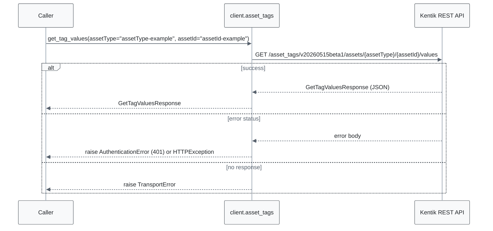

#### gRPC call flow

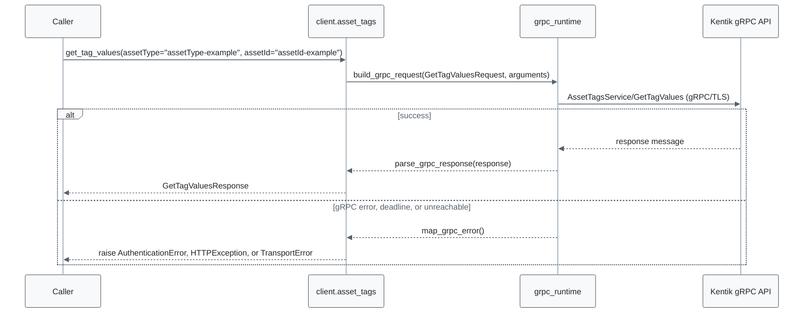

#### Parameters

| Name | In | Type | Required |
| --- | --- | --- | --- |
| `assetType` | path | `string` | Yes |
| `assetId` | path | `string` | Yes |

#### Responses

| Status | Description | Model |
| --- | --- | --- |
| 200 | A successful response. | `GetTagValuesResponse` |
| default | An unexpected error response. | `rpcStatus` |

#### Example

```python
from kentik_api.client import KentikAPI

# Both transports work: protocol="rest" (default) or protocol="grpc".
client = KentikAPI(protocol="rest")  # loads KENTIK_EMAIL/KENTIK_API_TOKEN from .env
response = client.asset_tags.get_tag_values(
    assetType="assetType-example",
    assetId="assetId-example",
)
```

---

### `GET` `/asset_tags/v20260515beta1/keys`

Lists all tag keys.

Returns a list of tag keys.

#### REST call flow

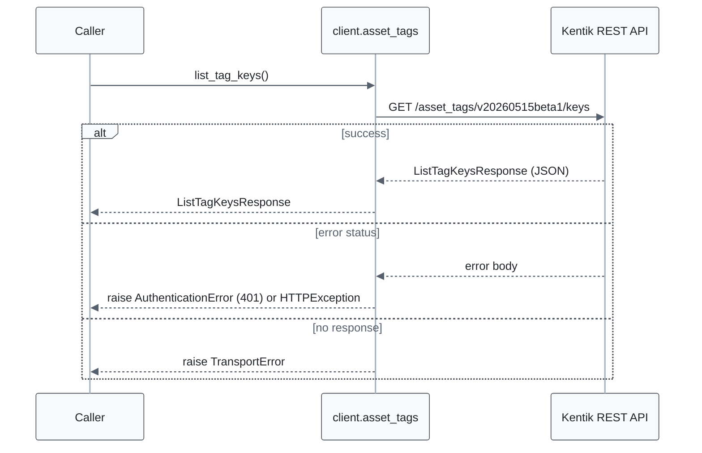

#### gRPC call flow

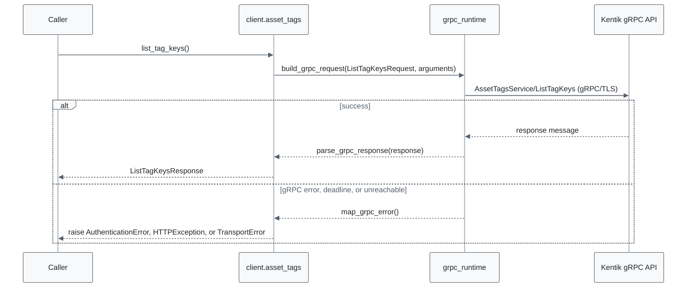

#### Responses

| Status | Description | Model |
| --- | --- | --- |
| 200 | A successful response. | `ListTagKeysResponse` |
| default | An unexpected error response. | `rpcStatus` |

#### Example

```python
from kentik_api.client import KentikAPI

# Both transports work: protocol="rest" (default) or protocol="grpc".
client = KentikAPI(protocol="rest")  # loads KENTIK_EMAIL/KENTIK_API_TOKEN from .env
response = client.asset_tags.list_tag_keys()
```

---

### `POST` `/asset_tags/v20260515beta1/keys`

Creates a new tag key.

Returns the created tag key.

#### REST call flow

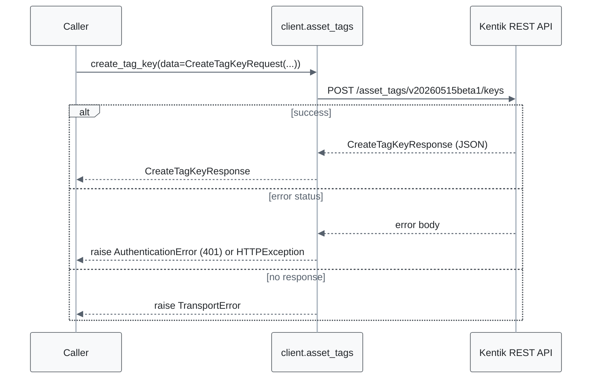

#### gRPC call flow

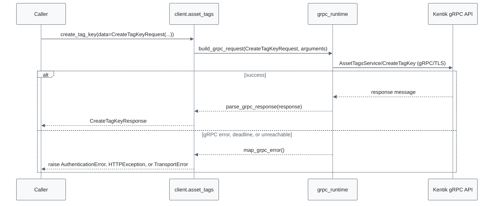

#### Parameters

| Name | In | Type | Required |
| --- | --- | --- | --- |
| `data` | body | `CreateTagKeyRequest` | Yes |

#### Responses

| Status | Description | Model |
| --- | --- | --- |
| 200 | A successful response. | `CreateTagKeyResponse` |
| default | An unexpected error response. | `rpcStatus` |

#### Example

```python
from kentik_api.client import KentikAPI
from kentik_api.gen.asset_tags.models import CreateTagKeyRequest

# Both transports work: protocol="rest" (default) or protocol="grpc".
client = KentikAPI(protocol="rest")  # loads KENTIK_EMAIL/KENTIK_API_TOKEN from .env
response = client.asset_tags.create_tag_key(
    data=CreateTagKeyRequest(...),
)
```

---

### `GET` `/asset_tags/v20260515beta1/keys/{id}`

Get a single tag key by id.

Returns a single tag key.

#### REST call flow

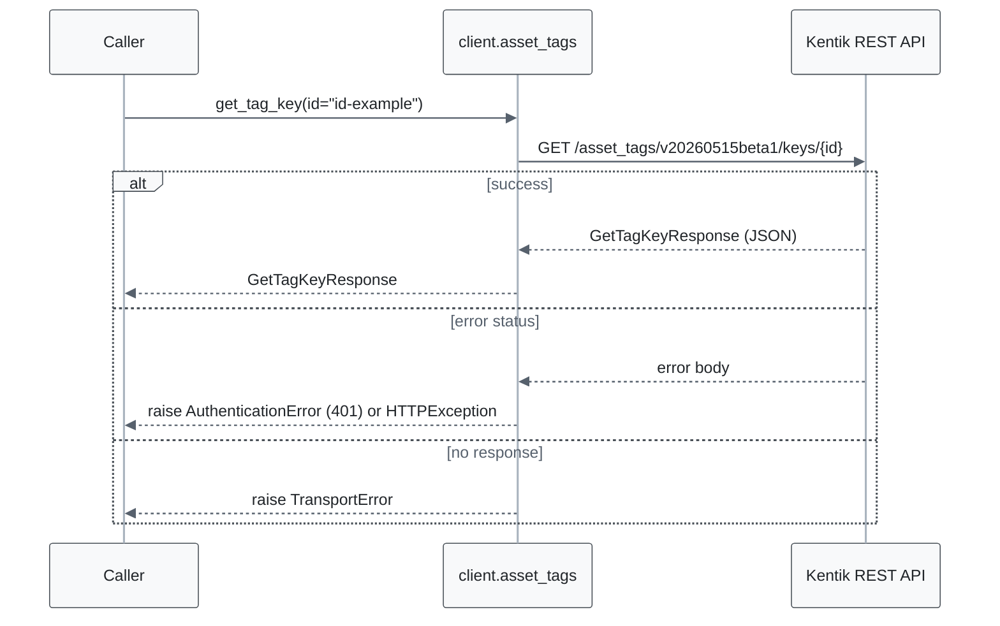

#### gRPC call flow

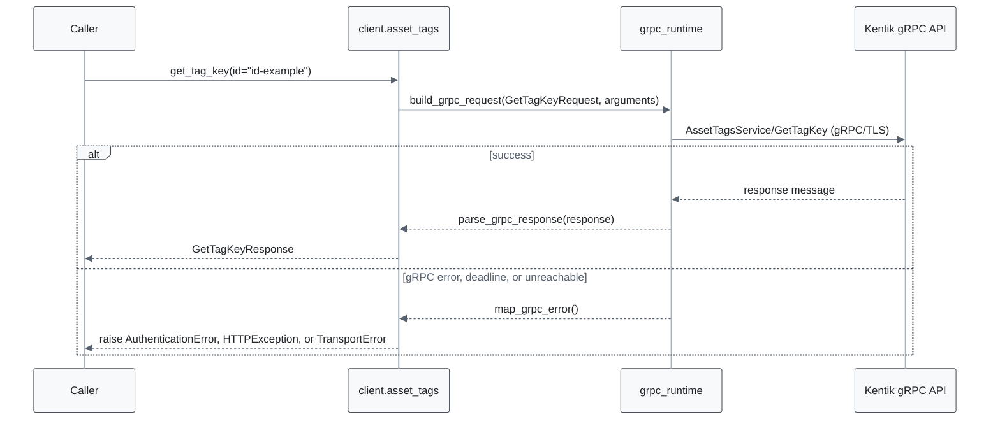

#### Parameters

| Name | In | Type | Required |
| --- | --- | --- | --- |
| `id` | path | `string` | Yes |

#### Responses

| Status | Description | Model |
| --- | --- | --- |
| 200 | A successful response. | `GetTagKeyResponse` |
| default | An unexpected error response. | `rpcStatus` |

#### Example

```python
from kentik_api.client import KentikAPI

# Both transports work: protocol="rest" (default) or protocol="grpc".
client = KentikAPI(protocol="rest")  # loads KENTIK_EMAIL/KENTIK_API_TOKEN from .env
response = client.asset_tags.get_tag_key(
    id="id-example",
)
```

---

### `PUT` `/asset_tags/v20260515beta1/keys/{id}`

Updates the display name of a tag key.

Returns the updated tag key.

#### REST call flow

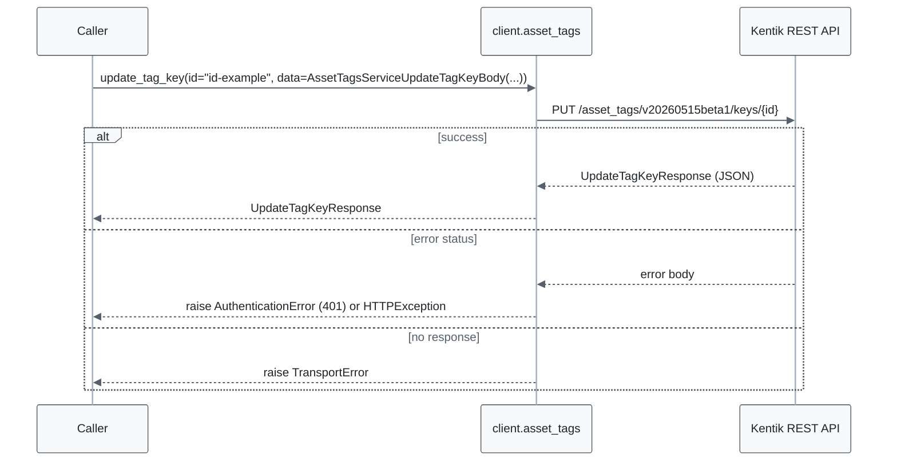

#### gRPC call flow

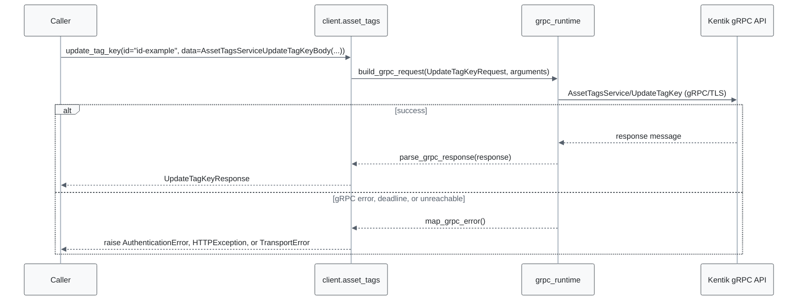

#### Parameters

| Name | In | Type | Required |
| --- | --- | --- | --- |
| `id` | path | `string` | Yes |
| `data` | body | `AssetTagsServiceUpdateTagKeyBody` | Yes |

#### Responses

| Status | Description | Model |
| --- | --- | --- |
| 200 | A successful response. | `UpdateTagKeyResponse` |
| default | An unexpected error response. | `rpcStatus` |

#### Example

```python
from kentik_api.client import KentikAPI
from kentik_api.gen.asset_tags.models import AssetTagsServiceUpdateTagKeyBody

# Both transports work: protocol="rest" (default) or protocol="grpc".
client = KentikAPI(protocol="rest")  # loads KENTIK_EMAIL/KENTIK_API_TOKEN from .env
response = client.asset_tags.update_tag_key(
    id="id-example",
    data=AssetTagsServiceUpdateTagKeyBody(...),
)
```

---

### `DELETE` `/asset_tags/v20260515beta1/keys/{id}`

Deletes a tag key by id.

Returns an empty response

#### REST call flow

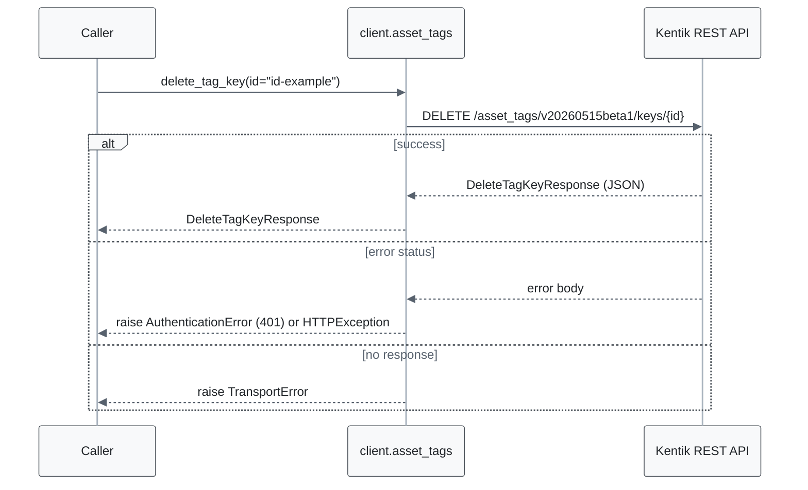

#### gRPC call flow

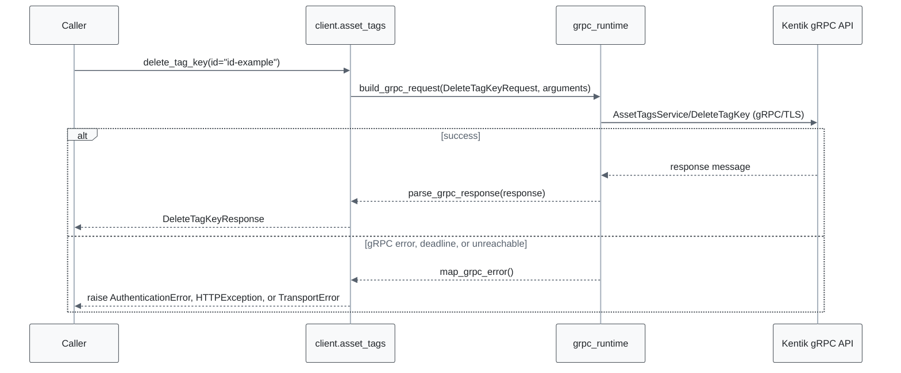

#### Parameters

| Name | In | Type | Required |
| --- | --- | --- | --- |
| `id` | path | `string` | Yes |

#### Responses

| Status | Description | Model |
| --- | --- | --- |
| 200 | A successful response. | `DeleteTagKeyResponse` |
| default | An unexpected error response. | `rpcStatus` |

#### Example

```python
from kentik_api.client import KentikAPI

# Both transports work: protocol="rest" (default) or protocol="grpc".
client = KentikAPI(protocol="rest")  # loads KENTIK_EMAIL/KENTIK_API_TOKEN from .env
response = client.asset_tags.delete_tag_key(
    id="id-example",
)
```

---

### `GET` `/asset_tags/v20260515beta1/keys/{tagId}/{assetType}/values`

Lists all tag values by id, optionally filtered by asset type.

Returns a list of tag values.

#### REST call flow

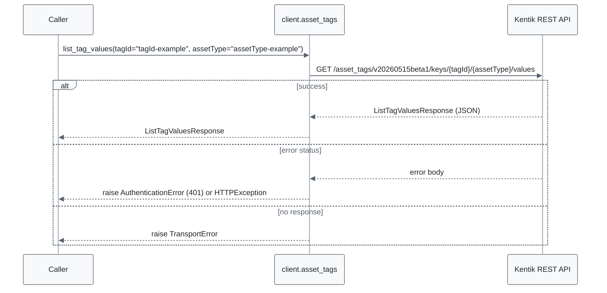

#### gRPC call flow

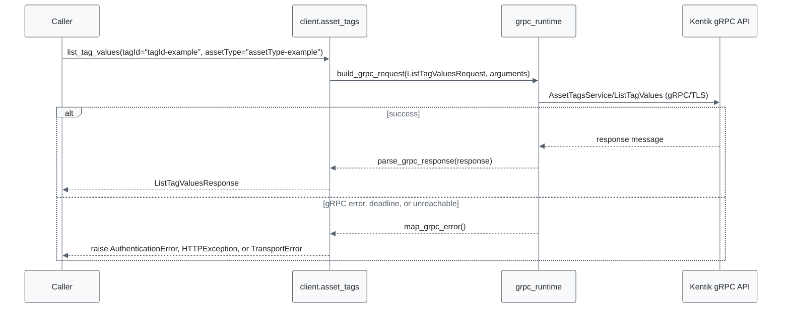

#### Parameters

| Name | In | Type | Required |
| --- | --- | --- | --- |
| `tagId` | path | `string` | Yes |
| `assetType` | path | `string` | Yes |

#### Responses

| Status | Description | Model |
| --- | --- | --- |
| 200 | A successful response. | `ListTagValuesResponse` |
| default | An unexpected error response. | `rpcStatus` |

#### Example

```python
from kentik_api.client import KentikAPI

# Both transports work: protocol="rest" (default) or protocol="grpc".
client = KentikAPI(protocol="rest")  # loads KENTIK_EMAIL/KENTIK_API_TOKEN from .env
response = client.asset_tags.list_tag_values(
    tagId="tagId-example",
    assetType="assetType-example",
)
```

---

### `PUT` `/asset_tags/v20260515beta1/values`

Bulk upserts a tag value for a list of asset ids of a given type.

Returns a list of tag values.

#### REST call flow


#### gRPC call flow


#### Parameters

| Name | In | Type | Required |
| --- | --- | --- | --- |
| `data` | body | `SetTagValuesRequest` | Yes |

#### Responses

| Status | Description | Model |
| --- | --- | --- |
| 200 | A successful response. | `SetTagValuesResponse` |
| default | An unexpected error response. | `rpcStatus` |

#### Example

```python
from kentik_api.client import KentikAPI
from kentik_api.gen.asset_tags.models import SetTagValuesRequest

# Both transports work: protocol="rest" (default) or protocol="grpc".
client = KentikAPI(protocol="rest")  # loads KENTIK_EMAIL/KENTIK_API_TOKEN from .env
response = client.asset_tags.set_tag_values(
    data=SetTagValuesRequest(...),
)
```

---

### `POST` `/asset_tags/v20260515beta1/values/delete`

Bulk deletes a tag values for a list of asset ids of a given type.

Returns an empty response.

#### REST call flow

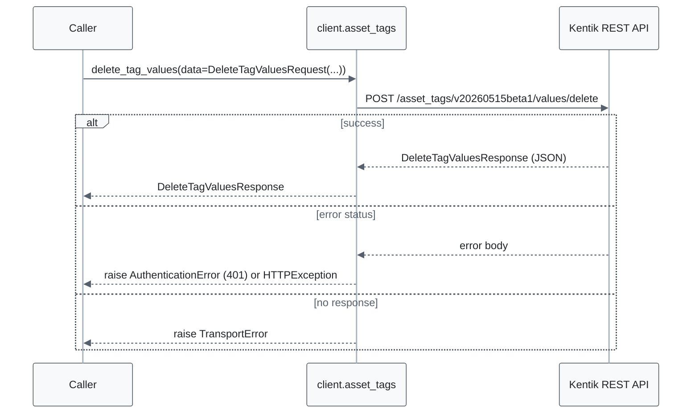

#### gRPC call flow

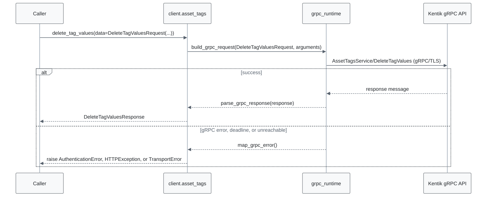

#### Parameters

| Name | In | Type | Required |
| --- | --- | --- | --- |
| `data` | body | `DeleteTagValuesRequest` | Yes |

#### Responses

| Status | Description | Model |
| --- | --- | --- |
| 200 | A successful response. | `DeleteTagValuesResponse` |
| default | An unexpected error response. | `rpcStatus` |

#### Example

```python
from kentik_api.client import KentikAPI
from kentik_api.gen.asset_tags.models import DeleteTagValuesRequest

# Both transports work: protocol="rest" (default) or protocol="grpc".
client = KentikAPI(protocol="rest")  # loads KENTIK_EMAIL/KENTIK_API_TOKEN from .env
response = client.asset_tags.delete_tag_values(
    data=DeleteTagValuesRequest(...),
)
```

## Data Models

<details>
<summary>Model relationships (18 of 18 models)</summary>

Each arrow points from a model to a model that one of its fields holds. The label names the field.

```mermaid
%%{init: {"theme": "base", "fontFamily": "ui-monospace, SFMono-Regular, Menlo, monospace", "themeVariables": {"fontFamily": "ui-monospace, SFMono-Regular, Menlo, monospace", "primaryColor": "#f8f9fa", "primaryBorderColor": "#495057", "primaryTextColor": "#212529", "textColor": "#212529", "lineColor": "#77818c", "edgeLabelBackground": "#ffffff", "actorBkg": "#f8f9fa", "actorBorder": "#495057", "actorTextColor": "#212529", "actorLineColor": "#a9b3be", "signalColor": "#57616d", "signalTextColor": "#212529", "labelBoxBkgColor": "#f8f9fa", "labelBoxBorderColor": "#495057", "labelTextColor": "#212529", "loopTextColor": "#57616d", "noteBkgColor": "#fff9db", "noteBorderColor": "#f08c00", "noteTextColor": "#a35a00"}, "flowchart": {"curve": "step", "nodeSpacing": 30, "rankSpacing": 70, "wrappingWidth": 400}}}%%
classDiagram
    class AssetTagsServiceUpdateTagKeyBody
    class AssetType
    class CreateTagKeyRequest
    class CreateTagKeyResponse
    class DeleteTagKeyResponse
    class DeleteTagValuesRequest
    class DeleteTagValuesResponse
    class GetTagKeyResponse
    class GetTagValuesResponse
    class ListTagKeysResponse
    class ListTagValuesResponse
    class SetTagValuesRequest
    class SetTagValuesResponse
    class TagKey
    class TagValue
    class UpdateTagKeyResponse
    class protobufAny
    class rpcStatus
    CreateTagKeyResponse --> TagKey : tagKey
    DeleteTagValuesRequest --> AssetType : assetType
    GetTagKeyResponse --> TagKey : tagKey
    GetTagValuesResponse --> TagValue : tagValues
    ListTagKeysResponse --> TagKey : tagKeys
    ListTagValuesResponse --> TagValue : tagValues
    SetTagValuesRequest --> AssetType : assetType
    SetTagValuesResponse --> TagValue : tagValues
    TagValue --> AssetType : assetType
    UpdateTagKeyResponse --> TagKey : tagKey
    rpcStatus --> protobufAny : details
```

</details>

```{eval-rst}
.. autopydantic_model:: kentik_api.gen.asset_tags.models.AssetTagsServiceUpdateTagKeyBody
```

```{eval-rst}
.. autoclass:: kentik_api.gen.asset_tags.models.AssetType
   :members:
```

```{eval-rst}
.. autopydantic_model:: kentik_api.gen.asset_tags.models.CreateTagKeyRequest
```

```{eval-rst}
.. autopydantic_model:: kentik_api.gen.asset_tags.models.CreateTagKeyResponse
```

```{eval-rst}
.. autopydantic_model:: kentik_api.gen.asset_tags.models.DeleteTagKeyResponse
```

```{eval-rst}
.. autopydantic_model:: kentik_api.gen.asset_tags.models.DeleteTagValuesRequest
```

```{eval-rst}
.. autopydantic_model:: kentik_api.gen.asset_tags.models.DeleteTagValuesResponse
```

```{eval-rst}
.. autopydantic_model:: kentik_api.gen.asset_tags.models.GetTagKeyResponse
```

```{eval-rst}
.. autopydantic_model:: kentik_api.gen.asset_tags.models.GetTagValuesResponse
```

```{eval-rst}
.. autopydantic_model:: kentik_api.gen.asset_tags.models.ListTagKeysResponse
```

```{eval-rst}
.. autopydantic_model:: kentik_api.gen.asset_tags.models.ListTagValuesResponse
```

```{eval-rst}
.. autopydantic_model:: kentik_api.gen.asset_tags.models.SetTagValuesRequest
```

```{eval-rst}
.. autopydantic_model:: kentik_api.gen.asset_tags.models.SetTagValuesResponse
```

```{eval-rst}
.. autopydantic_model:: kentik_api.gen.asset_tags.models.TagKey
```

```{eval-rst}
.. autopydantic_model:: kentik_api.gen.asset_tags.models.TagValue
```

```{eval-rst}
.. autopydantic_model:: kentik_api.gen.asset_tags.models.UpdateTagKeyResponse
```

```{eval-rst}
.. autopydantic_model:: kentik_api.gen.asset_tags.models.protobufAny
```

```{eval-rst}
.. autopydantic_model:: kentik_api.gen.asset_tags.models.rpcStatus
```
