<!-- AUTO-GENERATED: scripts/generation/endpoint_docs.py, render_endpoint_docs() -->
<!-- Rebuilt on every `uv run poe generate`. Do not edit by hand. -->

# Cloud Export Service

## Overview

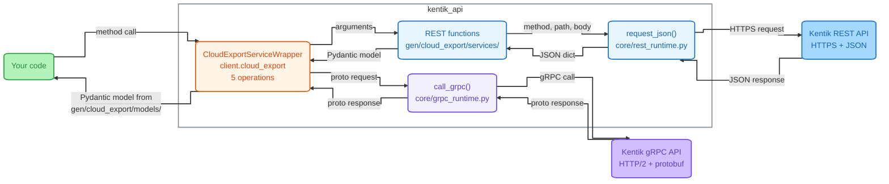

On an error status or a failed call, the SDK raises an error class from `gen/cloud_export/error/`, or a shared type from `kentik_api.errors`.

## Endpoints

### `GET` `/cloud_export/v202506/exports`

List cloud exports.

Returns a list of all cloud exports in the account.

#### REST call flow

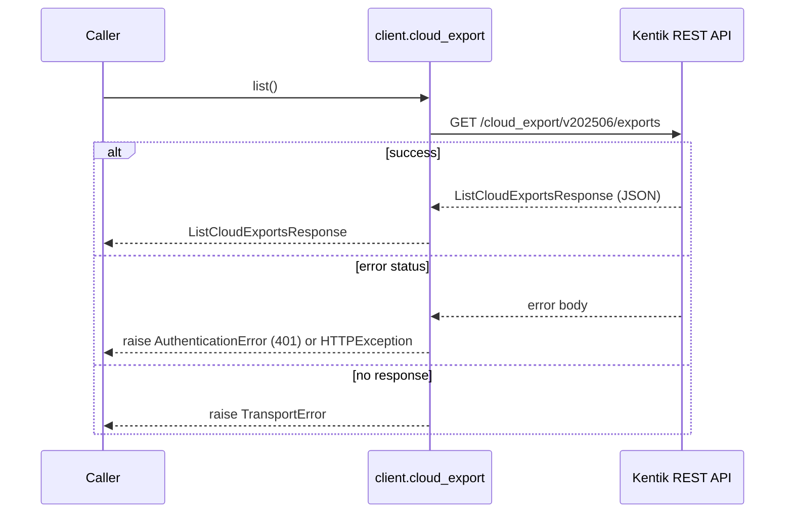

#### gRPC call flow

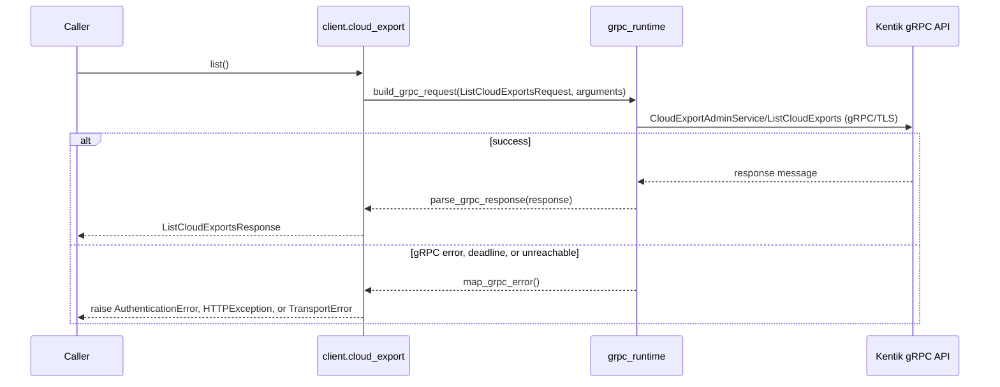

#### Responses

| Status | Description | Model |
| --- | --- | --- |
| 200 | A successful response. | `ListCloudExportsResponse` |
| default | An unexpected error response. | `rpcStatus` |

#### Example

```python
from kentik_api.client import KentikAPI

# Both transports work: protocol="rest" (default) or protocol="grpc".
client = KentikAPI(protocol="rest")  # loads KENTIK_EMAIL/KENTIK_API_TOKEN from .env
response = client.cloud_export.list()
```

---

### `POST` `/cloud_export/v202506/exports`

Create Cloud Export.

Create new cloud export based on configuration in the request.

#### REST call flow

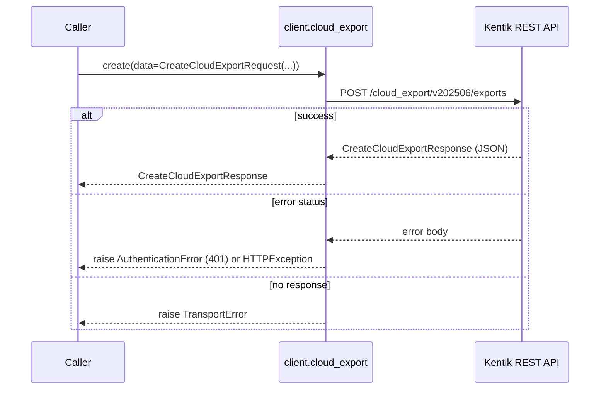

#### gRPC call flow

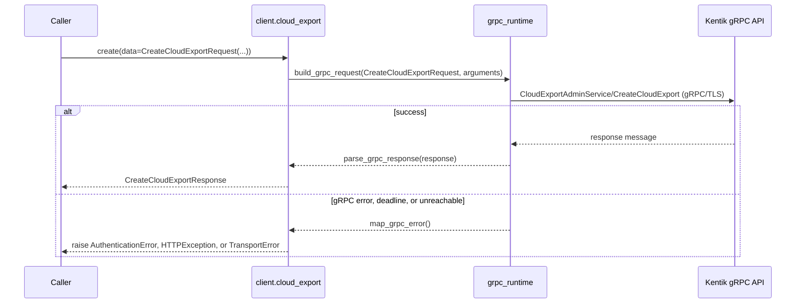

#### Parameters

| Name | In | Type | Required |
| --- | --- | --- | --- |
| `data` | body | `CreateCloudExportRequest` | Yes |

#### Responses

| Status | Description | Model |
| --- | --- | --- |
| 200 | A successful response. | `CreateCloudExportResponse` |
| default | An unexpected error response. | `rpcStatus` |

#### Example

```python
from kentik_api.client import KentikAPI
from kentik_api.gen.cloud_export.models import CreateCloudExportRequest

# Both transports work: protocol="rest" (default) or protocol="grpc".
client = KentikAPI(protocol="rest")  # loads KENTIK_EMAIL/KENTIK_API_TOKEN from .env
response = client.cloud_export.create(
    data=CreateCloudExportRequest(...),
)
```

---

### `GET` `/cloud_export/v202506/exports/{export.id}`

Get cloud export configuration and status.

Returns configuration and status of cloud export with specified ID.

#### REST call flow

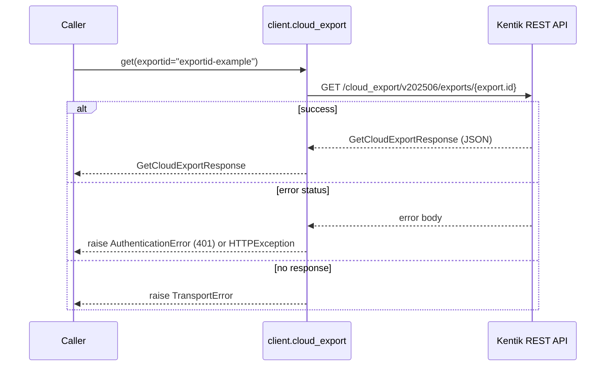

#### gRPC call flow

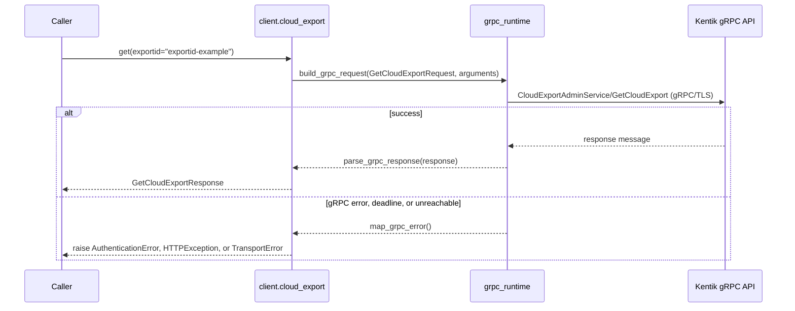

#### Parameters

| Name | In | Type | Required |
| --- | --- | --- | --- |
| `exportid` | path | `string` | Yes |

#### Responses

| Status | Description | Model |
| --- | --- | --- |
| 200 | A successful response. | `GetCloudExportResponse` |
| default | An unexpected error response. | `rpcStatus` |

#### Example

```python
from kentik_api.client import KentikAPI

# Both transports work: protocol="rest" (default) or protocol="grpc".
client = KentikAPI(protocol="rest")  # loads KENTIK_EMAIL/KENTIK_API_TOKEN from .env
response = client.cloud_export.get(
    exportid="exportid-example",
)
```

---

### `PUT` `/cloud_export/v202506/exports/{export.id}`

Update configuration of cloud export.

Replace complete configuration of a cloud export with data in the request.

#### REST call flow

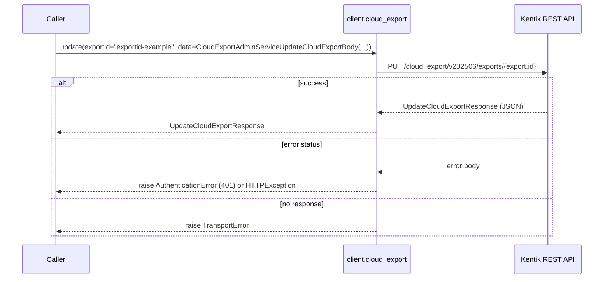

#### gRPC call flow

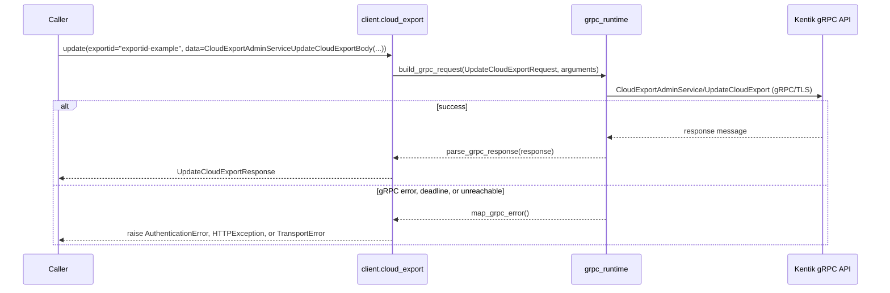

#### Parameters

| Name | In | Type | Required |
| --- | --- | --- | --- |
| `exportid` | path | `string` | Yes |
| `data` | body | `CloudExportAdminServiceUpdateCloudExportBody` | Yes |

#### Responses

| Status | Description | Model |
| --- | --- | --- |
| 200 | A successful response. | `UpdateCloudExportResponse` |
| default | An unexpected error response. | `rpcStatus` |

#### Example

```python
from kentik_api.client import KentikAPI
from kentik_api.gen.cloud_export.models import (
    CloudExportAdminServiceUpdateCloudExportBody,
)

# Both transports work: protocol="rest" (default) or protocol="grpc".
client = KentikAPI(protocol="rest")  # loads KENTIK_EMAIL/KENTIK_API_TOKEN from .env
response = client.cloud_export.update(
    exportid="exportid-example",
    data=CloudExportAdminServiceUpdateCloudExportBody(...),
)
```

---

### `DELETE` `/cloud_export/v202506/exports/{export.id}`

Delete a cloud export.

Delete cloud export with specified ID.

#### REST call flow

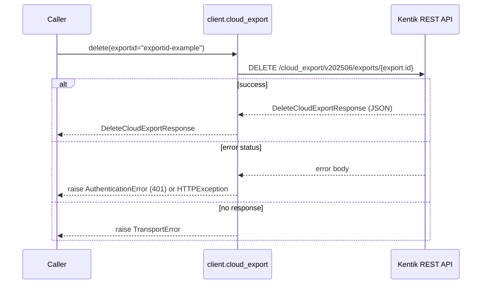

#### gRPC call flow


#### Parameters

| Name | In | Type | Required |
| --- | --- | --- | --- |
| `exportid` | path | `string` | Yes |

#### Responses

| Status | Description | Model |
| --- | --- | --- |
| 200 | A successful response. | `DeleteCloudExportResponse` |
| default | An unexpected error response. | `rpcStatus` |

#### Example

```python
from kentik_api.client import KentikAPI

# Both transports work: protocol="rest" (default) or protocol="grpc".
client = KentikAPI(protocol="rest")  # loads KENTIK_EMAIL/KENTIK_API_TOKEN from .env
response = client.cloud_export.delete(
    exportid="exportid-example",
)
```

## Data Models

<details>
<summary>Model relationships (10 of 19 models)</summary>

Each arrow points from a model to a model that one of its fields holds. The label names the field.

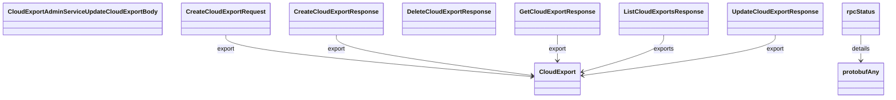

</details>

```{eval-rst}
.. autopydantic_model:: kentik_api.gen.cloud_export.models.AwsProperties
```

```{eval-rst}
.. autopydantic_model:: kentik_api.gen.cloud_export.models.AzureProperties
```

```{eval-rst}
.. autopydantic_model:: kentik_api.gen.cloud_export.models.CloudExport
```

```{eval-rst}
.. autopydantic_model:: kentik_api.gen.cloud_export.models.CloudExportAdminServiceUpdateCloudExportBody
```

```{eval-rst}
.. autopydantic_model:: kentik_api.gen.cloud_export.models.CloudExportSamplingProperties
```

```{eval-rst}
.. autoclass:: kentik_api.gen.cloud_export.models.CloudExportSamplingType
   :members:
```

```{eval-rst}
.. autopydantic_model:: kentik_api.gen.cloud_export.models.CloudExportStatus
```

```{eval-rst}
.. autoclass:: kentik_api.gen.cloud_export.models.CloudExportType
   :members:
```

```{eval-rst}
.. autoclass:: kentik_api.gen.cloud_export.models.CloudProvider
   :members:
```

```{eval-rst}
.. autopydantic_model:: kentik_api.gen.cloud_export.models.CreateCloudExportRequest
```

```{eval-rst}
.. autopydantic_model:: kentik_api.gen.cloud_export.models.CreateCloudExportResponse
```

```{eval-rst}
.. autopydantic_model:: kentik_api.gen.cloud_export.models.DeleteCloudExportResponse
```

```{eval-rst}
.. autopydantic_model:: kentik_api.gen.cloud_export.models.GceProperties
```

```{eval-rst}
.. autopydantic_model:: kentik_api.gen.cloud_export.models.GetCloudExportResponse
```

```{eval-rst}
.. autopydantic_model:: kentik_api.gen.cloud_export.models.ListCloudExportsResponse
```

```{eval-rst}
.. autopydantic_model:: kentik_api.gen.cloud_export.models.OciProperties
```

```{eval-rst}
.. autopydantic_model:: kentik_api.gen.cloud_export.models.UpdateCloudExportResponse
```

```{eval-rst}
.. autopydantic_model:: kentik_api.gen.cloud_export.models.protobufAny
```

```{eval-rst}
.. autopydantic_model:: kentik_api.gen.cloud_export.models.rpcStatus
```
