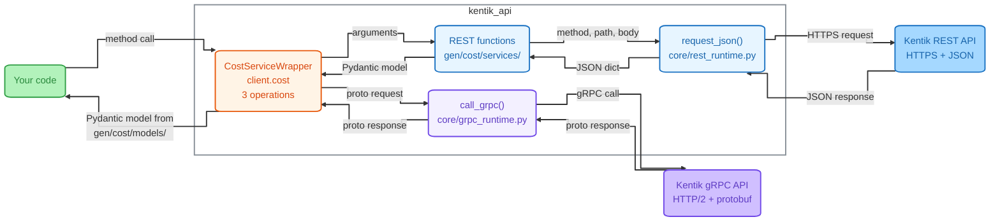
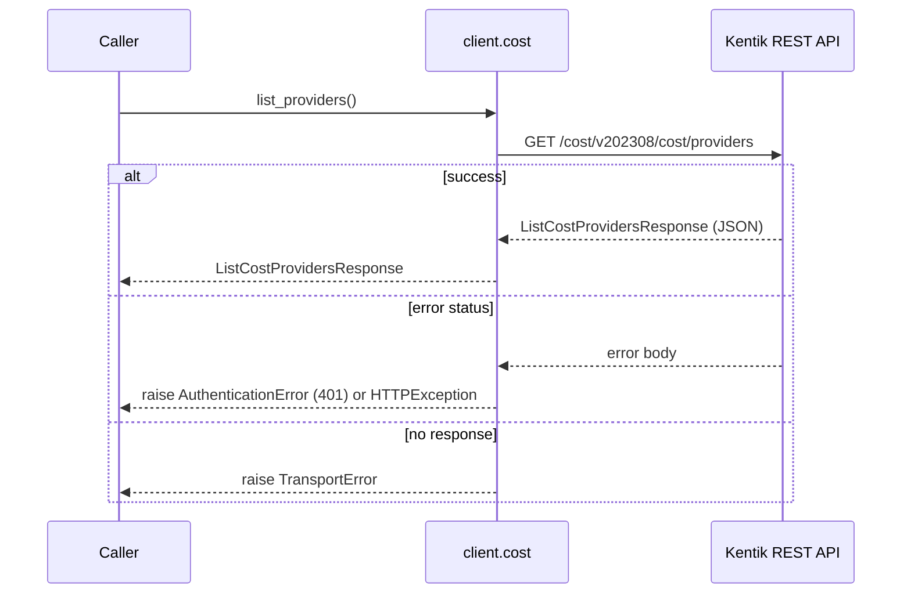
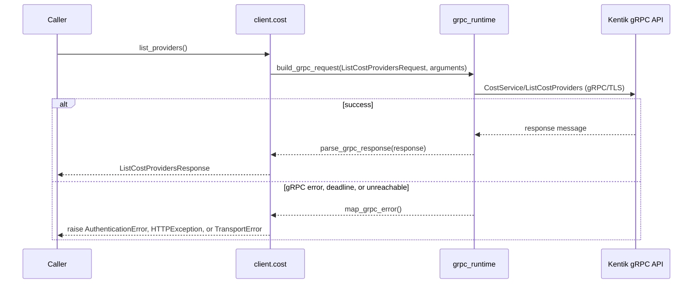
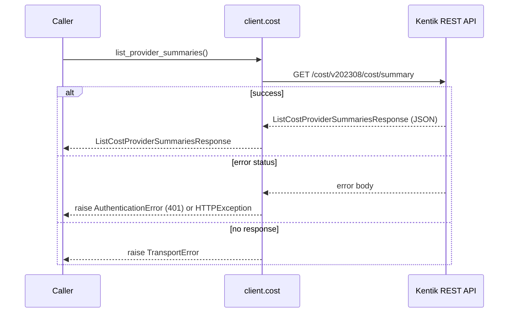
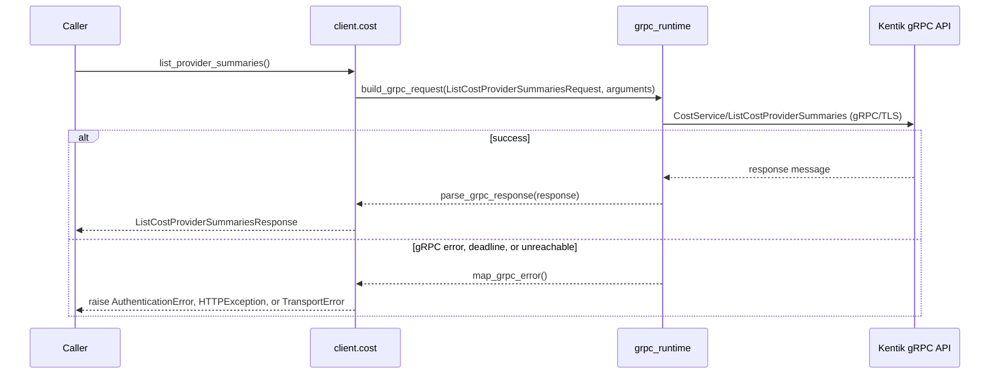
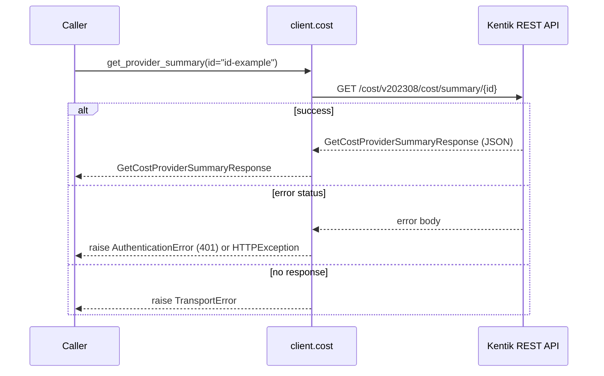
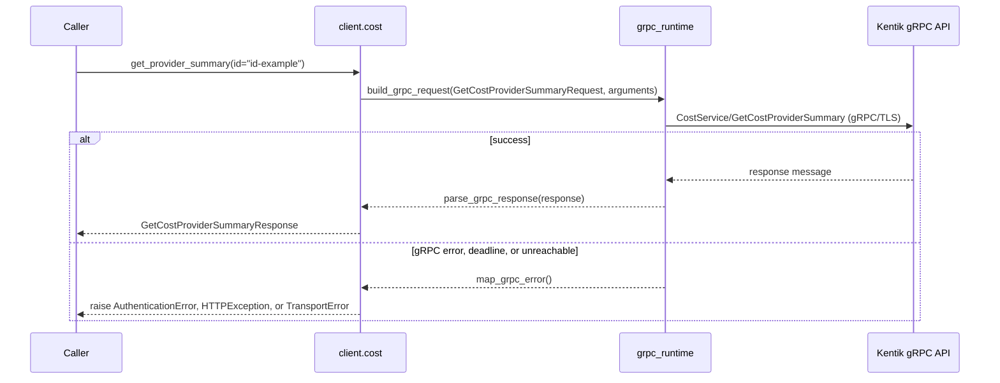
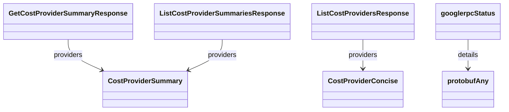

<!-- AUTO-GENERATED: scripts/generation/endpoint_docs.py, render_endpoint_docs() -->
<!-- Rebuilt on every `uv run poe generate`. Do not edit by hand. -->

# Cost Service

## Overview



On an error status or a failed call, the SDK raises an error class from `gen/cost/error/`, or a shared type from `kentik_api.errors`.

## Endpoints

### `GET` `/cost/v202308/cost/providers`

List all cost providers.

Returns list of configured cost providers.

#### REST call flow



#### gRPC call flow



#### Responses

| Status | Description | Model |
| --- | --- | --- |
| 200 | A successful response. | `ListCostProvidersResponse` |
| default | An unexpected error response. | `googlerpcStatus` |

#### Example

```python
from kentik_api.client import KentikAPI

# Both transports work: protocol="rest" (default) or protocol="grpc".
client = KentikAPI(protocol="rest")  # loads KENTIK_EMAIL/KENTIK_API_TOKEN from .env
response = client.cost.list_providers()
```

---

### `GET` `/cost/v202308/cost/summary`

List all cost provider summaries.

Returns list of summaries of configured cost providers.

#### REST call flow



#### gRPC call flow



#### Parameters

| Name | In | Type | Required |
| --- | --- | --- | --- |
| `date` | query | `string` | No |

#### Responses

| Status | Description | Model |
| --- | --- | --- |
| 200 | A successful response. | `ListCostProviderSummariesResponse` |
| default | An unexpected error response. | `googlerpcStatus` |

#### Example

```python
from kentik_api.client import KentikAPI

# Both transports work: protocol="rest" (default) or protocol="grpc".
client = KentikAPI(protocol="rest")  # loads KENTIK_EMAIL/KENTIK_API_TOKEN from .env
response = client.cost.list_provider_summaries()
```

---

### `GET` `/cost/v202308/cost/summary/{id}`

Get cost provider summary.

Returns summary of configured cost provider.

#### REST call flow



#### gRPC call flow



#### Parameters

| Name | In | Type | Required |
| --- | --- | --- | --- |
| `id` | path | `string` | Yes |
| `date` | query | `string` | No |

#### Responses

| Status | Description | Model |
| --- | --- | --- |
| 200 | A successful response. | `GetCostProviderSummaryResponse` |
| default | An unexpected error response. | `googlerpcStatus` |

#### Example

```python
from kentik_api.client import KentikAPI

# Both transports work: protocol="rest" (default) or protocol="grpc".
client = KentikAPI(protocol="rest")  # loads KENTIK_EMAIL/KENTIK_API_TOKEN from .env
response = client.cost.get_provider_summary(
    id="id-example",
)
```

## Data Models

<details>
<summary>Model relationships (7 of 8 models)</summary>

Each arrow points from a model to a model that one of its fields holds. The label names the field.



</details>

```{eval-rst}
.. autopydantic_model:: kentik_api.gen.cost.models.CostProviderConcise
```

```{eval-rst}
.. autopydantic_model:: kentik_api.gen.cost.models.CostProviderSummary
```

```{eval-rst}
.. autopydantic_model:: kentik_api.gen.cost.models.GetCostProviderSummaryResponse
```

```{eval-rst}
.. autopydantic_model:: kentik_api.gen.cost.models.ListCostProviderSummariesResponse
```

```{eval-rst}
.. autopydantic_model:: kentik_api.gen.cost.models.ListCostProvidersResponse
```

```{eval-rst}
.. autoclass:: kentik_api.gen.cost.models.Status
   :members:
```

```{eval-rst}
.. autopydantic_model:: kentik_api.gen.cost.models.googlerpcStatus
```

```{eval-rst}
.. autopydantic_model:: kentik_api.gen.cost.models.protobufAny
```
