<!-- AUTO-GENERATED: scripts/generation/endpoint_docs.py, render_endpoint_docs() -->
<!-- Rebuilt on every `uv run poe generate`. Do not edit by hand. -->

# Credential Service

## Overview

<!-- github-only -->

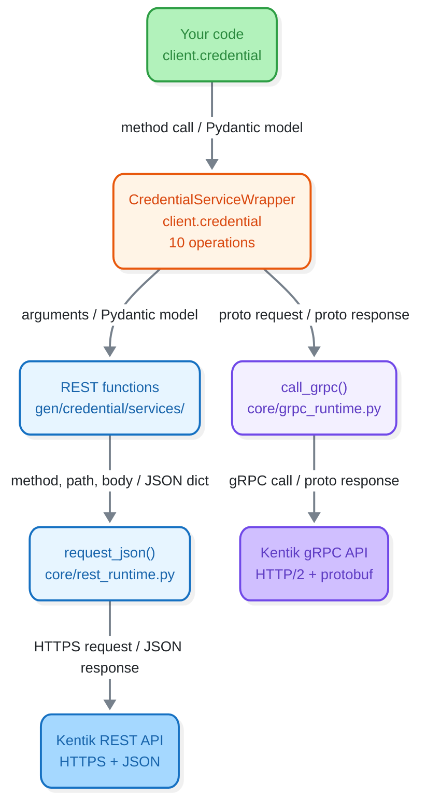

<!-- /github-only -->
<!-- sphinx-only
```{raw} html
<div class="kx">
<div class="chips" role="group" aria-label="Show one path" data-paths-for="overview-svg"></div>
<figure>
<div class="diagram explorer"><svg id="overview-svg" viewBox="0 0 1100 680" role="img" aria-label="Call path of client.credential: your code calls the wrapper, which sends the call over REST or gRPC." xmlns="http://www.w3.org/2000/svg"><defs><marker id="ov-ah" viewBox="0 0 10 10" refX="8.5" refY="5" markerWidth="7" markerHeight="7" orient="auto-start-reverse"><path d="M0,0 L10,5 L0,10 z" class="ah"/></marker><marker id="ov-ah-hi" viewBox="0 0 10 10" refX="8.5" refY="5" markerWidth="7" markerHeight="7" orient="auto-start-reverse"><path d="M0,0 L10,5 L0,10 z" class="ah-hi"/></marker></defs><g class="edge call" data-seg="code_call" data-links="code>wrap"><path d="M520,102 V170" data-route="M520,102 V170" class="wire arrow" marker-end="url(#ov-ah)"/><text x="512" y="140" class="elabel" text-anchor="end">method call</text></g><g class="edge data" data-seg="wrap_answer" data-links="wrap>code"><path d="M580,170 V102" data-route="M580,170 V102" class="wire arrow" marker-end="url(#ov-ah)"/><text x="588" y="140" class="elabel" text-anchor="start">Pydantic model</text></g><g class="edge call" data-seg="rest_call" data-links="wrap>rest"><path d="M450,196 L240,196 Q230,196 230,206 L230,310" data-route="M450,196 H230 V310" class="wire arrow" marker-end="url(#ov-ah)"/><text x="340" y="188" class="elabel" text-anchor="middle">arguments</text></g><g class="edge data" data-seg="rest_answer" data-links="rest>wrap"><path d="M290,310 L290,236 Q290,226 300,226 L450,226" data-route="M290,310 V226 H450" class="wire arrow" marker-end="url(#ov-ah)"/><text x="298" y="275" class="elabel" text-anchor="start">Pydantic model</text></g><g class="edge call" data-seg="rj_call" data-links="rest>rj"><path d="M230,382 V450" data-route="M230,382 V450" class="wire arrow" marker-end="url(#ov-ah)"/><text x="222" y="420" class="elabel" text-anchor="end">method, path, body</text></g><g class="edge data" data-seg="rj_answer" data-links="rj>rest"><path d="M290,450 V382" data-route="M290,450 V382" class="wire arrow" marker-end="url(#ov-ah)"/><text x="298" y="420" class="elabel" text-anchor="start">JSON dict</text></g><g class="edge call" data-seg="api_call" data-links="rj>restapi"><path d="M230,522 V590" data-route="M230,522 V590" class="wire arrow" marker-end="url(#ov-ah)"/><text x="222" y="560" class="elabel" text-anchor="end">HTTPS request</text></g><g class="edge data" data-seg="api_answer" data-links="restapi>rj"><path d="M290,590 V522" data-route="M290,590 V522" class="wire arrow" marker-end="url(#ov-ah)"/><text x="298" y="560" class="elabel" text-anchor="start">JSON response</text></g><g class="edge call" data-seg="cg_call" data-links="wrap>cg"><path d="M650,196 L860,196 Q870,196 870,206 L870,310" data-route="M650,196 H870 V310" class="wire arrow" marker-end="url(#ov-ah)"/><text x="760" y="188" class="elabel" text-anchor="middle">proto request</text></g><g class="edge data" data-seg="cg_answer" data-links="cg>wrap"><path d="M810,310 L810,236 Q810,226 800,226 L650,226" data-route="M810,310 V226 H650" class="wire arrow" marker-end="url(#ov-ah)"/><text x="802" y="275" class="elabel" text-anchor="end">proto response</text></g><g class="edge call" data-seg="grpc_call" data-links="cg>grpcapi"><path d="M810,382 V590" data-route="M810,382 V590" class="wire arrow" marker-end="url(#ov-ah)"/><text x="802" y="490" class="elabel" text-anchor="end">gRPC call</text></g><g class="edge data" data-seg="grpc_answer" data-links="grpcapi>cg"><path d="M870,590 V382" data-route="M870,590 V382" class="wire arrow" marker-end="url(#ov-ah)"/><text x="878" y="490" class="elabel" text-anchor="start">proto response</text></g><g class="node fam-green src " data-id="code" tabindex="0" role="button" aria-label="Select Your code"><rect x="450" y="30" width="200" height="72" rx="14"/><text x="550.0" y="62.5" class="nm">Your code</text><text x="550.0" y="79.5" class="ft">client.credential</text></g><g class="node fam-orange proc " data-id="wrap" tabindex="0" role="button" aria-label="Select CredentialServiceWrapper"><rect x="450" y="170" width="200" height="72" rx="14"/><text x="550.0" y="194.0" class="nm">CredentialServiceWrapper</text><text x="550.0" y="211.0" class="ft">client.credential</text><text x="550.0" y="228.0" class="ft">10 operations</text></g><g class="node fam-blue proc " data-id="rest" tabindex="0" role="button" aria-label="Select REST functions"><rect x="160" y="310" width="200" height="72" rx="14"/><text x="260.0" y="342.5" class="nm">REST functions</text><text x="260.0" y="359.5" class="ft">gen/credential/services/</text></g><g class="node fam-blue proc " data-id="rj" tabindex="0" role="button" aria-label="Select request_json()"><rect x="160" y="450" width="200" height="72" rx="14"/><text x="260.0" y="482.5" class="nm">request_json()</text><text x="260.0" y="499.5" class="ft">core/rest_runtime.py</text></g><g class="node fam-blue src " data-id="restapi" tabindex="0" role="button" aria-label="Select Kentik REST API"><rect x="160" y="590" width="200" height="72" rx="14"/><text x="260.0" y="622.5" class="nm">Kentik REST API</text><text x="260.0" y="639.5" class="ft">HTTPS + JSON</text></g><g class="node fam-violet proc " data-id="cg" tabindex="0" role="button" aria-label="Select call_grpc()"><rect x="740" y="310" width="200" height="72" rx="14"/><text x="840.0" y="342.5" class="nm">call_grpc()</text><text x="840.0" y="359.5" class="ft">core/grpc_runtime.py</text></g><g class="node fam-violet src " data-id="grpcapi" tabindex="0" role="button" aria-label="Select Kentik gRPC API"><rect x="740" y="590" width="200" height="72" rx="14"/><text x="840.0" y="622.5" class="nm">Kentik gRPC API</text><text x="840.0" y="639.5" class="ft">HTTP/2 + protobuf</text></g></svg></div>
<figcaption>Select a part. Each hop is a call going down and its answer coming back up.</figcaption>
</figure>
<div class="legend" aria-hidden="true"><span><svg viewBox="0 0 34 10"><line x1="2" y1="5" x2="32" y2="5" stroke="var(--wire-hi)" stroke-linecap="round" stroke-width="3"/></svg>what the selected part needs</span><span><svg viewBox="0 0 34 10"><line x1="2" y1="5" x2="32" y2="5" stroke="var(--wire-hi)" stroke-linecap="round" stroke-width="3" stroke-dasharray="9 7"/></svg>where its data goes</span></div>
<div class="detail" data-detail-for="overview-svg" aria-live="polite"></div>
<script type="application/json" id="diagram-data">{"overview-svg": {"select": "wrap", "parts": {"code": {"title": "Your code", "role": "Calls a method on the service wrapper.", "facts": ["client.credential.<method>(...)"], "stops": "Nothing in the SDK runs."}, "wrap": {"title": "CredentialServiceWrapper", "role": "Sends each call to the REST function or to call_grpc(), for the transport that the client uses.", "facts": ["Source: gen/credential/services/credential.py", "Returns models from gen/credential/models/"], "stops": "Expected: no operation of this service can be called."}, "rest": {"title": "REST functions", "role": "One function per operation. Each one calls request_json() with its own error class.", "facts": ["Error classes: gen/credential/error/"], "stops": "Expected: calls on a REST transport fail. A gRPC client keeps working."}, "rj": {"title": "request_json()", "role": "The one function that sends REST traffic: auth headers, quota, and errors.", "facts": ["Raises AuthenticationError on 401", "Raises the operation's error class on other errors"], "stops": "Expected: every REST call of every service fails."}, "restapi": {"title": "Kentik REST API", "role": "The REST endpoints of the service.", "facts": ["Reports the quota in response headers"], "stops": "Expected: REST calls raise TransportError. A gRPC client keeps working."}, "cg": {"title": "call_grpc()", "role": "The one function that sends gRPC traffic: deadline, quota, and errors.", "facts": ["Parses each answer into the same models as REST"], "stops": "Expected: every gRPC call fails. A REST client keeps working."}, "grpcapi": {"title": "Kentik gRPC API", "role": "The gRPC methods of the service.", "facts": ["Reports the quota in response metadata"], "stops": "Expected: gRPC calls raise TransportError. A REST client keeps working."}}, "paths": {"rest": {"label": "REST call", "family": "blue", "title": "A call on a REST transport", "text": "The wrapper calls the REST function, which sends the request with request_json().", "links": ["code>wrap", "wrap>rest", "rest>rj", "rj>restapi", "restapi>rj", "rj>rest", "rest>wrap", "wrap>code"]}, "grpc": {"label": "gRPC call", "family": "violet", "title": "A call on a gRPC transport", "text": "The wrapper builds the proto request and sends it with call_grpc().", "links": ["code>wrap", "wrap>cg", "cg>grpcapi", "grpcapi>cg", "cg>wrap", "wrap>code"]}}}}</script>
</div>
```
-->

On an error status or a failed call, the SDK raises an error class from `gen/credential/error/`, or a shared type from `kentik_api.errors`.

## Endpoints

### `GET` `/credential/v20261020alpha1/credentials`

List credentials.

Returns the latest version of every credential.

#### REST call flow

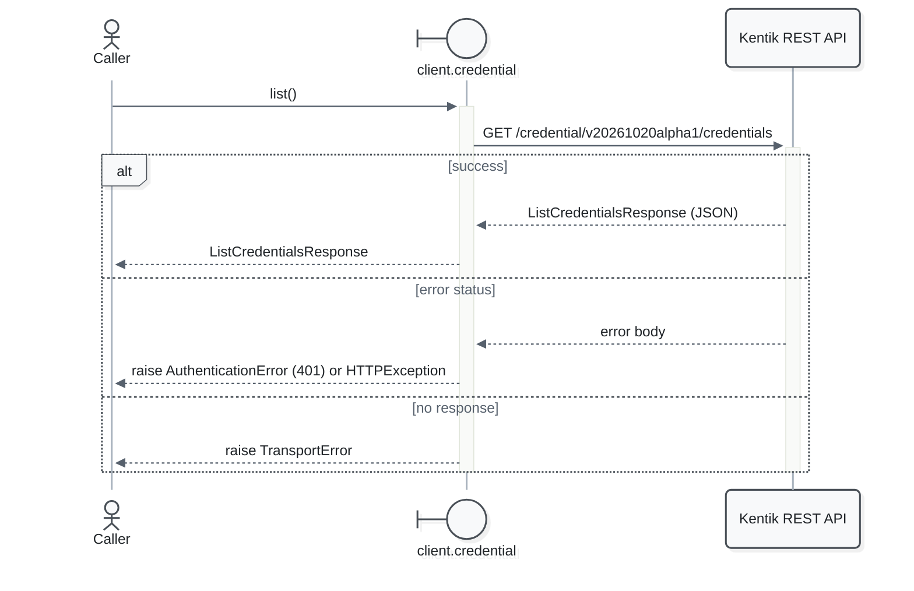

#### gRPC call flow

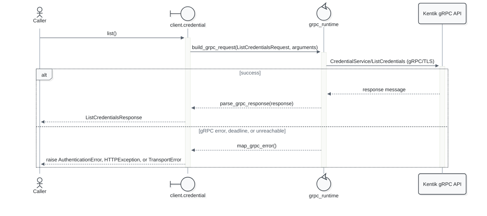

#### Responses

| Status | Description | Model |
| --- | --- | --- |
| 200 | A successful response. | `ListCredentialsResponse` |
| default | An unexpected error response. | `rpcStatus` |

#### Example

```python
from kentik_api.client import KentikAPI

# Both transports work: protocol="rest" (default) or protocol="grpc".
client = KentikAPI(protocol="rest")  # loads KENTIK_EMAIL/KENTIK_API_TOKEN from .env
response = client.credential.list()
```

---

### `GET` `/credential/v20261020alpha1/credentials/{name}`

Get a credential by name.

Returns the latest, a specific, or every version of a credential.

#### REST call flow

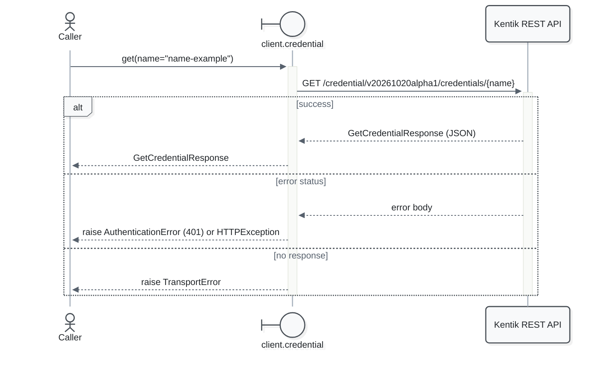

#### gRPC call flow

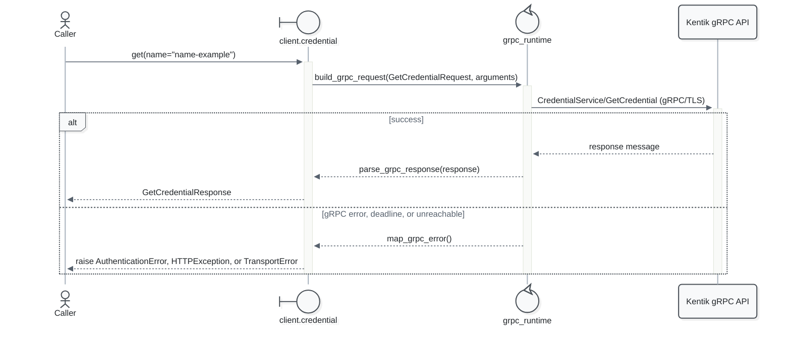

#### Parameters

| Name | In | Type | Required |
| --- | --- | --- | --- |
| `name` | path | `string` | Yes |
| `version` | query | `integer (int64)` | No |
| `allVersions` | query | `boolean` | No |

#### Responses

| Status | Description | Model |
| --- | --- | --- |
| 200 | A successful response. | `GetCredentialResponse` |
| default | An unexpected error response. | `rpcStatus` |

#### Example

```python
from kentik_api.client import KentikAPI

# Both transports work: protocol="rest" (default) or protocol="grpc".
client = KentikAPI(protocol="rest")  # loads KENTIK_EMAIL/KENTIK_API_TOKEN from .env
response = client.credential.get(
    name="name-example",
)
```

---

### `DELETE` `/credential/v20261020alpha1/credentials/{name}`

Delete a credential version.

Deletes a single version of a credential. Version Requires. Fails if the credential has consumers.

#### REST call flow

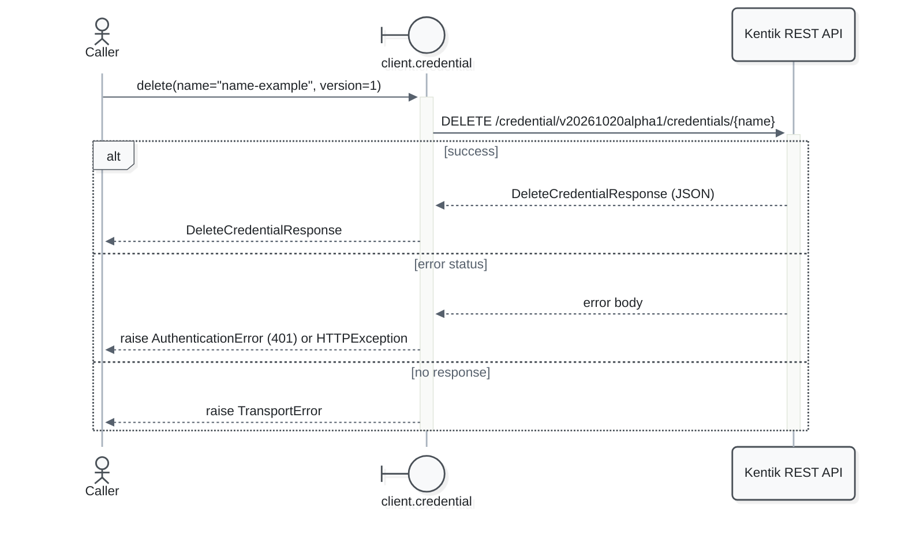

#### gRPC call flow

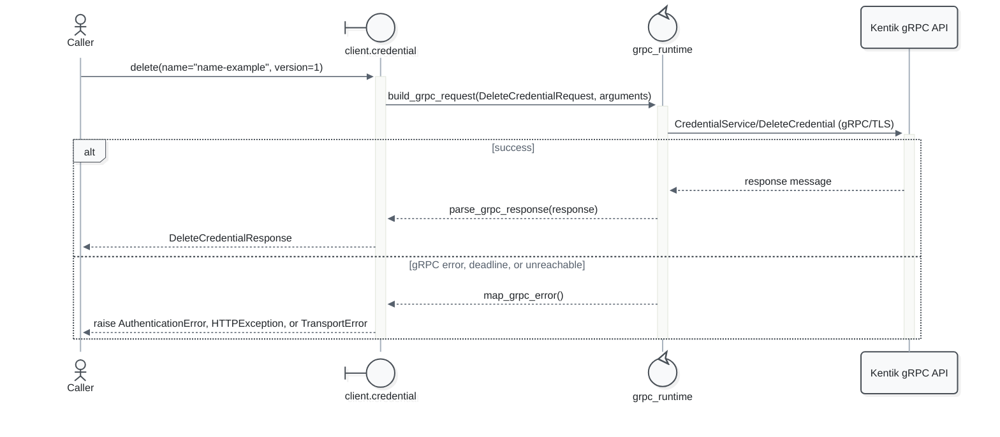

#### Parameters

| Name | In | Type | Required |
| --- | --- | --- | --- |
| `name` | path | `string` | Yes |
| `version` | query | `integer (int64)` | Yes |

#### Responses

| Status | Description | Model |
| --- | --- | --- |
| 200 | A successful response. | `DeleteCredentialResponse` |
| default | An unexpected error response. | `rpcStatus` |

#### Example

```python
from kentik_api.client import KentikAPI

# Both transports work: protocol="rest" (default) or protocol="grpc".
client = KentikAPI(protocol="rest")  # loads KENTIK_EMAIL/KENTIK_API_TOKEN from .env
response = client.credential.delete(
    name="name-example",
    version=1,
)
```

---

### `PUT` `/credential/v20261020alpha1/credentials/{name}/consumer`

Assign a consumer to a credential.

Records that an entity (synthetic test, device, etc.) uses the credential.

#### REST call flow

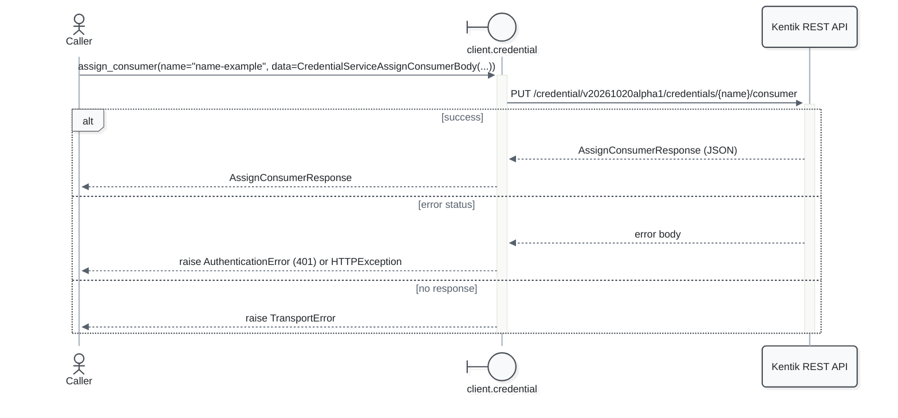

#### gRPC call flow

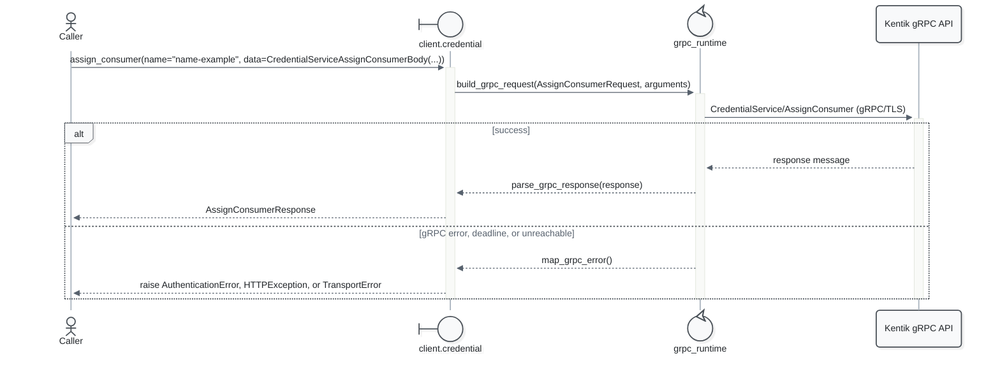

#### Parameters

| Name | In | Type | Required |
| --- | --- | --- | --- |
| `name` | path | `string` | Yes |
| `data` | body | `CredentialServiceAssignConsumerBody` | Yes |

#### Responses

| Status | Description | Model |
| --- | --- | --- |
| 200 | A successful response. | `AssignConsumerResponse` |
| default | An unexpected error response. | `rpcStatus` |

#### Example

```python
from kentik_api.client import KentikAPI
from kentik_api.gen.credential.models import CredentialServiceAssignConsumerBody

# Both transports work: protocol="rest" (default) or protocol="grpc".
client = KentikAPI(protocol="rest")  # loads KENTIK_EMAIL/KENTIK_API_TOKEN from .env
response = client.credential.assign_consumer(
    name="name-example",
    data=CredentialServiceAssignConsumerBody(...),
)
```

---

### `GET` `/credential/v20261020alpha1/groups`

List credential groups.

Returns every credential group with the latest version of its credentials.

#### REST call flow

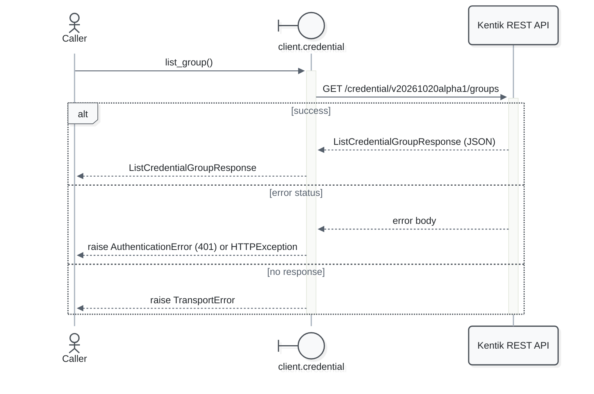

#### gRPC call flow

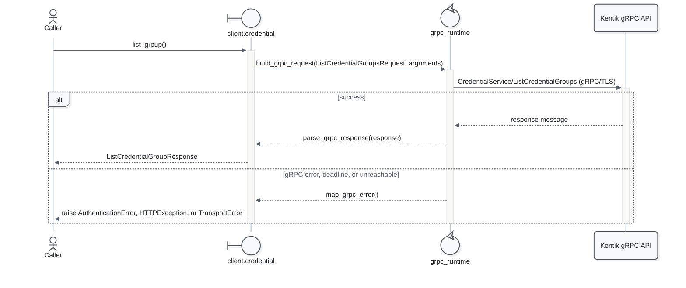

#### Responses

| Status | Description | Model |
| --- | --- | --- |
| 200 | A successful response. | `ListCredentialGroupResponse` |
| default | An unexpected error response. | `rpcStatus` |

#### Example

```python
from kentik_api.client import KentikAPI

# Both transports work: protocol="rest" (default) or protocol="grpc".
client = KentikAPI(protocol="rest")  # loads KENTIK_EMAIL/KENTIK_API_TOKEN from .env
response = client.credential.list_group()
```

---

### `POST` `/credential/v20261020alpha1/groups`

Create a credential group.

Creates one credential per token and returns the created group.

#### REST call flow

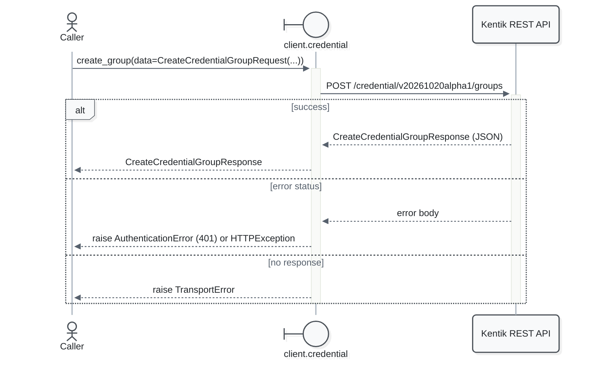

#### gRPC call flow

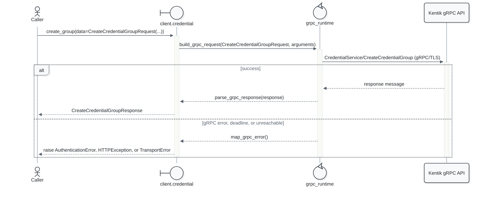

#### Parameters

| Name | In | Type | Required |
| --- | --- | --- | --- |
| `data` | body | `CreateCredentialGroupRequest` | Yes |

#### Responses

| Status | Description | Model |
| --- | --- | --- |
| 200 | A successful response. | `CreateCredentialGroupResponse` |
| default | An unexpected error response. | `rpcStatus` |

#### Example

```python
from kentik_api.client import KentikAPI
from kentik_api.gen.credential.models import CreateCredentialGroupRequest

# Both transports work: protocol="rest" (default) or protocol="grpc".
client = KentikAPI(protocol="rest")  # loads KENTIK_EMAIL/KENTIK_API_TOKEN from .env
response = client.credential.create_group(
    data=CreateCredentialGroupRequest(...),
)
```

---

### `GET` `/credential/v20261020alpha1/groups/{name}`

Get a credential group by name.

Returns a single credential group.

#### REST call flow

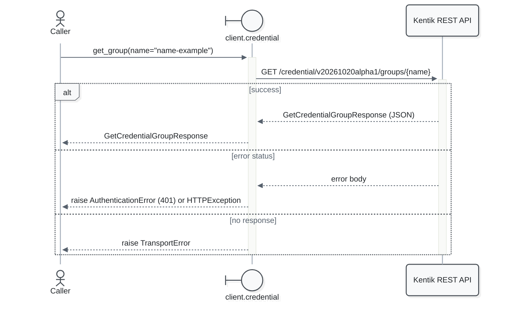

#### gRPC call flow

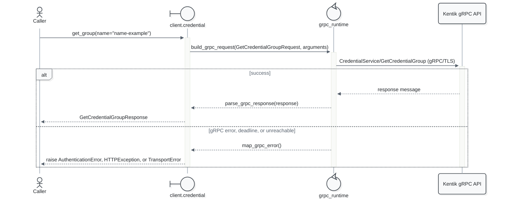

#### Parameters

| Name | In | Type | Required |
| --- | --- | --- | --- |
| `name` | path | `string` | Yes |

#### Responses

| Status | Description | Model |
| --- | --- | --- |
| 200 | A successful response. | `GetCredentialGroupResponse` |
| default | An unexpected error response. | `rpcStatus` |

#### Example

```python
from kentik_api.client import KentikAPI

# Both transports work: protocol="rest" (default) or protocol="grpc".
client = KentikAPI(protocol="rest")  # loads KENTIK_EMAIL/KENTIK_API_TOKEN from .env
response = client.credential.get_group(
    name="name-example",
)
```

---

### `PUT` `/credential/v20261020alpha1/groups/{name}`

Update a credential group.

Tokens with a value create a new credential version; tokens without one only update metadata.

#### REST call flow

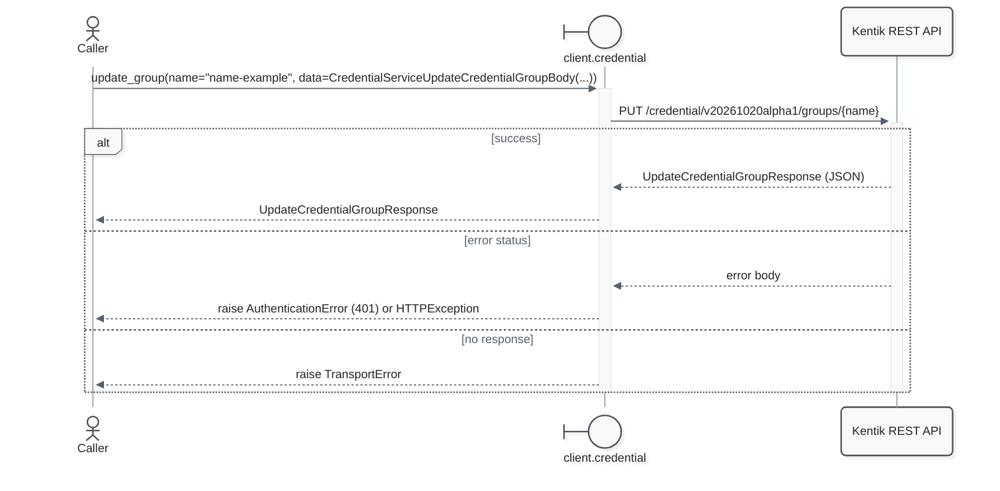

#### gRPC call flow

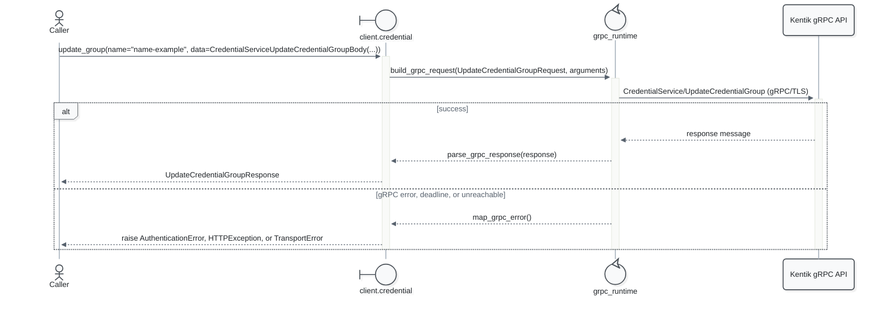

#### Parameters

| Name | In | Type | Required |
| --- | --- | --- | --- |
| `name` | path | `string` | Yes |
| `data` | body | `CredentialServiceUpdateCredentialGroupBody` | Yes |

#### Responses

| Status | Description | Model |
| --- | --- | --- |
| 200 | A successful response. | `UpdateCredentialGroupResponse` |
| default | An unexpected error response. | `rpcStatus` |

#### Example

```python
from kentik_api.client import KentikAPI
from kentik_api.gen.credential.models import CredentialServiceUpdateCredentialGroupBody

# Both transports work: protocol="rest" (default) or protocol="grpc".
client = KentikAPI(protocol="rest")  # loads KENTIK_EMAIL/KENTIK_API_TOKEN from .env
response = client.credential.update_group(
    name="name-example",
    data=CredentialServiceUpdateCredentialGroupBody(...),
)
```

---

### `DELETE` `/credential/v20261020alpha1/groups/{name}`

Delete a credential group.

Deletes every version of every credential in the group. Fails if any credential has consumers.

#### REST call flow

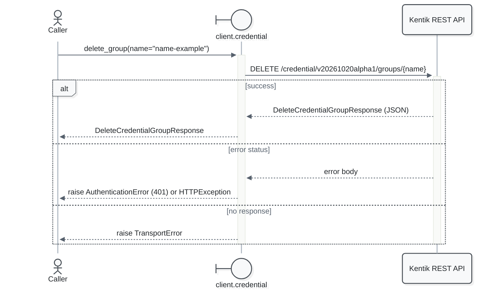

#### gRPC call flow

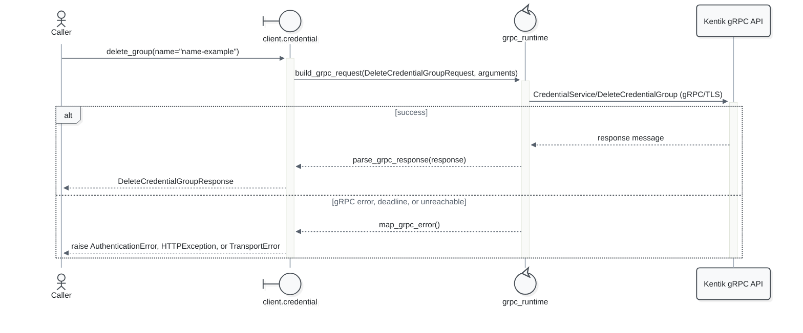

#### Parameters

| Name | In | Type | Required |
| --- | --- | --- | --- |
| `name` | path | `string` | Yes |

#### Responses

| Status | Description | Model |
| --- | --- | --- |
| 200 | A successful response. | `DeleteCredentialGroupResponse` |
| default | An unexpected error response. | `rpcStatus` |

#### Example

```python
from kentik_api.client import KentikAPI

# Both transports work: protocol="rest" (default) or protocol="grpc".
client = KentikAPI(protocol="rest")  # loads KENTIK_EMAIL/KENTIK_API_TOKEN from .env
response = client.credential.delete_group(
    name="name-example",
)
```

---

### `GET` `/credential/v20261020alpha1/overviews`

List credential group names and types.

Returns a lightweight name and type listing of every credential group, for lookups.

#### REST call flow

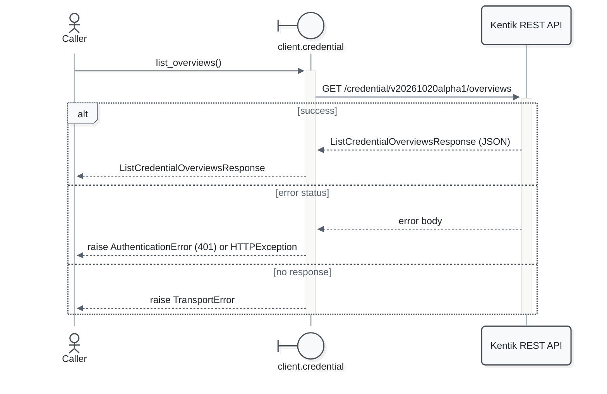

#### gRPC call flow

```mermaid
%%{init: {"theme": "redux", "look": "neo", "layout": "elk", "fontFamily": "ui-monospace, SFMono-Regular, Menlo, monospace", "themeVariables": {"fontFamily": "ui-monospace, SFMono-Regular, Menlo, monospace", "primaryColor": "#f8f9fa", "primaryBorderColor": "#495057", "primaryTextColor": "#212529", "textColor": "#212529", "lineColor": "#77818c", "edgeLabelBackground": "#ffffff", "actorBkg": "#f8f9fa", "actorBorder": "#495057", "actorTextColor": "#212529", "actorLineColor": "#a9b3be", "signalColor": "#57616d", "signalTextColor": "#212529", "labelBoxBkgColor": "#f8f9fa", "labelBoxBorderColor": "#495057", "labelTextColor": "#212529", "loopTextColor": "#57616d", "noteBkgColor": "#fff9db", "noteBorderColor": "#f08c00", "noteTextColor": "#a35a00"}, "sequence": {"activationWidth": 16}, "flowchart": {"curve": "basis", "nodeSpacing": 30, "rankSpacing": 70, "wrappingWidth": 400}}}%%
sequenceDiagram
    actor C as Caller
    participant W@{ "type": "boundary" } as client.credential
    participant R@{ "type": "control" } as grpc_runtime
    participant API as Kentik gRPC API

    C->>+W: list_overviews()
    W->>+R: build_grpc_request(ListCredentialOverviewsRequest, arguments)
    R->>+API: CredentialService/ListCredentialOverviews (gRPC/TLS)
    alt success
        API-->>R: response message
        R-->>W: parse_grpc_response(response)
        W-->>C: ListCredentialOverviewsResponse
    else gRPC error, deadline, or unreachable
        R-->>W: map_grpc_error()
        W-->>C: raise AuthenticationError, HTTPException, or TransportError
    end
    deactivate API
    deactivate R
    deactivate W
```

#### Responses

| Status | Description | Model |
| --- | --- | --- |
| 200 | A successful response. | `ListCredentialOverviewsResponse` |
| default | An unexpected error response. | `rpcStatus` |

#### Example

```python
from kentik_api.client import KentikAPI

# Both transports work: protocol="rest" (default) or protocol="grpc".
client = KentikAPI(protocol="rest")  # loads KENTIK_EMAIL/KENTIK_API_TOKEN from .env
response = client.credential.list_overviews()
```

## Data Models

<details>
<summary>Model relationships (21 of 22 models)</summary>

Each arrow points from a model to a model that one of its fields holds. The label names the field.

```mermaid
%%{init: {"theme": "redux", "look": "neo", "layout": "elk", "fontFamily": "ui-monospace, SFMono-Regular, Menlo, monospace", "themeVariables": {"fontFamily": "ui-monospace, SFMono-Regular, Menlo, monospace", "primaryColor": "#f8f9fa", "primaryBorderColor": "#495057", "primaryTextColor": "#212529", "textColor": "#212529", "lineColor": "#77818c", "edgeLabelBackground": "#ffffff", "actorBkg": "#f8f9fa", "actorBorder": "#495057", "actorTextColor": "#212529", "actorLineColor": "#a9b3be", "signalColor": "#57616d", "signalTextColor": "#212529", "labelBoxBkgColor": "#f8f9fa", "labelBoxBorderColor": "#495057", "labelTextColor": "#212529", "loopTextColor": "#57616d", "noteBkgColor": "#fff9db", "noteBorderColor": "#f08c00", "noteTextColor": "#a35a00"}, "sequence": {"activationWidth": 16}, "flowchart": {"curve": "basis", "nodeSpacing": 30, "rankSpacing": 70, "wrappingWidth": 400}}}%%
classDiagram
    class AssignConsumerResponse
    class Consumer
    class CreateCredentialGroupRequest
    class CreateCredentialGroupResponse
    class Credential
    class CredentialGroup
    class CredentialOverview
    class CredentialServiceAssignConsumerBody
    class CredentialServiceUpdateCredentialGroupBody
    class CredentialType
    class DeleteCredentialGroupResponse
    class DeleteCredentialResponse
    class GetCredentialGroupResponse
    class GetCredentialResponse
    class ListCredentialGroupResponse
    class ListCredentialOverviewsResponse
    class ListCredentialsResponse
    class Token
    class UpdateCredentialGroupResponse
    class protobufAny
    class rpcStatus
    AssignConsumerResponse --> Credential : credential
    CreateCredentialGroupRequest --> CredentialType : type
    CreateCredentialGroupRequest --> Token : tokens
    CreateCredentialGroupResponse --> CredentialGroup : group
    Credential --> Consumer : consumers
    Credential --> CredentialType : type
    CredentialGroup --> Consumer : consumers
    CredentialGroup --> Credential : credentials
    CredentialGroup --> CredentialType : type
    CredentialOverview --> CredentialType : type
    CredentialServiceAssignConsumerBody --> Consumer : consumer
    CredentialServiceUpdateCredentialGroupBody --> CredentialType : type
    CredentialServiceUpdateCredentialGroupBody --> Token : tokens
    GetCredentialGroupResponse --> CredentialGroup : group
    GetCredentialResponse --> Credential : credentials
    ListCredentialGroupResponse --> CredentialGroup : groups
    ListCredentialOverviewsResponse --> CredentialOverview : overviews
    ListCredentialsResponse --> Credential : credentials
    UpdateCredentialGroupResponse --> CredentialGroup : group
    rpcStatus --> protobufAny : details
```

</details>

```{eval-rst}
.. autopydantic_model:: kentik_api.gen.credential.models.AssignConsumerResponse
```

```{eval-rst}
.. autopydantic_model:: kentik_api.gen.credential.models.Consumer
```

```{eval-rst}
.. autopydantic_model:: kentik_api.gen.credential.models.CreateCredentialGroupRequest
```

```{eval-rst}
.. autopydantic_model:: kentik_api.gen.credential.models.CreateCredentialGroupResponse
```

```{eval-rst}
.. autopydantic_model:: kentik_api.gen.credential.models.CreatedBy
```

```{eval-rst}
.. autopydantic_model:: kentik_api.gen.credential.models.Credential
```

```{eval-rst}
.. autopydantic_model:: kentik_api.gen.credential.models.CredentialGroup
```

```{eval-rst}
.. autopydantic_model:: kentik_api.gen.credential.models.CredentialOverview
```

```{eval-rst}
.. autopydantic_model:: kentik_api.gen.credential.models.CredentialServiceAssignConsumerBody
```

```{eval-rst}
.. autopydantic_model:: kentik_api.gen.credential.models.CredentialServiceUpdateCredentialGroupBody
```

```{eval-rst}
.. autoclass:: kentik_api.gen.credential.models.CredentialType
   :members:
```

```{eval-rst}
.. autopydantic_model:: kentik_api.gen.credential.models.DeleteCredentialGroupResponse
```

```{eval-rst}
.. autopydantic_model:: kentik_api.gen.credential.models.DeleteCredentialResponse
```

```{eval-rst}
.. autopydantic_model:: kentik_api.gen.credential.models.GetCredentialGroupResponse
```

```{eval-rst}
.. autopydantic_model:: kentik_api.gen.credential.models.GetCredentialResponse
```

```{eval-rst}
.. autopydantic_model:: kentik_api.gen.credential.models.ListCredentialGroupResponse
```

```{eval-rst}
.. autopydantic_model:: kentik_api.gen.credential.models.ListCredentialOverviewsResponse
```

```{eval-rst}
.. autopydantic_model:: kentik_api.gen.credential.models.ListCredentialsResponse
```

```{eval-rst}
.. autopydantic_model:: kentik_api.gen.credential.models.Token
```

```{eval-rst}
.. autopydantic_model:: kentik_api.gen.credential.models.UpdateCredentialGroupResponse
```

```{eval-rst}
.. autopydantic_model:: kentik_api.gen.credential.models.protobufAny
```

```{eval-rst}
.. autopydantic_model:: kentik_api.gen.credential.models.rpcStatus
```
