<!-- AUTO-GENERATED: scripts/generation/endpoint_docs.py, render_endpoint_docs() -->
<!-- Rebuilt on every `uv run poe generate`. Do not edit by hand. -->

# Credential Service

## Overview

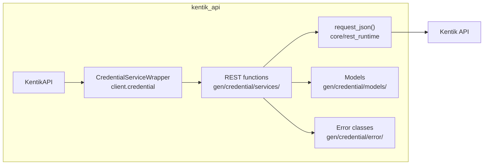

## Endpoints

### `GET` `/credential/v20261020alpha1/credentials`

List credentials.

Returns the latest version of every credential.

**REST transport**

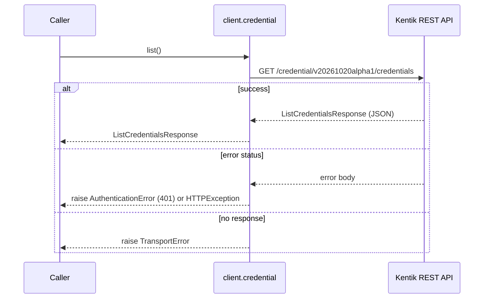

**gRPC transport**

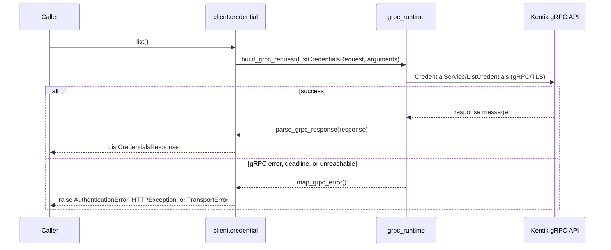

#### Responses

| Status | Description | Model |
| --- | --- | --- |
| 200 | A successful response. | `ListCredentialsResponse` |
| default | An unexpected error response. | `rpcStatus` |

#### Example

```python
from kentik_api.client import KentikAPI

# Both transports work: protocol="rest" (default) or protocol="grpc".
client = KentikAPI(protocol="rest")  # loads KENTIK_EMAIL/KENTIK_API_TOKEN from .env
response = client.credential.list()
```

---

### `GET` `/credential/v20261020alpha1/credentials/{name}`

Get a credential by name.

Returns the latest, a specific, or every version of a credential.

**REST transport**

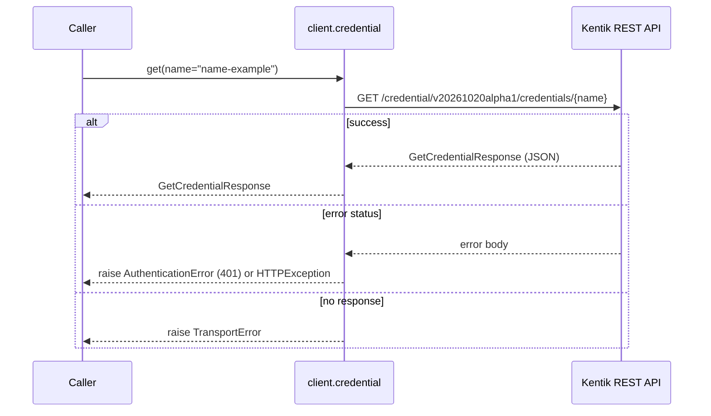

**gRPC transport**

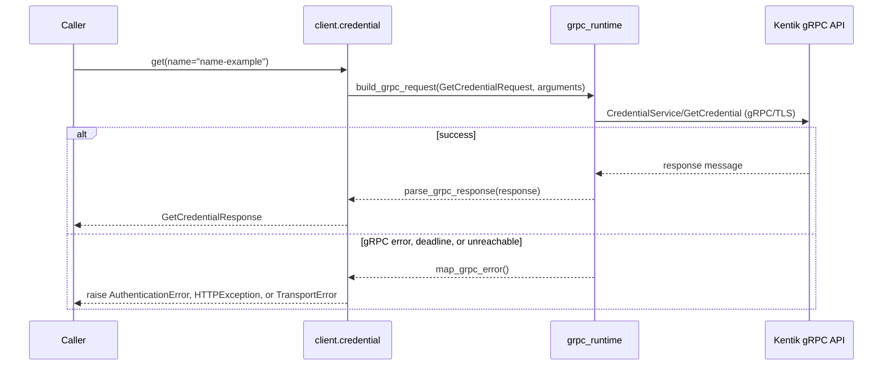

#### Parameters

| Name | In | Type | Required |
| --- | --- | --- | --- |
| `name` | path | `string` | Yes |
| `version` | query | `integer (int64)` | No |
| `allVersions` | query | `boolean` | No |

#### Responses

| Status | Description | Model |
| --- | --- | --- |
| 200 | A successful response. | `GetCredentialResponse` |
| default | An unexpected error response. | `rpcStatus` |

#### Example

```python
from kentik_api.client import KentikAPI

# Both transports work: protocol="rest" (default) or protocol="grpc".
client = KentikAPI(protocol="rest")  # loads KENTIK_EMAIL/KENTIK_API_TOKEN from .env
response = client.credential.get(
    name="name-example",
)
```

---

### `PUT` `/credential/v20261020alpha1/credentials/{name}/consumer`

Assign a consumer to a credential.

Records that an entity (synthetic test, device, etc.) uses the credential.

**REST transport**

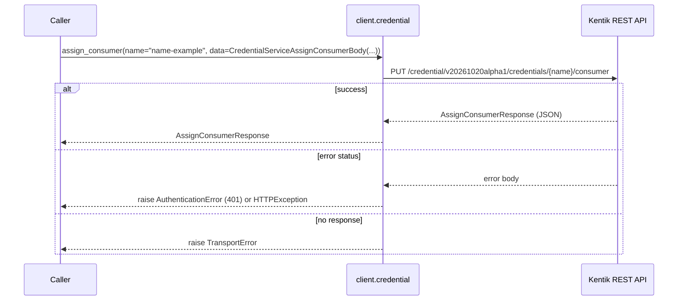

**gRPC transport**

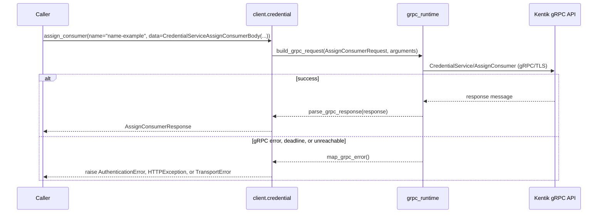

#### Parameters

| Name | In | Type | Required |
| --- | --- | --- | --- |
| `name` | path | `string` | Yes |
| `data` | body | `CredentialServiceAssignConsumerBody` | Yes |

#### Responses

| Status | Description | Model |
| --- | --- | --- |
| 200 | A successful response. | `AssignConsumerResponse` |
| default | An unexpected error response. | `rpcStatus` |

#### Example

```python
from kentik_api.client import KentikAPI
from kentik_api.gen.credential.models import CredentialServiceAssignConsumerBody

# Both transports work: protocol="rest" (default) or protocol="grpc".
client = KentikAPI(protocol="rest")  # loads KENTIK_EMAIL/KENTIK_API_TOKEN from .env
response = client.credential.assign_consumer(
    name="name-example",
    data=CredentialServiceAssignConsumerBody(...),
)
```

---

### `DELETE` `/credential/v20261020alpha1/credentials/{name}/versions/{version}`

Delete a credential version.

Deletes a single version of a credential. Fails if the credential has consumers.

**REST transport**

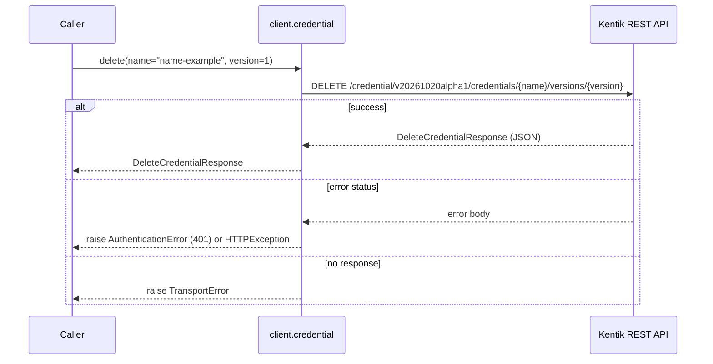

**gRPC transport**

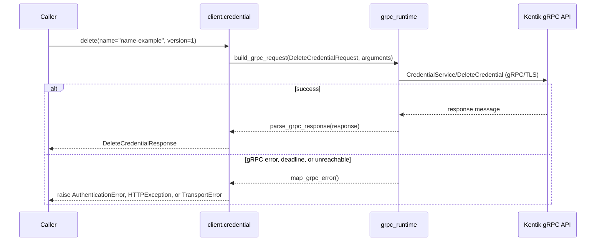

#### Parameters

| Name | In | Type | Required |
| --- | --- | --- | --- |
| `name` | path | `string` | Yes |
| `version` | path | `integer (int64)` | Yes |

#### Responses

| Status | Description | Model |
| --- | --- | --- |
| 200 | A successful response. | `DeleteCredentialResponse` |
| default | An unexpected error response. | `rpcStatus` |

#### Example

```python
from kentik_api.client import KentikAPI

# Both transports work: protocol="rest" (default) or protocol="grpc".
client = KentikAPI(protocol="rest")  # loads KENTIK_EMAIL/KENTIK_API_TOKEN from .env
response = client.credential.delete(
    name="name-example",
    version=1,
)
```

---

### `GET` `/credential/v20261020alpha1/groups`

List credential groups.

Returns every credential group with the latest version of its credentials.

**REST transport**

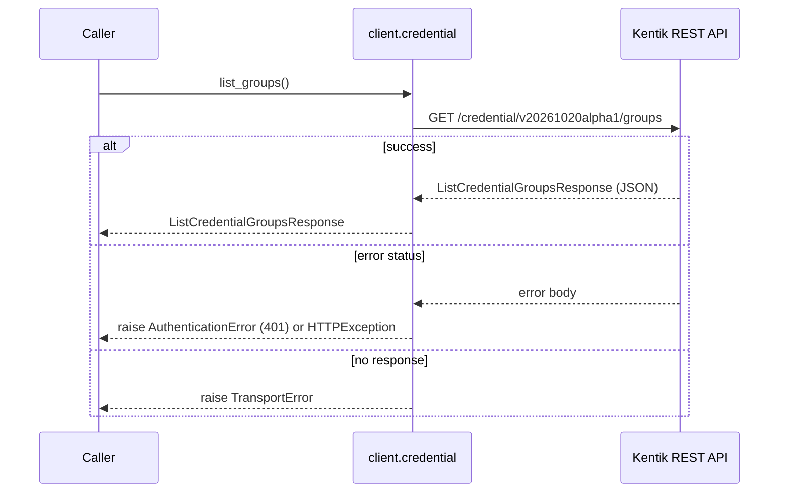

**gRPC transport**

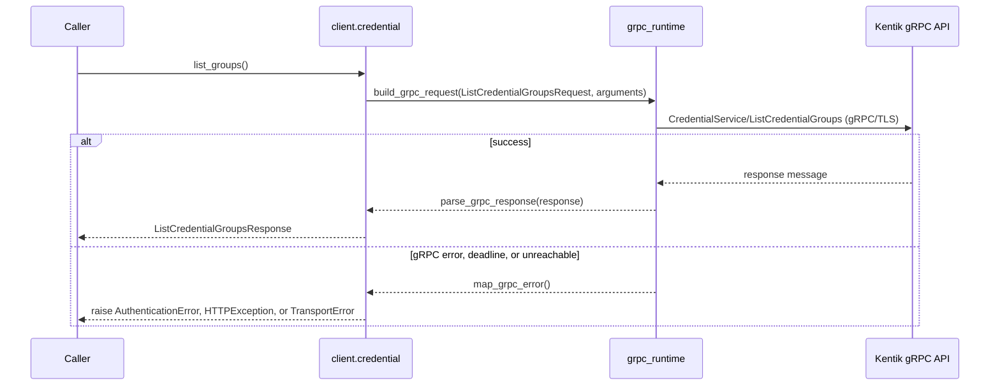

#### Responses

| Status | Description | Model |
| --- | --- | --- |
| 200 | A successful response. | `ListCredentialGroupsResponse` |
| default | An unexpected error response. | `rpcStatus` |

#### Example

```python
from kentik_api.client import KentikAPI

# Both transports work: protocol="rest" (default) or protocol="grpc".
client = KentikAPI(protocol="rest")  # loads KENTIK_EMAIL/KENTIK_API_TOKEN from .env
response = client.credential.list_groups()
```

---

### `POST` `/credential/v20261020alpha1/groups`

Create a credential group.

Creates one credential per token and returns the created group.

**REST transport**

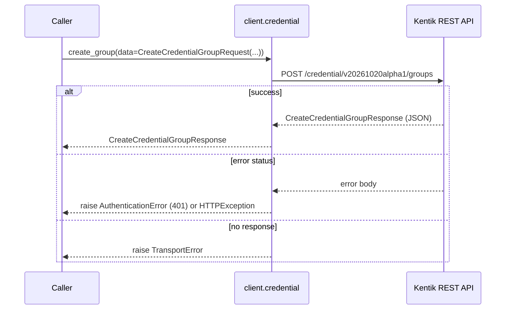

**gRPC transport**

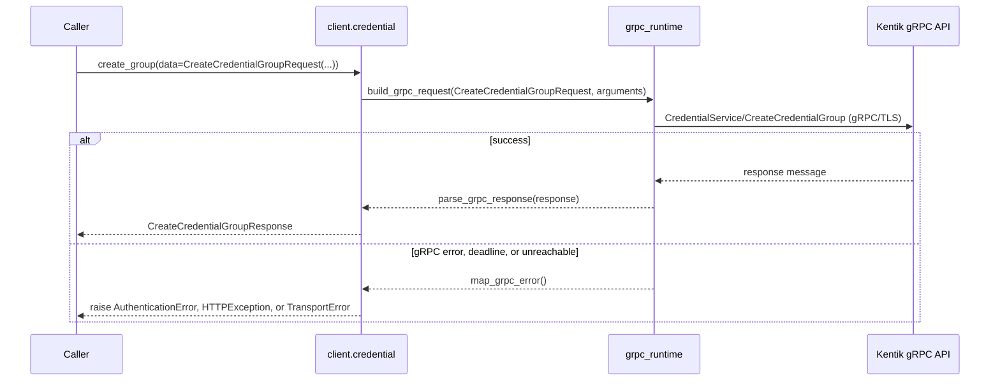

#### Parameters

| Name | In | Type | Required |
| --- | --- | --- | --- |
| `data` | body | `CreateCredentialGroupRequest` | Yes |

#### Responses

| Status | Description | Model |
| --- | --- | --- |
| 200 | A successful response. | `CreateCredentialGroupResponse` |
| default | An unexpected error response. | `rpcStatus` |

#### Example

```python
from kentik_api.client import KentikAPI
from kentik_api.gen.credential.models import CreateCredentialGroupRequest

# Both transports work: protocol="rest" (default) or protocol="grpc".
client = KentikAPI(protocol="rest")  # loads KENTIK_EMAIL/KENTIK_API_TOKEN from .env
response = client.credential.create_group(
    data=CreateCredentialGroupRequest(...),
)
```

---

### `GET` `/credential/v20261020alpha1/groups/{name}`

Get a credential group by name.

Returns a single credential group.

**REST transport**

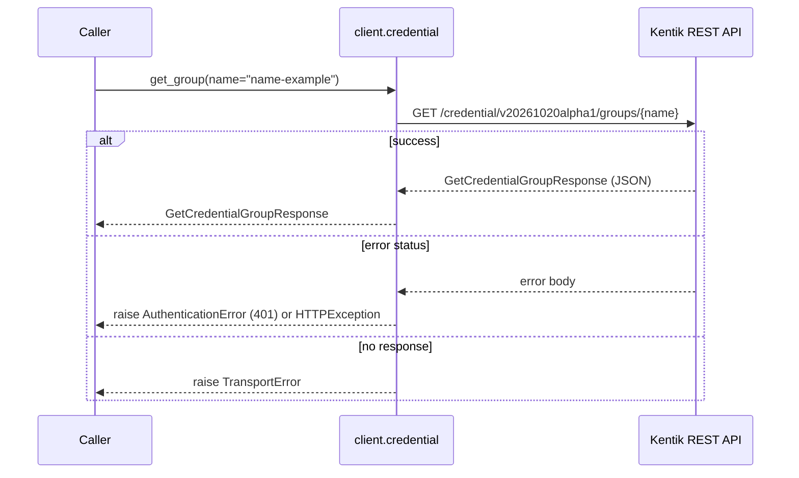

**gRPC transport**

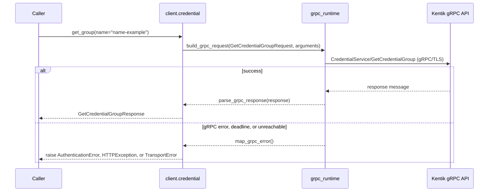

#### Parameters

| Name | In | Type | Required |
| --- | --- | --- | --- |
| `name` | path | `string` | Yes |

#### Responses

| Status | Description | Model |
| --- | --- | --- |
| 200 | A successful response. | `GetCredentialGroupResponse` |
| default | An unexpected error response. | `rpcStatus` |

#### Example

```python
from kentik_api.client import KentikAPI

# Both transports work: protocol="rest" (default) or protocol="grpc".
client = KentikAPI(protocol="rest")  # loads KENTIK_EMAIL/KENTIK_API_TOKEN from .env
response = client.credential.get_group(
    name="name-example",
)
```

---

### `PUT` `/credential/v20261020alpha1/groups/{name}`

Update a credential group.

Tokens with a value create a new credential version; tokens without one only update metadata.

**REST transport**

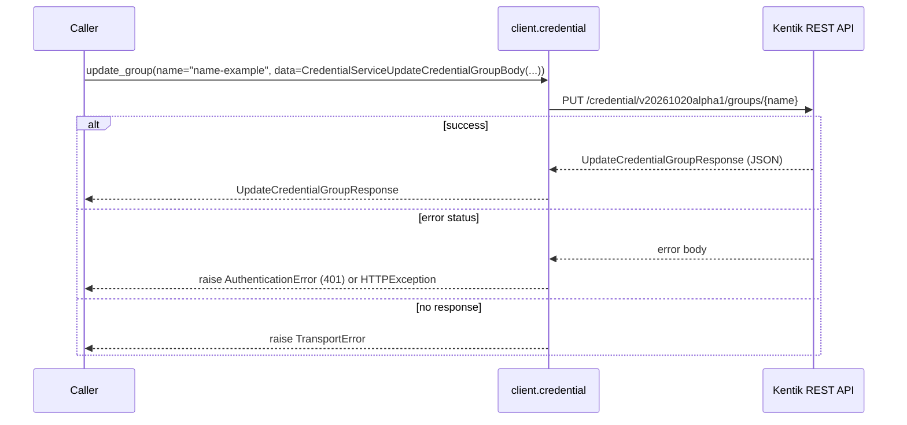

**gRPC transport**

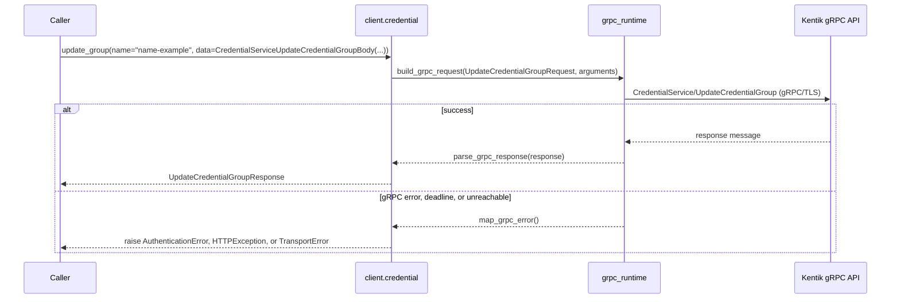

#### Parameters

| Name | In | Type | Required |
| --- | --- | --- | --- |
| `name` | path | `string` | Yes |
| `data` | body | `CredentialServiceUpdateCredentialGroupBody` | Yes |

#### Responses

| Status | Description | Model |
| --- | --- | --- |
| 200 | A successful response. | `UpdateCredentialGroupResponse` |
| default | An unexpected error response. | `rpcStatus` |

#### Example

```python
from kentik_api.client import KentikAPI
from kentik_api.gen.credential.models import CredentialServiceUpdateCredentialGroupBody

# Both transports work: protocol="rest" (default) or protocol="grpc".
client = KentikAPI(protocol="rest")  # loads KENTIK_EMAIL/KENTIK_API_TOKEN from .env
response = client.credential.update_group(
    name="name-example",
    data=CredentialServiceUpdateCredentialGroupBody(...),
)
```

---

### `DELETE` `/credential/v20261020alpha1/groups/{name}`

Delete a credential group.

Deletes every version of every credential in the group. Fails if any credential has consumers.

**REST transport**

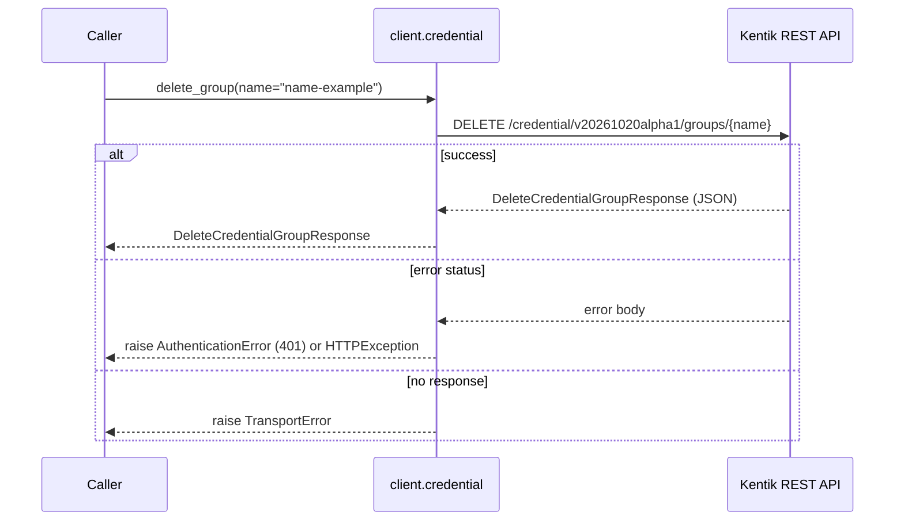

**gRPC transport**

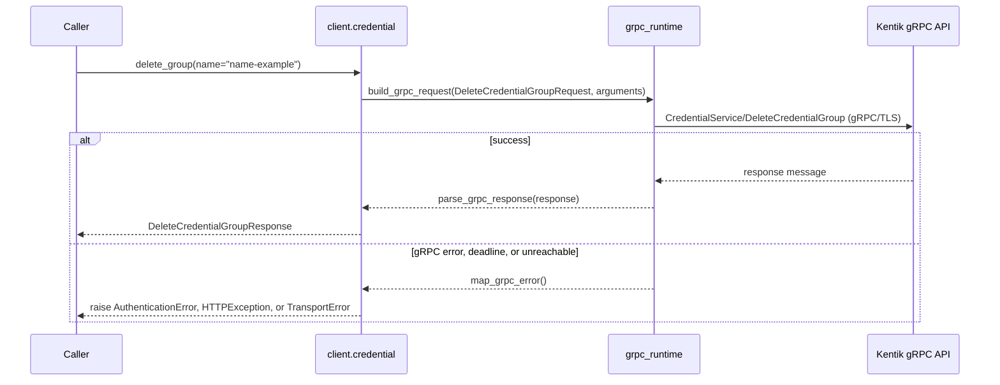

#### Parameters

| Name | In | Type | Required |
| --- | --- | --- | --- |
| `name` | path | `string` | Yes |

#### Responses

| Status | Description | Model |
| --- | --- | --- |
| 200 | A successful response. | `DeleteCredentialGroupResponse` |
| default | An unexpected error response. | `rpcStatus` |

#### Example

```python
from kentik_api.client import KentikAPI

# Both transports work: protocol="rest" (default) or protocol="grpc".
client = KentikAPI(protocol="rest")  # loads KENTIK_EMAIL/KENTIK_API_TOKEN from .env
response = client.credential.delete_group(
    name="name-example",
)
```

---

### `GET` `/credential/v20261020alpha1/overviews`

List credential group names and types.

Returns a lightweight name and type listing of every credential group, for lookups.

**REST transport**

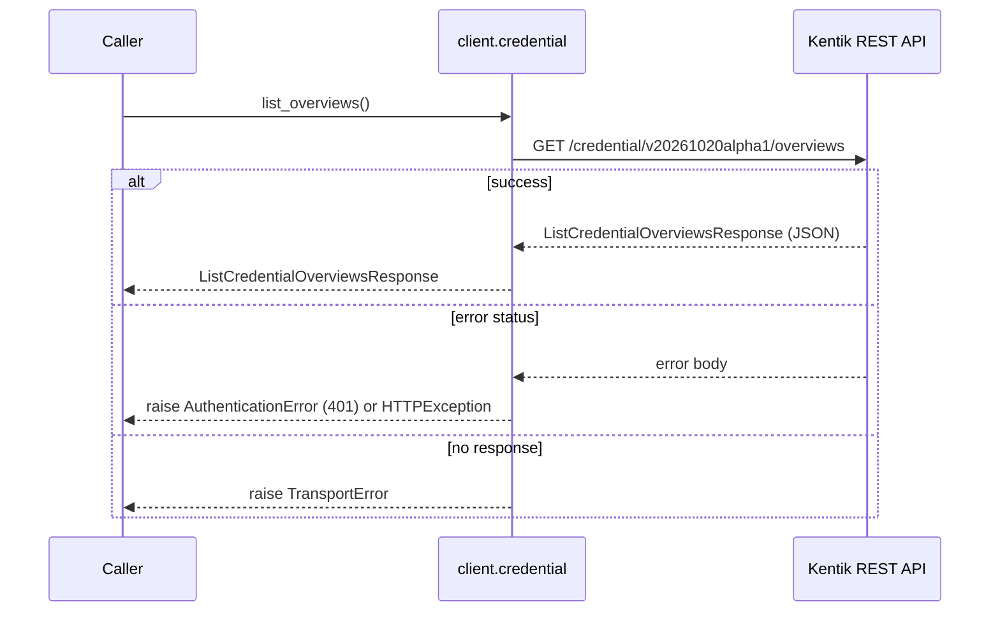

**gRPC transport**

```mermaid
sequenceDiagram
    participant C as Caller
    participant W as client.credential
    participant R as grpc_runtime
    participant API as Kentik gRPC API

    C->>W: list_overviews()
    W->>R: build_grpc_request(ListCredentialOverviewsRequest, arguments)
    R->>API: CredentialService/ListCredentialOverviews (gRPC/TLS)
    alt success
        API-->>R: response message
        R-->>W: parse_grpc_response(response)
        W-->>C: ListCredentialOverviewsResponse
    else gRPC error, deadline, or unreachable
        R-->>W: map_grpc_error()
        W-->>C: raise AuthenticationError, HTTPException, or TransportError
    end
```

#### Responses

| Status | Description | Model |
| --- | --- | --- |
| 200 | A successful response. | `ListCredentialOverviewsResponse` |
| default | An unexpected error response. | `rpcStatus` |

#### Example

```python
from kentik_api.client import KentikAPI

# Both transports work: protocol="rest" (default) or protocol="grpc".
client = KentikAPI(protocol="rest")  # loads KENTIK_EMAIL/KENTIK_API_TOKEN from .env
response = client.credential.list_overviews()
```

## Data Models

<details>
<summary>Model relationships (21 of 22 models)</summary>

```mermaid
classDiagram
    class AssignConsumerResponse
    class Consumer
    class CreateCredentialGroupRequest
    class CreateCredentialGroupResponse
    class Credential
    class CredentialGroup
    class CredentialOverview
    class CredentialServiceAssignConsumerBody
    class CredentialServiceUpdateCredentialGroupBody
    class CredentialType
    class DeleteCredentialGroupResponse
    class DeleteCredentialResponse
    class GetCredentialGroupResponse
    class GetCredentialResponse
    class ListCredentialGroupsResponse
    class ListCredentialOverviewsResponse
    class ListCredentialsResponse
    class Token
    class UpdateCredentialGroupResponse
    class protobufAny
    class rpcStatus
    AssignConsumerResponse --> Credential
    CreateCredentialGroupRequest --> CredentialType
    CreateCredentialGroupRequest --> Token
    CreateCredentialGroupResponse --> CredentialGroup
    Credential --> Consumer
    Credential --> CredentialType
    CredentialGroup --> Consumer
    CredentialGroup --> Credential
    CredentialGroup --> CredentialType
    CredentialOverview --> CredentialType
    CredentialServiceAssignConsumerBody --> Consumer
    CredentialServiceUpdateCredentialGroupBody --> CredentialType
    CredentialServiceUpdateCredentialGroupBody --> Token
    GetCredentialGroupResponse --> CredentialGroup
    GetCredentialResponse --> Credential
    ListCredentialGroupsResponse --> CredentialGroup
    ListCredentialOverviewsResponse --> CredentialOverview
    ListCredentialsResponse --> Credential
    UpdateCredentialGroupResponse --> CredentialGroup
    rpcStatus --> protobufAny
```

</details>

```{eval-rst}
.. autopydantic_model:: kentik_api.gen.credential.models.AssignConsumerResponse
```

```{eval-rst}
.. autopydantic_model:: kentik_api.gen.credential.models.Consumer
```

```{eval-rst}
.. autopydantic_model:: kentik_api.gen.credential.models.CreateCredentialGroupRequest
```

```{eval-rst}
.. autopydantic_model:: kentik_api.gen.credential.models.CreateCredentialGroupResponse
```

```{eval-rst}
.. autopydantic_model:: kentik_api.gen.credential.models.CreatedBy
```

```{eval-rst}
.. autopydantic_model:: kentik_api.gen.credential.models.Credential
```

```{eval-rst}
.. autopydantic_model:: kentik_api.gen.credential.models.CredentialGroup
```

```{eval-rst}
.. autopydantic_model:: kentik_api.gen.credential.models.CredentialOverview
```

```{eval-rst}
.. autopydantic_model:: kentik_api.gen.credential.models.CredentialServiceAssignConsumerBody
```

```{eval-rst}
.. autopydantic_model:: kentik_api.gen.credential.models.CredentialServiceUpdateCredentialGroupBody
```

```{eval-rst}
.. autoclass:: kentik_api.gen.credential.models.CredentialType
   :members:
```

```{eval-rst}
.. autopydantic_model:: kentik_api.gen.credential.models.DeleteCredentialGroupResponse
```

```{eval-rst}
.. autopydantic_model:: kentik_api.gen.credential.models.DeleteCredentialResponse
```

```{eval-rst}
.. autopydantic_model:: kentik_api.gen.credential.models.GetCredentialGroupResponse
```

```{eval-rst}
.. autopydantic_model:: kentik_api.gen.credential.models.GetCredentialResponse
```

```{eval-rst}
.. autopydantic_model:: kentik_api.gen.credential.models.ListCredentialGroupsResponse
```

```{eval-rst}
.. autopydantic_model:: kentik_api.gen.credential.models.ListCredentialOverviewsResponse
```

```{eval-rst}
.. autopydantic_model:: kentik_api.gen.credential.models.ListCredentialsResponse
```

```{eval-rst}
.. autopydantic_model:: kentik_api.gen.credential.models.Token
```

```{eval-rst}
.. autopydantic_model:: kentik_api.gen.credential.models.UpdateCredentialGroupResponse
```

```{eval-rst}
.. autopydantic_model:: kentik_api.gen.credential.models.protobufAny
```

```{eval-rst}
.. autopydantic_model:: kentik_api.gen.credential.models.rpcStatus
```
