<!-- AUTO-GENERATED: scripts/generation/endpoint_docs.py, render_endpoint_docs() -->
<!-- Rebuilt on every `uv run poe generate`. Do not edit by hand. -->

# Custom Dimension Service

## Overview

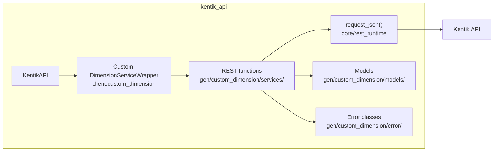

## Endpoints

### `GET` `/custom_dimensions/v202411alpha1`

List Custom Dimensions

Returns an array of custom dimension objects that each contain information about an individual custom dimension.

**REST transport**

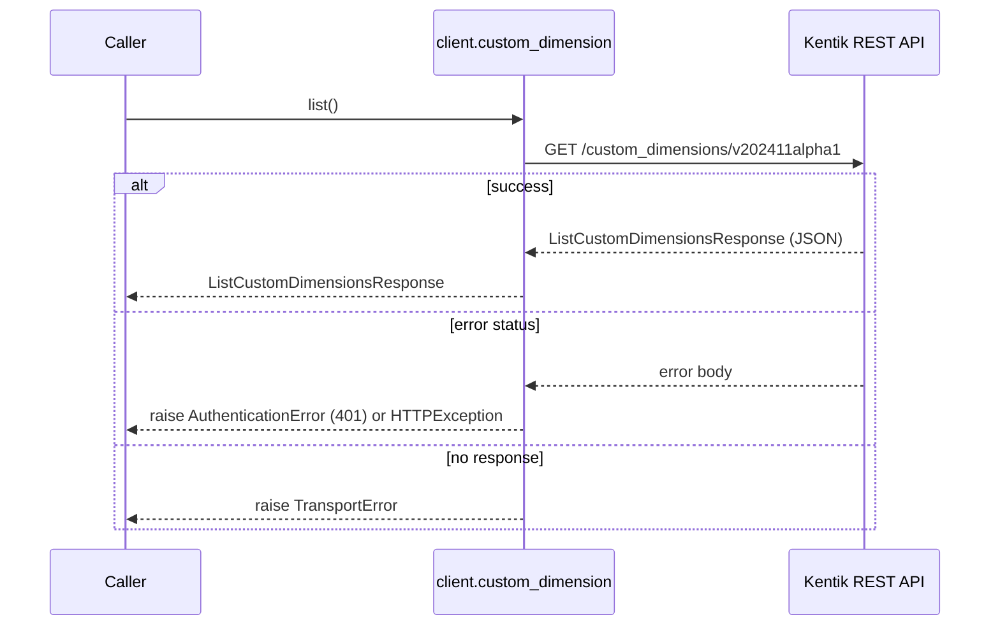

**gRPC transport**

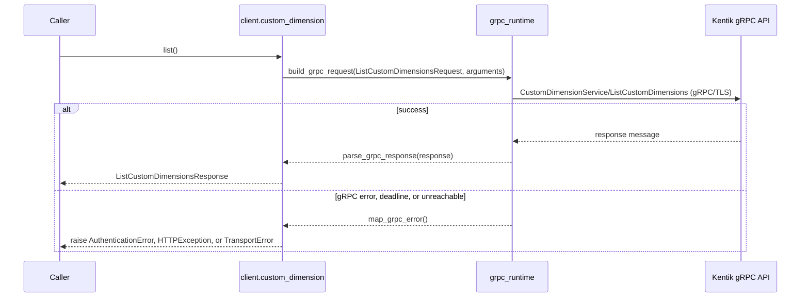

#### Responses

| Status | Description | Model |
| --- | --- | --- |
| 200 | A successful response. | `ListCustomDimensionsResponse` |
| default | An unexpected error response. | `rpcStatus` |

#### Example

```python
from kentik_api.client import KentikAPI

# Both transports work: protocol="rest" (default) or protocol="grpc".
client = KentikAPI(protocol="rest")  # loads KENTIK_EMAIL/KENTIK_API_TOKEN from .env
response = client.custom_dimension.list()
```

---

### `GET` `/custom_dimensions/v202411alpha1/{customDimensionId}`

Custom Dimension Info

Returns a custom dimension object containing information about an individual custom dimension.

**REST transport**

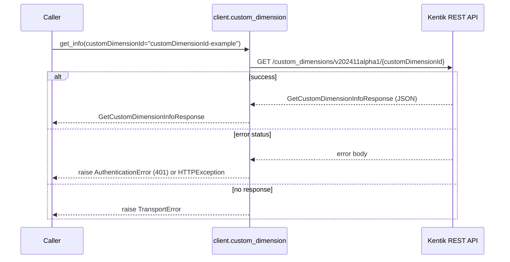

**gRPC transport**


#### Parameters

| Name | In | Type | Required |
| --- | --- | --- | --- |
| `customDimensionId` | path | `string` | Yes |

#### Responses

| Status | Description | Model |
| --- | --- | --- |
| 200 | A successful response. | `GetCustomDimensionInfoResponse` |
| default | An unexpected error response. | `rpcStatus` |

#### Example

```python
from kentik_api.client import KentikAPI

# Both transports work: protocol="rest" (default) or protocol="grpc".
client = KentikAPI(protocol="rest")  # loads KENTIK_EMAIL/KENTIK_API_TOKEN from .env
response = client.custom_dimension.get_info(
    customDimensionId="customDimensionId-example",
)
```

---

### `PUT` `/custom_dimensions/v202411alpha1/{customDimensionId}`

Update Custom Dimension

Updates and returns a custom dimension object containing information about an individual custom dimension (see About Custom Dimensions). Populators are not sent back in the response body. To get them use 'Custom Dimension info' API instead.

**REST transport**

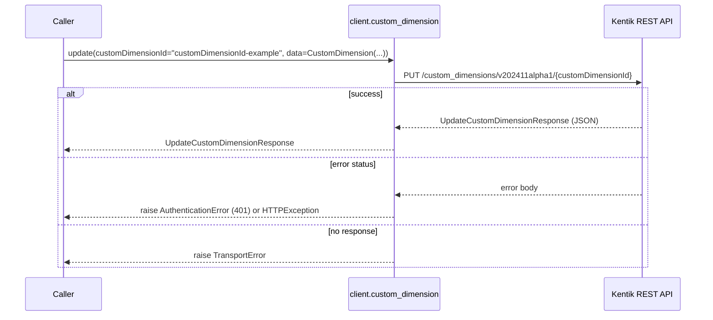

**gRPC transport**

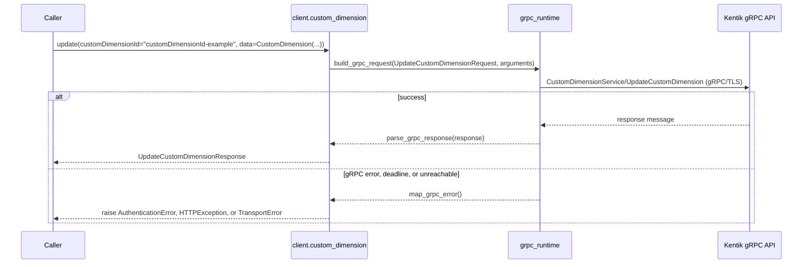

#### Parameters

| Name | In | Type | Required |
| --- | --- | --- | --- |
| `customDimensionId` | path | `string` | Yes |
| `data` | body | `CustomDimension` | Yes |

#### Responses

| Status | Description | Model |
| --- | --- | --- |
| 200 | A successful response. | `UpdateCustomDimensionResponse` |
| default | An unexpected error response. | `rpcStatus` |

#### Example

```python
from kentik_api.client import KentikAPI
from kentik_api.gen.custom_dimension.models import CustomDimension

# Both transports work: protocol="rest" (default) or protocol="grpc".
client = KentikAPI(protocol="rest")  # loads KENTIK_EMAIL/KENTIK_API_TOKEN from .env
response = client.custom_dimension.update(
    customDimensionId="customDimensionId-example",
    data=CustomDimension(...),
)
```

---

### `DELETE` `/custom_dimensions/v202411alpha1/{customDimensionId}`

Delete Custom Dimension

Deletes a custom dimension.

**REST transport**

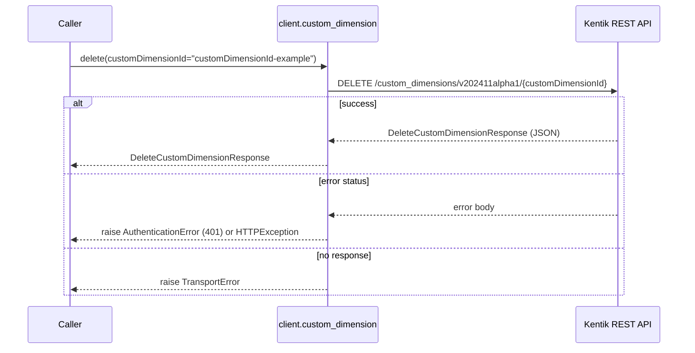

**gRPC transport**

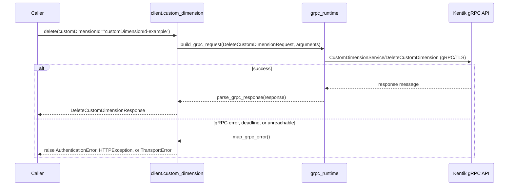

#### Parameters

| Name | In | Type | Required |
| --- | --- | --- | --- |
| `customDimensionId` | path | `string` | Yes |

#### Responses

| Status | Description | Model |
| --- | --- | --- |
| 200 | A successful response. | `DeleteCustomDimensionResponse` |
| default | An unexpected error response. | `rpcStatus` |

#### Example

```python
from kentik_api.client import KentikAPI

# Both transports work: protocol="rest" (default) or protocol="grpc".
client = KentikAPI(protocol="rest")  # loads KENTIK_EMAIL/KENTIK_API_TOKEN from .env
response = client.custom_dimension.delete(
    customDimensionId="customDimensionId-example",
)
```

---

### `POST` `/custom_dimensions/v202411alpha1/{customDimensionId}/populator`

Create Populator

Creates and returns a populator object containing information about an individual populator.

**REST transport**

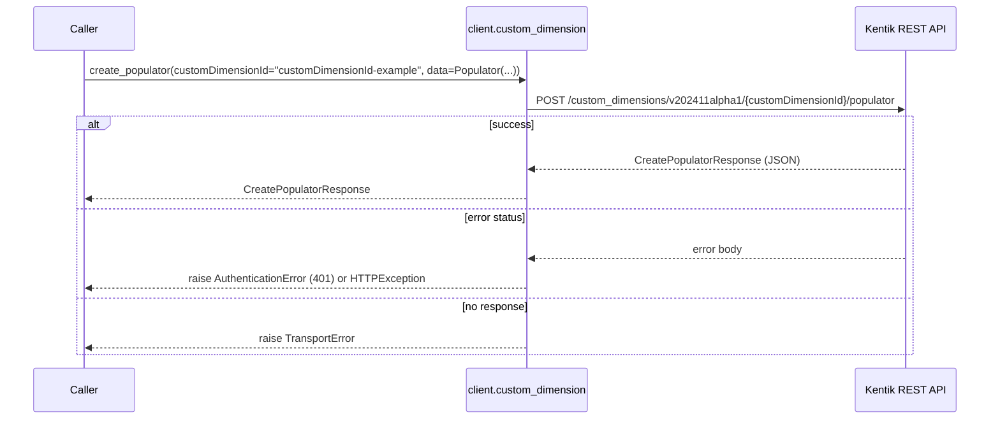

**gRPC transport**

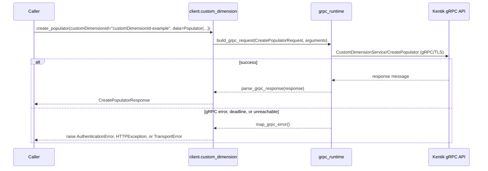

#### Parameters

| Name | In | Type | Required |
| --- | --- | --- | --- |
| `customDimensionId` | path | `string` | Yes |
| `data` | body | `Populator` | Yes |

#### Responses

| Status | Description | Model |
| --- | --- | --- |
| 200 | A successful response. | `CreatePopulatorResponse` |
| default | An unexpected error response. | `rpcStatus` |

#### Example

```python
from kentik_api.client import KentikAPI
from kentik_api.gen.custom_dimension.models import Populator

# Both transports work: protocol="rest" (default) or protocol="grpc".
client = KentikAPI(protocol="rest")  # loads KENTIK_EMAIL/KENTIK_API_TOKEN from .env
response = client.custom_dimension.create_populator(
    customDimensionId="customDimensionId-example",
    data=Populator(...),
)
```

---

### `GET` `/custom_dimensions/v202411alpha1/{customDimensionId}/populator/{populatorId}`

Get Populator

Get Populator by Dimension and Populator ID.

**REST transport**

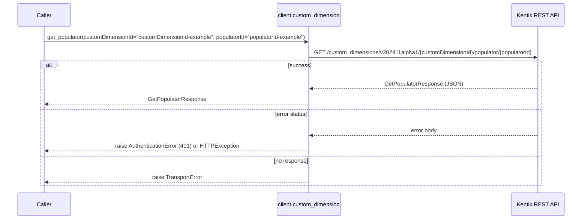

**gRPC transport**

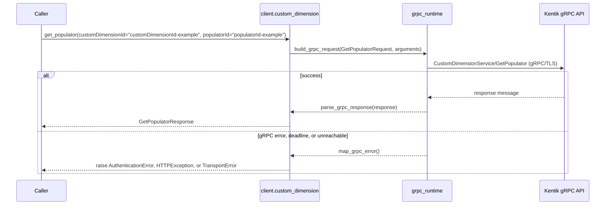

#### Parameters

| Name | In | Type | Required |
| --- | --- | --- | --- |
| `customDimensionId` | path | `string` | Yes |
| `populatorId` | path | `string` | Yes |
| `fieldLimit` | query | `integer (int64)` | No |

#### Responses

| Status | Description | Model |
| --- | --- | --- |
| 200 | A successful response. | `GetPopulatorResponse` |
| default | An unexpected error response. | `rpcStatus` |

#### Example

```python
from kentik_api.client import KentikAPI

# Both transports work: protocol="rest" (default) or protocol="grpc".
client = KentikAPI(protocol="rest")  # loads KENTIK_EMAIL/KENTIK_API_TOKEN from .env
response = client.custom_dimension.get_populator(
    customDimensionId="customDimensionId-example",
    populatorId="populatorId-example",
)
```

---

### `PUT` `/custom_dimensions/v202411alpha1/{customDimensionId}/populator/{populatorId}`

Update Populator

Updates and returns a populator object containing information about an individual populator.

**REST transport**

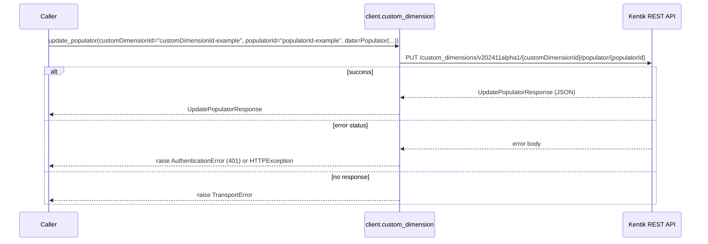

**gRPC transport**

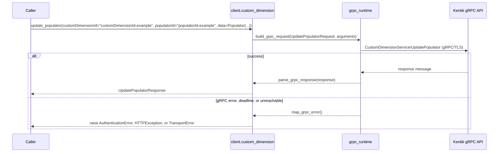

#### Parameters

| Name | In | Type | Required |
| --- | --- | --- | --- |
| `customDimensionId` | path | `string` | Yes |
| `populatorId` | path | `string` | Yes |
| `data` | body | `Populator` | Yes |

#### Responses

| Status | Description | Model |
| --- | --- | --- |
| 200 | A successful response. | `UpdatePopulatorResponse` |
| default | An unexpected error response. | `rpcStatus` |

#### Example

```python
from kentik_api.client import KentikAPI
from kentik_api.gen.custom_dimension.models import Populator

# Both transports work: protocol="rest" (default) or protocol="grpc".
client = KentikAPI(protocol="rest")  # loads KENTIK_EMAIL/KENTIK_API_TOKEN from .env
response = client.custom_dimension.update_populator(
    customDimensionId="customDimensionId-example",
    populatorId="populatorId-example",
    data=Populator(...),
)
```

---

### `DELETE` `/custom_dimensions/v202411alpha1/{customDimensionId}/populator/{populatorId}`

Delete Populator

Deletes a populator.

**REST transport**

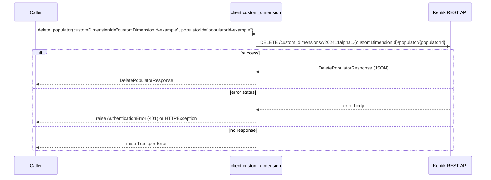

**gRPC transport**

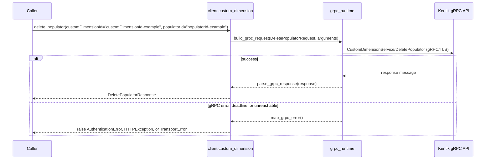

#### Parameters

| Name | In | Type | Required |
| --- | --- | --- | --- |
| `customDimensionId` | path | `string` | Yes |
| `populatorId` | path | `string` | Yes |

#### Responses

| Status | Description | Model |
| --- | --- | --- |
| 200 | A successful response. | `DeletePopulatorResponse` |
| default | An unexpected error response. | `rpcStatus` |

#### Example

```python
from kentik_api.client import KentikAPI

# Both transports work: protocol="rest" (default) or protocol="grpc".
client = KentikAPI(protocol="rest")  # loads KENTIK_EMAIL/KENTIK_API_TOKEN from .env
response = client.custom_dimension.delete_populator(
    customDimensionId="customDimensionId-example",
    populatorId="populatorId-example",
)
```

---

### `GET` `/custom_dimensions/v202411alpha1/{customDimensionId}/populator/{populatorId}/field/{fieldName}`

Get Populator Field

Get Populator field by Dimension, Populator ID, and field name.

**REST transport**

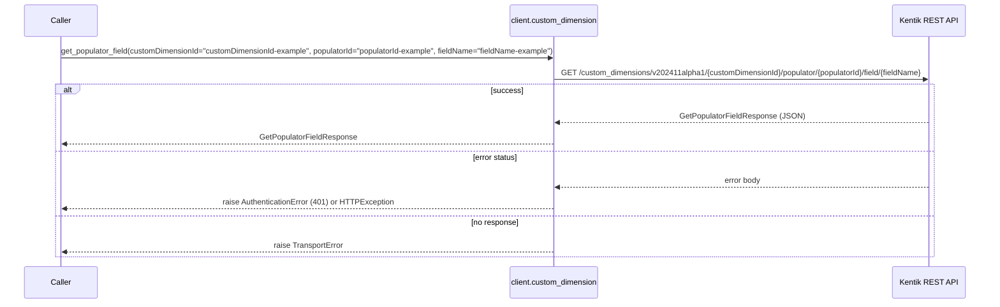

**gRPC transport**

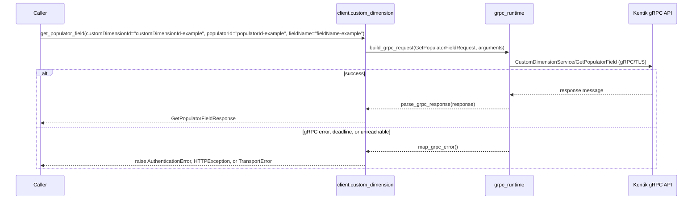

#### Parameters

| Name | In | Type | Required |
| --- | --- | --- | --- |
| `customDimensionId` | path | `string` | Yes |
| `populatorId` | path | `string` | Yes |
| `fieldName` | path | `string` | Yes |
| `offset` | query | `integer (int32)` | No |
| `limit` | query | `integer (int32)` | No |

#### Responses

| Status | Description | Model |
| --- | --- | --- |
| 200 | A successful response. | `GetPopulatorFieldResponse` |
| default | An unexpected error response. | `rpcStatus` |

#### Example

```python
from kentik_api.client import KentikAPI

# Both transports work: protocol="rest" (default) or protocol="grpc".
client = KentikAPI(protocol="rest")  # loads KENTIK_EMAIL/KENTIK_API_TOKEN from .env
response = client.custom_dimension.get_populator_field(
    customDimensionId="customDimensionId-example",
    populatorId="populatorId-example",
    fieldName="fieldName-example",
)
```

---

### `POST` `/v1/customdimension`

Create Custom Dimension

Creates and returns a custom dimension object containing information about an individual custom dimension

**REST transport**

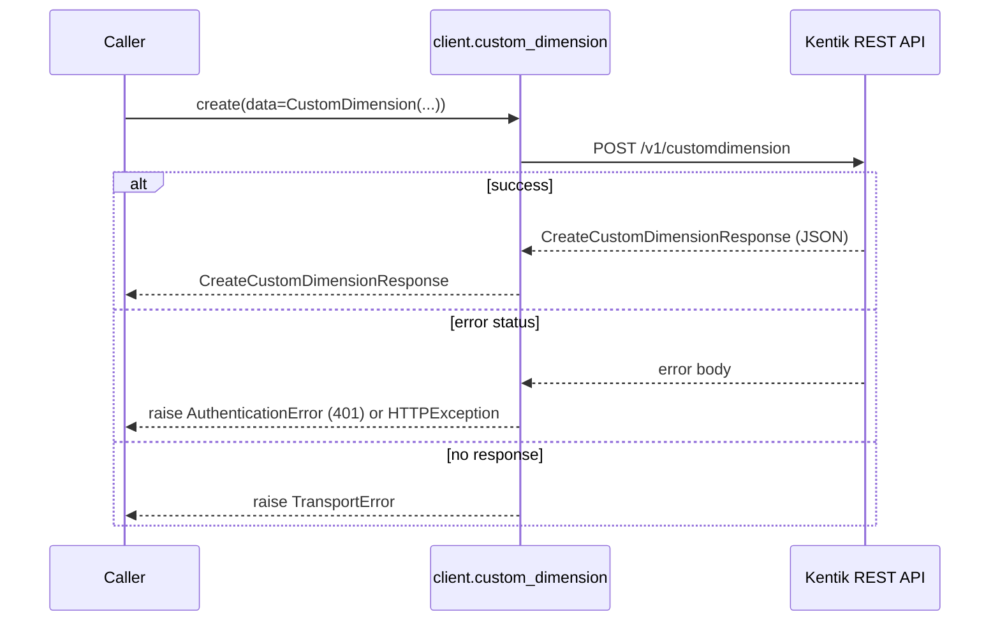

**gRPC transport**

```mermaid
sequenceDiagram
    participant C as Caller
    participant W as client.custom_dimension
    participant R as grpc_runtime
    participant API as Kentik gRPC API

    C->>W: create(data=CustomDimension(...))
    W->>R: build_grpc_request(CreateCustomDimensionRequest, arguments)
    R->>API: CustomDimensionService/CreateCustomDimension (gRPC/TLS)
    alt success
        API-->>R: response message
        R-->>W: parse_grpc_response(response)
        W-->>C: CreateCustomDimensionResponse
    else gRPC error, deadline, or unreachable
        R-->>W: map_grpc_error()
        W-->>C: raise AuthenticationError, HTTPException, or TransportError
    end
```

#### Parameters

| Name | In | Type | Required |
| --- | --- | --- | --- |
| `data` | body | `CustomDimension` | Yes |

#### Responses

| Status | Description | Model |
| --- | --- | --- |
| 200 | A successful response. | `CreateCustomDimensionResponse` |
| default | An unexpected error response. | `rpcStatus` |

#### Example

```python
from kentik_api.client import KentikAPI
from kentik_api.gen.custom_dimension.models import CustomDimension

# Both transports work: protocol="rest" (default) or protocol="grpc".
client = KentikAPI(protocol="rest")  # loads KENTIK_EMAIL/KENTIK_API_TOKEN from .env
response = client.custom_dimension.create(
    data=CustomDimension(...),
)
```

## Data Models

<details>
<summary>Model relationships (14 of 15 models)</summary>

```mermaid
classDiagram
    class CreateCustomDimensionResponse
    class CreatePopulatorResponse
    class CustomDimension
    class DeleteCustomDimensionResponse
    class DeletePopulatorResponse
    class GetCustomDimensionInfoResponse
    class GetPopulatorFieldResponse
    class GetPopulatorResponse
    class ListCustomDimensionsResponse
    class Populator
    class UpdateCustomDimensionResponse
    class UpdatePopulatorResponse
    class protobufAny
    class rpcStatus
    CreateCustomDimensionResponse --> CustomDimension
    CreatePopulatorResponse --> Populator
    CustomDimension --> Populator
    GetCustomDimensionInfoResponse --> CustomDimension
    GetPopulatorResponse --> Populator
    ListCustomDimensionsResponse --> CustomDimension
    UpdateCustomDimensionResponse --> CustomDimension
    UpdatePopulatorResponse --> Populator
    rpcStatus --> protobufAny
```

</details>

```{eval-rst}
.. autopydantic_model:: kentik_api.gen.custom_dimension.models.CreateCustomDimensionResponse
```

```{eval-rst}
.. autopydantic_model:: kentik_api.gen.custom_dimension.models.CreatePopulatorResponse
```

```{eval-rst}
.. autopydantic_model:: kentik_api.gen.custom_dimension.models.CustomDimension
```

```{eval-rst}
.. autopydantic_model:: kentik_api.gen.custom_dimension.models.DeleteCustomDimensionResponse
```

```{eval-rst}
.. autopydantic_model:: kentik_api.gen.custom_dimension.models.DeletePopulatorResponse
```

```{eval-rst}
.. autopydantic_model:: kentik_api.gen.custom_dimension.models.ExtendedField
```

```{eval-rst}
.. autopydantic_model:: kentik_api.gen.custom_dimension.models.GetCustomDimensionInfoResponse
```

```{eval-rst}
.. autopydantic_model:: kentik_api.gen.custom_dimension.models.GetPopulatorFieldResponse
```

```{eval-rst}
.. autopydantic_model:: kentik_api.gen.custom_dimension.models.GetPopulatorResponse
```

```{eval-rst}
.. autopydantic_model:: kentik_api.gen.custom_dimension.models.ListCustomDimensionsResponse
```

```{eval-rst}
.. autopydantic_model:: kentik_api.gen.custom_dimension.models.Populator
```

```{eval-rst}
.. autopydantic_model:: kentik_api.gen.custom_dimension.models.UpdateCustomDimensionResponse
```

```{eval-rst}
.. autopydantic_model:: kentik_api.gen.custom_dimension.models.UpdatePopulatorResponse
```

```{eval-rst}
.. autopydantic_model:: kentik_api.gen.custom_dimension.models.protobufAny
```

```{eval-rst}
.. autopydantic_model:: kentik_api.gen.custom_dimension.models.rpcStatus
```
