<!-- AUTO-GENERATED: scripts/generation/endpoint_docs.py, render_endpoint_docs() -->
<!-- Rebuilt on every `make generate`. Do not edit by hand. -->

# Kmeta Service

## Overview

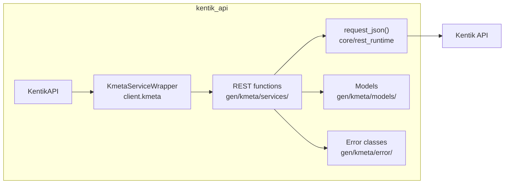

## Endpoints

### `GET` `/kmeta/v202607alpha1/{cid}/servicenow/config`

List ServiceNow Configs

Returns all ServiceNow integration configurations for the specified company.

**REST transport**

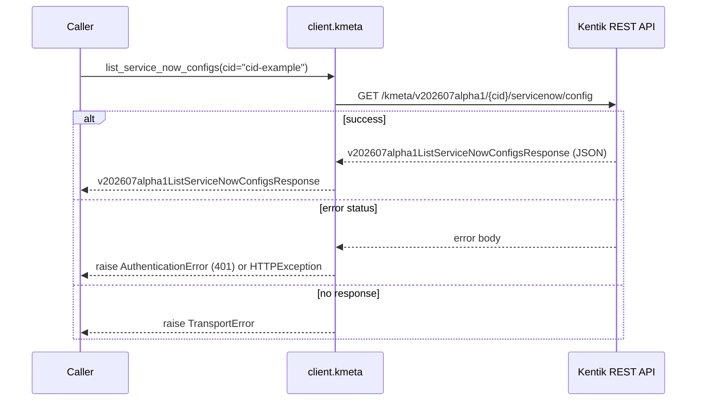

**gRPC transport**

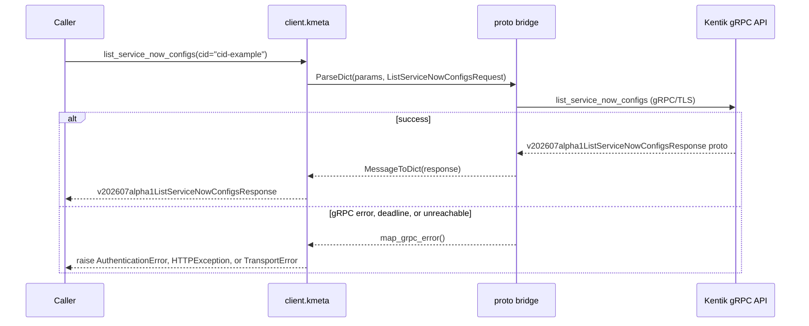

#### Parameters

| Name | In | Type | Required |
| --- | --- | --- | --- |
| `cid` | path | `string` | Yes |

#### Responses

| Status | Description | Model |
| --- | --- | --- |
| 200 | A successful response. | `v202607alpha1ListServiceNowConfigsResponse` |
| default | An unexpected error response. | `rpcStatus` |

#### Example

```python
from kentik_api.client import KentikAPI

# Both transports work: protocol="rest" (default) or protocol="grpc".
client = KentikAPI(protocol="rest")  # loads KENTIK_EMAIL/KENTIK_API_TOKEN from .env
response = client.kmeta.list_service_now_configs(
    cid="cid-example",
)
```

---

### `POST` `/kmeta/v202607alpha1/{cid}/servicenow/config`

Create ServiceNow Config

Creates a new ServiceNow integration configuration for the specified company.

**REST transport**

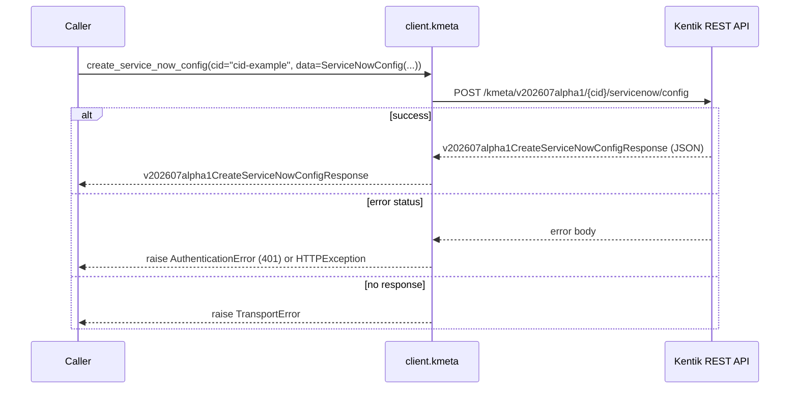

**gRPC transport**

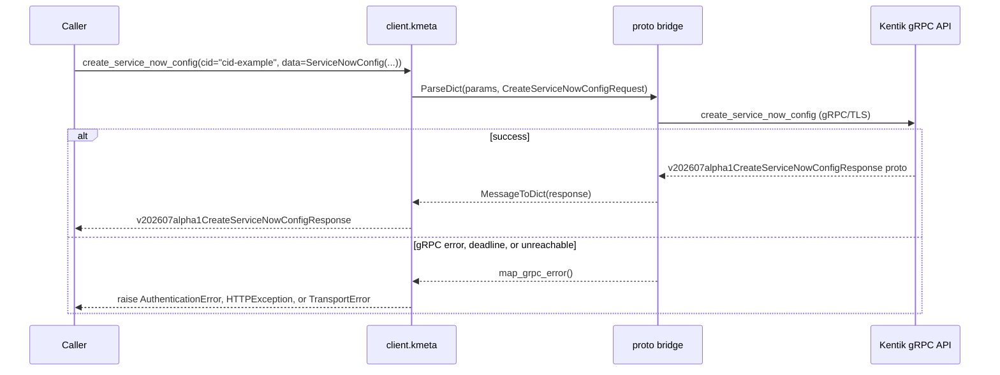

#### Parameters

| Name | In | Type | Required |
| --- | --- | --- | --- |
| `cid` | path | `string` | Yes |
| `data` | body | `-` | No |

#### Responses

| Status | Description | Model |
| --- | --- | --- |
| 200 | A successful response. | `v202607alpha1CreateServiceNowConfigResponse` |
| default | An unexpected error response. | `rpcStatus` |

#### Example

```python
from kentik_api.client import KentikAPI

# Both transports work: protocol="rest" (default) or protocol="grpc".
client = KentikAPI(protocol="rest")  # loads KENTIK_EMAIL/KENTIK_API_TOKEN from .env
response = client.kmeta.create_service_now_config(
    cid="cid-example",
    data=ServiceNowConfig(...),
)
```

---

### `GET` `/kmeta/v202607alpha1/{cid}/servicenow/config/{id}`

Get ServiceNow Config

Returns a single ServiceNow integration configuration.

**REST transport**

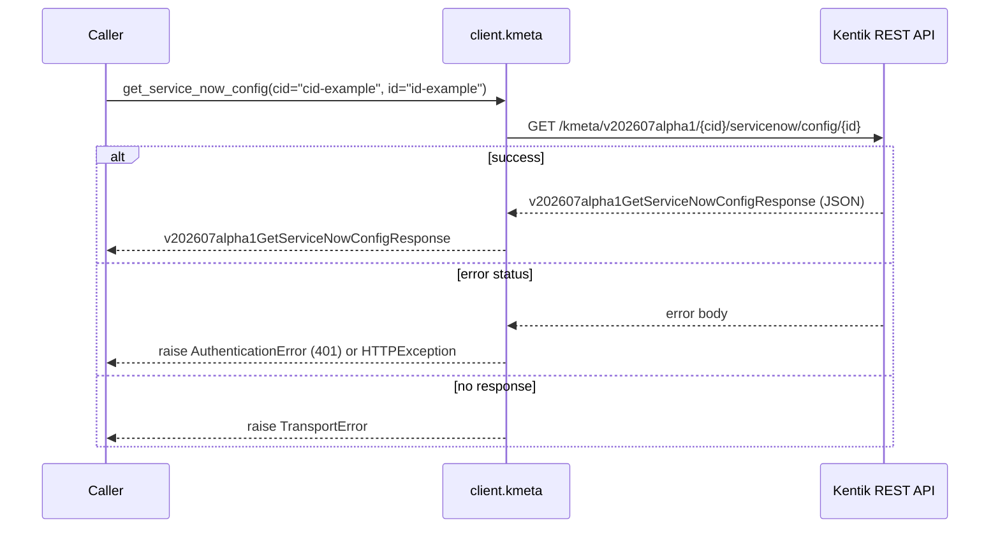

**gRPC transport**

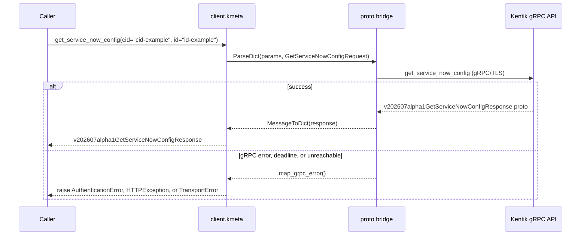

#### Parameters

| Name | In | Type | Required |
| --- | --- | --- | --- |
| `cid` | path | `string` | Yes |
| `id` | path | `string` | Yes |

#### Responses

| Status | Description | Model |
| --- | --- | --- |
| 200 | A successful response. | `v202607alpha1GetServiceNowConfigResponse` |
| default | An unexpected error response. | `rpcStatus` |

#### Example

```python
from kentik_api.client import KentikAPI

# Both transports work: protocol="rest" (default) or protocol="grpc".
client = KentikAPI(protocol="rest")  # loads KENTIK_EMAIL/KENTIK_API_TOKEN from .env
response = client.kmeta.get_service_now_config(
    cid="cid-example",
    id="id-example",
)
```

---

### `PUT` `/kmeta/v202607alpha1/{cid}/servicenow/config/{id}`

Update ServiceNow Config

Updates an existing ServiceNow integration configuration.

**REST transport**

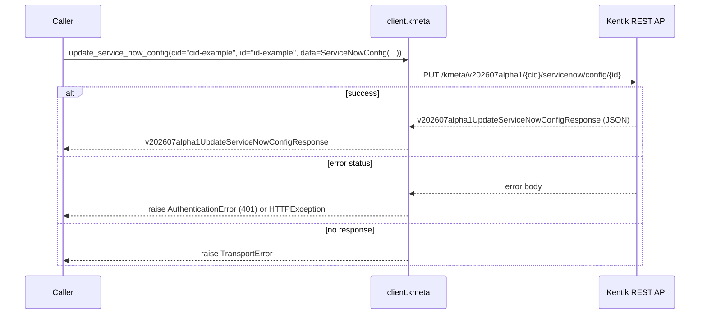

**gRPC transport**

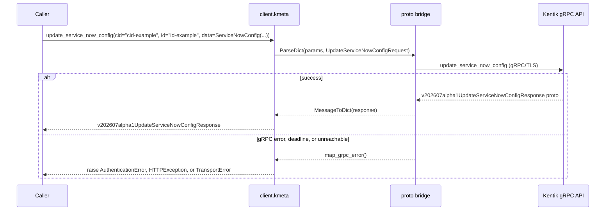

#### Parameters

| Name | In | Type | Required |
| --- | --- | --- | --- |
| `cid` | path | `string` | Yes |
| `id` | path | `string` | Yes |
| `data` | body | `-` | No |

#### Responses

| Status | Description | Model |
| --- | --- | --- |
| 200 | A successful response. | `v202607alpha1UpdateServiceNowConfigResponse` |
| default | An unexpected error response. | `rpcStatus` |

#### Example

```python
from kentik_api.client import KentikAPI

# Both transports work: protocol="rest" (default) or protocol="grpc".
client = KentikAPI(protocol="rest")  # loads KENTIK_EMAIL/KENTIK_API_TOKEN from .env
response = client.kmeta.update_service_now_config(
    cid="cid-example",
    id="id-example",
    data=ServiceNowConfig(...),
)
```

---

### `DELETE` `/kmeta/v202607alpha1/{cid}/servicenow/config/{id}`

Delete ServiceNow Config

Deletes a ServiceNow integration configuration.

**REST transport**

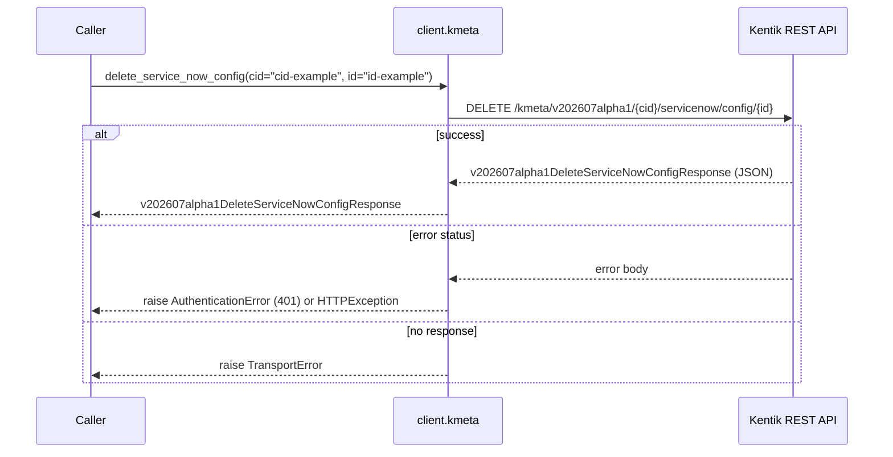

**gRPC transport**

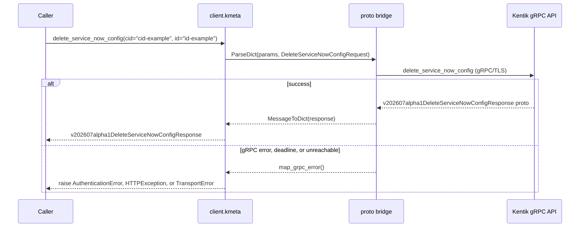

#### Parameters

| Name | In | Type | Required |
| --- | --- | --- | --- |
| `cid` | path | `string` | Yes |
| `id` | path | `string` | Yes |

#### Responses

| Status | Description | Model |
| --- | --- | --- |
| 200 | A successful response. | `v202607alpha1DeleteServiceNowConfigResponse` |
| default | An unexpected error response. | `rpcStatus` |

#### Example

```python
from kentik_api.client import KentikAPI

# Both transports work: protocol="rest" (default) or protocol="grpc".
client = KentikAPI(protocol="rest")  # loads KENTIK_EMAIL/KENTIK_API_TOKEN from .env
response = client.kmeta.delete_service_now_config(
    cid="cid-example",
    id="id-example",
)
```

## Data Models

<details>
<summary>Model relationships (2 of 8 models)</summary>

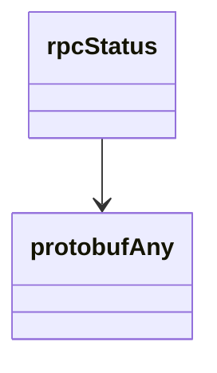

</details>

```{eval-rst}
.. autopydantic_model:: kentik_api.gen.kmeta.models.CreateServiceNowConfigResponse
```

```{eval-rst}
.. autopydantic_model:: kentik_api.gen.kmeta.models.DeleteServiceNowConfigResponse
```

```{eval-rst}
.. autopydantic_model:: kentik_api.gen.kmeta.models.GetServiceNowConfigResponse
```

```{eval-rst}
.. autopydantic_model:: kentik_api.gen.kmeta.models.ListServiceNowConfigsResponse
```

```{eval-rst}
.. autopydantic_model:: kentik_api.gen.kmeta.models.ServiceNowConfig
```

```{eval-rst}
.. autopydantic_model:: kentik_api.gen.kmeta.models.UpdateServiceNowConfigResponse
```

```{eval-rst}
.. autopydantic_model:: kentik_api.gen.kmeta.models.protobufAny
```

```{eval-rst}
.. autopydantic_model:: kentik_api.gen.kmeta.models.rpcStatus
```
