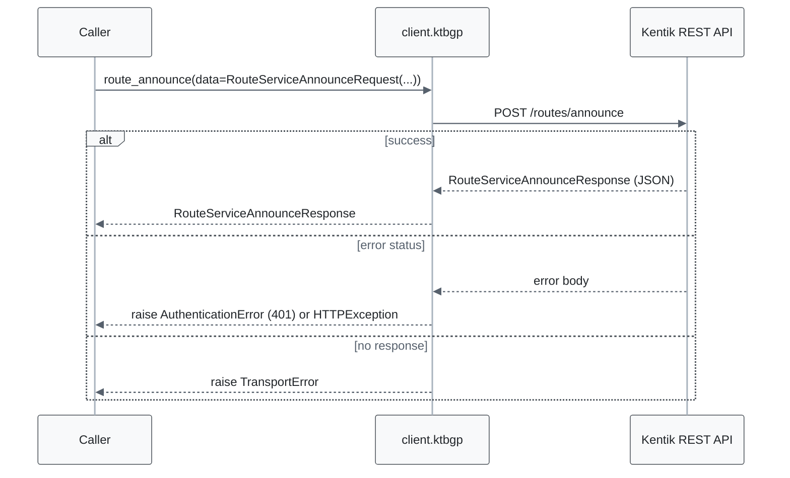
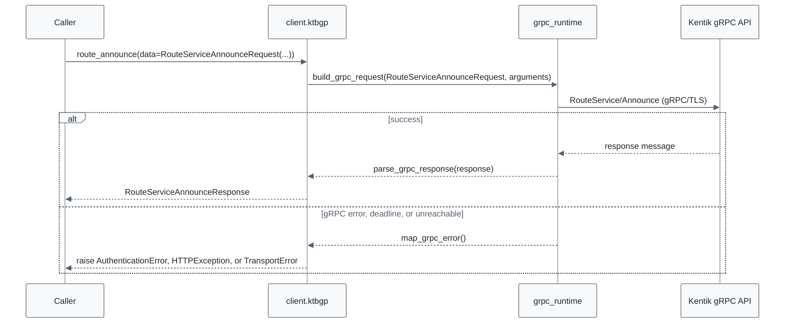
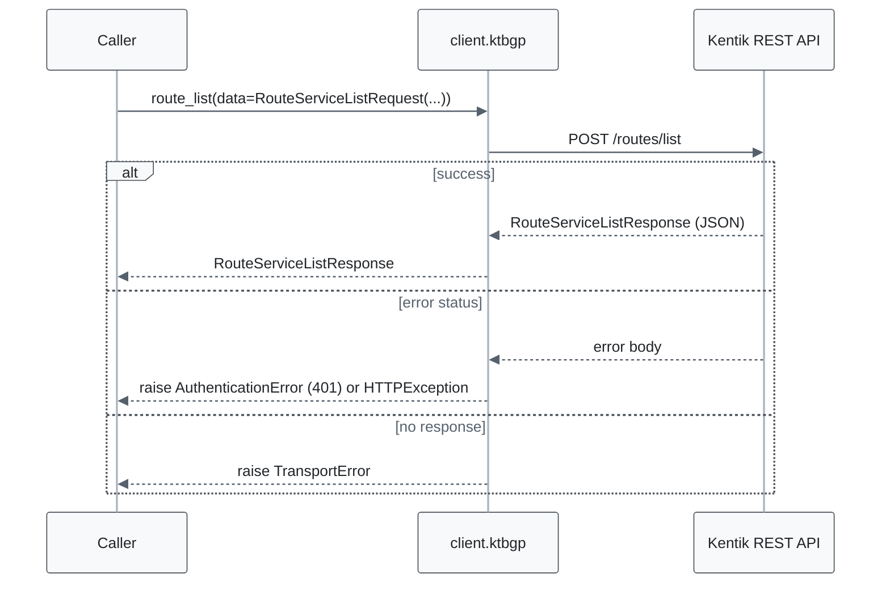
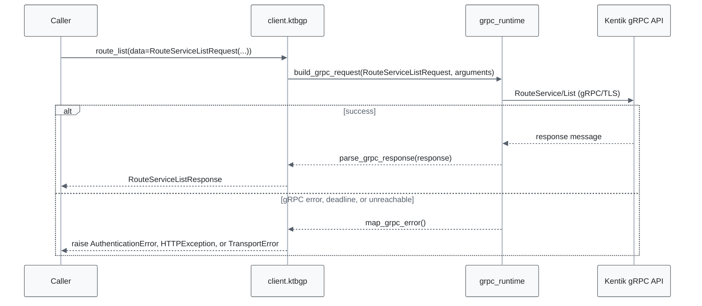
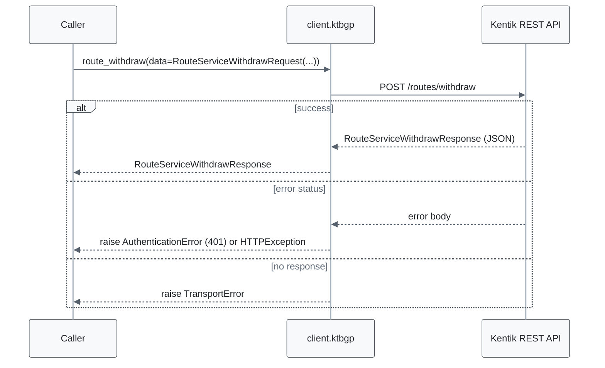
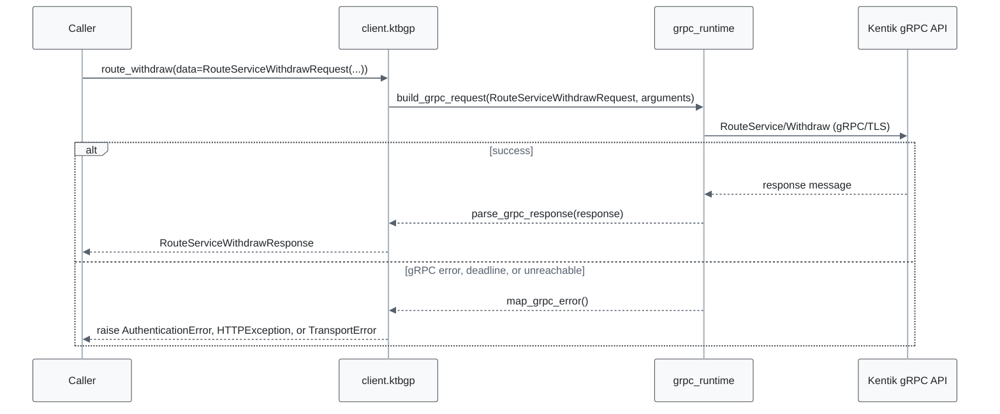
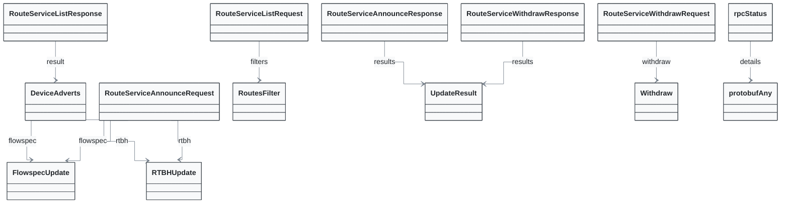

<!-- AUTO-GENERATED: scripts/generation/endpoint_docs.py, render_endpoint_docs() -->
<!-- Rebuilt on every `uv run poe generate`. Do not edit by hand. -->

# Ktbgp Service

## Overview

```{raw} html
<div class="kx">
<div class="chips" role="group" aria-label="Show one path" data-paths-for="overview-svg"></div>
<figure>
<div class="diagram explorer"><svg id="overview-svg" viewBox="0 0 1100 680" role="img" aria-label="Call path of client.ktbgp: your code calls the wrapper, which sends the call over REST or gRPC." xmlns="http://www.w3.org/2000/svg"><defs><marker id="ov-ah" viewBox="0 0 10 10" refX="8.5" refY="5" markerWidth="7" markerHeight="7" orient="auto-start-reverse"><path d="M0,0 L10,5 L0,10 z" class="ah"/></marker><marker id="ov-ah-hi" viewBox="0 0 10 10" refX="8.5" refY="5" markerWidth="7" markerHeight="7" orient="auto-start-reverse"><path d="M0,0 L10,5 L0,10 z" class="ah-hi"/></marker></defs><g class="edge call" data-seg="code_call" data-links="code>wrap"><path d="M520,102 V170" class="wire arrow" marker-end="url(#ov-ah)"/><text x="512" y="140" class="elabel" text-anchor="end">method call</text></g><g class="edge data" data-seg="wrap_answer" data-links="wrap>code"><path d="M580,170 V102" class="wire arrow" marker-end="url(#ov-ah)"/><text x="588" y="140" class="elabel" text-anchor="start">Pydantic model</text></g><g class="edge call" data-seg="rest_call" data-links="wrap>rest"><path d="M450,196 H230 V310" class="wire arrow" marker-end="url(#ov-ah)"/><text x="340" y="188" class="elabel" text-anchor="middle">arguments</text></g><g class="edge data" data-seg="rest_answer" data-links="rest>wrap"><path d="M290,310 V226 H450" class="wire arrow" marker-end="url(#ov-ah)"/><text x="298" y="275" class="elabel" text-anchor="start">Pydantic model</text></g><g class="edge call" data-seg="rj_call" data-links="rest>rj"><path d="M230,382 V450" class="wire arrow" marker-end="url(#ov-ah)"/><text x="222" y="420" class="elabel" text-anchor="end">method, path, body</text></g><g class="edge data" data-seg="rj_answer" data-links="rj>rest"><path d="M290,450 V382" class="wire arrow" marker-end="url(#ov-ah)"/><text x="298" y="420" class="elabel" text-anchor="start">JSON dict</text></g><g class="edge call" data-seg="api_call" data-links="rj>restapi"><path d="M230,522 V590" class="wire arrow" marker-end="url(#ov-ah)"/><text x="222" y="560" class="elabel" text-anchor="end">HTTPS request</text></g><g class="edge data" data-seg="api_answer" data-links="restapi>rj"><path d="M290,590 V522" class="wire arrow" marker-end="url(#ov-ah)"/><text x="298" y="560" class="elabel" text-anchor="start">JSON response</text></g><g class="edge call" data-seg="cg_call" data-links="wrap>cg"><path d="M650,196 H870 V310" class="wire arrow" marker-end="url(#ov-ah)"/><text x="760" y="188" class="elabel" text-anchor="middle">proto request</text></g><g class="edge data" data-seg="cg_answer" data-links="cg>wrap"><path d="M810,310 V226 H650" class="wire arrow" marker-end="url(#ov-ah)"/><text x="802" y="275" class="elabel" text-anchor="end">proto response</text></g><g class="edge call" data-seg="grpc_call" data-links="cg>grpcapi"><path d="M810,382 V590" class="wire arrow" marker-end="url(#ov-ah)"/><text x="802" y="490" class="elabel" text-anchor="end">gRPC call</text></g><g class="edge data" data-seg="grpc_answer" data-links="grpcapi>cg"><path d="M870,590 V382" class="wire arrow" marker-end="url(#ov-ah)"/><text x="878" y="490" class="elabel" text-anchor="start">proto response</text></g><g class="node fam-green src " data-id="code" tabindex="0" role="button" aria-label="Select Your code"><rect x="450" y="30" width="200" height="72" rx="14"/><text x="550.0" y="62.5" class="nm">Your code</text><text x="550.0" y="79.5" class="ft">client.ktbgp</text></g><g class="node fam-orange proc " data-id="wrap" tabindex="0" role="button" aria-label="Select KtbgpServiceWrapper"><rect x="450" y="170" width="200" height="72" rx="14"/><text x="550.0" y="194.0" class="nm">KtbgpServiceWrapper</text><text x="550.0" y="211.0" class="ft">client.ktbgp</text><text x="550.0" y="228.0" class="ft">3 operations</text></g><g class="node fam-blue proc " data-id="rest" tabindex="0" role="button" aria-label="Select REST functions"><rect x="160" y="310" width="200" height="72" rx="14"/><text x="260.0" y="342.5" class="nm">REST functions</text><text x="260.0" y="359.5" class="ft">gen/ktbgp/services/</text></g><g class="node fam-blue proc " data-id="rj" tabindex="0" role="button" aria-label="Select request_json()"><rect x="160" y="450" width="200" height="72" rx="14"/><text x="260.0" y="482.5" class="nm">request_json()</text><text x="260.0" y="499.5" class="ft">core/rest_runtime.py</text></g><g class="node fam-blue src " data-id="restapi" tabindex="0" role="button" aria-label="Select Kentik REST API"><rect x="160" y="590" width="200" height="72" rx="14"/><text x="260.0" y="622.5" class="nm">Kentik REST API</text><text x="260.0" y="639.5" class="ft">HTTPS + JSON</text></g><g class="node fam-violet proc " data-id="cg" tabindex="0" role="button" aria-label="Select call_grpc()"><rect x="740" y="310" width="200" height="72" rx="14"/><text x="840.0" y="342.5" class="nm">call_grpc()</text><text x="840.0" y="359.5" class="ft">core/grpc_runtime.py</text></g><g class="node fam-violet src " data-id="grpcapi" tabindex="0" role="button" aria-label="Select Kentik gRPC API"><rect x="740" y="590" width="200" height="72" rx="14"/><text x="840.0" y="622.5" class="nm">Kentik gRPC API</text><text x="840.0" y="639.5" class="ft">HTTP/2 + protobuf</text></g></svg></div>
<figcaption>Select a part. Each hop is a call going down and its answer coming back up.</figcaption>
</figure>
<div class="legend" aria-hidden="true"><span><svg viewBox="0 0 34 10"><line x1="2" y1="5" x2="32" y2="5" stroke="var(--wire-hi)" stroke-linecap="round" stroke-width="3"/></svg>what the selected part needs</span><span><svg viewBox="0 0 34 10"><line x1="2" y1="5" x2="32" y2="5" stroke="var(--wire-hi)" stroke-linecap="round" stroke-width="3" stroke-dasharray="9 7"/></svg>where its data goes</span></div>
<div class="detail" data-detail-for="overview-svg" aria-live="polite"></div>
<script type="application/json" id="diagram-data">{"overview-svg": {"select": "wrap", "parts": {"code": {"title": "Your code", "role": "Calls a method on the service wrapper.", "facts": ["client.ktbgp.<method>(...)"], "stops": "Nothing in the SDK runs."}, "wrap": {"title": "KtbgpServiceWrapper", "role": "Sends each call to the REST function or to call_grpc(), for the transport that the client uses.", "facts": ["Source: gen/ktbgp/services/ktbgp.py", "Returns models from gen/ktbgp/models/"], "stops": "Expected: no operation of this service can be called."}, "rest": {"title": "REST functions", "role": "One function per operation. Each one calls request_json() with its own error class.", "facts": ["Error classes: gen/ktbgp/error/"], "stops": "Expected: calls on a REST transport fail. A gRPC client keeps working."}, "rj": {"title": "request_json()", "role": "The one function that sends REST traffic: auth headers, quota, and errors.", "facts": ["Raises AuthenticationError on 401", "Raises the operation's error class on other errors"], "stops": "Expected: every REST call of every service fails."}, "restapi": {"title": "Kentik REST API", "role": "The REST endpoints of the service.", "facts": ["Reports the quota in response headers"], "stops": "Expected: REST calls raise TransportError. A gRPC client keeps working."}, "cg": {"title": "call_grpc()", "role": "The one function that sends gRPC traffic: deadline, quota, and errors.", "facts": ["Parses each answer into the same models as REST"], "stops": "Expected: every gRPC call fails. A REST client keeps working."}, "grpcapi": {"title": "Kentik gRPC API", "role": "The gRPC methods of the service.", "facts": ["Reports the quota in response metadata"], "stops": "Expected: gRPC calls raise TransportError. A REST client keeps working."}}, "paths": {"rest": {"label": "REST call", "family": "blue", "title": "A call on a REST transport", "text": "The wrapper calls the REST function, which sends the request with request_json().", "links": ["code>wrap", "wrap>rest", "rest>rj", "rj>restapi", "restapi>rj", "rj>rest", "rest>wrap", "wrap>code"]}, "grpc": {"label": "gRPC call", "family": "violet", "title": "A call on a gRPC transport", "text": "The wrapper builds the proto request and sends it with call_grpc().", "links": ["code>wrap", "wrap>cg", "cg>grpcapi", "grpcapi>cg", "cg>wrap", "wrap>code"]}}}}</script>
</div>
```

On an error status or a failed call, the SDK raises an error class from `gen/ktbgp/error/`, or a shared type from `kentik_api.errors`.

## Endpoints

### `POST` `/routes/announce`

Announce a BGP route to a specified set of devices

#### REST call flow



#### gRPC call flow



#### Parameters

| Name | In | Type | Required |
| --- | --- | --- | --- |
| `data` | body | `RouteServiceAnnounceRequest` | Yes |

#### Responses

| Status | Description | Model |
| --- | --- | --- |
| 200 | A successful response. | `RouteServiceAnnounceResponse` |
| default | An unexpected error response. | `rpcStatus` |

#### Example

```python
from kentik_api.client import KentikAPI
from kentik_api.gen.ktbgp.models import RouteServiceAnnounceRequest

# Both transports work: protocol="rest" (default) or protocol="grpc".
client = KentikAPI(protocol="rest")  # loads KENTIK_EMAIL/KENTIK_API_TOKEN from .env
response = client.ktbgp.route_announce(
    data=RouteServiceAnnounceRequest(...),
)
```

---

### `POST` `/routes/list`

List active BGP updates for a specified set of devices

#### REST call flow



#### gRPC call flow



#### Parameters

| Name | In | Type | Required |
| --- | --- | --- | --- |
| `data` | body | `RouteServiceListRequest` | Yes |

#### Responses

| Status | Description | Model |
| --- | --- | --- |
| 200 | A successful response. | `RouteServiceListResponse` |
| default | An unexpected error response. | `rpcStatus` |

#### Example

```python
from kentik_api.client import KentikAPI
from kentik_api.gen.ktbgp.models import RouteServiceListRequest

# Both transports work: protocol="rest" (default) or protocol="grpc".
client = KentikAPI(protocol="rest")  # loads KENTIK_EMAIL/KENTIK_API_TOKEN from .env
response = client.ktbgp.route_list(
    data=RouteServiceListRequest(...),
)
```

---

### `POST` `/routes/withdraw`

Withdraw active BGP updates from devices

#### REST call flow



#### gRPC call flow



#### Parameters

| Name | In | Type | Required |
| --- | --- | --- | --- |
| `data` | body | `RouteServiceWithdrawRequest` | Yes |

#### Responses

| Status | Description | Model |
| --- | --- | --- |
| 200 | A successful response. | `RouteServiceWithdrawResponse` |
| default | An unexpected error response. | `rpcStatus` |

#### Example

```python
from kentik_api.client import KentikAPI
from kentik_api.gen.ktbgp.models import RouteServiceWithdrawRequest

# Both transports work: protocol="rest" (default) or protocol="grpc".
client = KentikAPI(protocol="rest")  # loads KENTIK_EMAIL/KENTIK_API_TOKEN from .env
response = client.ktbgp.route_withdraw(
    data=RouteServiceWithdrawRequest(...),
)
```

## Data Models

<details>
<summary>Model relationships (14 of 45 models)</summary>

Each arrow points from a model to a model that one of its fields holds. The label names the field.



</details>

```{eval-rst}
.. autoclass:: kentik_api.gen.ktbgp.models.AdvertStatus
   :members:
```

```{eval-rst}
.. autoclass:: kentik_api.gen.ktbgp.models.BitwiseOp
   :members:
```

```{eval-rst}
.. autopydantic_model:: kentik_api.gen.ktbgp.models.DeviceAdverts
```

```{eval-rst}
.. autoclass:: kentik_api.gen.ktbgp.models.ExtendedCommunityRouteType
   :members:
```

```{eval-rst}
.. autopydantic_model:: kentik_api.gen.ktbgp.models.FlowspecAction
```

```{eval-rst}
.. autopydantic_model:: kentik_api.gen.ktbgp.models.FlowspecActionAccept
```

```{eval-rst}
.. autopydantic_model:: kentik_api.gen.ktbgp.models.FlowspecActionDiscard
```

```{eval-rst}
.. autopydantic_model:: kentik_api.gen.ktbgp.models.FlowspecActionExtendedCommunity
```

```{eval-rst}
.. autopydantic_model:: kentik_api.gen.ktbgp.models.FlowspecActionIPNextHopCopy
```

```{eval-rst}
.. autopydantic_model:: kentik_api.gen.ktbgp.models.FlowspecActionIPNextHopRedirect
```

```{eval-rst}
.. autopydantic_model:: kentik_api.gen.ktbgp.models.FlowspecActionLargeCommunity
```

```{eval-rst}
.. autopydantic_model:: kentik_api.gen.ktbgp.models.FlowspecActionMarkDSCP
```

```{eval-rst}
.. autopydantic_model:: kentik_api.gen.ktbgp.models.FlowspecActionRegularCommunity
```

```{eval-rst}
.. autopydantic_model:: kentik_api.gen.ktbgp.models.FlowspecActionRouteTargetRedirect
```

```{eval-rst}
.. autopydantic_model:: kentik_api.gen.ktbgp.models.FlowspecActionTerminalSample
```

```{eval-rst}
.. autopydantic_model:: kentik_api.gen.ktbgp.models.FlowspecActionTrafficRateBytes
```

```{eval-rst}
.. autopydantic_model:: kentik_api.gen.ktbgp.models.FlowspecMatch
```

```{eval-rst}
.. autopydantic_model:: kentik_api.gen.ktbgp.models.FlowspecUpdate
```

```{eval-rst}
.. autoclass:: kentik_api.gen.ktbgp.models.Fragment
   :members:
```

```{eval-rst}
.. autopydantic_model:: kentik_api.gen.ktbgp.models.FragmentFormula
```

```{eval-rst}
.. autopydantic_model:: kentik_api.gen.ktbgp.models.FragmentPredicate
```

```{eval-rst}
.. autopydantic_model:: kentik_api.gen.ktbgp.models.FragmentPredicateGroup
```

```{eval-rst}
.. autoclass:: kentik_api.gen.ktbgp.models.InetType
   :members:
```

```{eval-rst}
.. autopydantic_model:: kentik_api.gen.ktbgp.models.NumericFormula
```

```{eval-rst}
.. autoclass:: kentik_api.gen.ktbgp.models.NumericOp
   :members:
```

```{eval-rst}
.. autopydantic_model:: kentik_api.gen.ktbgp.models.NumericPredicate
```

```{eval-rst}
.. autopydantic_model:: kentik_api.gen.ktbgp.models.NumericPredicateGroup
```

```{eval-rst}
.. autopydantic_model:: kentik_api.gen.ktbgp.models.RTBHAction
```

```{eval-rst}
.. autopydantic_model:: kentik_api.gen.ktbgp.models.RTBHMatch
```

```{eval-rst}
.. autopydantic_model:: kentik_api.gen.ktbgp.models.RTBHUpdate
```

```{eval-rst}
.. autopydantic_model:: kentik_api.gen.ktbgp.models.RouteServiceAnnounceRequest
```

```{eval-rst}
.. autopydantic_model:: kentik_api.gen.ktbgp.models.RouteServiceAnnounceResponse
```

```{eval-rst}
.. autopydantic_model:: kentik_api.gen.ktbgp.models.RouteServiceListRequest
```

```{eval-rst}
.. autopydantic_model:: kentik_api.gen.ktbgp.models.RouteServiceListResponse
```

```{eval-rst}
.. autopydantic_model:: kentik_api.gen.ktbgp.models.RouteServiceWithdrawRequest
```

```{eval-rst}
.. autopydantic_model:: kentik_api.gen.ktbgp.models.RouteServiceWithdrawResponse
```

```{eval-rst}
.. autopydantic_model:: kentik_api.gen.ktbgp.models.RoutesFilter
```

```{eval-rst}
.. autoclass:: kentik_api.gen.ktbgp.models.TCPFlag
   :members:
```

```{eval-rst}
.. autopydantic_model:: kentik_api.gen.ktbgp.models.TCPFlagsFormula
```

```{eval-rst}
.. autopydantic_model:: kentik_api.gen.ktbgp.models.TCPFlagsPredicate
```

```{eval-rst}
.. autopydantic_model:: kentik_api.gen.ktbgp.models.TCPFlagsPredicateGroup
```

```{eval-rst}
.. autopydantic_model:: kentik_api.gen.ktbgp.models.UpdateResult
```

```{eval-rst}
.. autopydantic_model:: kentik_api.gen.ktbgp.models.Withdraw
```

```{eval-rst}
.. autopydantic_model:: kentik_api.gen.ktbgp.models.protobufAny
```

```{eval-rst}
.. autopydantic_model:: kentik_api.gen.ktbgp.models.rpcStatus
```
