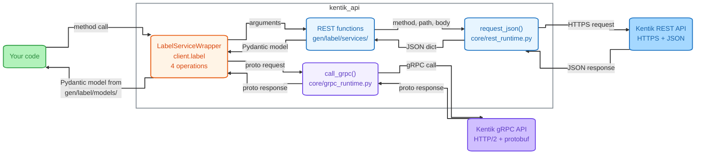
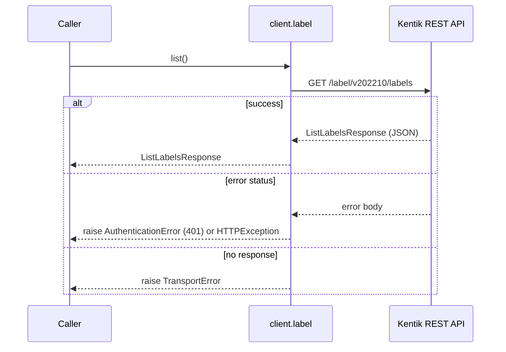
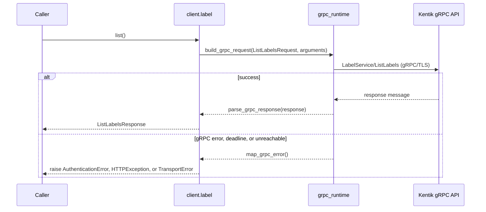
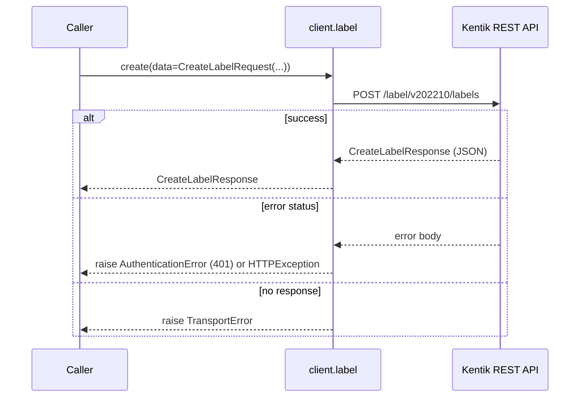
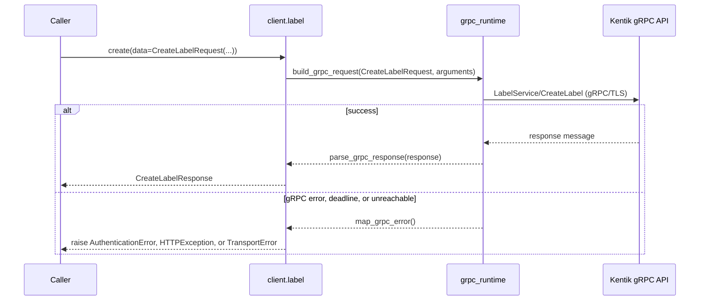
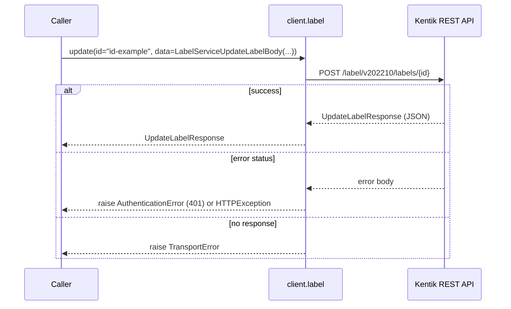
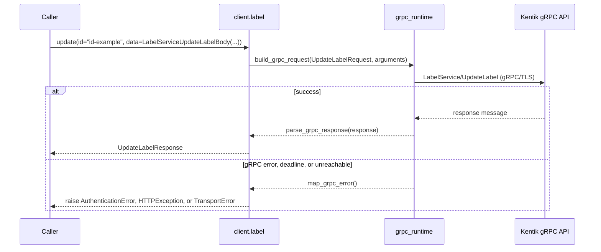
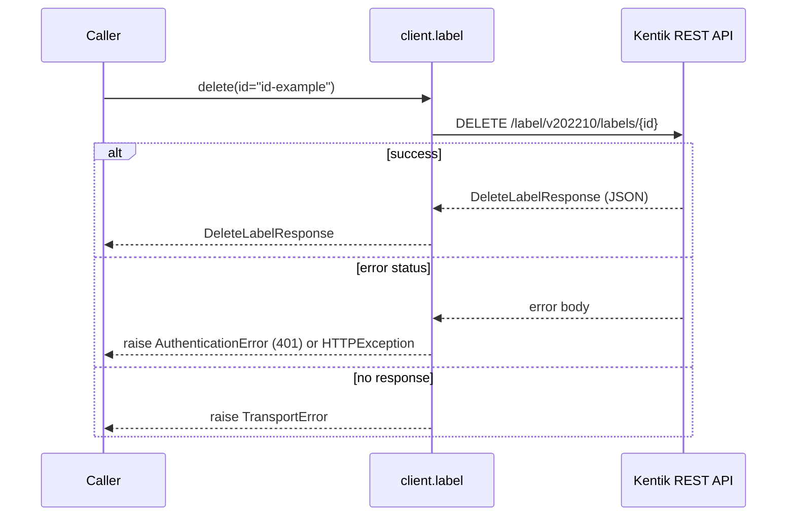
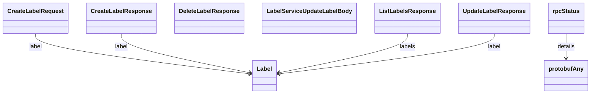

<!-- AUTO-GENERATED: scripts/generation/endpoint_docs.py, render_endpoint_docs() -->
<!-- Rebuilt on every `uv run poe generate`. Do not edit by hand. -->

# Label Service

## Overview



On an error status or a failed call, the SDK raises an error class from `gen/label/error/`, or a shared type from `kentik_api.errors`.

## Endpoints

### `GET` `/label/v202210/labels`

List all configured labels

Returns list of all labels configured in the account.

#### REST call flow



#### gRPC call flow



#### Responses

| Status | Description | Model |
| --- | --- | --- |
| 200 | A successful response. | `ListLabelsResponse` |
| default | An unexpected error response. | `rpcStatus` |

#### Example

```python
from kentik_api.client import KentikAPI

# Both transports work: protocol="rest" (default) or protocol="grpc".
client = KentikAPI(protocol="rest")  # loads KENTIK_EMAIL/KENTIK_API_TOKEN from .env
response = client.label.list()
```

---

### `POST` `/label/v202210/labels`

Create a new label.

Creates a new label based on data in the request.

#### REST call flow



#### gRPC call flow



#### Parameters

| Name | In | Type | Required |
| --- | --- | --- | --- |
| `data` | body | `CreateLabelRequest` | Yes |

#### Responses

| Status | Description | Model |
| --- | --- | --- |
| 200 | A successful response. | `CreateLabelResponse` |
| default | An unexpected error response. | `rpcStatus` |

#### Example

```python
from kentik_api.client import KentikAPI
from kentik_api.gen.label.models import CreateLabelRequest

# Both transports work: protocol="rest" (default) or protocol="grpc".
client = KentikAPI(protocol="rest")  # loads KENTIK_EMAIL/KENTIK_API_TOKEN from .env
response = client.label.create(
    data=CreateLabelRequest(...),
)
```

---

### `POST` `/label/v202210/labels/{id}`

Update an existing label.

Updates configuration of a label.

#### REST call flow



#### gRPC call flow



#### Parameters

| Name | In | Type | Required |
| --- | --- | --- | --- |
| `id` | path | `string` | Yes |
| `data` | body | `LabelServiceUpdateLabelBody` | Yes |

#### Responses

| Status | Description | Model |
| --- | --- | --- |
| 200 | A successful response. | `UpdateLabelResponse` |
| default | An unexpected error response. | `rpcStatus` |

#### Example

```python
from kentik_api.client import KentikAPI
from kentik_api.gen.label.models import LabelServiceUpdateLabelBody

# Both transports work: protocol="rest" (default) or protocol="grpc".
client = KentikAPI(protocol="rest")  # loads KENTIK_EMAIL/KENTIK_API_TOKEN from .env
response = client.label.update(
    id="id-example",
    data=LabelServiceUpdateLabelBody(...),
)
```

---

### `DELETE` `/label/v202210/labels/{id}`

Delete a label.

Deletes label with specified with id.

#### REST call flow



#### gRPC call flow


#### Parameters

| Name | In | Type | Required |
| --- | --- | --- | --- |
| `id` | path | `string` | Yes |

#### Responses

| Status | Description | Model |
| --- | --- | --- |
| 200 | A successful response. | `DeleteLabelResponse` |
| default | An unexpected error response. | `rpcStatus` |

#### Example

```python
from kentik_api.client import KentikAPI

# Both transports work: protocol="rest" (default) or protocol="grpc".
client = KentikAPI(protocol="rest")  # loads KENTIK_EMAIL/KENTIK_API_TOKEN from .env
response = client.label.delete(
    id="id-example",
)
```

## Data Models

<details>
<summary>Model relationships (9 of 9 models)</summary>

Each arrow points from a model to a model that one of its fields holds. The label names the field.



</details>

```{eval-rst}
.. autopydantic_model:: kentik_api.gen.label.models.CreateLabelRequest
```

```{eval-rst}
.. autopydantic_model:: kentik_api.gen.label.models.CreateLabelResponse
```

```{eval-rst}
.. autopydantic_model:: kentik_api.gen.label.models.DeleteLabelResponse
```

```{eval-rst}
.. autopydantic_model:: kentik_api.gen.label.models.Label
```

```{eval-rst}
.. autopydantic_model:: kentik_api.gen.label.models.LabelServiceUpdateLabelBody
```

```{eval-rst}
.. autopydantic_model:: kentik_api.gen.label.models.ListLabelsResponse
```

```{eval-rst}
.. autopydantic_model:: kentik_api.gen.label.models.UpdateLabelResponse
```

```{eval-rst}
.. autopydantic_model:: kentik_api.gen.label.models.protobufAny
```

```{eval-rst}
.. autopydantic_model:: kentik_api.gen.label.models.rpcStatus
```
