<!-- AUTO-GENERATED: scripts/generation/endpoint_docs.py, render_endpoint_docs() -->
<!-- Rebuilt on every `uv run poe generate`. Do not edit by hand. -->

# Mkp Service

## Overview

```{raw} html
<div class="kx">
<div class="chips" role="group" aria-label="Show one path" data-paths-for="overview-svg"></div>
<figure>
<div class="diagram explorer"><svg id="overview-svg" viewBox="0 0 1100 680" role="img" aria-label="Call path of client.mkp: your code calls the wrapper, which sends the call over REST or gRPC." xmlns="http://www.w3.org/2000/svg"><defs><marker id="ov-ah" viewBox="0 0 10 10" refX="8.5" refY="5" markerWidth="7" markerHeight="7" orient="auto-start-reverse"><path d="M0,0 L10,5 L0,10 z" class="ah"/></marker><marker id="ov-ah-hi" viewBox="0 0 10 10" refX="8.5" refY="5" markerWidth="7" markerHeight="7" orient="auto-start-reverse"><path d="M0,0 L10,5 L0,10 z" class="ah-hi"/></marker></defs><g class="edge call" data-seg="code_call" data-links="code>wrap"><path d="M520,102 V170" data-route="M520,102 V170" class="wire arrow" marker-end="url(#ov-ah)"/><text x="512" y="140" class="elabel" text-anchor="end">method call</text></g><g class="edge data" data-seg="wrap_answer" data-links="wrap>code"><path d="M580,170 V102" data-route="M580,170 V102" class="wire arrow" marker-end="url(#ov-ah)"/><text x="588" y="140" class="elabel" text-anchor="start">Pydantic model</text></g><g class="edge call" data-seg="rest_call" data-links="wrap>rest"><path d="M450,196 L240,196 Q230,196 230,206 L230,310" data-route="M450,196 H230 V310" class="wire arrow" marker-end="url(#ov-ah)"/><text x="340" y="188" class="elabel" text-anchor="middle">arguments</text></g><g class="edge data" data-seg="rest_answer" data-links="rest>wrap"><path d="M290,310 L290,236 Q290,226 300,226 L450,226" data-route="M290,310 V226 H450" class="wire arrow" marker-end="url(#ov-ah)"/><text x="298" y="275" class="elabel" text-anchor="start">Pydantic model</text></g><g class="edge call" data-seg="rj_call" data-links="rest>rj"><path d="M230,382 V450" data-route="M230,382 V450" class="wire arrow" marker-end="url(#ov-ah)"/><text x="222" y="420" class="elabel" text-anchor="end">method, path, body</text></g><g class="edge data" data-seg="rj_answer" data-links="rj>rest"><path d="M290,450 V382" data-route="M290,450 V382" class="wire arrow" marker-end="url(#ov-ah)"/><text x="298" y="420" class="elabel" text-anchor="start">JSON dict</text></g><g class="edge call" data-seg="api_call" data-links="rj>restapi"><path d="M230,522 V590" data-route="M230,522 V590" class="wire arrow" marker-end="url(#ov-ah)"/><text x="222" y="560" class="elabel" text-anchor="end">HTTPS request</text></g><g class="edge data" data-seg="api_answer" data-links="restapi>rj"><path d="M290,590 V522" data-route="M290,590 V522" class="wire arrow" marker-end="url(#ov-ah)"/><text x="298" y="560" class="elabel" text-anchor="start">JSON response</text></g><g class="edge call" data-seg="cg_call" data-links="wrap>cg"><path d="M650,196 L860,196 Q870,196 870,206 L870,310" data-route="M650,196 H870 V310" class="wire arrow" marker-end="url(#ov-ah)"/><text x="760" y="188" class="elabel" text-anchor="middle">proto request</text></g><g class="edge data" data-seg="cg_answer" data-links="cg>wrap"><path d="M810,310 L810,236 Q810,226 800,226 L650,226" data-route="M810,310 V226 H650" class="wire arrow" marker-end="url(#ov-ah)"/><text x="802" y="275" class="elabel" text-anchor="end">proto response</text></g><g class="edge call" data-seg="grpc_call" data-links="cg>grpcapi"><path d="M810,382 V590" data-route="M810,382 V590" class="wire arrow" marker-end="url(#ov-ah)"/><text x="802" y="490" class="elabel" text-anchor="end">gRPC call</text></g><g class="edge data" data-seg="grpc_answer" data-links="grpcapi>cg"><path d="M870,590 V382" data-route="M870,590 V382" class="wire arrow" marker-end="url(#ov-ah)"/><text x="878" y="490" class="elabel" text-anchor="start">proto response</text></g><g class="node fam-green src " data-id="code" tabindex="0" role="button" aria-label="Select Your code"><rect x="450" y="30" width="200" height="72" rx="14"/><text x="550.0" y="62.5" class="nm">Your code</text><text x="550.0" y="79.5" class="ft">client.mkp</text></g><g class="node fam-orange proc " data-id="wrap" tabindex="0" role="button" aria-label="Select MkpServiceWrapper"><rect x="450" y="170" width="200" height="72" rx="14"/><text x="550.0" y="194.0" class="nm">MkpServiceWrapper</text><text x="550.0" y="211.0" class="ft">client.mkp</text><text x="550.0" y="228.0" class="ft">14 operations</text></g><g class="node fam-blue proc " data-id="rest" tabindex="0" role="button" aria-label="Select REST functions"><rect x="160" y="310" width="200" height="72" rx="14"/><text x="260.0" y="342.5" class="nm">REST functions</text><text x="260.0" y="359.5" class="ft">gen/mkp/services/</text></g><g class="node fam-blue proc " data-id="rj" tabindex="0" role="button" aria-label="Select request_json()"><rect x="160" y="450" width="200" height="72" rx="14"/><text x="260.0" y="482.5" class="nm">request_json()</text><text x="260.0" y="499.5" class="ft">core/rest_runtime.py</text></g><g class="node fam-blue src " data-id="restapi" tabindex="0" role="button" aria-label="Select Kentik REST API"><rect x="160" y="590" width="200" height="72" rx="14"/><text x="260.0" y="622.5" class="nm">Kentik REST API</text><text x="260.0" y="639.5" class="ft">HTTPS + JSON</text></g><g class="node fam-violet proc " data-id="cg" tabindex="0" role="button" aria-label="Select call_grpc()"><rect x="740" y="310" width="200" height="72" rx="14"/><text x="840.0" y="342.5" class="nm">call_grpc()</text><text x="840.0" y="359.5" class="ft">core/grpc_runtime.py</text></g><g class="node fam-violet src " data-id="grpcapi" tabindex="0" role="button" aria-label="Select Kentik gRPC API"><rect x="740" y="590" width="200" height="72" rx="14"/><text x="840.0" y="622.5" class="nm">Kentik gRPC API</text><text x="840.0" y="639.5" class="ft">HTTP/2 + protobuf</text></g></svg></div>
<figcaption>Select a part. Each hop is a call going down and its answer coming back up.</figcaption>
</figure>
<div class="legend" aria-hidden="true"><span><svg viewBox="0 0 34 10"><line x1="2" y1="5" x2="32" y2="5" stroke="var(--wire-hi)" stroke-linecap="round" stroke-width="3"/></svg>what the selected part needs</span><span><svg viewBox="0 0 34 10"><line x1="2" y1="5" x2="32" y2="5" stroke="var(--wire-hi)" stroke-linecap="round" stroke-width="3" stroke-dasharray="9 7"/></svg>where its data goes</span></div>
<div class="detail" data-detail-for="overview-svg" aria-live="polite"></div>
<script type="application/json" id="diagram-data">{"overview-svg": {"select": "wrap", "parts": {"code": {"title": "Your code", "role": "Calls a method on the service wrapper.", "facts": ["client.mkp.<method>(...)"], "stops": "Nothing in the SDK runs."}, "wrap": {"title": "MkpServiceWrapper", "role": "Sends each call to the REST function or to call_grpc(), for the transport that the client uses.", "facts": ["Source: gen/mkp/services/mkp.py", "Returns models from gen/mkp/models/"], "stops": "Expected: no operation of this service can be called."}, "rest": {"title": "REST functions", "role": "One function per operation. Each one calls request_json() with its own error class.", "facts": ["Error classes: gen/mkp/error/"], "stops": "Expected: calls on a REST transport fail. A gRPC client keeps working."}, "rj": {"title": "request_json()", "role": "The one function that sends REST traffic: auth headers, quota, and errors.", "facts": ["Raises AuthenticationError on 401", "Raises the operation's error class on other errors"], "stops": "Expected: every REST call of every service fails."}, "restapi": {"title": "Kentik REST API", "role": "The REST endpoints of the service.", "facts": ["Reports the quota in response headers"], "stops": "Expected: REST calls raise TransportError. A gRPC client keeps working."}, "cg": {"title": "call_grpc()", "role": "The one function that sends gRPC traffic: deadline, quota, and errors.", "facts": ["Parses each answer into the same models as REST"], "stops": "Expected: every gRPC call fails. A REST client keeps working."}, "grpcapi": {"title": "Kentik gRPC API", "role": "The gRPC methods of the service.", "facts": ["Reports the quota in response metadata"], "stops": "Expected: gRPC calls raise TransportError. A REST client keeps working."}}, "paths": {"rest": {"label": "REST call", "family": "blue", "title": "A call on a REST transport", "text": "The wrapper calls the REST function, which sends the request with request_json().", "links": ["code>wrap", "wrap>rest", "rest>rj", "rj>restapi", "restapi>rj", "rj>rest", "rest>wrap", "wrap>code"]}, "grpc": {"label": "gRPC call", "family": "violet", "title": "A call on a gRPC transport", "text": "The wrapper builds the proto request and sends it with call_grpc().", "links": ["code>wrap", "wrap>cg", "cg>grpcapi", "grpcapi>cg", "cg>wrap", "wrap>code"]}}}}</script>
</div>
```

On an error status or a failed call, the SDK raises an error class from `gen/mkp/error/`, or a shared type from `kentik_api.errors`.

## Endpoints

### PackageService

#### `GET` `/mkp/v202407/packages`

List MKP packages.

Returns a list of MKP packages.

##### REST call flow

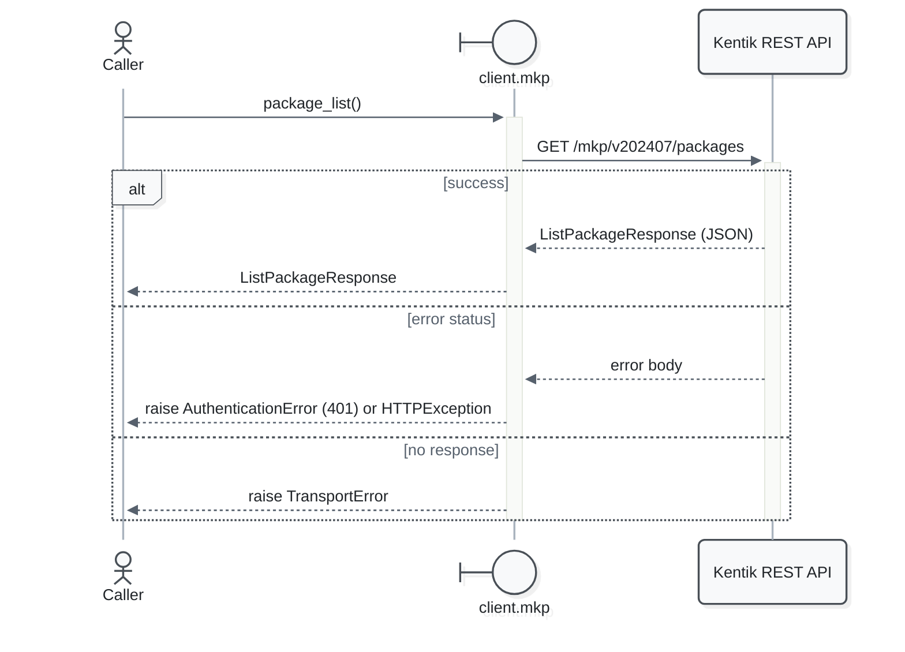

##### gRPC call flow

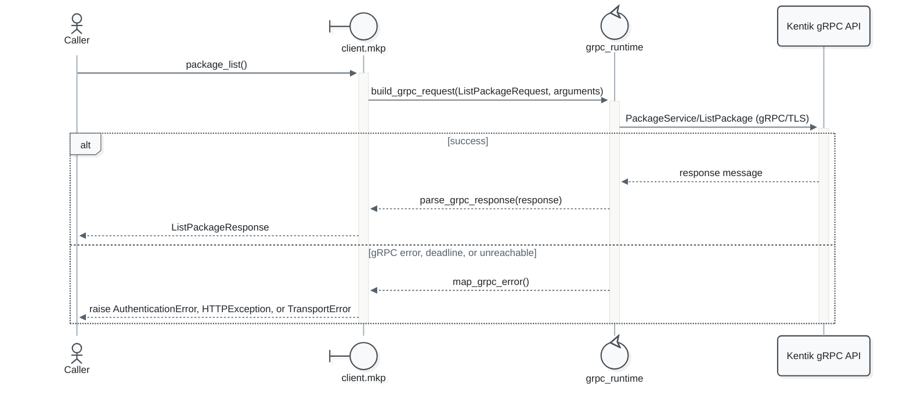

##### Responses

| Status | Description | Model |
| --- | --- | --- |
| 200 | A successful response. | `ListPackageResponse` |
| default | An unexpected error response. | `rpcStatus` |

##### Example

```python
from kentik_api.client import KentikAPI

# Both transports work: protocol="rest" (default) or protocol="grpc".
client = KentikAPI(protocol="rest")  # loads KENTIK_EMAIL/KENTIK_API_TOKEN from .env
response = client.mkp.package_list()
```

---

#### `POST` `/mkp/v202407/packages`

Create a package template.

Create package from request. returns created package.

##### REST call flow

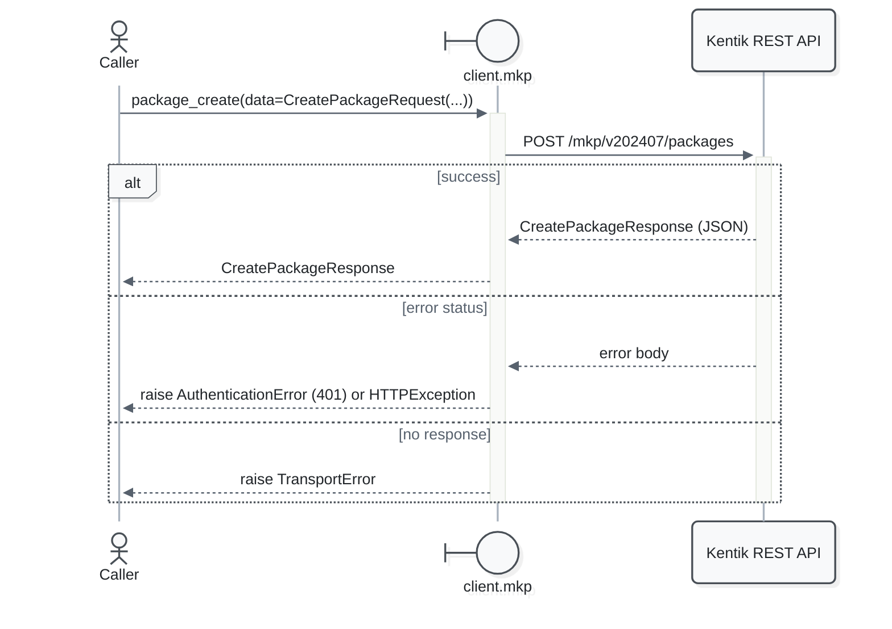

##### gRPC call flow


##### Parameters

| Name | In | Type | Required |
| --- | --- | --- | --- |
| `data` | body | `CreatePackageRequest` | Yes |

##### Responses

| Status | Description | Model |
| --- | --- | --- |
| 200 | A successful response. | `CreatePackageResponse` |
| default | An unexpected error response. | `rpcStatus` |

##### Example

```python
from kentik_api.client import KentikAPI
from kentik_api.gen.mkp.models import CreatePackageRequest

# Both transports work: protocol="rest" (default) or protocol="grpc".
client = KentikAPI(protocol="rest")  # loads KENTIK_EMAIL/KENTIK_API_TOKEN from .env
response = client.mkp.package_create(
    data=CreatePackageRequest(...),
)
```

---

#### `GET` `/mkp/v202407/packages/{id}`

Get information aboout a package.

Returns information about package specified with ID.

##### REST call flow

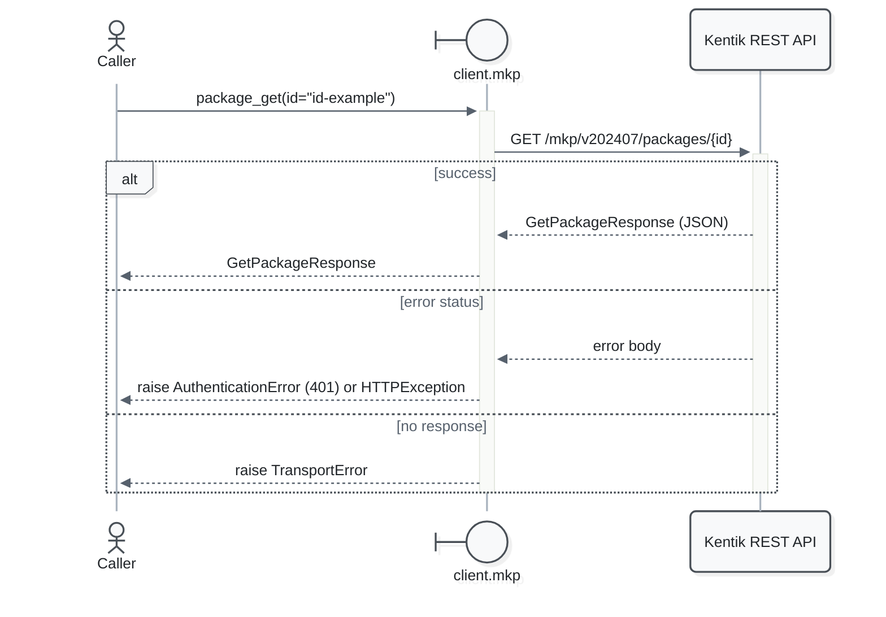

##### gRPC call flow

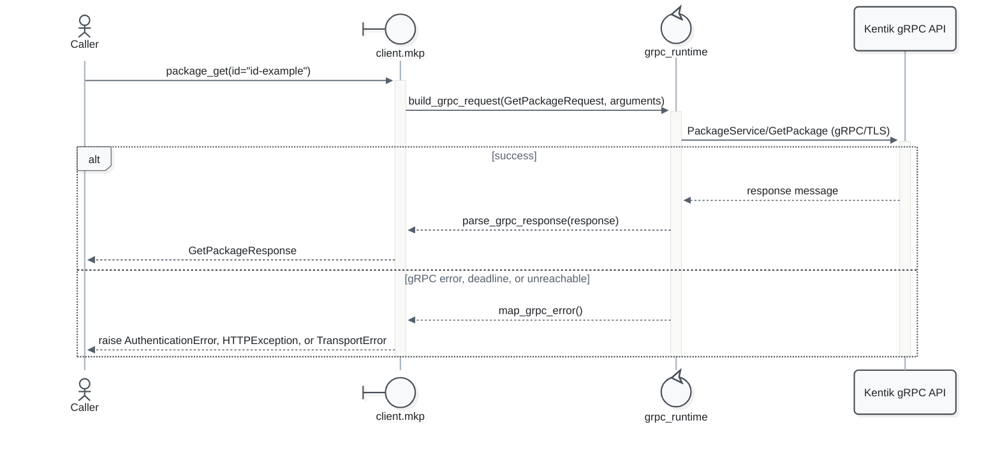

##### Parameters

| Name | In | Type | Required |
| --- | --- | --- | --- |
| `id` | path | `string` | Yes |

##### Responses

| Status | Description | Model |
| --- | --- | --- |
| 200 | A successful response. | `GetPackageResponse` |
| default | An unexpected error response. | `rpcStatus` |

##### Example

```python
from kentik_api.client import KentikAPI

# Both transports work: protocol="rest" (default) or protocol="grpc".
client = KentikAPI(protocol="rest")  # loads KENTIK_EMAIL/KENTIK_API_TOKEN from .env
response = client.mkp.package_get(
    id="id-example",
)
```

---

#### `PUT` `/mkp/v202407/packages/{id}`

Update a package.

Update package attributes specified with id.

##### REST call flow

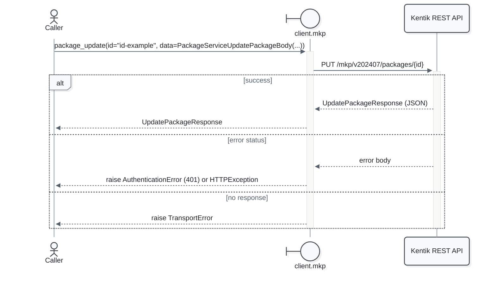

##### gRPC call flow

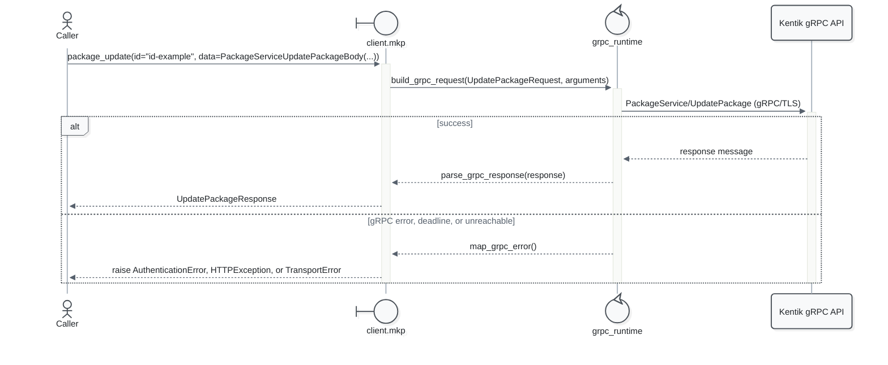

##### Parameters

| Name | In | Type | Required |
| --- | --- | --- | --- |
| `id` | path | `string` | Yes |
| `data` | body | `PackageServiceUpdatePackageBody` | Yes |

##### Responses

| Status | Description | Model |
| --- | --- | --- |
| 200 | A successful response. | `UpdatePackageResponse` |
| default | An unexpected error response. | `rpcStatus` |

##### Example

```python
from kentik_api.client import KentikAPI
from kentik_api.gen.mkp.models import PackageServiceUpdatePackageBody

# Both transports work: protocol="rest" (default) or protocol="grpc".
client = KentikAPI(protocol="rest")  # loads KENTIK_EMAIL/KENTIK_API_TOKEN from .env
response = client.mkp.package_update(
    id="id-example",
    data=PackageServiceUpdatePackageBody(...),
)
```

---

#### `DELETE` `/mkp/v202407/packages/{id}`

Delete a package.

Deletes the package specified with id.

##### REST call flow

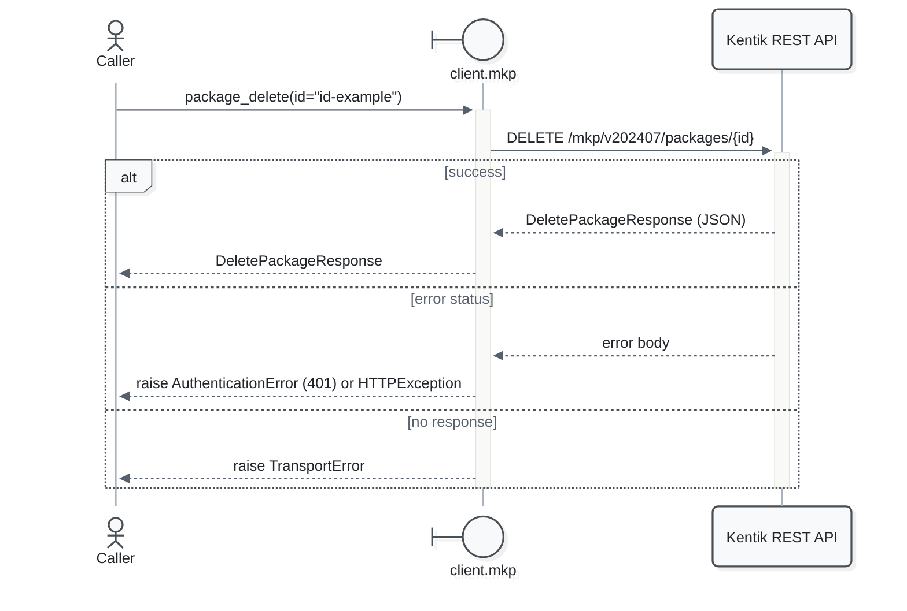

##### gRPC call flow

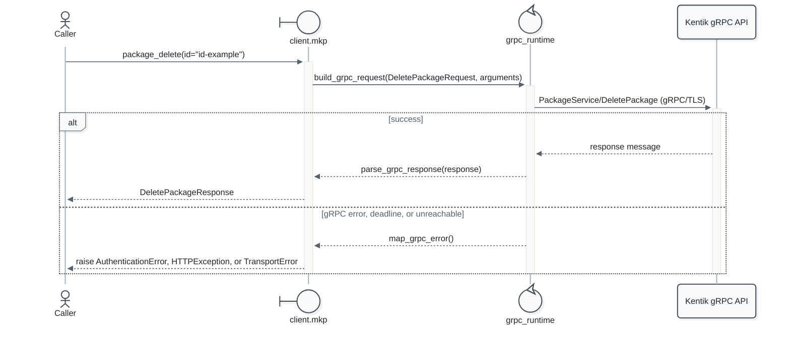

##### Parameters

| Name | In | Type | Required |
| --- | --- | --- | --- |
| `id` | path | `string` | Yes |

##### Responses

| Status | Description | Model |
| --- | --- | --- |
| 200 | A successful response. | `DeletePackageResponse` |
| default | An unexpected error response. | `rpcStatus` |

##### Example

```python
from kentik_api.client import KentikAPI

# Both transports work: protocol="rest" (default) or protocol="grpc".
client = KentikAPI(protocol="rest")  # loads KENTIK_EMAIL/KENTIK_API_TOKEN from .env
response = client.mkp.package_delete(
    id="id-example",
)
```

### TenantService

#### `GET` `/mkp/v202407/tenants`

List MKP tenants.

Returns a list of MKP tenants.

##### REST call flow

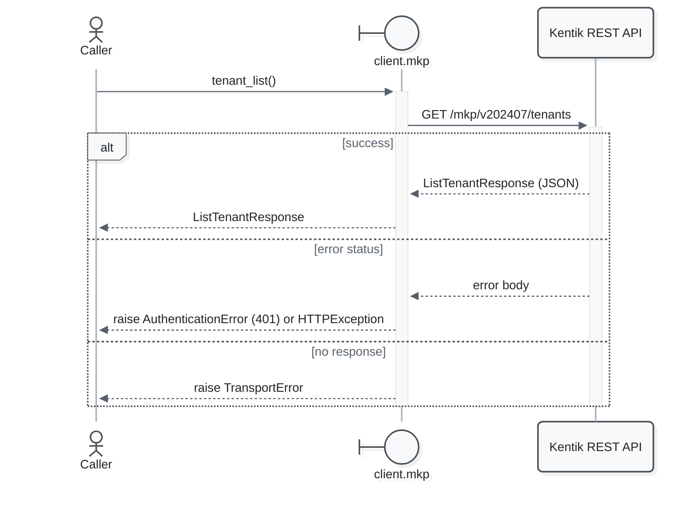

##### gRPC call flow

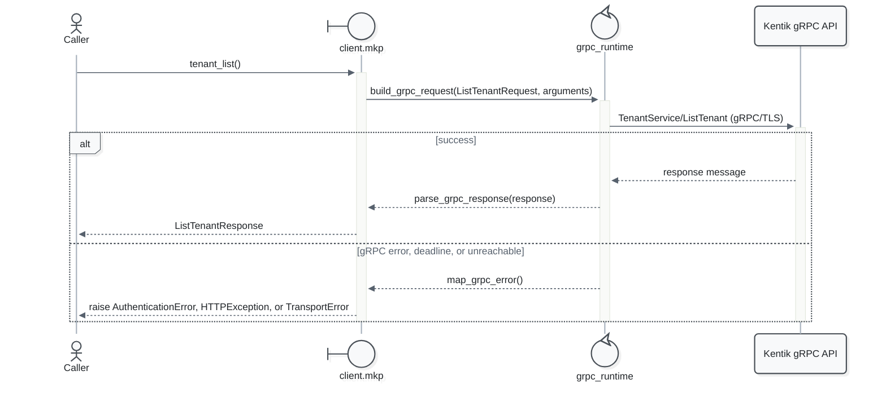

##### Responses

| Status | Description | Model |
| --- | --- | --- |
| 200 | A successful response. | `ListTenantResponse` |
| default | An unexpected error response. | `rpcStatus` |

##### Example

```python
from kentik_api.client import KentikAPI

# Both transports work: protocol="rest" (default) or protocol="grpc".
client = KentikAPI(protocol="rest")  # loads KENTIK_EMAIL/KENTIK_API_TOKEN from .env
response = client.mkp.tenant_list()
```

---

#### `POST` `/mkp/v202407/tenants`

Create a tenant.

Create tenant from request. returns created tenant.

##### REST call flow

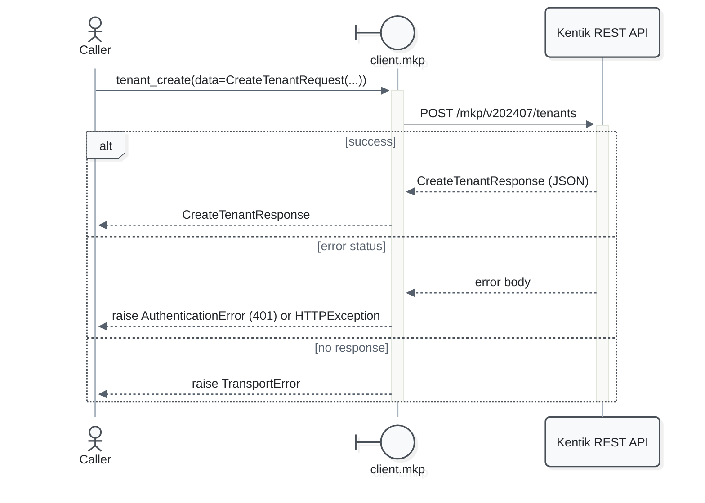

##### gRPC call flow

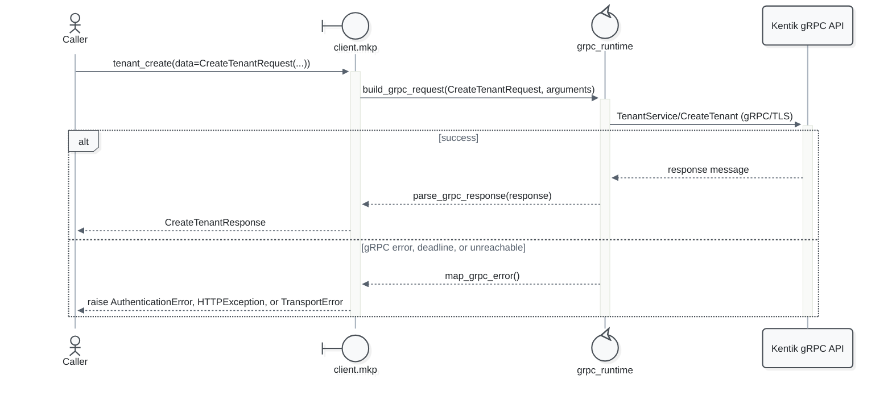

##### Parameters

| Name | In | Type | Required |
| --- | --- | --- | --- |
| `data` | body | `CreateTenantRequest` | Yes |

##### Responses

| Status | Description | Model |
| --- | --- | --- |
| 200 | A successful response. | `CreateTenantResponse` |
| default | An unexpected error response. | `rpcStatus` |

##### Example

```python
from kentik_api.client import KentikAPI
from kentik_api.gen.mkp.models import CreateTenantRequest

# Both transports work: protocol="rest" (default) or protocol="grpc".
client = KentikAPI(protocol="rest")  # loads KENTIK_EMAIL/KENTIK_API_TOKEN from .env
response = client.mkp.tenant_create(
    data=CreateTenantRequest(...),
)
```

---

#### `GET` `/mkp/v202407/tenants/{id}`

Get information aboout a tenant.

Returns information about package specified with ID.

##### REST call flow

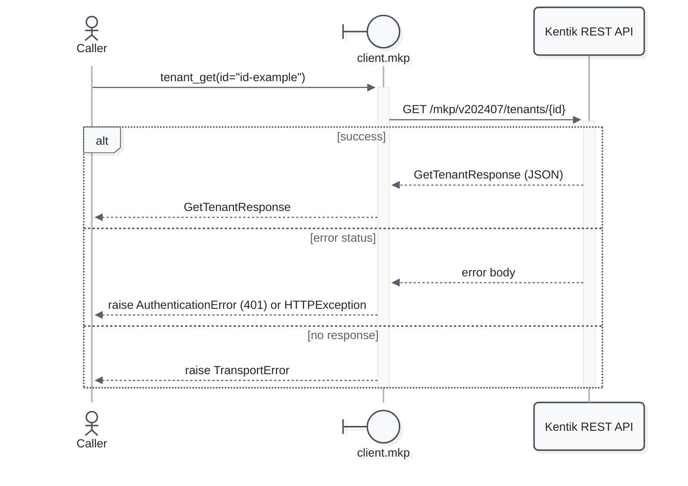

##### gRPC call flow

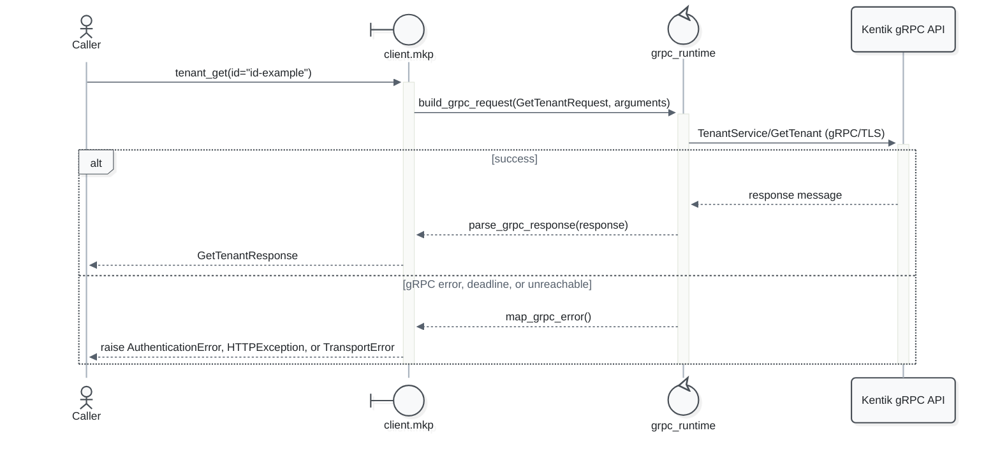

##### Parameters

| Name | In | Type | Required |
| --- | --- | --- | --- |
| `id` | path | `string` | Yes |

##### Responses

| Status | Description | Model |
| --- | --- | --- |
| 200 | A successful response. | `GetTenantResponse` |
| default | An unexpected error response. | `rpcStatus` |

##### Example

```python
from kentik_api.client import KentikAPI

# Both transports work: protocol="rest" (default) or protocol="grpc".
client = KentikAPI(protocol="rest")  # loads KENTIK_EMAIL/KENTIK_API_TOKEN from .env
response = client.mkp.tenant_get(
    id="id-example",
)
```

---

#### `PUT` `/mkp/v202407/tenants/{id}`

Update a tenant.

Update tenant attributes specified with id.

##### REST call flow

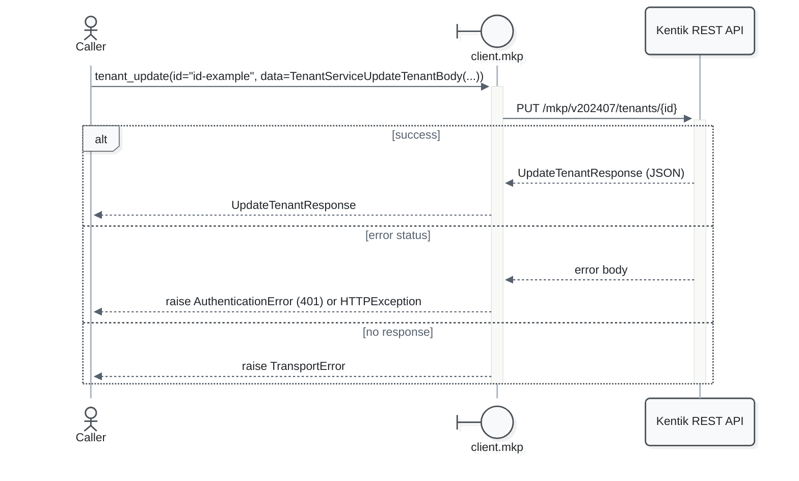

##### gRPC call flow

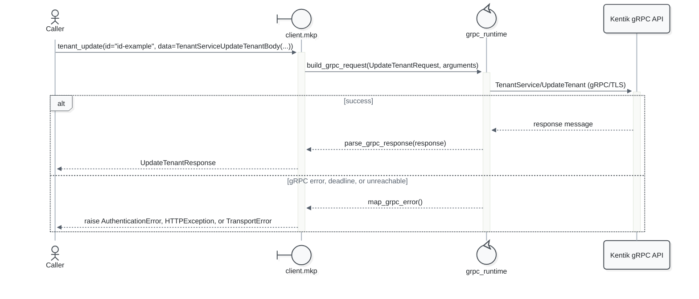

##### Parameters

| Name | In | Type | Required |
| --- | --- | --- | --- |
| `id` | path | `string` | Yes |
| `data` | body | `TenantServiceUpdateTenantBody` | Yes |

##### Responses

| Status | Description | Model |
| --- | --- | --- |
| 200 | A successful response. | `UpdateTenantResponse` |
| default | An unexpected error response. | `rpcStatus` |

##### Example

```python
from kentik_api.client import KentikAPI
from kentik_api.gen.mkp.models import TenantServiceUpdateTenantBody

# Both transports work: protocol="rest" (default) or protocol="grpc".
client = KentikAPI(protocol="rest")  # loads KENTIK_EMAIL/KENTIK_API_TOKEN from .env
response = client.mkp.tenant_update(
    id="id-example",
    data=TenantServiceUpdateTenantBody(...),
)
```

---

#### `DELETE` `/mkp/v202407/tenants/{id}`

Delete a tenant.

Deletes the tenant specified with id.

##### REST call flow

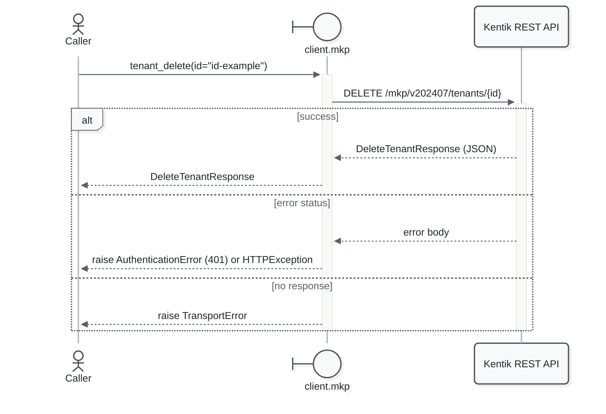

##### gRPC call flow

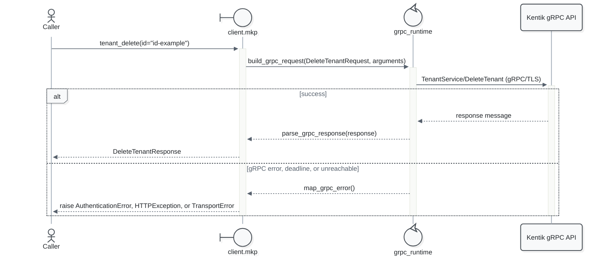

##### Parameters

| Name | In | Type | Required |
| --- | --- | --- | --- |
| `id` | path | `string` | Yes |

##### Responses

| Status | Description | Model |
| --- | --- | --- |
| 200 | A successful response. | `DeleteTenantResponse` |
| default | An unexpected error response. | `rpcStatus` |

##### Example

```python
from kentik_api.client import KentikAPI

# Both transports work: protocol="rest" (default) or protocol="grpc".
client = KentikAPI(protocol="rest")  # loads KENTIK_EMAIL/KENTIK_API_TOKEN from .env
response = client.mkp.tenant_delete(
    id="id-example",
)
```

### TenantUserService

#### `GET` `/mkp/v202407/tenants/{tenantId}/users`

List users for a tenant.

Returns a list of users associated with the specified tenant.

##### REST call flow

```mermaid
%%{init: {"theme": "redux", "look": "neo", "layout": "elk", "fontFamily": "ui-monospace, SFMono-Regular, Menlo, monospace", "themeVariables": {"fontFamily": "ui-monospace, SFMono-Regular, Menlo, monospace", "primaryColor": "#f8f9fa", "primaryBorderColor": "#495057", "primaryTextColor": "#212529", "textColor": "#212529", "lineColor": "#77818c", "edgeLabelBackground": "#ffffff", "actorBkg": "#f8f9fa", "actorBorder": "#495057", "actorTextColor": "#212529", "actorLineColor": "#a9b3be", "signalColor": "#57616d", "signalTextColor": "#212529", "labelBoxBkgColor": "#f8f9fa", "labelBoxBorderColor": "#495057", "labelTextColor": "#212529", "loopTextColor": "#57616d", "noteBkgColor": "#fff9db", "noteBorderColor": "#f08c00", "noteTextColor": "#a35a00"}, "sequence": {"activationWidth": 16}, "flowchart": {"curve": "basis", "nodeSpacing": 30, "rankSpacing": 70, "wrappingWidth": 400}}}%%
sequenceDiagram
    actor C as Caller
    participant W@{ "type": "boundary" } as client.mkp
    participant API as Kentik REST API

    C->>+W: tenant_user_list(tenantId="tenantId-example")
    W->>+API: GET /mkp/v202407/tenants/{tenantId}/users
    alt success
        API-->>W: ListTenantUserResponse (JSON)
        W-->>C: ListTenantUserResponse
    else error status
        API-->>W: error body
        W-->>C: raise AuthenticationError (401) or HTTPException
    else no response
        W-->>C: raise TransportError
    end
    deactivate API
    deactivate W
```

##### gRPC call flow

```mermaid
%%{init: {"theme": "redux", "look": "neo", "layout": "elk", "fontFamily": "ui-monospace, SFMono-Regular, Menlo, monospace", "themeVariables": {"fontFamily": "ui-monospace, SFMono-Regular, Menlo, monospace", "primaryColor": "#f8f9fa", "primaryBorderColor": "#495057", "primaryTextColor": "#212529", "textColor": "#212529", "lineColor": "#77818c", "edgeLabelBackground": "#ffffff", "actorBkg": "#f8f9fa", "actorBorder": "#495057", "actorTextColor": "#212529", "actorLineColor": "#a9b3be", "signalColor": "#57616d", "signalTextColor": "#212529", "labelBoxBkgColor": "#f8f9fa", "labelBoxBorderColor": "#495057", "labelTextColor": "#212529", "loopTextColor": "#57616d", "noteBkgColor": "#fff9db", "noteBorderColor": "#f08c00", "noteTextColor": "#a35a00"}, "sequence": {"activationWidth": 16}, "flowchart": {"curve": "basis", "nodeSpacing": 30, "rankSpacing": 70, "wrappingWidth": 400}}}%%
sequenceDiagram
    actor C as Caller
    participant W@{ "type": "boundary" } as client.mkp
    participant R@{ "type": "control" } as grpc_runtime
    participant API as Kentik gRPC API

    C->>+W: tenant_user_list(tenantId="tenantId-example")
    W->>+R: build_grpc_request(ListTenantUserRequest, arguments)
    R->>+API: TenantUserService/ListTenantUser (gRPC/TLS)
    alt success
        API-->>R: response message
        R-->>W: parse_grpc_response(response)
        W-->>C: ListTenantUserResponse
    else gRPC error, deadline, or unreachable
        R-->>W: map_grpc_error()
        W-->>C: raise AuthenticationError, HTTPException, or TransportError
    end
    deactivate API
    deactivate R
    deactivate W
```

##### Parameters

| Name | In | Type | Required |
| --- | --- | --- | --- |
| `tenantId` | path | `string` | Yes |

##### Responses

| Status | Description | Model |
| --- | --- | --- |
| 200 | A successful response. | `ListTenantUserResponse` |
| default | An unexpected error response. | `rpcStatus` |

##### Example

```python
from kentik_api.client import KentikAPI

# Both transports work: protocol="rest" (default) or protocol="grpc".
client = KentikAPI(protocol="rest")  # loads KENTIK_EMAIL/KENTIK_API_TOKEN from .env
response = client.mkp.tenant_user_list(
    tenantId="tenantId-example",
)
```

---

#### `POST` `/mkp/v202407/tenants/{tenantId}/users`

Add a user to a tenant.

Creates a user association with the specified tenant.

##### REST call flow

```mermaid
%%{init: {"theme": "redux", "look": "neo", "layout": "elk", "fontFamily": "ui-monospace, SFMono-Regular, Menlo, monospace", "themeVariables": {"fontFamily": "ui-monospace, SFMono-Regular, Menlo, monospace", "primaryColor": "#f8f9fa", "primaryBorderColor": "#495057", "primaryTextColor": "#212529", "textColor": "#212529", "lineColor": "#77818c", "edgeLabelBackground": "#ffffff", "actorBkg": "#f8f9fa", "actorBorder": "#495057", "actorTextColor": "#212529", "actorLineColor": "#a9b3be", "signalColor": "#57616d", "signalTextColor": "#212529", "labelBoxBkgColor": "#f8f9fa", "labelBoxBorderColor": "#495057", "labelTextColor": "#212529", "loopTextColor": "#57616d", "noteBkgColor": "#fff9db", "noteBorderColor": "#f08c00", "noteTextColor": "#a35a00"}, "sequence": {"activationWidth": 16}, "flowchart": {"curve": "basis", "nodeSpacing": 30, "rankSpacing": 70, "wrappingWidth": 400}}}%%
sequenceDiagram
    actor C as Caller
    participant W@{ "type": "boundary" } as client.mkp
    participant API as Kentik REST API

    C->>+W: tenant_user_create(tenantId="tenantId-example", data=TenantUserServiceCreateTenantUserBody(...))
    W->>+API: POST /mkp/v202407/tenants/{tenantId}/users
    alt success
        API-->>W: CreateTenantUserResponse (JSON)
        W-->>C: CreateTenantUserResponse
    else error status
        API-->>W: error body
        W-->>C: raise AuthenticationError (401) or HTTPException
    else no response
        W-->>C: raise TransportError
    end
    deactivate API
    deactivate W
```

##### gRPC call flow

```mermaid
%%{init: {"theme": "redux", "look": "neo", "layout": "elk", "fontFamily": "ui-monospace, SFMono-Regular, Menlo, monospace", "themeVariables": {"fontFamily": "ui-monospace, SFMono-Regular, Menlo, monospace", "primaryColor": "#f8f9fa", "primaryBorderColor": "#495057", "primaryTextColor": "#212529", "textColor": "#212529", "lineColor": "#77818c", "edgeLabelBackground": "#ffffff", "actorBkg": "#f8f9fa", "actorBorder": "#495057", "actorTextColor": "#212529", "actorLineColor": "#a9b3be", "signalColor": "#57616d", "signalTextColor": "#212529", "labelBoxBkgColor": "#f8f9fa", "labelBoxBorderColor": "#495057", "labelTextColor": "#212529", "loopTextColor": "#57616d", "noteBkgColor": "#fff9db", "noteBorderColor": "#f08c00", "noteTextColor": "#a35a00"}, "sequence": {"activationWidth": 16}, "flowchart": {"curve": "basis", "nodeSpacing": 30, "rankSpacing": 70, "wrappingWidth": 400}}}%%
sequenceDiagram
    actor C as Caller
    participant W@{ "type": "boundary" } as client.mkp
    participant R@{ "type": "control" } as grpc_runtime
    participant API as Kentik gRPC API

    C->>+W: tenant_user_create(tenantId="tenantId-example", data=TenantUserServiceCreateTenantUserBody(...))
    W->>+R: build_grpc_request(CreateTenantUserRequest, arguments)
    R->>+API: TenantUserService/CreateTenantUser (gRPC/TLS)
    alt success
        API-->>R: response message
        R-->>W: parse_grpc_response(response)
        W-->>C: CreateTenantUserResponse
    else gRPC error, deadline, or unreachable
        R-->>W: map_grpc_error()
        W-->>C: raise AuthenticationError, HTTPException, or TransportError
    end
    deactivate API
    deactivate R
    deactivate W
```

##### Parameters

| Name | In | Type | Required |
| --- | --- | --- | --- |
| `tenantId` | path | `string` | Yes |
| `data` | body | `TenantUserServiceCreateTenantUserBody` | Yes |

##### Responses

| Status | Description | Model |
| --- | --- | --- |
| 200 | A successful response. | `CreateTenantUserResponse` |
| default | An unexpected error response. | `rpcStatus` |

##### Example

```python
from kentik_api.client import KentikAPI
from kentik_api.gen.mkp.models import TenantUserServiceCreateTenantUserBody

# Both transports work: protocol="rest" (default) or protocol="grpc".
client = KentikAPI(protocol="rest")  # loads KENTIK_EMAIL/KENTIK_API_TOKEN from .env
response = client.mkp.tenant_user_create(
    tenantId="tenantId-example",
    data=TenantUserServiceCreateTenantUserBody(...),
)
```

---

#### `PUT` `/mkp/v202407/tenants/{tenantId}/users/{id}`

Update a tenant user.

Updates the user associated with the specified tenant and user ID.

##### REST call flow

```mermaid
%%{init: {"theme": "redux", "look": "neo", "layout": "elk", "fontFamily": "ui-monospace, SFMono-Regular, Menlo, monospace", "themeVariables": {"fontFamily": "ui-monospace, SFMono-Regular, Menlo, monospace", "primaryColor": "#f8f9fa", "primaryBorderColor": "#495057", "primaryTextColor": "#212529", "textColor": "#212529", "lineColor": "#77818c", "edgeLabelBackground": "#ffffff", "actorBkg": "#f8f9fa", "actorBorder": "#495057", "actorTextColor": "#212529", "actorLineColor": "#a9b3be", "signalColor": "#57616d", "signalTextColor": "#212529", "labelBoxBkgColor": "#f8f9fa", "labelBoxBorderColor": "#495057", "labelTextColor": "#212529", "loopTextColor": "#57616d", "noteBkgColor": "#fff9db", "noteBorderColor": "#f08c00", "noteTextColor": "#a35a00"}, "sequence": {"activationWidth": 16}, "flowchart": {"curve": "basis", "nodeSpacing": 30, "rankSpacing": 70, "wrappingWidth": 400}}}%%
sequenceDiagram
    actor C as Caller
    participant W@{ "type": "boundary" } as client.mkp
    participant API as Kentik REST API

    C->>+W: tenant_user_update(tenantId="tenantId-example", id="id-example", data=TenantUserServiceUpdateTenantUserBody(...))
    W->>+API: PUT /mkp/v202407/tenants/{tenantId}/users/{id}
    alt success
        API-->>W: UpdateTenantUserResponse (JSON)
        W-->>C: UpdateTenantUserResponse
    else error status
        API-->>W: error body
        W-->>C: raise AuthenticationError (401) or HTTPException
    else no response
        W-->>C: raise TransportError
    end
    deactivate API
    deactivate W
```

##### gRPC call flow

```mermaid
%%{init: {"theme": "redux", "look": "neo", "layout": "elk", "fontFamily": "ui-monospace, SFMono-Regular, Menlo, monospace", "themeVariables": {"fontFamily": "ui-monospace, SFMono-Regular, Menlo, monospace", "primaryColor": "#f8f9fa", "primaryBorderColor": "#495057", "primaryTextColor": "#212529", "textColor": "#212529", "lineColor": "#77818c", "edgeLabelBackground": "#ffffff", "actorBkg": "#f8f9fa", "actorBorder": "#495057", "actorTextColor": "#212529", "actorLineColor": "#a9b3be", "signalColor": "#57616d", "signalTextColor": "#212529", "labelBoxBkgColor": "#f8f9fa", "labelBoxBorderColor": "#495057", "labelTextColor": "#212529", "loopTextColor": "#57616d", "noteBkgColor": "#fff9db", "noteBorderColor": "#f08c00", "noteTextColor": "#a35a00"}, "sequence": {"activationWidth": 16}, "flowchart": {"curve": "basis", "nodeSpacing": 30, "rankSpacing": 70, "wrappingWidth": 400}}}%%
sequenceDiagram
    actor C as Caller
    participant W@{ "type": "boundary" } as client.mkp
    participant R@{ "type": "control" } as grpc_runtime
    participant API as Kentik gRPC API

    C->>+W: tenant_user_update(tenantId="tenantId-example", id="id-example", data=TenantUserServiceUpdateTenantUserBody(...))
    W->>+R: build_grpc_request(UpdateTenantUserRequest, arguments)
    R->>+API: TenantUserService/UpdateTenantUser (gRPC/TLS)
    alt success
        API-->>R: response message
        R-->>W: parse_grpc_response(response)
        W-->>C: UpdateTenantUserResponse
    else gRPC error, deadline, or unreachable
        R-->>W: map_grpc_error()
        W-->>C: raise AuthenticationError, HTTPException, or TransportError
    end
    deactivate API
    deactivate R
    deactivate W
```

##### Parameters

| Name | In | Type | Required |
| --- | --- | --- | --- |
| `tenantId` | path | `string` | Yes |
| `id` | path | `string` | Yes |
| `data` | body | `TenantUserServiceUpdateTenantUserBody` | Yes |

##### Responses

| Status | Description | Model |
| --- | --- | --- |
| 200 | A successful response. | `UpdateTenantUserResponse` |
| default | An unexpected error response. | `rpcStatus` |

##### Example

```python
from kentik_api.client import KentikAPI
from kentik_api.gen.mkp.models import TenantUserServiceUpdateTenantUserBody

# Both transports work: protocol="rest" (default) or protocol="grpc".
client = KentikAPI(protocol="rest")  # loads KENTIK_EMAIL/KENTIK_API_TOKEN from .env
response = client.mkp.tenant_user_update(
    tenantId="tenantId-example",
    id="id-example",
    data=TenantUserServiceUpdateTenantUserBody(...),
)
```

---

#### `DELETE` `/mkp/v202407/tenants/{tenantId}/users/{id}`

Remove a user from a tenant.

Deletes the user association with the specified tenant.

##### REST call flow

```mermaid
%%{init: {"theme": "redux", "look": "neo", "layout": "elk", "fontFamily": "ui-monospace, SFMono-Regular, Menlo, monospace", "themeVariables": {"fontFamily": "ui-monospace, SFMono-Regular, Menlo, monospace", "primaryColor": "#f8f9fa", "primaryBorderColor": "#495057", "primaryTextColor": "#212529", "textColor": "#212529", "lineColor": "#77818c", "edgeLabelBackground": "#ffffff", "actorBkg": "#f8f9fa", "actorBorder": "#495057", "actorTextColor": "#212529", "actorLineColor": "#a9b3be", "signalColor": "#57616d", "signalTextColor": "#212529", "labelBoxBkgColor": "#f8f9fa", "labelBoxBorderColor": "#495057", "labelTextColor": "#212529", "loopTextColor": "#57616d", "noteBkgColor": "#fff9db", "noteBorderColor": "#f08c00", "noteTextColor": "#a35a00"}, "sequence": {"activationWidth": 16}, "flowchart": {"curve": "basis", "nodeSpacing": 30, "rankSpacing": 70, "wrappingWidth": 400}}}%%
sequenceDiagram
    actor C as Caller
    participant W@{ "type": "boundary" } as client.mkp
    participant API as Kentik REST API

    C->>+W: tenant_user_delete(tenantId="tenantId-example", id="id-example")
    W->>+API: DELETE /mkp/v202407/tenants/{tenantId}/users/{id}
    alt success
        API-->>W: DeleteTenantUserResponse (JSON)
        W-->>C: DeleteTenantUserResponse
    else error status
        API-->>W: error body
        W-->>C: raise AuthenticationError (401) or HTTPException
    else no response
        W-->>C: raise TransportError
    end
    deactivate API
    deactivate W
```

##### gRPC call flow

```mermaid
%%{init: {"theme": "redux", "look": "neo", "layout": "elk", "fontFamily": "ui-monospace, SFMono-Regular, Menlo, monospace", "themeVariables": {"fontFamily": "ui-monospace, SFMono-Regular, Menlo, monospace", "primaryColor": "#f8f9fa", "primaryBorderColor": "#495057", "primaryTextColor": "#212529", "textColor": "#212529", "lineColor": "#77818c", "edgeLabelBackground": "#ffffff", "actorBkg": "#f8f9fa", "actorBorder": "#495057", "actorTextColor": "#212529", "actorLineColor": "#a9b3be", "signalColor": "#57616d", "signalTextColor": "#212529", "labelBoxBkgColor": "#f8f9fa", "labelBoxBorderColor": "#495057", "labelTextColor": "#212529", "loopTextColor": "#57616d", "noteBkgColor": "#fff9db", "noteBorderColor": "#f08c00", "noteTextColor": "#a35a00"}, "sequence": {"activationWidth": 16}, "flowchart": {"curve": "basis", "nodeSpacing": 30, "rankSpacing": 70, "wrappingWidth": 400}}}%%
sequenceDiagram
    actor C as Caller
    participant W@{ "type": "boundary" } as client.mkp
    participant R@{ "type": "control" } as grpc_runtime
    participant API as Kentik gRPC API

    C->>+W: tenant_user_delete(tenantId="tenantId-example", id="id-example")
    W->>+R: build_grpc_request(DeleteTenantUserRequest, arguments)
    R->>+API: TenantUserService/DeleteTenantUser (gRPC/TLS)
    alt success
        API-->>R: response message
        R-->>W: parse_grpc_response(response)
        W-->>C: DeleteTenantUserResponse
    else gRPC error, deadline, or unreachable
        R-->>W: map_grpc_error()
        W-->>C: raise AuthenticationError, HTTPException, or TransportError
    end
    deactivate API
    deactivate R
    deactivate W
```

##### Parameters

| Name | In | Type | Required |
| --- | --- | --- | --- |
| `tenantId` | path | `string` | Yes |
| `id` | path | `string` | Yes |

##### Responses

| Status | Description | Model |
| --- | --- | --- |
| 200 | A successful response. | `DeleteTenantUserResponse` |
| default | An unexpected error response. | `rpcStatus` |

##### Example

```python
from kentik_api.client import KentikAPI

# Both transports work: protocol="rest" (default) or protocol="grpc".
client = KentikAPI(protocol="rest")  # loads KENTIK_EMAIL/KENTIK_API_TOKEN from .env
response = client.mkp.tenant_user_delete(
    tenantId="tenantId-example",
    id="id-example",
)
```

## Data Models

<details>
<summary>Model relationships (25 of 42 models)</summary>

Each arrow points from a model to a model that one of its fields holds. The label names the field.

```mermaid
%%{init: {"theme": "redux", "look": "neo", "layout": "elk", "fontFamily": "ui-monospace, SFMono-Regular, Menlo, monospace", "themeVariables": {"fontFamily": "ui-monospace, SFMono-Regular, Menlo, monospace", "primaryColor": "#f8f9fa", "primaryBorderColor": "#495057", "primaryTextColor": "#212529", "textColor": "#212529", "lineColor": "#77818c", "edgeLabelBackground": "#ffffff", "actorBkg": "#f8f9fa", "actorBorder": "#495057", "actorTextColor": "#212529", "actorLineColor": "#a9b3be", "signalColor": "#57616d", "signalTextColor": "#212529", "labelBoxBkgColor": "#f8f9fa", "labelBoxBorderColor": "#495057", "labelTextColor": "#212529", "loopTextColor": "#57616d", "noteBkgColor": "#fff9db", "noteBorderColor": "#f08c00", "noteTextColor": "#a35a00"}, "sequence": {"activationWidth": 16}, "flowchart": {"curve": "basis", "nodeSpacing": 30, "rankSpacing": 70, "wrappingWidth": 400}}}%%
classDiagram
    class CreatePackageRequest
    class CreatePackageResponse
    class CreateTenantRequest
    class CreateTenantResponse
    class CreateTenantUserResponse
    class DeletePackageResponse
    class DeleteTenantResponse
    class DeleteTenantUserResponse
    class GetPackageResponse
    class GetTenantResponse
    class ListPackageResponse
    class ListTenantResponse
    class ListTenantUserResponse
    class Package
    class PackageServiceUpdatePackageBody
    class Tenant
    class TenantServiceUpdateTenantBody
    class TenantUser
    class TenantUserServiceCreateTenantUserBody
    class TenantUserServiceUpdateTenantUserBody
    class UpdatePackageResponse
    class UpdateTenantResponse
    class UpdateTenantUserResponse
    class protobufAny
    class rpcStatus
    CreatePackageRequest --> Package : package
    CreatePackageResponse --> Package : package
    CreateTenantRequest --> Tenant : tenant
    CreateTenantResponse --> Tenant : tenant
    CreateTenantUserResponse --> TenantUser : user
    GetPackageResponse --> Package : package
    GetTenantResponse --> Tenant : tenant
    ListPackageResponse --> Package : packages
    ListTenantResponse --> Tenant : tenants
    ListTenantUserResponse --> TenantUser : users
    Tenant --> Package : packages
    UpdatePackageResponse --> Package : package
    UpdateTenantResponse --> Tenant : tenant
    UpdateTenantUserResponse --> TenantUser : user
    rpcStatus --> protobufAny : details
```

</details>

```{eval-rst}
.. autopydantic_model:: kentik_api.gen.mkp.models.Activate
```

```{eval-rst}
.. autopydantic_model:: kentik_api.gen.mkp.models.Alert
```

```{eval-rst}
.. autopydantic_model:: kentik_api.gen.mkp.models.Asset
```

```{eval-rst}
.. autopydantic_model:: kentik_api.gen.mkp.models.AssetReport
```

```{eval-rst}
.. autopydantic_model:: kentik_api.gen.mkp.models.Condition
```

```{eval-rst}
.. autopydantic_model:: kentik_api.gen.mkp.models.CreatePackageRequest
```

```{eval-rst}
.. autopydantic_model:: kentik_api.gen.mkp.models.CreatePackageResponse
```

```{eval-rst}
.. autopydantic_model:: kentik_api.gen.mkp.models.CreateTenantRequest
```

```{eval-rst}
.. autopydantic_model:: kentik_api.gen.mkp.models.CreateTenantResponse
```

```{eval-rst}
.. autopydantic_model:: kentik_api.gen.mkp.models.CreateTenantUserResponse
```

```{eval-rst}
.. autopydantic_model:: kentik_api.gen.mkp.models.CustomDimension
```

```{eval-rst}
.. autopydantic_model:: kentik_api.gen.mkp.models.DeletePackageResponse
```

```{eval-rst}
.. autopydantic_model:: kentik_api.gen.mkp.models.DeleteTenantResponse
```

```{eval-rst}
.. autopydantic_model:: kentik_api.gen.mkp.models.DeleteTenantUserResponse
```

```{eval-rst}
.. autopydantic_model:: kentik_api.gen.mkp.models.Devices
```

```{eval-rst}
.. autopydantic_model:: kentik_api.gen.mkp.models.Filter
```

```{eval-rst}
.. autopydantic_model:: kentik_api.gen.mkp.models.FilterField
```

```{eval-rst}
.. autopydantic_model:: kentik_api.gen.mkp.models.GetPackageResponse
```

```{eval-rst}
.. autopydantic_model:: kentik_api.gen.mkp.models.GetTenantResponse
```

```{eval-rst}
.. autoclass:: kentik_api.gen.mkp.models.LandingType
   :members:
```

```{eval-rst}
.. autopydantic_model:: kentik_api.gen.mkp.models.ListPackageResponse
```

```{eval-rst}
.. autopydantic_model:: kentik_api.gen.mkp.models.ListTenantResponse
```

```{eval-rst}
.. autopydantic_model:: kentik_api.gen.mkp.models.ListTenantUserResponse
```

```{eval-rst}
.. autopydantic_model:: kentik_api.gen.mkp.models.Mitigation
```

```{eval-rst}
.. autopydantic_model:: kentik_api.gen.mkp.models.NotificationChannel
```

```{eval-rst}
.. autopydantic_model:: kentik_api.gen.mkp.models.Package
```

```{eval-rst}
.. autopydantic_model:: kentik_api.gen.mkp.models.PackageServiceUpdatePackageBody
```

```{eval-rst}
.. autopydantic_model:: kentik_api.gen.mkp.models.PermissionEntry
```

```{eval-rst}
.. autoclass:: kentik_api.gen.mkp.models.Role
   :members:
```

```{eval-rst}
.. autopydantic_model:: kentik_api.gen.mkp.models.Tenant
```

```{eval-rst}
.. autopydantic_model:: kentik_api.gen.mkp.models.TenantLink
```

```{eval-rst}
.. autopydantic_model:: kentik_api.gen.mkp.models.TenantServiceUpdateTenantBody
```

```{eval-rst}
.. autopydantic_model:: kentik_api.gen.mkp.models.TenantUser
```

```{eval-rst}
.. autopydantic_model:: kentik_api.gen.mkp.models.TenantUserServiceCreateTenantUserBody
```

```{eval-rst}
.. autopydantic_model:: kentik_api.gen.mkp.models.TenantUserServiceUpdateTenantUserBody
```

```{eval-rst}
.. autopydantic_model:: kentik_api.gen.mkp.models.Threshold
```

```{eval-rst}
.. autopydantic_model:: kentik_api.gen.mkp.models.UpdatePackageResponse
```

```{eval-rst}
.. autopydantic_model:: kentik_api.gen.mkp.models.UpdateTenantResponse
```

```{eval-rst}
.. autopydantic_model:: kentik_api.gen.mkp.models.UpdateTenantUserResponse
```

```{eval-rst}
.. autopydantic_model:: kentik_api.gen.mkp.models.User
```

```{eval-rst}
.. autopydantic_model:: kentik_api.gen.mkp.models.protobufAny
```

```{eval-rst}
.. autopydantic_model:: kentik_api.gen.mkp.models.rpcStatus
```
