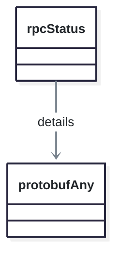

<!-- AUTO-GENERATED: scripts/generation/endpoint_docs.py, render_endpoint_docs() -->
<!-- Rebuilt on every `uv run poe generate`. Do not edit by hand. -->

# Net Service

## Endpoints

This service's schema defines shared types only. It has no REST endpoints.

## Data Models

<details>
<summary>Model relationships (2 of 2 models)</summary>

Each arrow points from a model to a model that one of its fields holds. The label names the field.



</details>

```{eval-rst}
.. autopydantic_model:: kentik_api.gen.net.models.protobufAny
```

```{eval-rst}
.. autopydantic_model:: kentik_api.gen.net.models.rpcStatus
```
