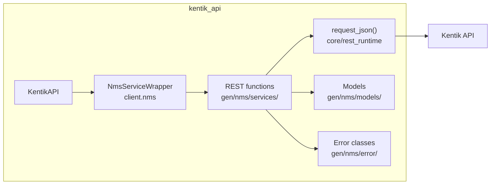
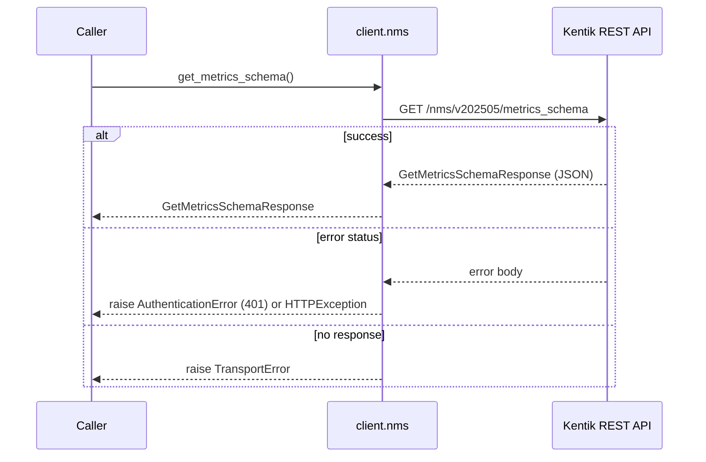
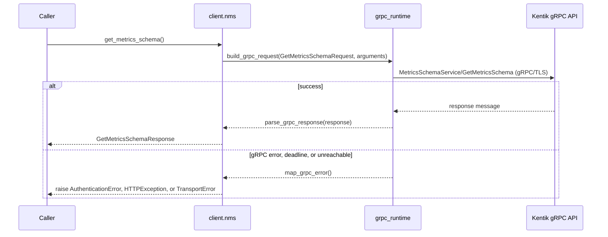
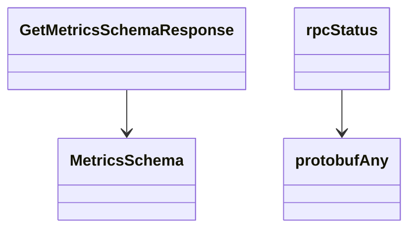

<!-- AUTO-GENERATED: scripts/generation/endpoint_docs.py, render_endpoint_docs() -->
<!-- Rebuilt on every `make generate`. Do not edit by hand. -->

# Nms Service

## Overview



## Endpoints

### `GET` `/nms/v202505/metrics_schema`

**REST transport**



**gRPC transport**



#### Responses

| Status | Description | Model |
| --- | --- | --- |
| 200 | A successful response. | `GetMetricsSchemaResponse` |
| default | An unexpected error response. | `rpcStatus` |

#### Example

```python
from kentik_api.client import KentikAPI

# Both transports work: protocol="rest" (default) or protocol="grpc".
client = KentikAPI(protocol="rest")  # loads KENTIK_EMAIL/KENTIK_API_TOKEN from .env
response = client.nms.get_metrics_schema()
```

## Data Models

<details>
<summary>Model relationships (4 of 9 models)</summary>



</details>

```{eval-rst}
.. autopydantic_model:: kentik_api.gen.nms.models.FieldDisplay
```

```{eval-rst}
.. autopydantic_model:: kentik_api.gen.nms.models.FieldSchema
```

```{eval-rst}
.. autoclass:: kentik_api.gen.nms.models.FieldType
   :members:
```

```{eval-rst}
.. autopydantic_model:: kentik_api.gen.nms.models.GetMetricsSchemaResponse
```

```{eval-rst}
.. autopydantic_model:: kentik_api.gen.nms.models.MeasurementSchema
```

```{eval-rst}
.. autopydantic_model:: kentik_api.gen.nms.models.MetricsSchema
```

```{eval-rst}
.. autoclass:: kentik_api.gen.nms.models.Usage
   :members:
```

```{eval-rst}
.. autopydantic_model:: kentik_api.gen.nms.models.protobufAny
```

```{eval-rst}
.. autopydantic_model:: kentik_api.gen.nms.models.rpcStatus
```
