<!-- AUTO-GENERATED: scripts/generation/endpoint_docs.py, render_endpoint_docs() -->
<!-- Rebuilt on every `uv run poe generate`. Do not edit by hand. -->

# Site Service

## Overview

```mermaid
%%{init: {"theme": "base", "fontFamily": "ui-monospace, SFMono-Regular, Menlo, monospace", "themeVariables": {"fontFamily": "ui-monospace, SFMono-Regular, Menlo, monospace", "primaryColor": "#f8f9fa", "primaryBorderColor": "#495057", "primaryTextColor": "#212529", "textColor": "#212529", "lineColor": "#77818c", "edgeLabelBackground": "#ffffff", "actorBkg": "#f8f9fa", "actorBorder": "#495057", "actorTextColor": "#212529", "actorLineColor": "#a9b3be", "signalColor": "#57616d", "signalTextColor": "#212529", "labelBoxBkgColor": "#f8f9fa", "labelBoxBorderColor": "#495057", "labelTextColor": "#212529", "loopTextColor": "#57616d", "noteBkgColor": "#fff9db", "noteBorderColor": "#f08c00", "noteTextColor": "#a35a00"}, "flowchart": {"curve": "step", "nodeSpacing": 30, "rankSpacing": 70, "wrappingWidth": 400}}}%%
flowchart LR
    code("Your code"):::greenSrc
    subgraph sdk["kentik_api"]
        wrap("SiteServiceWrapper<br/>client.site<br/>10 operations"):::orange
        rest("REST functions<br/>gen/site/services/"):::blue
        rj("request_json()<br/>core/rest_runtime.py"):::blue
        cg("call_grpc()<br/>core/grpc_runtime.py"):::violet
    end
    grpcapi("Kentik gRPC API<br/>HTTP/2 + protobuf"):::violetSrc
    restapi("Kentik REST API<br/>HTTPS + JSON"):::blueSrc

    code -->|"method call"| wrap
    wrap -->|"Pydantic model from<br/>gen/site/models/"| code
    wrap -->|"arguments"| rest
    rest -->|"Pydantic model"| wrap
    rest -->|"method, path, body"| rj
    rj -->|"JSON dict"| rest
    rj -->|"HTTPS request"| restapi
    restapi -->|"JSON response"| rj
    wrap -->|"proto request"| cg
    cg -->|"proto response"| wrap
    cg -->|"gRPC call"| grpcapi
    grpcapi -->|"proto response"| cg

    classDef greenSrc fill:#b2f2bb,stroke:#2f9e44,color:#2b8a3e
    classDef orange fill:#fff4e6,stroke:#e8590c,color:#d9480f
    classDef blue fill:#e7f5ff,stroke:#1971c2,color:#1864ab
    classDef blueSrc fill:#a5d8ff,stroke:#1971c2,color:#1864ab
    classDef violet fill:#f3f0ff,stroke:#7048e8,color:#5f3dc4
    classDef violetSrc fill:#d0bfff,stroke:#7048e8,color:#5f3dc4
    classDef greenSrc,orange,blue,blueSrc,violet,violetSrc stroke-width:2px,rx:10px
    style sdk fill:none,stroke:#868e96,stroke-width:2px
    linkStyle default stroke-width:2px,stroke-linecap:round,stroke-linejoin:round
```

On an error status or a failed call, the SDK raises an error class from `gen/site/error/`, or a shared type from `kentik_api.errors`.

## Endpoints

### `GET` `/site/v202509/site_markets`

List all site markets.

Returns list of configured site markets.

#### REST call flow

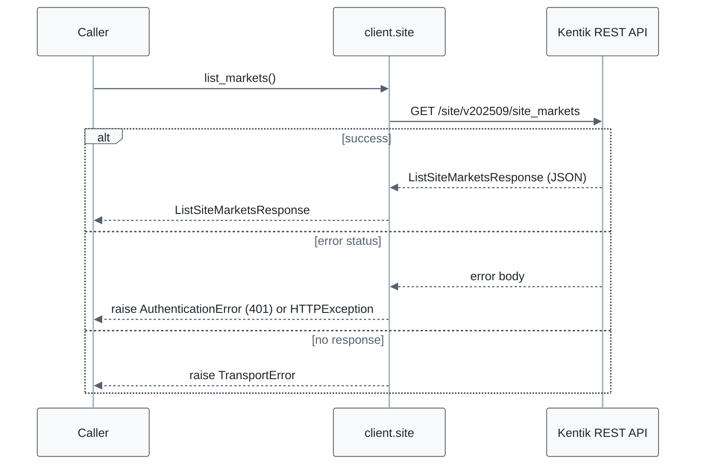

#### gRPC call flow

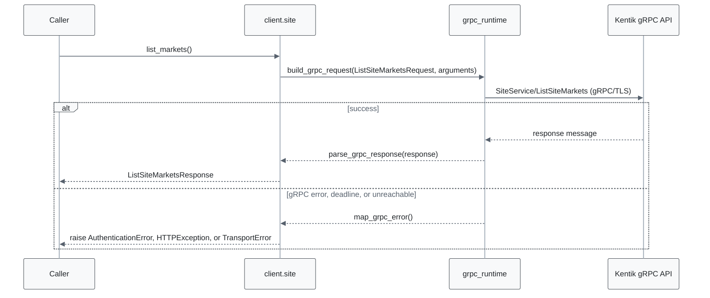

#### Responses

| Status | Description | Model |
| --- | --- | --- |
| 200 | A successful response. | `ListSiteMarketsResponse` |
| default | An unexpected error response. | `rpcStatus` |

#### Example

```python
from kentik_api.client import KentikAPI

# Both transports work: protocol="rest" (default) or protocol="grpc".
client = KentikAPI(protocol="rest")  # loads KENTIK_EMAIL/KENTIK_API_TOKEN from .env
response = client.site.list_markets()
```

---

### `POST` `/site/v202509/site_markets`

Configure a new site market.

Create configuration for a new site market. Returns the newly created configuration.

#### REST call flow

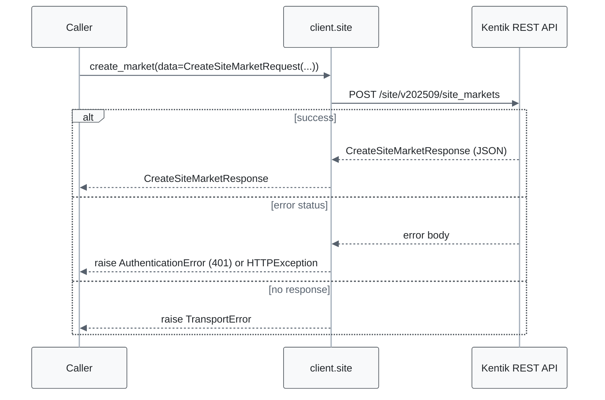

#### gRPC call flow

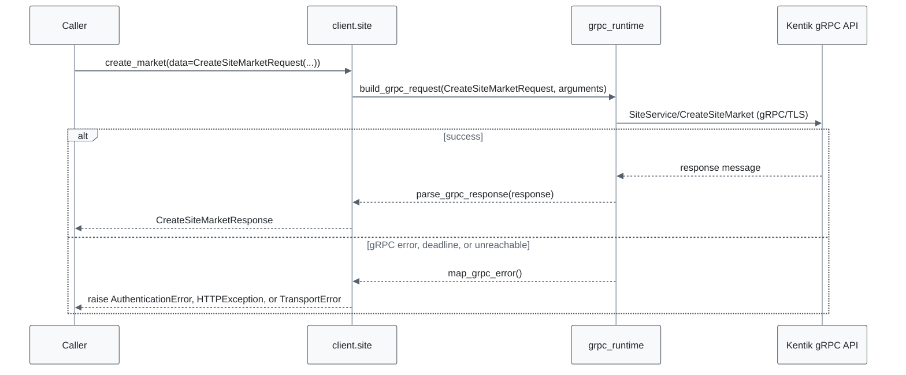

#### Parameters

| Name | In | Type | Required |
| --- | --- | --- | --- |
| `data` | body | `CreateSiteMarketRequest` | Yes |

#### Responses

| Status | Description | Model |
| --- | --- | --- |
| 200 | A successful response. | `CreateSiteMarketResponse` |
| default | An unexpected error response. | `rpcStatus` |

#### Example

```python
from kentik_api.client import KentikAPI
from kentik_api.gen.site.models import CreateSiteMarketRequest

# Both transports work: protocol="rest" (default) or protocol="grpc".
client = KentikAPI(protocol="rest")  # loads KENTIK_EMAIL/KENTIK_API_TOKEN from .env
response = client.site.create_market(
    data=CreateSiteMarketRequest(...),
)
```

---

### `GET` `/site/v202509/site_markets/{id}`

Retrieve configuration of a site market.

Returns configuration of a site market specified by ID.

#### REST call flow

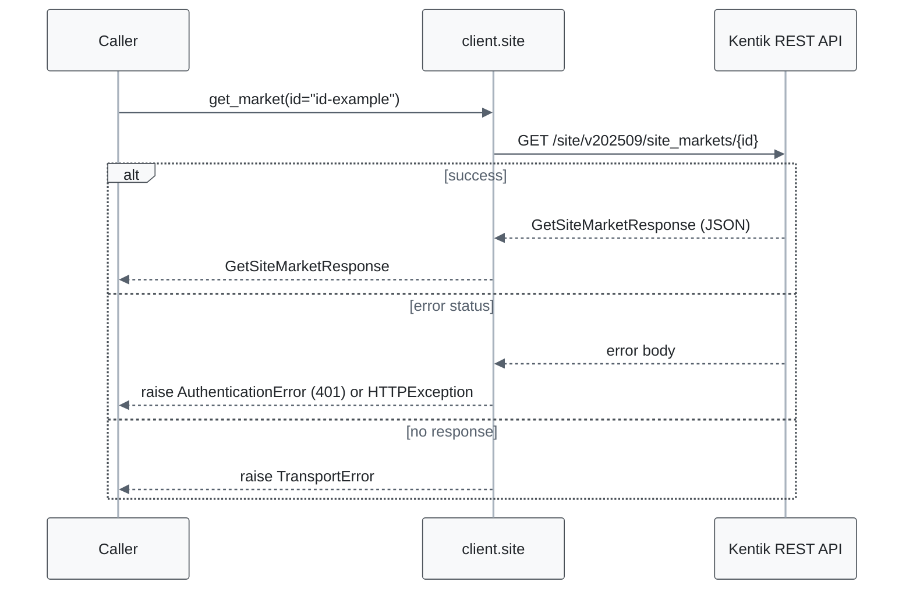

#### gRPC call flow

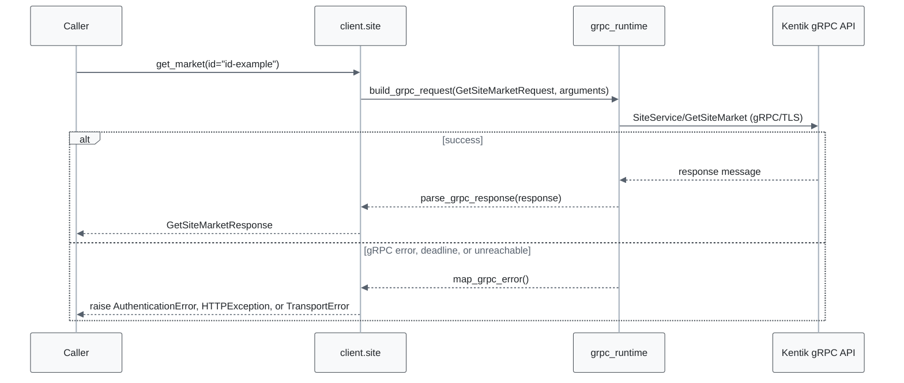

#### Parameters

| Name | In | Type | Required |
| --- | --- | --- | --- |
| `id` | path | `string` | Yes |

#### Responses

| Status | Description | Model |
| --- | --- | --- |
| 200 | A successful response. | `GetSiteMarketResponse` |
| default | An unexpected error response. | `rpcStatus` |

#### Example

```python
from kentik_api.client import KentikAPI

# Both transports work: protocol="rest" (default) or protocol="grpc".
client = KentikAPI(protocol="rest")  # loads KENTIK_EMAIL/KENTIK_API_TOKEN from .env
response = client.site.get_market(
    id="id-example",
)
```

---

### `PUT` `/site/v202509/site_markets/{id}`

Updates configuration of a site market.

Replaces configuration of a site market with attributes in the request. Returns the updated configuration.

#### REST call flow

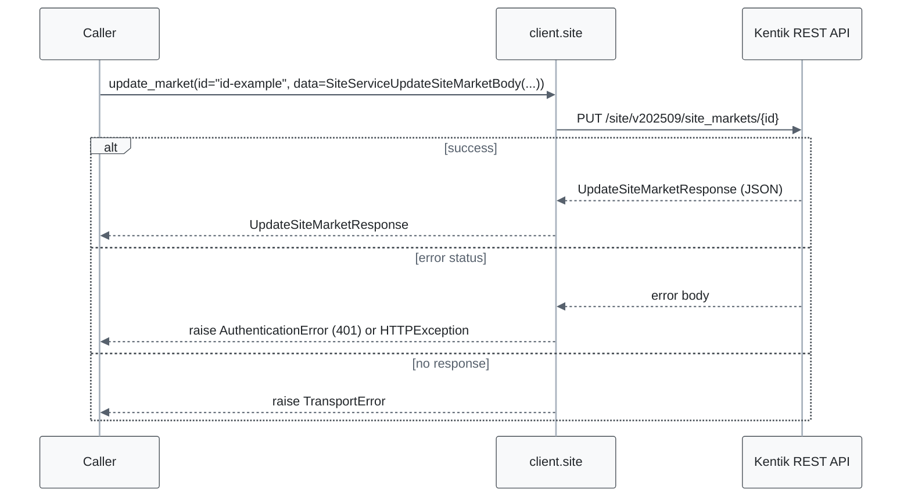

#### gRPC call flow

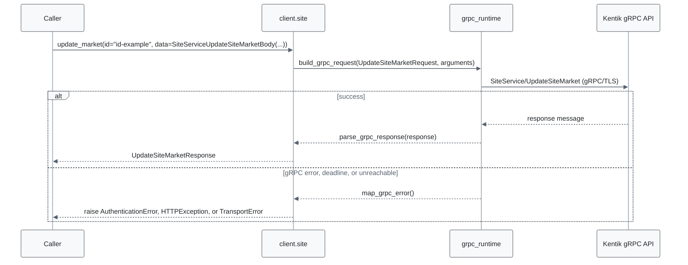

#### Parameters

| Name | In | Type | Required |
| --- | --- | --- | --- |
| `id` | path | `string` | Yes |
| `data` | body | `SiteServiceUpdateSiteMarketBody` | Yes |

#### Responses

| Status | Description | Model |
| --- | --- | --- |
| 200 | A successful response. | `UpdateSiteMarketResponse` |
| default | An unexpected error response. | `rpcStatus` |

#### Example

```python
from kentik_api.client import KentikAPI
from kentik_api.gen.site.models import SiteServiceUpdateSiteMarketBody

# Both transports work: protocol="rest" (default) or protocol="grpc".
client = KentikAPI(protocol="rest")  # loads KENTIK_EMAIL/KENTIK_API_TOKEN from .env
response = client.site.update_market(
    id="id-example",
    data=SiteServiceUpdateSiteMarketBody(...),
)
```

---

### `DELETE` `/site/v202509/site_markets/{id}`

Delete configuration of a site market.

Deletes configuration of a site market with specific ID.

#### REST call flow

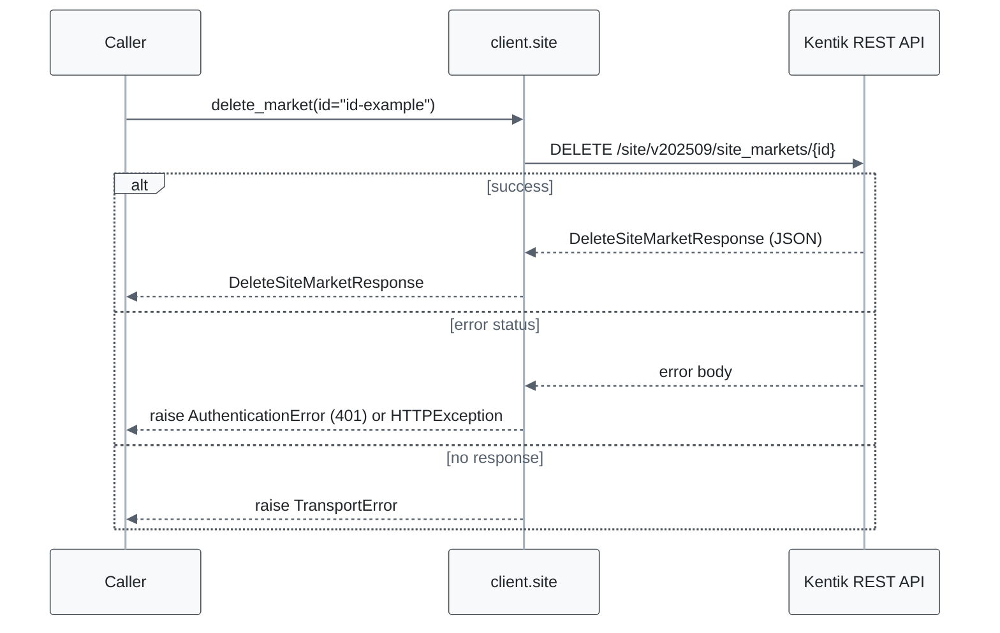

#### gRPC call flow

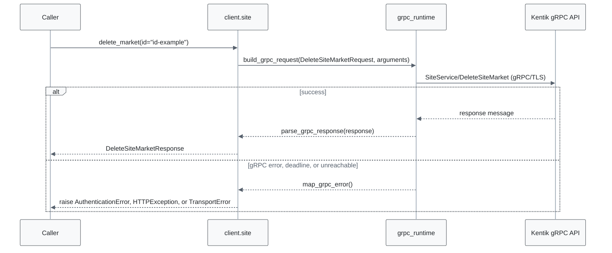

#### Parameters

| Name | In | Type | Required |
| --- | --- | --- | --- |
| `id` | path | `string` | Yes |

#### Responses

| Status | Description | Model |
| --- | --- | --- |
| 200 | A successful response. | `DeleteSiteMarketResponse` |
| default | An unexpected error response. | `rpcStatus` |

#### Example

```python
from kentik_api.client import KentikAPI

# Both transports work: protocol="rest" (default) or protocol="grpc".
client = KentikAPI(protocol="rest")  # loads KENTIK_EMAIL/KENTIK_API_TOKEN from .env
response = client.site.delete_market(
    id="id-example",
)
```

---

### `GET` `/site/v202509/sites`

List all sites.

Returns list of configured sites.

#### REST call flow

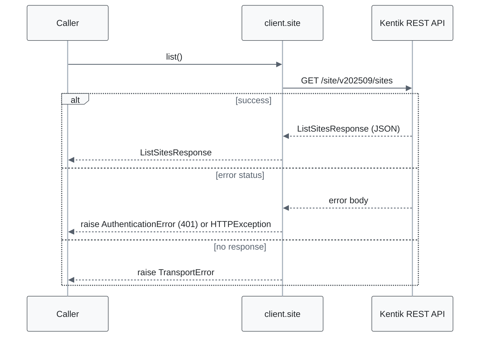

#### gRPC call flow

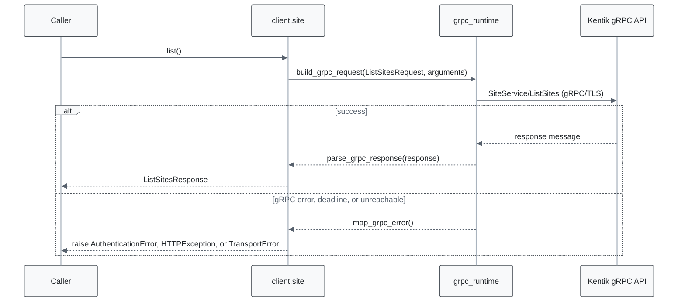

#### Responses

| Status | Description | Model |
| --- | --- | --- |
| 200 | A successful response. | `ListSitesResponse` |
| default | An unexpected error response. | `rpcStatus` |

#### Example

```python
from kentik_api.client import KentikAPI

# Both transports work: protocol="rest" (default) or protocol="grpc".
client = KentikAPI(protocol="rest")  # loads KENTIK_EMAIL/KENTIK_API_TOKEN from .env
response = client.site.list()
```

---

### `POST` `/site/v202509/sites`

Configure a new site.

Create configuration for a new site. Returns the newly created configuration.

#### REST call flow

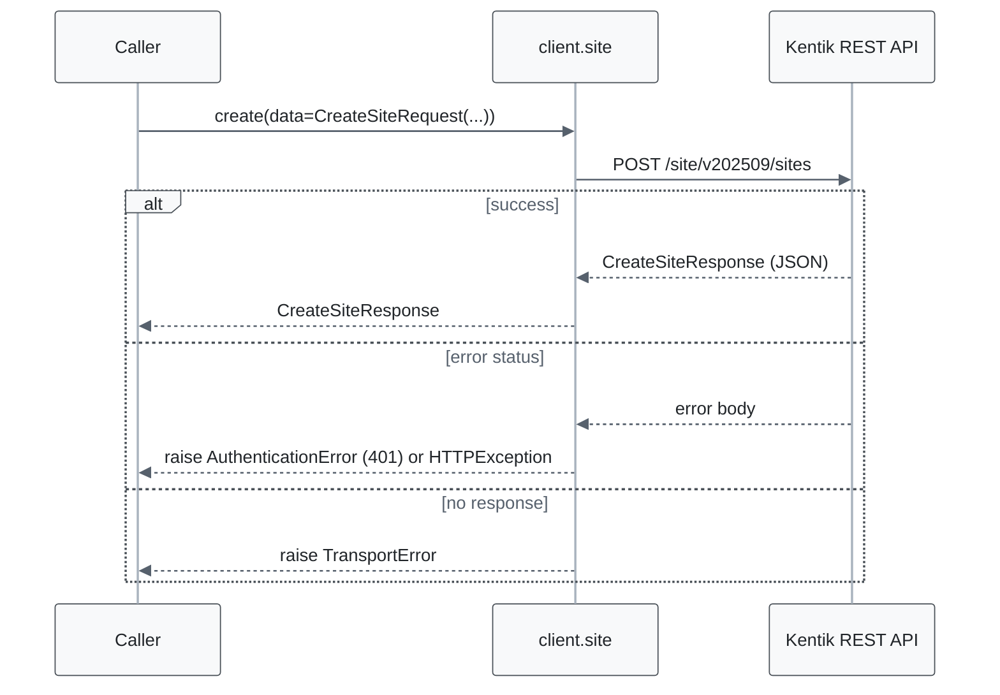

#### gRPC call flow

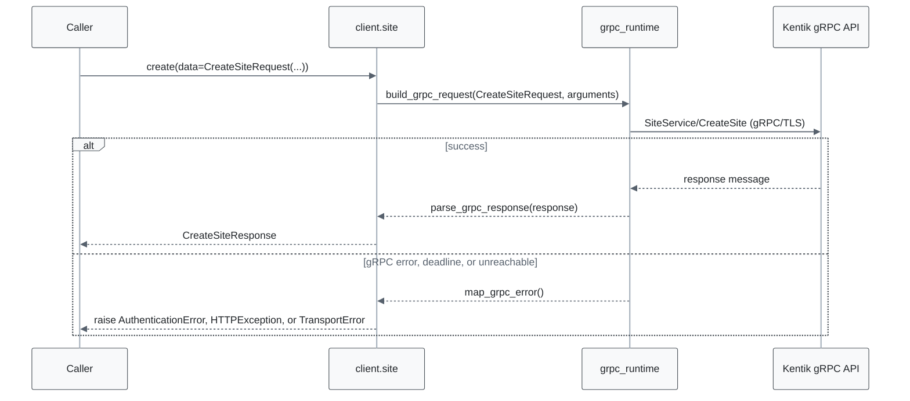

#### Parameters

| Name | In | Type | Required |
| --- | --- | --- | --- |
| `data` | body | `CreateSiteRequest` | Yes |

#### Responses

| Status | Description | Model |
| --- | --- | --- |
| 200 | A successful response. | `CreateSiteResponse` |
| default | An unexpected error response. | `rpcStatus` |

#### Example

```python
from kentik_api.client import KentikAPI
from kentik_api.gen.site.models import CreateSiteRequest

# Both transports work: protocol="rest" (default) or protocol="grpc".
client = KentikAPI(protocol="rest")  # loads KENTIK_EMAIL/KENTIK_API_TOKEN from .env
response = client.site.create(
    data=CreateSiteRequest(...),
)
```

---

### `GET` `/site/v202509/sites/{id}`

Retrieve configuration of a site.

Returns configuration of a site specified by ID.

#### REST call flow

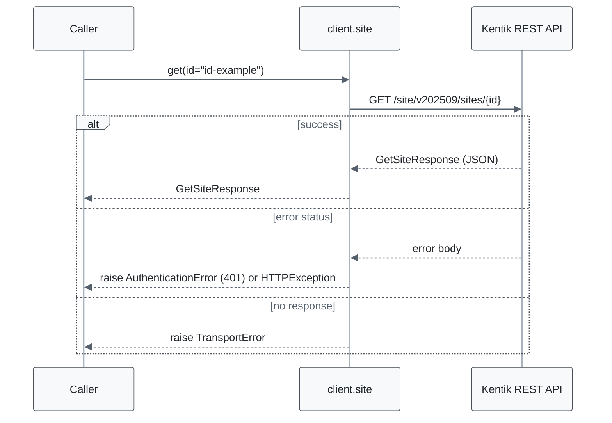

#### gRPC call flow

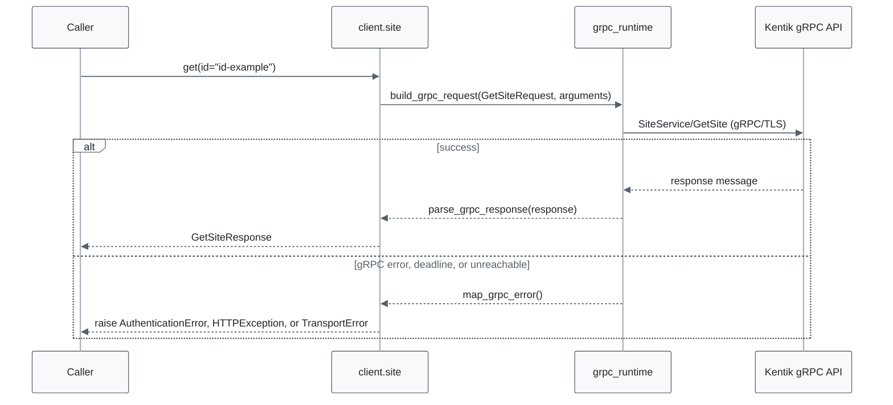

#### Parameters

| Name | In | Type | Required |
| --- | --- | --- | --- |
| `id` | path | `string` | Yes |

#### Responses

| Status | Description | Model |
| --- | --- | --- |
| 200 | A successful response. | `GetSiteResponse` |
| default | An unexpected error response. | `rpcStatus` |

#### Example

```python
from kentik_api.client import KentikAPI

# Both transports work: protocol="rest" (default) or protocol="grpc".
client = KentikAPI(protocol="rest")  # loads KENTIK_EMAIL/KENTIK_API_TOKEN from .env
response = client.site.get(
    id="id-example",
)
```

---

### `PUT` `/site/v202509/sites/{id}`

Updates configuration of a site.

Replaces configuration of a site with attributes in the request. Returns the updated configuration.

#### REST call flow

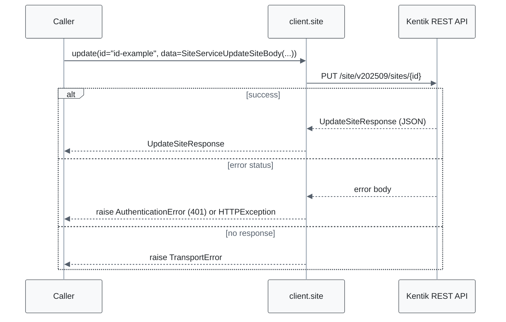

#### gRPC call flow

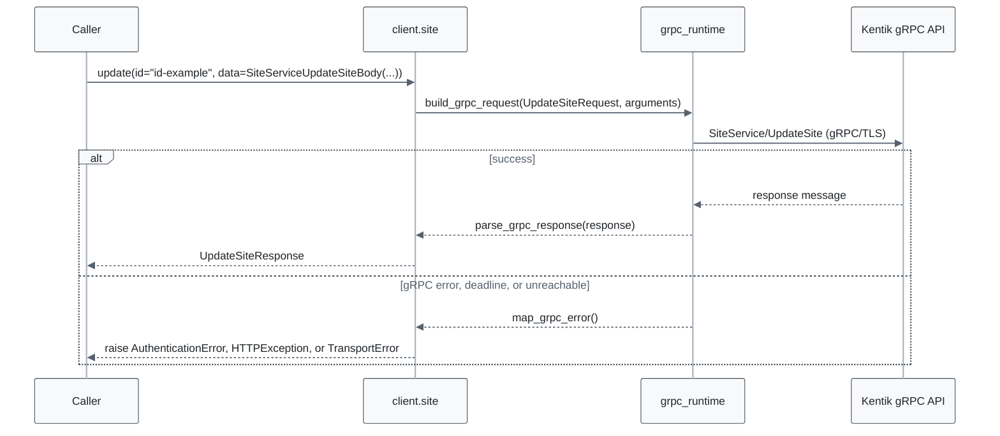

#### Parameters

| Name | In | Type | Required |
| --- | --- | --- | --- |
| `id` | path | `string` | Yes |
| `data` | body | `SiteServiceUpdateSiteBody` | Yes |

#### Responses

| Status | Description | Model |
| --- | --- | --- |
| 200 | A successful response. | `UpdateSiteResponse` |
| default | An unexpected error response. | `rpcStatus` |

#### Example

```python
from kentik_api.client import KentikAPI
from kentik_api.gen.site.models import SiteServiceUpdateSiteBody

# Both transports work: protocol="rest" (default) or protocol="grpc".
client = KentikAPI(protocol="rest")  # loads KENTIK_EMAIL/KENTIK_API_TOKEN from .env
response = client.site.update(
    id="id-example",
    data=SiteServiceUpdateSiteBody(...),
)
```

---

### `DELETE` `/site/v202509/sites/{id}`

Delete configuration of a site.

Deletes configuration of a site with specific ID.

#### REST call flow

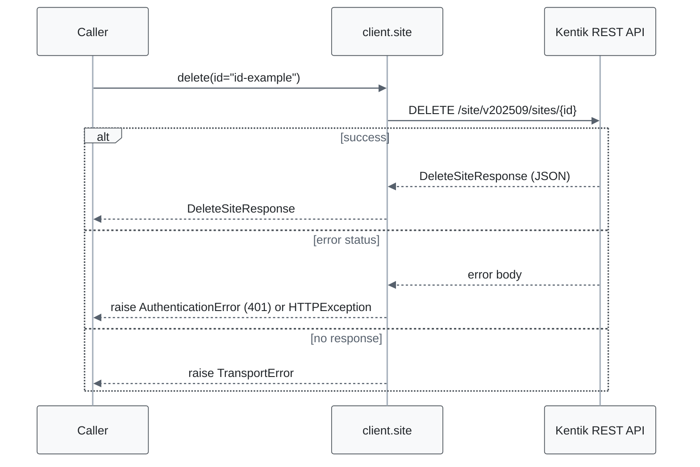

#### gRPC call flow

```mermaid
%%{init: {"theme": "base", "fontFamily": "ui-monospace, SFMono-Regular, Menlo, monospace", "themeVariables": {"fontFamily": "ui-monospace, SFMono-Regular, Menlo, monospace", "primaryColor": "#f8f9fa", "primaryBorderColor": "#495057", "primaryTextColor": "#212529", "textColor": "#212529", "lineColor": "#77818c", "edgeLabelBackground": "#ffffff", "actorBkg": "#f8f9fa", "actorBorder": "#495057", "actorTextColor": "#212529", "actorLineColor": "#a9b3be", "signalColor": "#57616d", "signalTextColor": "#212529", "labelBoxBkgColor": "#f8f9fa", "labelBoxBorderColor": "#495057", "labelTextColor": "#212529", "loopTextColor": "#57616d", "noteBkgColor": "#fff9db", "noteBorderColor": "#f08c00", "noteTextColor": "#a35a00"}, "flowchart": {"curve": "step", "nodeSpacing": 30, "rankSpacing": 70, "wrappingWidth": 400}}}%%
sequenceDiagram
    participant C as Caller
    participant W as client.site
    participant R as grpc_runtime
    participant API as Kentik gRPC API

    C->>W: delete(id="id-example")
    W->>R: build_grpc_request(DeleteSiteRequest, arguments)
    R->>API: SiteService/DeleteSite (gRPC/TLS)
    alt success
        API-->>R: response message
        R-->>W: parse_grpc_response(response)
        W-->>C: DeleteSiteResponse
    else gRPC error, deadline, or unreachable
        R-->>W: map_grpc_error()
        W-->>C: raise AuthenticationError, HTTPException, or TransportError
    end
```

#### Parameters

| Name | In | Type | Required |
| --- | --- | --- | --- |
| `id` | path | `string` | Yes |

#### Responses

| Status | Description | Model |
| --- | --- | --- |
| 200 | A successful response. | `DeleteSiteResponse` |
| default | An unexpected error response. | `rpcStatus` |

#### Example

```python
from kentik_api.client import KentikAPI

# Both transports work: protocol="rest" (default) or protocol="grpc".
client = KentikAPI(protocol="rest")  # loads KENTIK_EMAIL/KENTIK_API_TOKEN from .env
response = client.site.delete(
    id="id-example",
)
```

## Data Models

<details>
<summary>Model relationships (18 of 24 models)</summary>

Each arrow points from a model to a model that one of its fields holds. The label names the field.

```mermaid
%%{init: {"theme": "base", "fontFamily": "ui-monospace, SFMono-Regular, Menlo, monospace", "themeVariables": {"fontFamily": "ui-monospace, SFMono-Regular, Menlo, monospace", "primaryColor": "#f8f9fa", "primaryBorderColor": "#495057", "primaryTextColor": "#212529", "textColor": "#212529", "lineColor": "#77818c", "edgeLabelBackground": "#ffffff", "actorBkg": "#f8f9fa", "actorBorder": "#495057", "actorTextColor": "#212529", "actorLineColor": "#a9b3be", "signalColor": "#57616d", "signalTextColor": "#212529", "labelBoxBkgColor": "#f8f9fa", "labelBoxBorderColor": "#495057", "labelTextColor": "#212529", "loopTextColor": "#57616d", "noteBkgColor": "#fff9db", "noteBorderColor": "#f08c00", "noteTextColor": "#a35a00"}, "flowchart": {"curve": "step", "nodeSpacing": 30, "rankSpacing": 70, "wrappingWidth": 400}}}%%
classDiagram
    class CreateSiteMarketRequest
    class CreateSiteMarketResponse
    class CreateSiteRequest
    class CreateSiteResponse
    class DeleteSiteMarketResponse
    class DeleteSiteResponse
    class GetSiteMarketResponse
    class GetSiteResponse
    class ListSiteMarketsResponse
    class ListSitesResponse
    class Site
    class SiteMarket
    class SiteServiceUpdateSiteBody
    class SiteServiceUpdateSiteMarketBody
    class UpdateSiteMarketResponse
    class UpdateSiteResponse
    class protobufAny
    class rpcStatus
    CreateSiteMarketRequest --> SiteMarket : siteMarket
    CreateSiteMarketResponse --> SiteMarket : siteMarket
    CreateSiteRequest --> Site : site
    CreateSiteResponse --> Site : site
    GetSiteMarketResponse --> SiteMarket : siteMarket
    GetSiteResponse --> Site : site
    ListSiteMarketsResponse --> SiteMarket : siteMarkets
    ListSitesResponse --> Site : sites
    Site --> SiteMarket : siteMarket
    UpdateSiteMarketResponse --> SiteMarket : siteMarket
    UpdateSiteResponse --> Site : site
    rpcStatus --> protobufAny : details
```

</details>

```{eval-rst}
.. autopydantic_model:: kentik_api.gen.site.models.CreateSiteMarketRequest
```

```{eval-rst}
.. autopydantic_model:: kentik_api.gen.site.models.CreateSiteMarketResponse
```

```{eval-rst}
.. autopydantic_model:: kentik_api.gen.site.models.CreateSiteRequest
```

```{eval-rst}
.. autopydantic_model:: kentik_api.gen.site.models.CreateSiteResponse
```

```{eval-rst}
.. autopydantic_model:: kentik_api.gen.site.models.DeleteSiteMarketResponse
```

```{eval-rst}
.. autopydantic_model:: kentik_api.gen.site.models.DeleteSiteResponse
```

```{eval-rst}
.. autopydantic_model:: kentik_api.gen.site.models.GetSiteMarketResponse
```

```{eval-rst}
.. autopydantic_model:: kentik_api.gen.site.models.GetSiteResponse
```

```{eval-rst}
.. autopydantic_model:: kentik_api.gen.site.models.Layer
```

```{eval-rst}
.. autopydantic_model:: kentik_api.gen.site.models.LayerSet
```

```{eval-rst}
.. autopydantic_model:: kentik_api.gen.site.models.ListSiteMarketsResponse
```

```{eval-rst}
.. autopydantic_model:: kentik_api.gen.site.models.ListSitesResponse
```

```{eval-rst}
.. autopydantic_model:: kentik_api.gen.site.models.PeeringDBSiteMapping
```

```{eval-rst}
.. autopydantic_model:: kentik_api.gen.site.models.PostalAddress
```

```{eval-rst}
.. autopydantic_model:: kentik_api.gen.site.models.Site
```

```{eval-rst}
.. autopydantic_model:: kentik_api.gen.site.models.SiteIpAddressClassification
```

```{eval-rst}
.. autopydantic_model:: kentik_api.gen.site.models.SiteMarket
```

```{eval-rst}
.. autopydantic_model:: kentik_api.gen.site.models.SiteServiceUpdateSiteBody
```

```{eval-rst}
.. autopydantic_model:: kentik_api.gen.site.models.SiteServiceUpdateSiteMarketBody
```

```{eval-rst}
.. autoclass:: kentik_api.gen.site.models.SiteType
   :members:
```

```{eval-rst}
.. autopydantic_model:: kentik_api.gen.site.models.UpdateSiteMarketResponse
```

```{eval-rst}
.. autopydantic_model:: kentik_api.gen.site.models.UpdateSiteResponse
```

```{eval-rst}
.. autopydantic_model:: kentik_api.gen.site.models.protobufAny
```

```{eval-rst}
.. autopydantic_model:: kentik_api.gen.site.models.rpcStatus
```
