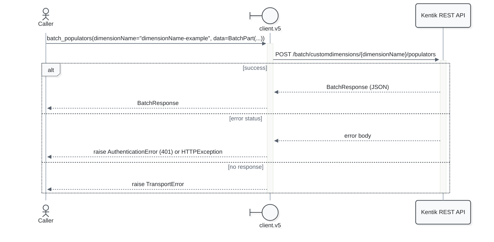
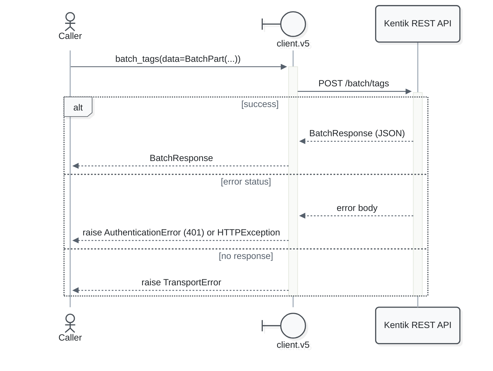
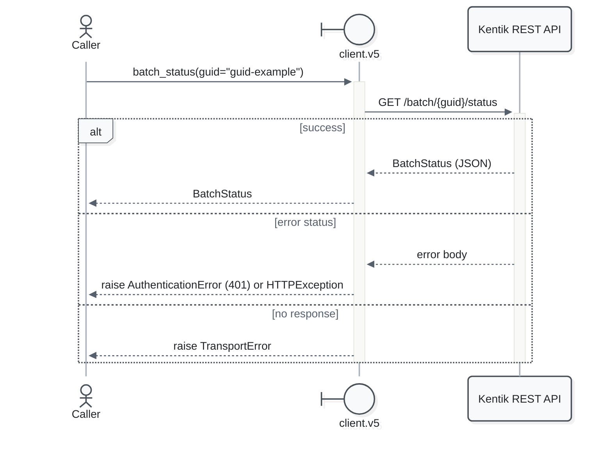
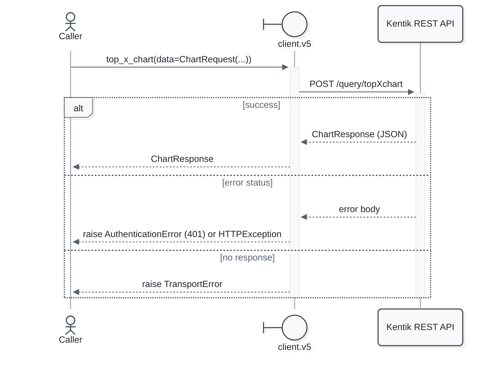
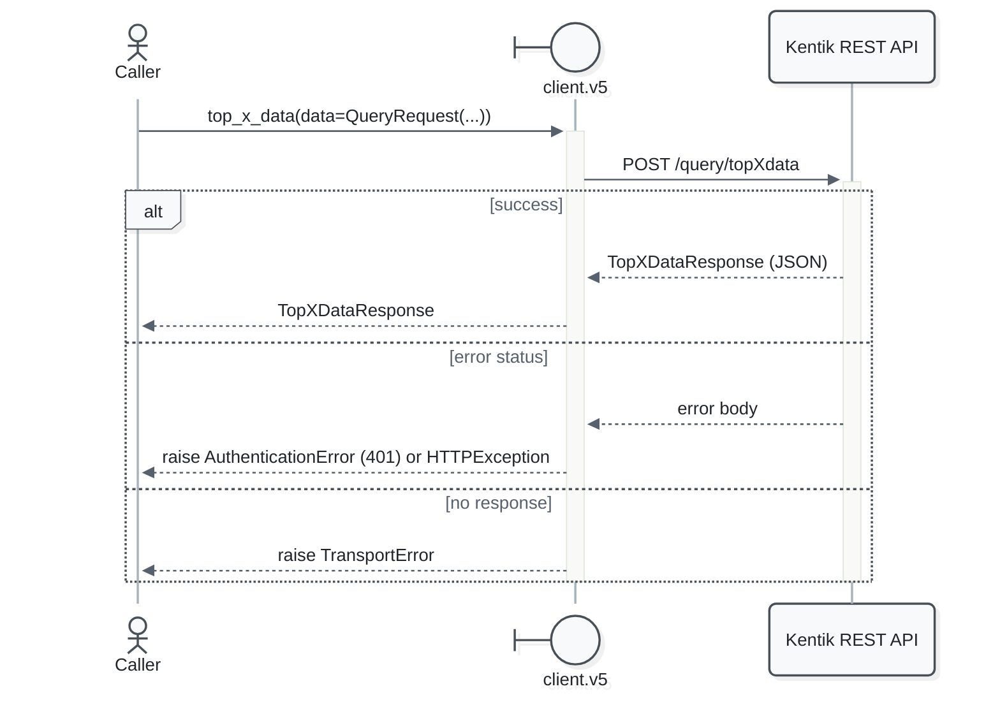
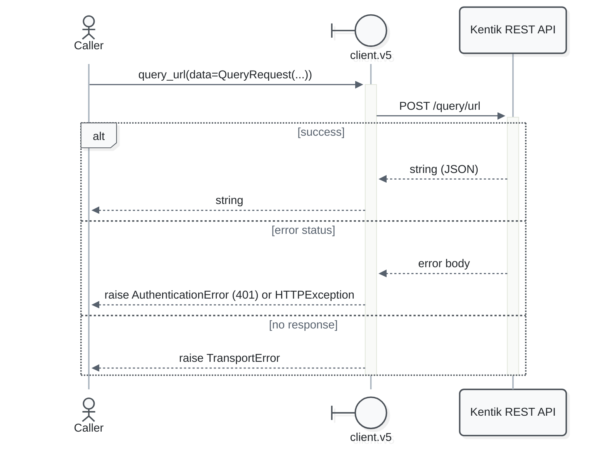

<!-- AUTO-GENERATED: scripts/generation/endpoint_docs.py, render_endpoint_docs() -->
<!-- Rebuilt on every `uv run poe generate`. Do not edit by hand. -->

# V5 Service

## Overview

```{raw} html
<div class="kx">
<div class="chips" role="group" aria-label="Show one path" data-paths-for="overview-svg"></div>
<figure>
<div class="diagram explorer"><svg id="overview-svg" viewBox="0 0 1100 680" role="img" aria-label="Call path of client.v5: your code calls the wrapper, which sends the call over REST." xmlns="http://www.w3.org/2000/svg"><defs><marker id="ov-ah" viewBox="0 0 10 10" refX="8.5" refY="5" markerWidth="7" markerHeight="7" orient="auto-start-reverse"><path d="M0,0 L10,5 L0,10 z" class="ah"/></marker><marker id="ov-ah-hi" viewBox="0 0 10 10" refX="8.5" refY="5" markerWidth="7" markerHeight="7" orient="auto-start-reverse"><path d="M0,0 L10,5 L0,10 z" class="ah-hi"/></marker></defs><g class="edge call" data-seg="code_call" data-links="code>wrap"><path d="M520,102 V170" class="wire arrow" marker-end="url(#ov-ah)"/><text x="512" y="140" class="elabel" text-anchor="end">method call</text></g><g class="edge data" data-seg="wrap_answer" data-links="wrap>code"><path d="M580,170 V102" class="wire arrow" marker-end="url(#ov-ah)"/><text x="588" y="140" class="elabel" text-anchor="start">Pydantic model</text></g><g class="edge call" data-seg="rest_call" data-links="wrap>rest"><path d="M520,242 V310" class="wire arrow" marker-end="url(#ov-ah)"/><text x="512" y="280" class="elabel" text-anchor="end">arguments</text></g><g class="edge data" data-seg="rest_answer" data-links="rest>wrap"><path d="M580,310 V242" class="wire arrow" marker-end="url(#ov-ah)"/><text x="588" y="280" class="elabel" text-anchor="start">Pydantic model</text></g><g class="edge call" data-seg="rj_call" data-links="rest>rj"><path d="M520,382 V450" class="wire arrow" marker-end="url(#ov-ah)"/><text x="512" y="420" class="elabel" text-anchor="end">method, path, body</text></g><g class="edge data" data-seg="rj_answer" data-links="rj>rest"><path d="M580,450 V382" class="wire arrow" marker-end="url(#ov-ah)"/><text x="588" y="420" class="elabel" text-anchor="start">JSON dict</text></g><g class="edge call" data-seg="restapi_call" data-links="rj>restapi"><path d="M520,522 V590" class="wire arrow" marker-end="url(#ov-ah)"/><text x="512" y="560" class="elabel" text-anchor="end">HTTPS request</text></g><g class="edge data" data-seg="restapi_answer" data-links="restapi>rj"><path d="M580,590 V522" class="wire arrow" marker-end="url(#ov-ah)"/><text x="588" y="560" class="elabel" text-anchor="start">JSON response</text></g><g class="node fam-green src " data-id="code" tabindex="0" role="button" aria-label="Select Your code"><rect x="450" y="30" width="200" height="72" rx="14"/><text x="550.0" y="62.5" class="nm">Your code</text><text x="550.0" y="79.5" class="ft">client.v5</text></g><g class="node fam-orange proc " data-id="wrap" tabindex="0" role="button" aria-label="Select V5ServiceWrapper"><rect x="450" y="170" width="200" height="72" rx="14"/><text x="550.0" y="194.0" class="nm">V5ServiceWrapper</text><text x="550.0" y="211.0" class="ft">client.v5</text><text x="550.0" y="228.0" class="ft">6 operations</text></g><g class="node fam-blue proc " data-id="rest" tabindex="0" role="button" aria-label="Select REST functions"><rect x="450" y="310" width="200" height="72" rx="14"/><text x="550.0" y="342.5" class="nm">REST functions</text><text x="550.0" y="359.5" class="ft">gen/v5/services/</text></g><g class="node fam-blue proc " data-id="rj" tabindex="0" role="button" aria-label="Select request_json()"><rect x="450" y="450" width="200" height="72" rx="14"/><text x="550.0" y="482.5" class="nm">request_json()</text><text x="550.0" y="499.5" class="ft">core/rest_runtime.py</text></g><g class="node fam-blue src " data-id="restapi" tabindex="0" role="button" aria-label="Select Kentik REST API"><rect x="450" y="590" width="200" height="72" rx="14"/><text x="550.0" y="622.5" class="nm">Kentik REST API</text><text x="550.0" y="639.5" class="ft">HTTPS + JSON</text></g></svg></div>
<figcaption>Select a part. Each hop is a call going down and its answer coming back up. This service is REST only, so a gRPC client also sends its calls over REST.</figcaption>
</figure>
<div class="legend" aria-hidden="true"><span><svg viewBox="0 0 34 10"><line x1="2" y1="5" x2="32" y2="5" stroke="var(--wire-hi)" stroke-linecap="round" stroke-width="3"/></svg>what the selected part needs</span><span><svg viewBox="0 0 34 10"><line x1="2" y1="5" x2="32" y2="5" stroke="var(--wire-hi)" stroke-linecap="round" stroke-width="3" stroke-dasharray="9 7"/></svg>where its data goes</span></div>
<div class="detail" data-detail-for="overview-svg" aria-live="polite"></div>
<script type="application/json" id="diagram-data">{"overview-svg": {"select": "wrap", "parts": {"code": {"title": "Your code", "role": "Calls a method on the service wrapper.", "facts": ["client.v5.<method>(...)"], "stops": "Nothing in the SDK runs."}, "wrap": {"title": "V5ServiceWrapper", "role": "Sends each call to the REST function or to call_grpc(), for the transport that the client uses.", "facts": ["Source: gen/v5/services/v5.py", "Returns models from gen/v5/models/"], "stops": "Expected: no operation of this service can be called."}, "rest": {"title": "REST functions", "role": "One function per operation. Each one calls request_json() with its own error class.", "facts": ["Error classes: gen/v5/error/"], "stops": "Expected: calls on a REST transport fail. A gRPC client keeps working."}, "rj": {"title": "request_json()", "role": "The one function that sends REST traffic: auth headers, quota, and errors.", "facts": ["Raises AuthenticationError on 401", "Raises the operation's error class on other errors"], "stops": "Expected: every REST call of every service fails."}, "restapi": {"title": "Kentik REST API", "role": "The REST endpoints of the service.", "facts": ["Reports the quota in response headers"], "stops": "Expected: REST calls raise TransportError. A gRPC client keeps working."}}, "paths": {"rest": {"label": "REST call", "family": "blue", "title": "A call on a REST transport", "text": "The wrapper calls the REST function, which sends the request with request_json().", "links": ["code>wrap", "wrap>rest", "rest>rj", "rj>restapi", "restapi>rj", "rj>rest", "rest>wrap", "wrap>code"]}}}}</script>
</div>
```

On an error status or a failed call, the SDK raises an error class from `gen/v5/error/`, or a shared type from `kentik_api.errors`.

## Endpoints

### BatchService

#### `POST` `/batch/customdimensions/{dimensionName}/populators`

Batch populators

Creates, updates, or deletes the populators of one custom dimension in bulk. Sends one part of a batch. The API applies upserts as parts arrive and deletes only after the part with complete=true. Each part is at most 4 MB. Every part after the first carries the guid from the first response. kentik_api.v5_tools.split_batch() and send_batch() do this. The SDK never resends a part.

##### REST call flow



##### gRPC call flow

Not used. This endpoint exists only on REST. A client with `protocol="grpc"` also sends this call over REST.

##### Parameters

| Name | In | Type | Required |
| --- | --- | --- | --- |
| `dimensionName` | path | `string` | Yes |
| `data` | body | `BatchPart` | Yes |

##### Responses

| Status | Description | Model |
| --- | --- | --- |
| 202 | The part is queued. Its guid identifies the batch. | `BatchResponse` |
| 400 | The request is not valid, for example a query without device_name. | `V5Error` |
| 401 | The credentials are missing or wrong. | `V5Error` |
| 403 | The user may not call this endpoint. | `V5Error` |
| 404 | The resource does not exist. | `V5Error` |
| 429 | The rate limit is exceeded. V5 sends no rate limit headers. | `V5Error` |
| 500 | The API failed. | `V5Error` |

##### Example

```python
from kentik_api.client import KentikAPI
from kentik_api.gen.v5.models import BatchPart

# REST only. A client created with protocol="grpc" also sends these calls over REST.
client = KentikAPI(protocol="rest")  # loads KENTIK_EMAIL/KENTIK_API_TOKEN from .env
response = client.v5.batch_populators(
    dimensionName="dimensionName-example",
    data=BatchPart(...),
)
```

---

#### `POST` `/batch/tags`

Batch flow tags

Creates, updates, or deletes flow tags in bulk. Sends one part of a batch. The API applies upserts as parts arrive and deletes only after the part with complete=true. Each part is at most 4 MB. Every part after the first carries the guid from the first response. kentik_api.v5_tools.split_batch() and send_batch() do this. The SDK never resends a part.

##### REST call flow



##### gRPC call flow

Not used. This endpoint exists only on REST. A client with `protocol="grpc"` also sends this call over REST.

##### Parameters

| Name | In | Type | Required |
| --- | --- | --- | --- |
| `data` | body | `BatchPart` | Yes |

##### Responses

| Status | Description | Model |
| --- | --- | --- |
| 202 | The part is queued. Its guid identifies the batch. | `BatchResponse` |
| 400 | The request is not valid, for example a query without device_name. | `V5Error` |
| 401 | The credentials are missing or wrong. | `V5Error` |
| 403 | The user may not call this endpoint. | `V5Error` |
| 404 | The resource does not exist. | `V5Error` |
| 429 | The rate limit is exceeded. V5 sends no rate limit headers. | `V5Error` |
| 500 | The API failed. | `V5Error` |

##### Example

```python
from kentik_api.client import KentikAPI
from kentik_api.gen.v5.models import BatchPart

# REST only. A client created with protocol="grpc" also sends these calls over REST.
client = KentikAPI(protocol="rest")  # loads KENTIK_EMAIL/KENTIK_API_TOKEN from .env
response = client.v5.batch_tags(
    data=BatchPart(...),
)
```

---

#### `GET` `/batch/{guid}/status`

Batch status

Returns the progress of a batch. kentik_api.v5_tools.wait_for_batch() polls it until is_complete is true.

##### REST call flow



##### gRPC call flow

Not used. This endpoint exists only on REST. A client with `protocol="grpc"` also sends this call over REST.

##### Parameters

| Name | In | Type | Required |
| --- | --- | --- | --- |
| `guid` | path | `string` | Yes |

##### Responses

| Status | Description | Model |
| --- | --- | --- |
| 200 | The batch progress. | `BatchStatus` |
| 400 | The request is not valid, for example a query without device_name. | `V5Error` |
| 401 | The credentials are missing or wrong. | `V5Error` |
| 403 | The user may not call this endpoint. | `V5Error` |
| 404 | The resource does not exist. | `V5Error` |
| 429 | The rate limit is exceeded. V5 sends no rate limit headers. | `V5Error` |
| 500 | The API failed. | `V5Error` |

##### Example

```python
from kentik_api.client import KentikAPI

# REST only. A client created with protocol="grpc" also sends these calls over REST.
client = KentikAPI(protocol="rest")  # loads KENTIK_EMAIL/KENTIK_API_TOKEN from .env
response = client.v5.batch_status(
    guid="guid-example",
)
```

### QueryService

#### `POST` `/query/topXchart`

Top-X chart query

Runs one or more queries and returns a chart image as a base64 data URI. Not verified: in a live check on 2026-10-16 this endpoint gave no response within 180 seconds. Decode the result with kentik_api.v5_tools.decode_chart().

##### REST call flow



##### gRPC call flow

Not used. This endpoint exists only on REST. A client with `protocol="grpc"` also sends this call over REST.

##### Parameters

| Name | In | Type | Required |
| --- | --- | --- | --- |
| `data` | body | `ChartRequest` | Yes |

##### Responses

| Status | Description | Model |
| --- | --- | --- |
| 200 | The chart image as a data URI. | `ChartResponse` |
| 400 | The request is not valid, for example a query without device_name. | `V5Error` |
| 401 | The credentials are missing or wrong. | `V5Error` |
| 403 | The user may not call this endpoint. | `V5Error` |
| 404 | The resource does not exist. | `V5Error` |
| 429 | The rate limit is exceeded. V5 sends no rate limit headers. | `V5Error` |
| 500 | The API failed. | `V5Error` |

##### Example

```python
from kentik_api.client import KentikAPI
from kentik_api.gen.v5.models import ChartRequest

# REST only. A client created with protocol="grpc" also sends these calls over REST.
client = KentikAPI(protocol="rest")  # loads KENTIK_EMAIL/KENTIK_API_TOKEN from .env
response = client.v5.top_x_chart(
    data=ChartRequest(...),
)
```

---

#### `POST` `/query/topXdata`

Top-X data query

Runs one or more queries on the Kentik Data Engine and returns the result rows of each bucket, with time series for the top-X rows.

##### REST call flow



##### gRPC call flow

Not used. This endpoint exists only on REST. A client with `protocol="grpc"` also sends this call over REST.

##### Parameters

| Name | In | Type | Required |
| --- | --- | --- | --- |
| `data` | body | `QueryRequest` | Yes |

##### Responses

| Status | Description | Model |
| --- | --- | --- |
| 200 | The result rows of each bucket. | `TopXDataResponse` |
| 400 | The request is not valid, for example a query without device_name. | `V5Error` |
| 401 | The credentials are missing or wrong. | `V5Error` |
| 403 | The user may not call this endpoint. | `V5Error` |
| 404 | The resource does not exist. | `V5Error` |
| 429 | The rate limit is exceeded. V5 sends no rate limit headers. | `V5Error` |
| 500 | The API failed. | `V5Error` |

##### Example

```python
from kentik_api.client import KentikAPI
from kentik_api.gen.v5.models import QueryRequest

# REST only. A client created with protocol="grpc" also sends these calls over REST.
client = KentikAPI(protocol="rest")  # loads KENTIK_EMAIL/KENTIK_API_TOKEN from .env
response = client.v5.top_x_data(
    data=QueryRequest(...),
)
```

---

#### `POST` `/query/url`

Data Explorer URL

Returns a link that opens Data Explorer in the Kentik portal with the sidebar set to the query.

##### REST call flow



##### gRPC call flow

Not used. This endpoint exists only on REST. A client with `protocol="grpc"` also sends this call over REST.

##### Parameters

| Name | In | Type | Required |
| --- | --- | --- | --- |
| `data` | body | `QueryRequest` | Yes |

##### Responses

| Status | Description | Model |
| --- | --- | --- |
| 200 | The Data Explorer link. | `string` |
| 400 | The request is not valid, for example a query without device_name. | `V5Error` |
| 401 | The credentials are missing or wrong. | `V5Error` |
| 403 | The user may not call this endpoint. | `V5Error` |
| 404 | The resource does not exist. | `V5Error` |
| 429 | The rate limit is exceeded. V5 sends no rate limit headers. | `V5Error` |
| 500 | The API failed. | `V5Error` |

##### Example

```python
from kentik_api.client import KentikAPI
from kentik_api.gen.v5.models import QueryRequest

# REST only. A client created with protocol="grpc" also sends these calls over REST.
client = KentikAPI(protocol="rest")  # loads KENTIK_EMAIL/KENTIK_API_TOKEN from .env
response = client.v5.query_url(
    data=QueryRequest(...),
)
```

## Data Models

<details>
<summary>Model relationships (17 of 24 models)</summary>

Each arrow points from a model to a model that one of its fields holds. The label names the field.

```mermaid
%%{init: {"theme": "redux", "look": "neo", "layout": "dagre", "fontFamily": "ui-monospace, SFMono-Regular, Menlo, monospace", "themeVariables": {"fontFamily": "ui-monospace, SFMono-Regular, Menlo, monospace", "primaryColor": "#f8f9fa", "primaryBorderColor": "#495057", "primaryTextColor": "#212529", "textColor": "#212529", "lineColor": "#77818c", "edgeLabelBackground": "#ffffff", "actorBkg": "#f8f9fa", "actorBorder": "#495057", "actorTextColor": "#212529", "actorLineColor": "#a9b3be", "signalColor": "#57616d", "signalTextColor": "#212529", "labelBoxBkgColor": "#f8f9fa", "labelBoxBorderColor": "#495057", "labelTextColor": "#212529", "loopTextColor": "#57616d", "noteBkgColor": "#fff9db", "noteBorderColor": "#f08c00", "noteTextColor": "#a35a00"}, "sequence": {"activationWidth": 16}, "flowchart": {"curve": "step", "nodeSpacing": 30, "rankSpacing": 70, "wrappingWidth": 400}}}%%
classDiagram
    class BatchDelete
    class BatchDeleteCounts
    class BatchPart
    class BatchReplaceAll
    class BatchResponse
    class BatchStatus
    class BatchStatusCustomDimension
    class BatchStatusUser
    class BatchUpsert
    class BatchUpsertCounts
    class ChartRequest
    class ChartResponse
    class QueryItem
    class QueryRequest
    class ResultBucket
    class TopXDataResponse
    class V5Error
    BatchPart --> BatchDelete : deletes
    BatchPart --> BatchUpsert : upserts
    BatchStatus --> BatchDeleteCounts : deletes
    BatchStatus --> BatchReplaceAll : replace_all
    BatchStatus --> BatchStatusCustomDimension : custom_dimension
    BatchStatus --> BatchStatusUser : user
    BatchStatus --> BatchUpsertCounts : upserts
    ChartRequest --> QueryItem : queries
    QueryRequest --> QueryItem : queries
    TopXDataResponse --> ResultBucket : results
```



</details>

```{eval-rst}
.. autopydantic_model:: kentik_api.gen.v5.models.Aggregate
```

```{eval-rst}
.. autopydantic_model:: kentik_api.gen.v5.models.BatchCriterion
```

```{eval-rst}
.. autopydantic_model:: kentik_api.gen.v5.models.BatchDelete
```

```{eval-rst}
.. autopydantic_model:: kentik_api.gen.v5.models.BatchDeleteCounts
```

```{eval-rst}
.. autopydantic_model:: kentik_api.gen.v5.models.BatchPart
```

```{eval-rst}
.. autopydantic_model:: kentik_api.gen.v5.models.BatchReplaceAll
```

```{eval-rst}
.. autopydantic_model:: kentik_api.gen.v5.models.BatchResponse
```

```{eval-rst}
.. autopydantic_model:: kentik_api.gen.v5.models.BatchStatus
```

```{eval-rst}
.. autopydantic_model:: kentik_api.gen.v5.models.BatchStatusCustomDimension
```

```{eval-rst}
.. autopydantic_model:: kentik_api.gen.v5.models.BatchStatusUser
```

```{eval-rst}
.. autopydantic_model:: kentik_api.gen.v5.models.BatchUpsert
```

```{eval-rst}
.. autopydantic_model:: kentik_api.gen.v5.models.BatchUpsertCounts
```

```{eval-rst}
.. autopydantic_model:: kentik_api.gen.v5.models.ChartRequest
```

```{eval-rst}
.. autopydantic_model:: kentik_api.gen.v5.models.ChartResponse
```

```{eval-rst}
.. autopydantic_model:: kentik_api.gen.v5.models.Filter
```

```{eval-rst}
.. autopydantic_model:: kentik_api.gen.v5.models.FilterGroup
```

```{eval-rst}
.. autopydantic_model:: kentik_api.gen.v5.models.Query
```

```{eval-rst}
.. autopydantic_model:: kentik_api.gen.v5.models.QueryFilters
```

```{eval-rst}
.. autopydantic_model:: kentik_api.gen.v5.models.QueryItem
```

```{eval-rst}
.. autopydantic_model:: kentik_api.gen.v5.models.QueryRequest
```

```{eval-rst}
.. autopydantic_model:: kentik_api.gen.v5.models.ResultBucket
```

```{eval-rst}
.. autopydantic_model:: kentik_api.gen.v5.models.SavedFilterRef
```

```{eval-rst}
.. autopydantic_model:: kentik_api.gen.v5.models.TopXDataResponse
```

```{eval-rst}
.. autopydantic_model:: kentik_api.gen.v5.models.V5Error
```
