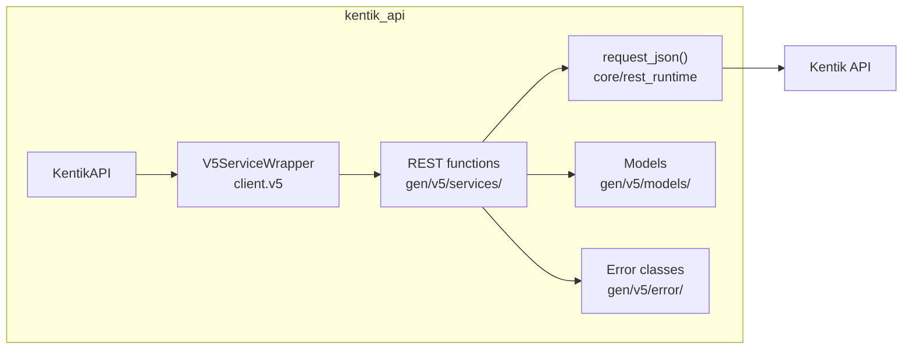
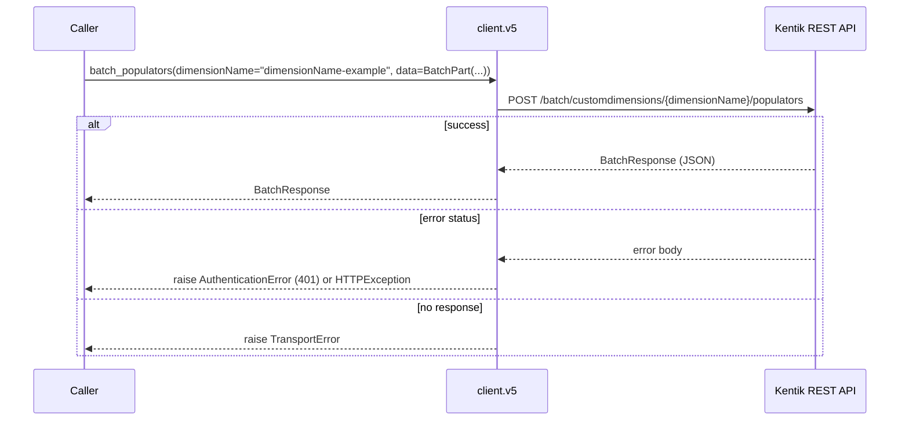
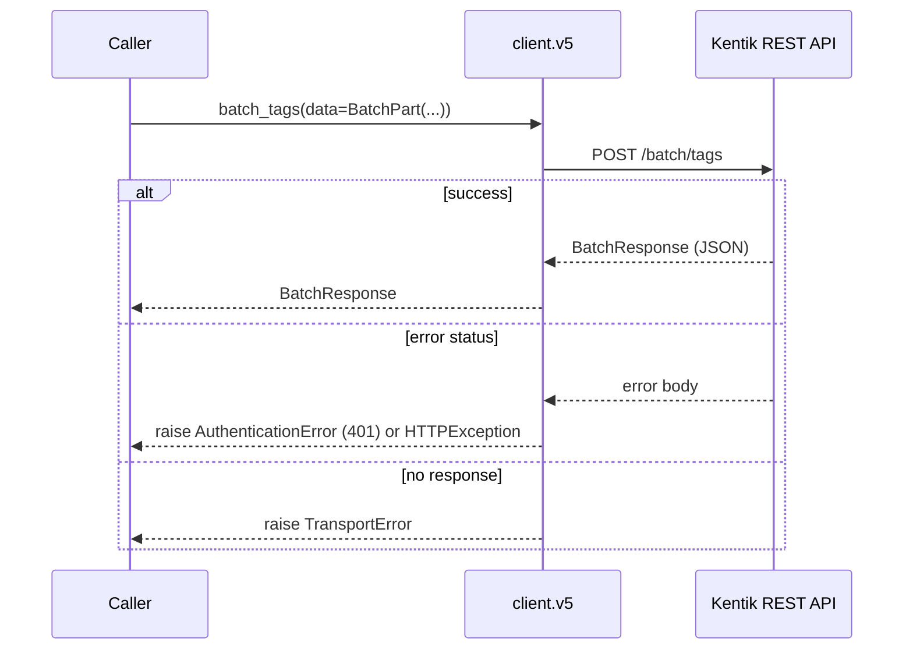
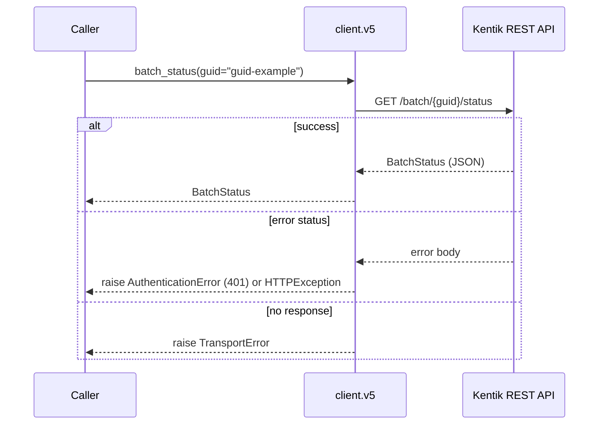
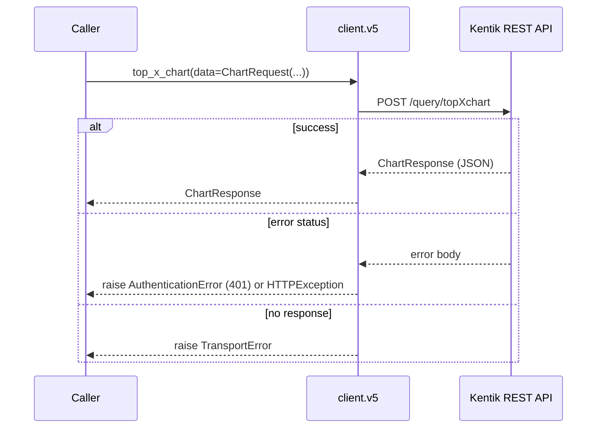
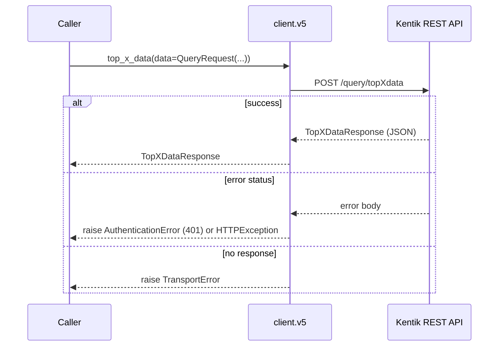
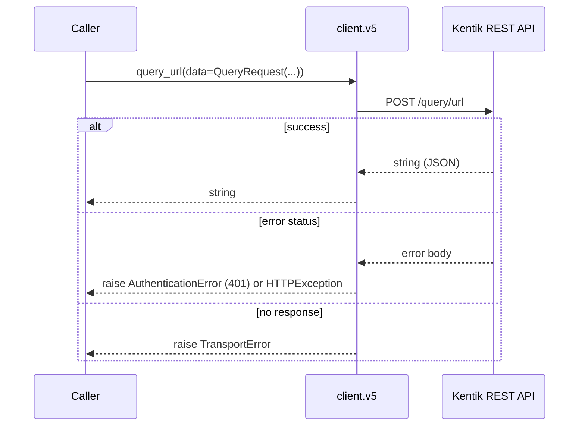
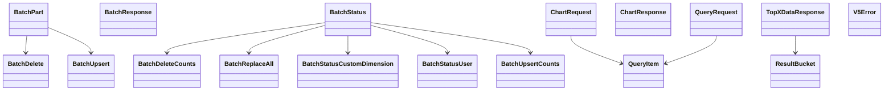

<!-- AUTO-GENERATED: scripts/generation/endpoint_docs.py, render_endpoint_docs() -->
<!-- Rebuilt on every `make generate`. Do not edit by hand. -->

# V5 Service

## Overview



## Endpoints

### BatchService

#### `POST` `/batch/customdimensions/{dimensionName}/populators`

Batch populators

Creates, updates, or deletes the populators of one custom dimension in bulk. Sends one part of a batch. The API applies upserts as parts arrive and deletes only after the part with complete=true. Each part is at most 4 MB. Every part after the first carries the guid from the first response. kentik_api.v5_tools.split_batch() and send_batch() do this. The SDK never resends a part.

**REST transport**



**gRPC transport**

Not used: this endpoint exists only on REST, so a client created with `protocol="grpc"` sends this call over REST too.

##### Parameters

| Name | In | Type | Required |
| --- | --- | --- | --- |
| `dimensionName` | path | `string` | Yes |
| `data` | body | `BatchPart` | Yes |

##### Responses

| Status | Description | Model |
| --- | --- | --- |
| 202 | The part is queued. Its guid identifies the batch. | `BatchResponse` |
| 400 | The request is not valid, for example a query without device_name. | `V5Error` |
| 401 | The credentials are missing or wrong. | `V5Error` |
| 403 | The user may not call this endpoint. | `V5Error` |
| 404 | The resource does not exist. | `V5Error` |
| 429 | The rate limit is exceeded. V5 sends no rate limit headers. | `V5Error` |
| 500 | The API failed. | `V5Error` |

##### Example

```python
from kentik_api.client import KentikAPI
from kentik_api.gen.v5.models import BatchPart

# REST only. A client created with protocol="grpc" also sends these calls over REST.
client = KentikAPI(protocol="rest")  # loads KENTIK_EMAIL/KENTIK_API_TOKEN from .env
response = client.v5.batch_populators(
    dimensionName="dimensionName-example",
    data=BatchPart(...),
)
```

---

#### `POST` `/batch/tags`

Batch flow tags

Creates, updates, or deletes flow tags in bulk. Sends one part of a batch. The API applies upserts as parts arrive and deletes only after the part with complete=true. Each part is at most 4 MB. Every part after the first carries the guid from the first response. kentik_api.v5_tools.split_batch() and send_batch() do this. The SDK never resends a part.

**REST transport**



**gRPC transport**

Not used: this endpoint exists only on REST, so a client created with `protocol="grpc"` sends this call over REST too.

##### Parameters

| Name | In | Type | Required |
| --- | --- | --- | --- |
| `data` | body | `BatchPart` | Yes |

##### Responses

| Status | Description | Model |
| --- | --- | --- |
| 202 | The part is queued. Its guid identifies the batch. | `BatchResponse` |
| 400 | The request is not valid, for example a query without device_name. | `V5Error` |
| 401 | The credentials are missing or wrong. | `V5Error` |
| 403 | The user may not call this endpoint. | `V5Error` |
| 404 | The resource does not exist. | `V5Error` |
| 429 | The rate limit is exceeded. V5 sends no rate limit headers. | `V5Error` |
| 500 | The API failed. | `V5Error` |

##### Example

```python
from kentik_api.client import KentikAPI
from kentik_api.gen.v5.models import BatchPart

# REST only. A client created with protocol="grpc" also sends these calls over REST.
client = KentikAPI(protocol="rest")  # loads KENTIK_EMAIL/KENTIK_API_TOKEN from .env
response = client.v5.batch_tags(
    data=BatchPart(...),
)
```

---

#### `GET` `/batch/{guid}/status`

Batch status

Returns the progress of a batch. kentik_api.v5_tools.wait_for_batch() polls it until is_complete is true.

**REST transport**



**gRPC transport**

Not used: this endpoint exists only on REST, so a client created with `protocol="grpc"` sends this call over REST too.

##### Parameters

| Name | In | Type | Required |
| --- | --- | --- | --- |
| `guid` | path | `string` | Yes |

##### Responses

| Status | Description | Model |
| --- | --- | --- |
| 200 | The batch progress. | `BatchStatus` |
| 400 | The request is not valid, for example a query without device_name. | `V5Error` |
| 401 | The credentials are missing or wrong. | `V5Error` |
| 403 | The user may not call this endpoint. | `V5Error` |
| 404 | The resource does not exist. | `V5Error` |
| 429 | The rate limit is exceeded. V5 sends no rate limit headers. | `V5Error` |
| 500 | The API failed. | `V5Error` |

##### Example

```python
from kentik_api.client import KentikAPI

# REST only. A client created with protocol="grpc" also sends these calls over REST.
client = KentikAPI(protocol="rest")  # loads KENTIK_EMAIL/KENTIK_API_TOKEN from .env
response = client.v5.batch_status(
    guid="guid-example",
)
```

### QueryService

#### `POST` `/query/topXchart`

Top-X chart query

Runs one or more queries and returns a chart image as a base64 data URI. Not verified: in a live check on 2026-10-16 this endpoint gave no response within 180 seconds. Decode the result with kentik_api.v5_tools.decode_chart().

**REST transport**



**gRPC transport**

Not used: this endpoint exists only on REST, so a client created with `protocol="grpc"` sends this call over REST too.

##### Parameters

| Name | In | Type | Required |
| --- | --- | --- | --- |
| `data` | body | `ChartRequest` | Yes |

##### Responses

| Status | Description | Model |
| --- | --- | --- |
| 200 | The chart image as a data URI. | `ChartResponse` |
| 400 | The request is not valid, for example a query without device_name. | `V5Error` |
| 401 | The credentials are missing or wrong. | `V5Error` |
| 403 | The user may not call this endpoint. | `V5Error` |
| 404 | The resource does not exist. | `V5Error` |
| 429 | The rate limit is exceeded. V5 sends no rate limit headers. | `V5Error` |
| 500 | The API failed. | `V5Error` |

##### Example

```python
from kentik_api.client import KentikAPI
from kentik_api.gen.v5.models import ChartRequest

# REST only. A client created with protocol="grpc" also sends these calls over REST.
client = KentikAPI(protocol="rest")  # loads KENTIK_EMAIL/KENTIK_API_TOKEN from .env
response = client.v5.top_x_chart(
    data=ChartRequest(...),
)
```

---

#### `POST` `/query/topXdata`

Top-X data query

Runs one or more queries on the Kentik Data Engine and returns the result rows of each bucket, with time series for the top-X rows.

**REST transport**



**gRPC transport**

Not used: this endpoint exists only on REST, so a client created with `protocol="grpc"` sends this call over REST too.

##### Parameters

| Name | In | Type | Required |
| --- | --- | --- | --- |
| `data` | body | `QueryRequest` | Yes |

##### Responses

| Status | Description | Model |
| --- | --- | --- |
| 200 | The result rows of each bucket. | `TopXDataResponse` |
| 400 | The request is not valid, for example a query without device_name. | `V5Error` |
| 401 | The credentials are missing or wrong. | `V5Error` |
| 403 | The user may not call this endpoint. | `V5Error` |
| 404 | The resource does not exist. | `V5Error` |
| 429 | The rate limit is exceeded. V5 sends no rate limit headers. | `V5Error` |
| 500 | The API failed. | `V5Error` |

##### Example

```python
from kentik_api.client import KentikAPI
from kentik_api.gen.v5.models import QueryRequest

# REST only. A client created with protocol="grpc" also sends these calls over REST.
client = KentikAPI(protocol="rest")  # loads KENTIK_EMAIL/KENTIK_API_TOKEN from .env
response = client.v5.top_x_data(
    data=QueryRequest(...),
)
```

---

#### `POST` `/query/url`

Data Explorer URL

Returns a link that opens Data Explorer in the Kentik portal with the sidebar set to the query.

**REST transport**



**gRPC transport**

Not used: this endpoint exists only on REST, so a client created with `protocol="grpc"` sends this call over REST too.

##### Parameters

| Name | In | Type | Required |
| --- | --- | --- | --- |
| `data` | body | `QueryRequest` | Yes |

##### Responses

| Status | Description | Model |
| --- | --- | --- |
| 200 | The Data Explorer link. | `string` |
| 400 | The request is not valid, for example a query without device_name. | `V5Error` |
| 401 | The credentials are missing or wrong. | `V5Error` |
| 403 | The user may not call this endpoint. | `V5Error` |
| 404 | The resource does not exist. | `V5Error` |
| 429 | The rate limit is exceeded. V5 sends no rate limit headers. | `V5Error` |
| 500 | The API failed. | `V5Error` |

##### Example

```python
from kentik_api.client import KentikAPI
from kentik_api.gen.v5.models import QueryRequest

# REST only. A client created with protocol="grpc" also sends these calls over REST.
client = KentikAPI(protocol="rest")  # loads KENTIK_EMAIL/KENTIK_API_TOKEN from .env
response = client.v5.query_url(
    data=QueryRequest(...),
)
```

## Data Models

<details>
<summary>Model relationships (17 of 24 models)</summary>



</details>

```{eval-rst}
.. autopydantic_model:: kentik_api.gen.v5.models.Aggregate
```

```{eval-rst}
.. autopydantic_model:: kentik_api.gen.v5.models.BatchCriterion
```

```{eval-rst}
.. autopydantic_model:: kentik_api.gen.v5.models.BatchDelete
```

```{eval-rst}
.. autopydantic_model:: kentik_api.gen.v5.models.BatchDeleteCounts
```

```{eval-rst}
.. autopydantic_model:: kentik_api.gen.v5.models.BatchPart
```

```{eval-rst}
.. autopydantic_model:: kentik_api.gen.v5.models.BatchReplaceAll
```

```{eval-rst}
.. autopydantic_model:: kentik_api.gen.v5.models.BatchResponse
```

```{eval-rst}
.. autopydantic_model:: kentik_api.gen.v5.models.BatchStatus
```

```{eval-rst}
.. autopydantic_model:: kentik_api.gen.v5.models.BatchStatusCustomDimension
```

```{eval-rst}
.. autopydantic_model:: kentik_api.gen.v5.models.BatchStatusUser
```

```{eval-rst}
.. autopydantic_model:: kentik_api.gen.v5.models.BatchUpsert
```

```{eval-rst}
.. autopydantic_model:: kentik_api.gen.v5.models.BatchUpsertCounts
```

```{eval-rst}
.. autopydantic_model:: kentik_api.gen.v5.models.ChartRequest
```

```{eval-rst}
.. autopydantic_model:: kentik_api.gen.v5.models.ChartResponse
```

```{eval-rst}
.. autopydantic_model:: kentik_api.gen.v5.models.Filter
```

```{eval-rst}
.. autopydantic_model:: kentik_api.gen.v5.models.FilterGroup
```

```{eval-rst}
.. autopydantic_model:: kentik_api.gen.v5.models.Query
```

```{eval-rst}
.. autopydantic_model:: kentik_api.gen.v5.models.QueryFilters
```

```{eval-rst}
.. autopydantic_model:: kentik_api.gen.v5.models.QueryItem
```

```{eval-rst}
.. autopydantic_model:: kentik_api.gen.v5.models.QueryRequest
```

```{eval-rst}
.. autopydantic_model:: kentik_api.gen.v5.models.ResultBucket
```

```{eval-rst}
.. autopydantic_model:: kentik_api.gen.v5.models.SavedFilterRef
```

```{eval-rst}
.. autopydantic_model:: kentik_api.gen.v5.models.TopXDataResponse
```

```{eval-rst}
.. autopydantic_model:: kentik_api.gen.v5.models.V5Error
```
