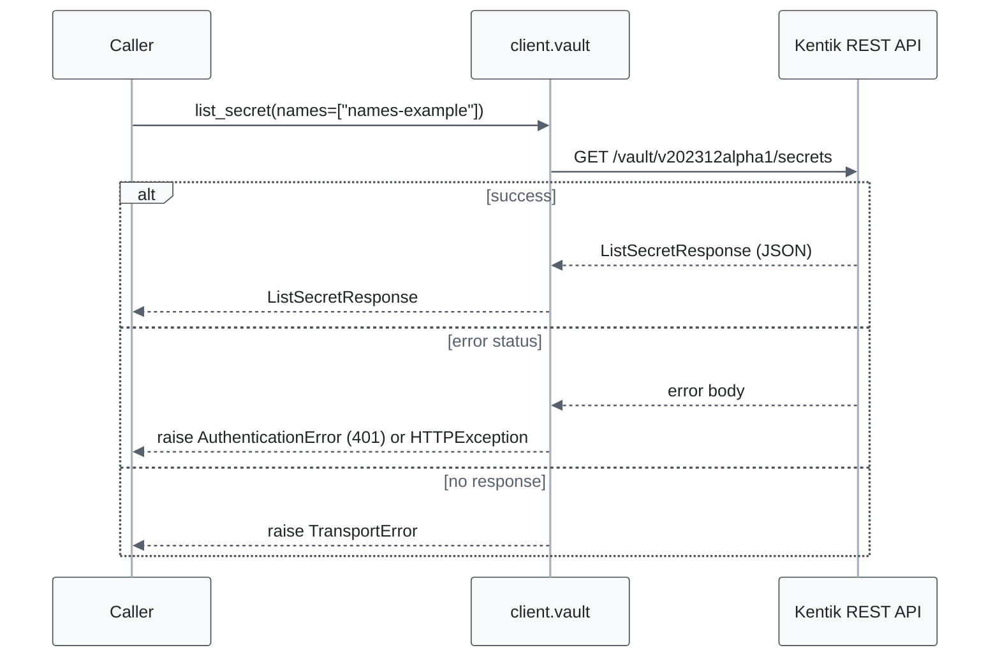
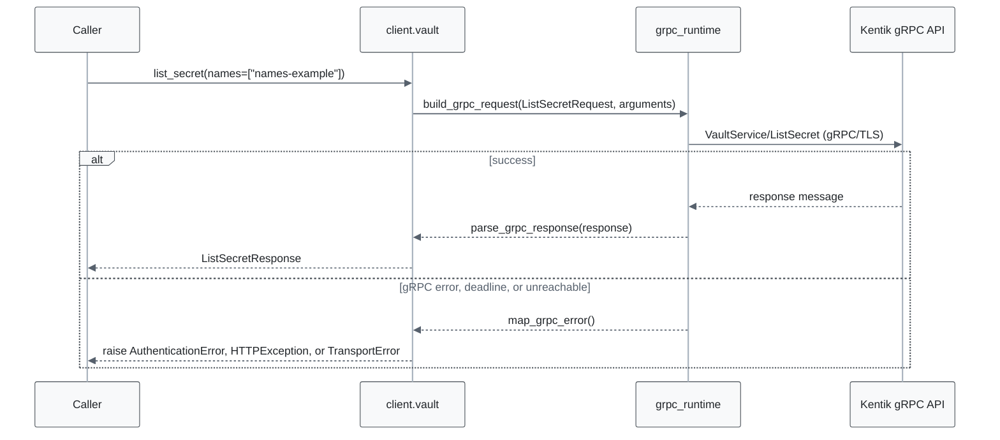
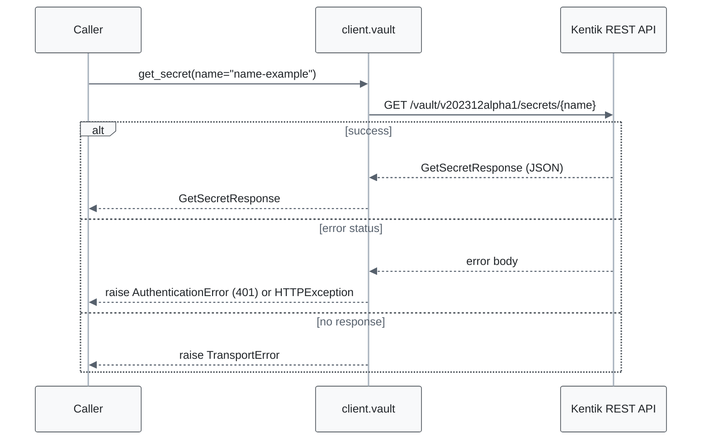
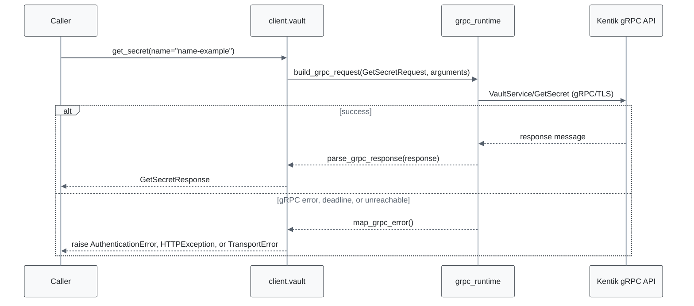
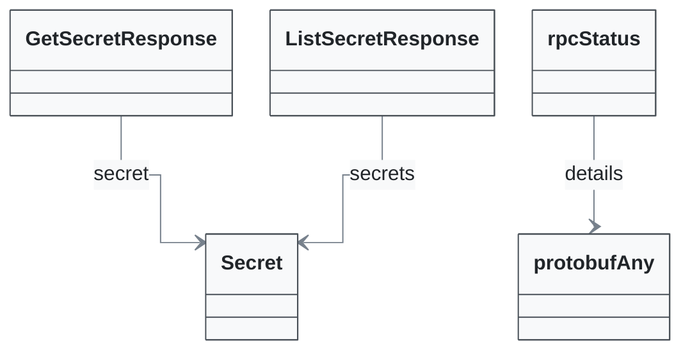

<!-- AUTO-GENERATED: scripts/generation/endpoint_docs.py, render_endpoint_docs() -->
<!-- Rebuilt on every `uv run poe generate`. Do not edit by hand. -->

# Vault Service

## Overview

```mermaid
%%{init: {"theme": "base", "fontFamily": "ui-monospace, SFMono-Regular, Menlo, monospace", "themeVariables": {"fontFamily": "ui-monospace, SFMono-Regular, Menlo, monospace", "primaryColor": "#f8f9fa", "primaryBorderColor": "#495057", "primaryTextColor": "#212529", "textColor": "#212529", "lineColor": "#77818c", "edgeLabelBackground": "#ffffff", "actorBkg": "#f8f9fa", "actorBorder": "#495057", "actorTextColor": "#212529", "actorLineColor": "#a9b3be", "signalColor": "#57616d", "signalTextColor": "#212529", "labelBoxBkgColor": "#f8f9fa", "labelBoxBorderColor": "#495057", "labelTextColor": "#212529", "loopTextColor": "#57616d", "noteBkgColor": "#fff9db", "noteBorderColor": "#f08c00", "noteTextColor": "#a35a00"}, "flowchart": {"curve": "step", "nodeSpacing": 30, "rankSpacing": 70, "wrappingWidth": 400}}}%%
flowchart LR
    code("Your code"):::greenSrc
    subgraph sdk["kentik_api"]
        wrap("VaultServiceWrapper<br/>client.vault<br/>2 operations"):::orange
        rest("REST functions<br/>gen/vault/services/"):::blue
        rj("request_json()<br/>core/rest_runtime.py"):::blue
        cg("call_grpc()<br/>core/grpc_runtime.py"):::violet
    end
    grpcapi("Kentik gRPC API<br/>HTTP/2 + protobuf"):::violetSrc
    restapi("Kentik REST API<br/>HTTPS + JSON"):::blueSrc

    code -->|"method call"| wrap
    wrap -->|"Pydantic model from<br/>gen/vault/models/"| code
    wrap -->|"arguments"| rest
    rest -->|"Pydantic model"| wrap
    rest -->|"method, path, body"| rj
    rj -->|"JSON dict"| rest
    rj -->|"HTTPS request"| restapi
    restapi -->|"JSON response"| rj
    wrap -->|"proto request"| cg
    cg -->|"proto response"| wrap
    cg -->|"gRPC call"| grpcapi
    grpcapi -->|"proto response"| cg

    classDef greenSrc fill:#b2f2bb,stroke:#2f9e44,color:#2b8a3e
    classDef orange fill:#fff4e6,stroke:#e8590c,color:#d9480f
    classDef blue fill:#e7f5ff,stroke:#1971c2,color:#1864ab
    classDef blueSrc fill:#a5d8ff,stroke:#1971c2,color:#1864ab
    classDef violet fill:#f3f0ff,stroke:#7048e8,color:#5f3dc4
    classDef violetSrc fill:#d0bfff,stroke:#7048e8,color:#5f3dc4
    classDef greenSrc,orange,blue,blueSrc,violet,violetSrc stroke-width:2px,rx:10px
    style sdk fill:none,stroke:#868e96,stroke-width:2px
    linkStyle default stroke-width:2px,stroke-linecap:round,stroke-linejoin:round
```



On an error status or a failed call, the SDK raises an error class from `gen/vault/error/`, or a shared type from `kentik_api.errors`.

## Endpoints

### `GET` `/vault/v202312alpha1/secrets`

List secrets.

Returns list of secret values stored in Kentik vault.

#### REST call flow



#### gRPC call flow



#### Parameters

| Name | In | Type | Required |
| --- | --- | --- | --- |
| `names` | query | `string[]` | Yes |

#### Responses

| Status | Description | Model |
| --- | --- | --- |
| 200 | A successful response. | `ListSecretResponse` |
| default | An unexpected error response. | `rpcStatus` |

#### Example

```python
from kentik_api.client import KentikAPI

# Both transports work: protocol="rest" (default) or protocol="grpc".
client = KentikAPI(protocol="rest")  # loads KENTIK_EMAIL/KENTIK_API_TOKEN from .env
response = client.vault.list_secret(
    names=["names-example"],
)
```

---

### `GET` `/vault/v202312alpha1/secrets/{name}`

Get a secret by name.

Returns a secret value stored in Kentik vault.

#### REST call flow



#### gRPC call flow



#### Parameters

| Name | In | Type | Required |
| --- | --- | --- | --- |
| `name` | path | `string` | Yes |

#### Responses

| Status | Description | Model |
| --- | --- | --- |
| 200 | A successful response. | `GetSecretResponse` |
| default | An unexpected error response. | `rpcStatus` |

#### Example

```python
from kentik_api.client import KentikAPI

# Both transports work: protocol="rest" (default) or protocol="grpc".
client = KentikAPI(protocol="rest")  # loads KENTIK_EMAIL/KENTIK_API_TOKEN from .env
response = client.vault.get_secret(
    name="name-example",
)
```

## Data Models

<details>
<summary>Model relationships (5 of 6 models)</summary>

Each arrow points from a model to a model that one of its fields holds. The label names the field.



</details>

```{eval-rst}
.. autopydantic_model:: kentik_api.gen.vault.models.GetSecretResponse
```

```{eval-rst}
.. autopydantic_model:: kentik_api.gen.vault.models.ListSecretResponse
```

```{eval-rst}
.. autopydantic_model:: kentik_api.gen.vault.models.Secret
```

```{eval-rst}
.. autoclass:: kentik_api.gen.vault.models.SecretType
   :members:
```

```{eval-rst}
.. autopydantic_model:: kentik_api.gen.vault.models.protobufAny
```

```{eval-rst}
.. autopydantic_model:: kentik_api.gen.vault.models.rpcStatus
```
