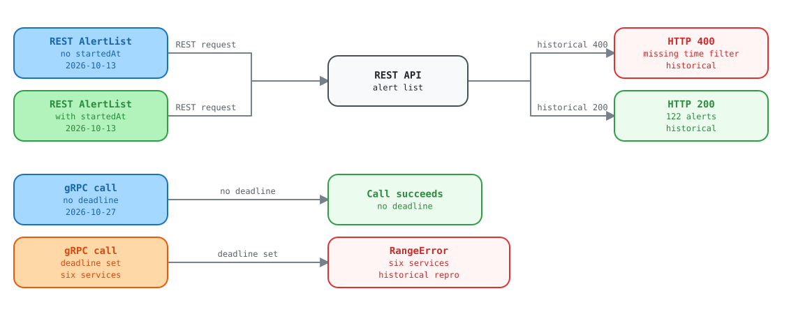

# Alerting: the backend needs `startedAt`, and every gRPC RPC returns 500

Report for the Kentik API team

Observed 2026-10-13 against the live V6 API with the Kentik community Python SDK. Schema checked: `api-schema-public` commit `9de9a68`.

> [!NOTE]
> **Current status, 2026-10-27:** the alert-list requirement no
> longer reproduces. Seven read-only request bodies returned HTTP 200, including
> an empty body. The broad gRPC claim below was narrowed by later tests. Calls
> without deadlines worked. A deadline caused `RangeError` on six services. See
> [the current findings tracker](../kentik-api-team-findings.md) for the
> current ticket list.

## Issue 1: REST `POST /v202505/alerts` rejects a request with no `startedAt`

The proto marks every field of `AlertServiceListRequest` and `AlertFilters`
as `OPTIONAL`. `started_at` has the default `{}`. The operation
description does not mention a required time range. The live API returns
`400 backend request error` for every request that has no `filters.startedAt`.

| Request body | Result |
| --- | --- |
| `{}` | 400 |
| `{"pagination":{"limit":5}}` | 400 |
| `{"sorting":{"field":"startedAt"}}` | 400 |
| `{"filters":{"states":["ALERT_STATE_ACTIVE"]}}` | 400 |
| `{"filters":{"activeAt":{"start":"...","end":"..."}}}` | 400 |
| `{"filters":{"startedAt":{"start":"now-30d","end":"now"}}}` | 200, 122 alerts |

Other `v202505` list routes (silence, auto-ack) accept an empty body.

> [!NOTE]
> **Ask:** either accept a request without `startedAt` (the documented default),
> or mark the field `REQUIRED` in the proto and describe the rule in the operation text.
> Please also return a message that names the missing field instead of `backend request error`.

## Issue 2: every alerting gRPC RPC returns 500 `RangeError`

All alerting RPCs we tried fail over gRPC with the same error. The same calls work over REST, and
other gRPC services work on the same account (for example device list, and the `mkp` lists).

| Operation | REST | gRPC |
| --- | --- | --- |
| Alert `Get` with id `does-not-exist` | 404 | 500 RangeError |
| Alert `List` (empty request, and with `startedAt`) | 200 with `startedAt` | 500 RangeError |
| Silence, mitigation method, mitigation platform, policy, suppression `List` | 200 (silence checked) | 500 RangeError |
| Mitigation `List`, `AvailableActions` | 200 | 500 RangeError |
| Mitigation `Get`, `AvailableActionsForMitigation` with id `999999999` | 404 | 500 RangeError |
| Mitigation `Create`, then `Get`, `Act` STOP and DELETE on it | 200, all succeed | 500 RangeError |

The failure does not depend on the request content: a Get with one string id fails the same way as a List
with a hand-built proto message. The 500 carries no status details. The response comes from the gateway
with `x-envoy-upstream-service-time: 29` (ms), so an upstream service received the call and failed.
Write RPCs fail the same way: a gRPC mitigation `Create` and `Act` both returned the error
on a lab account, while the same calls over REST succeeded.

```text
code    : StatusCode.INTERNAL
details : internal error (name:RangeError type:object) (errxid db77tw34km2g0gtxpkgg)
server  : envoy   x-envoy-upstream-service-time: 29
```

> [!NOTE]
> **Ask:** check the alerting service behind the gRPC route. A `RangeError` is a
> JavaScript error, so it looks like an unhandled exception in that service for every gRPC request.

<picture>
  <source media="(prefers-color-scheme: dark)" srcset="../assets/alert-history-dark.svg">
  <source media="(prefers-color-scheme: light)" srcset="../assets/alert-history-light.svg">
  
</picture>

Open the [interactive explorer](upstream-alert-list-requirements.html) to select each part and see its evidence.

## Related: `ktbgp` `RouteService.List` returns 501

`/kentik.ktbgp.v202501.RouteService/List` is declared in the proto, but the server answers
`501: The server does not implement the method`.

Request ids: REST 400 `db77aqa4km2g0tk1g020`; gRPC 500 `db77tw34km2g0gtxpkgg`.

Request ids: REST 400 `db77aqa4km2g0tk1g020`; gRPC 500 `db77tw34km2g0gtxpkgg`.
