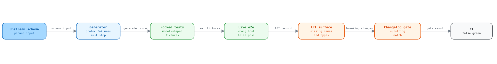

# Pre-PR audit of the V6 SDK branch

This report lists the defects that an audit found on branch
`FA-2-Update-the-python-SDK-from-V5-to-V6` at commit `6e76b43`, on
2026-10-10. Nine parallel audits covered the hand-written runtime, the gRPC
bridge, the generator, the generated code, the tests, packaging, CI, the
release tooling, and the docs. The main session reproduced the most severe
findings a second time.

The audit made no call to the real Kentik API. It ran no e2e test (an
end-to-end test against the real API) and did not read `.env`. It changed no
tracked file and pushed nothing. The reproduction scripts are in
[`evidence/`](evidence/). Some of them expect the scratch layout that they ran
in, so read them as records, not as ready tests.

## Summary

The baseline is green:

- `uv run poe test` gave 2948 passed, 145 skipped, and 468 e2e deselected.
- Ruff lint, Ruff format, `ty`, `uv run poe check-specs`, and the Sphinx `-W` build passed.
- A fresh regeneration at api-schema-public `9de9a68` is byte-identical to the
  committed tree. That commit is the upstream HEAD on 2026-10-10.
- The regeneration gives the same bytes across hash seeds, working
  directories, and a fresh Python 3.12 toolchain.

The green suite hides real defects. The mocked tests build their sample
responses from the generated models, so they cannot see a model that disagrees
with the schema. The REST e2e layer never reaches Kentik, and both e2e layers
pass on any SDK error. Two model bugs and a lost gRPC service passed all 2948
tests. The diagram shows the gap in each gate.

<picture>
  <source media="(prefers-color-scheme: dark)" srcset="../assets/audit-pipeline-dark.svg">
  <source media="(prefers-color-scheme: light)" srcset="../assets/audit-pipeline-light.svg">
  
</picture>

Open the [interactive audit explorer](report.html) to select each gate and see
its recorded failure and evidence.

| Section | Count | What to do |
| --- | --- | --- |
| [Blockers](#blockers) | 13 | Fix before the PR, or name each deferred item in the PR description. |
| [Generation pipeline](#generation-pipeline) | 7, plus 13 latent hazards | Fix before the next schema sync. |
| [Test gaps](#test-gaps) | 10 | Add the tests that can catch the blockers. |
| [Runtime defects](#lower-severity-runtime-defects) | 16 | Fix in the hand-written runtime. |
| [Release and packaging](#release-and-packaging) | 12 | Fix before the first 2.0.0 release. |
| [Documentation](#documentation) | 12 | Fix in the generator templates or the hand-written pages. |

## Remediation batch tracker

| Batch | Phase | Target findings | Verification gates | Status | Notes |
| --- | --- | --- | --- | --- | --- |
| A1 | Phase 1 setup | Tracking scaffolding for all finding sections | Validation ledger header + quickstart workflow review | Complete | Establishes execution header, batch tracker, and deferred-risk template. |
| A2 | Phase 2 foundational | Finding-state governance for B1-B13, P1-P7, L1-L13, T1-T10, R1-R16, K1-K12, D1-D12 | Spot-check runner state hooks + policy checks | Complete | Enables per-finding state recording before story implementation work starts. |
| B1 | US1 blockers | B1-B13 | Runtime regressions + C1-C5 replay + evidence scripts | Complete | Fixed B1, B5, B6, B7, B10, B13. Deferred B2, B3, B4, B8, B9, B11, B12. |
| C1 | US2 generator and release | P1, P4 to P7, L1-L13 | Generator tests, `uv run poe generate --local` | Complete | P1, P5, P7 fixed. P4, P6 partial. L1-L13 deferred. |
| D1 | US3 runtime | R1-R16 | Runtime suites | Complete | R1, R3, R8 fixed. R2, R12 partial. The rest deferred. |
| E1 | US4 test gaps | T1-T10 | Smoke and generated suites | Complete | T5, T6, T8, T10 fixed. T2 partial. T1, T3, T4, T7, T9 deferred. |
| F1 | US5 packaging and docs | K1-K12, D1-D12 | Packaging tests, `uv build`, Sphinx | Complete | K4-K7, K9-K12, D7-D10 fixed. The rest deferred. |

Each finding names the place for the fix: the runtime, the generator, a
template, the tests, CI, the docs, or upstream. No fix belongs in a generated
file. "Reproduced" means that a script showed the failure. "Traced" means that
the audit followed the code path but did not run it.

## Blockers

### B1. A new enum value from the server breaks the whole call

Where: the 97 generated `(str, Enum)` classes, and
[`httpx.jinja2:33`](../../scripts/openapi_templates/httpx.jinja2#L33), which
builds the response model with no guard.

The generated enums reject any value that they do not list. When Kentik adds a
value, every installed SDK version fails on each response that contains it.
The error is a `pydantic.ValidationError`. It is not a `KentikError`, but
[`error_handling.md:48`](../../docs/sphinx/guides/error_handling.md#L48) says
that `except KentikError` catches everything.

This happens in practice. Upstream commit `8eb47aa` (2026-08-18) added
`LANDING_TYPE_AI_ADVISOR`. One user with that landing page makes
`client.user.list_users()` fail for the whole account. 99 of 234 operations
return a model that reaches one of 79 enums. The gRPC audit found that 96 of
the 228 gRPC-covered operations fail on both transports.

Evidence: Reproduced. A mocked `list_users` response with an unknown
`defaultLandingPageType` raised a `ValidationError` of type `enum`.

Fix in: a template. Override the enum template of the generator and add a
`_missing_` hook that returns a pseudo-member for unknown names and numbers.
The generated-code audit tested this approach with pydantic. Also wrap a
response parse failure in a `KentikError` subclass that keeps the raw body and
`rate_limit`.

### B2. `Alert.acknowledgement` has the wrong type

Where: [`generate_sdk.py:193-197`](../../scripts/generate_sdk.py#L193-L197), in
`clean_schema_names`.

The alert swagger defines an object `AlertAcknowledgement` (`state`,
`ackedByUser`, `autoAckId`, `ackedAt`) and an enum
`v202505AlertAcknowledgement`. When the generator strips the version prefix,
the enum overwrites the object with no warning.
[`Alert.py:42`](../../src/kentik_api/gen/alerting/models/Alert.py#L42) then
types the field as the enum.

Any alert that carries an acknowledgement makes `alert_list`, `alert_get`,
`ack`, and `un_ack` raise `ValidationError`, on REST and on gRPC. For `ack`, the
server performs the action and then the SDK raises, which invites a retry. This
is the only such collision in the 89 swagger files.

Evidence: Reproduced by four audits. The main session read both schemas in
`alert.swagger.json`.

Fix in: the generator. When the short name already exists, keep the prefix or
fail the run. Add the same guard for model files that two swagger files write.
43 model names repeat across files today, and all of them are identical.

### B3. `ExternalContext` requires both members of a oneof

Where:
[`ExternalContext.py:17-19`](../../src/kentik_api/gen/alerting/models/ExternalContext.py#L17-L19).
Upstream `alert.proto:484-498` marks `servicenow` and `jira_cloud` as REQUIRED.
Both sit inside `oneof context`, a proto group where at most one field is set.

Any alert linked to an external ticket fails with `jiraCloud Field required`.
`set_external_context` cannot work. The model needs both members, and the
server rejects a body with both.

Evidence: Reproduced on both transports. This is the only oneof with more than
one REQUIRED member.

Fix in: the generator, and upstream. Drop oneof members from `required`, with
the oneof index from the compiled descriptors. Report the annotation upstream.

### B4. gRPC lost `MitigationsService` to a file-name collision

Where: [`generate_sdk.py:496-497`](../../scripts/generate_sdk.py#L496-L497)
copies every compiled proto into one flat `pb/` directory by file name.

`alerting/public/v202505/mitigation.proto` declares `MitigationsService` with 6
RPCs. `alerting/types/v202506/mitigation.proto` compiles to the same file name
and overwrites it. The generator prints no warning. These 6 methods raise
`NotImplementedError` on gRPC:

- `mitigations_list`, `mitigations_create`, and `mitigations_get`
- `act`
- `available_actions` and `available_actions_for_mitigation`

The docs blame upstream.
[`rest-vs-grpc.md:129`](../../docs/sphinx/guides/rest-vs-grpc.md#L129),
[`CHANGELOG.md:95`](../../CHANGELOG.md#L95), and the alerting service page say
that no proto declares the service.
[`test_wrapper_generation.py:258`](../../tests/generator/test_wrapper_generation.py#L258)
asserts the bug as the expected result.

Evidence: Reproduced. The committed `mitigation_pb2.py` names the
`types/v202506` source, and no alerting pb file contains `MitigationsService`.

Fix in: the generator. Keep the proto package tree under `pb/`. Fail on a
duplicate file name. Relink imports by package, not by file stem. The fix gives
gRPC 234 of 234 operations. Then correct the test, the docs, and the CHANGELOG.

### B5. A malformed credential leaks the API token into the error text

Where:
[`rest_runtime.py:91-94`](../../src/kentik_api/core/rest_runtime.py#L91-L94)
copies the httpx error text into `TransportError`.

A token from a password manager CLI often ends in a newline. The HTTP library
rejects the header, and the message becomes
`ListUsers transport failed: Illegal header value b'<token>\n'`. The full token
then reaches logs, CI output, and error trackers. An email with a trailing
space leaks the same way. A non-ASCII value raises a bare `UnicodeEncodeError`.

Evidence: Reproduced against a local socket.

Fix in: the runtime. Strip the email and token once, in `KentikAPI` and
`APIConfig`. Reject control and non-ASCII characters with a
`ConfigurationError` that names the field, never the value. Do not copy
`httpx.LocalProtocolError` text into an exception.

### B6. A gRPC call after `close()` crashes the interpreter

Where:
[`grpc_client.py:98-99`](../../src/kentik_api/transports/grpc_client.py#L98-L99)
closes the channel. The deadline interceptor at
[`grpc_client.py:40-53`](../../src/kentik_api/transports/grpc_client.py#L40-L53)
still calls into it.

A wrapper call after `close()`, or a call that races shutdown, kills the
process with a segmentation fault (exit 139). There is no traceback and nothing
to catch. The root bug is in grpcio 1.84.0, but only the SDK can stop it. REST
raises `ConfigurationError` in the same case.

Evidence: Reproduced 3 of 3 times, with a localhost target. Another call path
raises the builtin `ValueError` instead.

Fix in: the runtime. Keep a closed flag on `GrpcTransport`. Make the
interceptor raise `ConfigurationError` before it calls the channel.

### B7. gRPC ignores the credentials and host of an override

Where:
[`grpc_runtime.py:125-136`](../../src/kentik_api/core/grpc_runtime.py#L125-L136)
takes only `grpc_deadline` from `api_config_override`. The channel binds the
credentials and target at
[`grpc_client.py:83-91`](../../src/kentik_api/transports/grpc_client.py#L83-L91).

A script that serves several accounts passes an override with tenant B
credentials to a tenant A client. REST acts as tenant B. gRPC acts as tenant A,
for writes too. An override with no credentials raises on REST but runs on
gRPC. The CHANGELOG mentions the limit. The quickstart says that an override
carries its own credentials, with no gRPC exception.

Evidence: Reproduced with an in-process gRPC server, which saw the tenant A
credentials.

Fix in: the runtime. When the override credentials, `base_path`, or `verify`
differ from the transport values, raise `ConfigurationError`. As an
alternative, build the auth metadata per call in the interceptor.

### B8. httpx 1.0 will break `import kentik_api`

Where: [`pyproject.toml:30`](../../pyproject.toml#L30) declares `httpx>=0.28.1`
with no upper bound.
[`api_config.py:9`](../../src/kentik_api/core/api_config.py#L9) imports the
private `httpx._utils`.

httpx `1.0.dev4` to `1.0.dev6` are on PyPI, and they have no `httpx._utils`.
When 1.0 final ships, every fresh install resolves to it. The import then fails
with `ModuleNotFoundError`.

Evidence: Reproduced in a throwaway venv with `httpx==1.0.dev6`.

Fix in: packaging and the runtime. Cap `httpx<1` now. Replace the private
import with `urllib.request.getproxies()` and `proxy_bypass`. The surface alert
treats a changed requirement as breaking, so add a CHANGELOG line.

### B9. gRPC responses over 4 MiB fail and look like a quota error

Where:
[`grpc_client.py:88-91`](../../src/kentik_api/transports/grpc_client.py#L88-L91)
passes no channel options, so grpcio keeps its 4 MiB receive limit. Version
1.0.7 set 40 MB.
[`grpc_runtime.py:28`](../../src/kentik_api/core/grpc_runtime.py#L28) maps
`RESOURCE_EXHAUSTED` to 429.

A large account calls `list_devices()`, and the response exceeds 4 MiB. REST
returns the data. gRPC raises `HTTPException(429)` with a `rate_limit` that is
not exhausted. The rate-limiting guide tells callers to back off on 429, so the
retries fail forever.

Evidence: Reproduced with a local server that returns 5 MB. Real Kentik
responses over 4 MiB are likely, but nobody measured one.

Fix in: the runtime. Set `grpc.max_receive_message_length` on the channel, and
expose channel options. Classify the client-side size error apart from quota.
Add the change to
[`migrating-from-1x.md`](../../docs/sphinx/guides/migrating-from-1x.md).

### B10. Enum members in a path or query go out as `ClassName.MEMBER`

Where: [`rest_runtime.py:33`](../../src/kentik_api/core/rest_runtime.py#L33)
formats path values with `format()`. Query values at
[`rest_runtime.py:77-79`](../../src/kentik_api/core/rest_runtime.py#L77-L79)
reach httpx unchanged, and httpx calls `str()`.

`client.device.list_devices(view=DeviceView.DEVICE_VIEW_FULL)` sends
`view=DeviceView.DEVICE_VIEW_FULL`. A `policy_get` call with
`PolicyType.POLICY_TYPE_AGENT` builds
`/v202505/policies/PolicyType.POLICY_TYPE_AGENT/1`. The parameters are typed
`str`, and the generated enums subclass `str`, so type checkers accept the
call. gRPC sends the correct value. At least 12 parameters across 9 operations
take enum values.

Evidence: Reproduced on Python 3.12 and 3.14.

Fix in: the runtime. Unwrap `Enum` to `.value` in `path_segment` and in query
cleaning, list items included.

### B11. Public names are not stable, and 2.0.0 will freeze them

Three naming rules make user code break on a routine schema update:

1. [`wrapper_generation.py:312-325`](../../scripts/generation/wrapper_generation.py#L312-L325)
   gives a bare method name to the module that sorts first. Today
   `client.alerting.list`, `get`, `create`, `delete`, and `replace` act on
   auto-ack rules, and the alert list is `alert_list`. A new upstream module
   that sorts earlier points these five methods at other endpoints. A
   regeneration experiment showed this, and the surface record reported no
   breaking change.
2. 12 method names carry a service prefix from upstream operationIds, joined
   with `__`, for example `route_service__announce`. They are in kagent (8),
   ktbgp (3), and nms (1).
3. 50 model class names keep a version string, for example
   `labelv202210Label`, `devicev202504beta2Label`, and
   `typesv202506PaginationConfig`. A version bump renames them.
   [`README.md:13`](../../README.md#L13) says that the pipeline removes these
   prefixes.

Evidence: Reproduced.

Fix in: the generator, before the first 2.0.0 release. Prefix every operation
name that is not unique in its service. Strip service prefixes from
operationIds. Strip version tokens in all positions, and fail on a resulting
collision. Record each `client.<service>.<method>` in
[`api_surface.json`](../../api_surface.json).

### B12. The per-operation error class is never raised

Where:
[`error_package.py:266`](../../scripts/generation/error_package.py#L266) makes
each leaf class, for example `ListDevicesUnexpectedError`, a subclass of the
service error. The operation class from
[`error_package.py:276`](../../scripts/generation/error_package.py#L276) is not
its parent.

`except ListDevicesError:` catches nothing. REST raises
`ListDevicesUnexpectedError`, and gRPC raises the base `HTTPException`. The
error guide documents the gRPC difference. CLAUDE.md says that both transports
raise the same type.

Evidence: Reproduced with a mocked 404.

Fix in: the generator and the runtime. Make each leaf class a subclass of its
operation class. Pass the operation error class to `call_grpc`, so that gRPC
raises the same type.

### B13. The e2e layer proves nothing

Four defects stack up:

1. The REST e2e never reaches Kentik.
   [`tests/_discovery.py:199-206`](../../tests/_discovery.py#L199-L206) gives
   `api_config_override` a sample `APIConfig` for `https://api.example.com`.
   [`test_endpoints_e2e.py:61`](../../tests/e2e/test_endpoints_e2e.py#L61)
   fills every parameter. All 100 REST calls go to that host and raise
   `TransportError`.
2. The pass rule accepts any `KentikError`, in
   [`test_endpoints_e2e.py:65-77`](../../tests/e2e/test_endpoints_e2e.py#L65-L77)
   and
   [`test_endpoints_e2e_grpc.py:63-81`](../../tests/e2e/test_endpoints_e2e_grpc.py#L63-L81).
   A revoked token or a network outage stays green. No test asserts the
   response type.
3. Without credentials, the fixtures error instead of skipping.
   [`conftest.py:23`](../../tests/e2e/conftest.py#L23) and
   [`conftest.py:40`](../../tests/e2e/conftest.py#L40) catch `ValueError`, but
   `KentikAPI` raises `ConfigurationError`.
4. Any `-m` expression replaces the default marker filter at
   [`pyproject.toml:92`](../../pyproject.toml#L92). The command
   `pytest tests/ -m "not slow"` collects all 468 live tests, which use the
   credentials in `.env`. The live tests issue only GET calls.

Evidence: Reproduced with mocked replays of the e2e calls and with
`--collect-only`.

Fix in: the tests.

1. Pass no override in e2e.
2. Accept only `HTTPException`, plus `NotImplementedError` for a listed
   unrouted operation.
3. Assert the return type.
4. Get real IDs with a list call before each get call.
5. Catch `ConfigurationError` in the fixtures.
6. Gate the live layer behind an explicit flag in
   [`tests/e2e/conftest.py`](../../tests/e2e/conftest.py), and add
   `--strict-markers`.

## Generation pipeline

These defects decide whether a schema sync stays cheap.

### P1. protoc failures do not fail generation

Where:
[`generate_sdk.py:504-515`](../../scripts/generate_sdk.py#L504-L515) and
[`generate_sdk.py:346-347`](../../scripts/generate_sdk.py#L346-L347) only print
a protoc error.

In a scratch copy, one syntax error in `vault.proto` gave exit 0 and
"Generation Complete". The vault and credential services lost all their pb
files, and their wrappers became REST-only. The surface record reported no
change, and `check-changelog` passed. B4 passed every gate the same way.

Fix in: the generator. Exit non-zero on any protoc failure. Record the gRPC
route of each operation in `api_surface.json`, and treat a lost route as
breaking.

### P2. The generator toolchain is not pinned

Where: [`generate_sdk.py:52-66`](../../scripts/generate_sdk.py#L52-L66) runs
`uvx openapi-python-generator` with no version. The tool is not in
[`pyproject.toml`](../../pyproject.toml) or `uv.lock`.

CI resolves the newest generator on every run, but the fixups match the exact
output of version 2.1.2. A new generator release can fail the determinism job
on unrelated PRs, and a local run cannot reproduce that failure. Also, a run
from outside the project directory resolves grpcio-tools fresh through
`uv run --with grpcio-tools`, and grpcio-tools `1.85.0rc1` shipped on
2026-10-09.

Fix in: the generator. Add `openapi-python-generator==2.1.2` to the dev group
and call it with `uv run`. Drop `--with grpcio-tools`. Pass `--project` to
every inner `uv` call. Add a pin test.

### P3. CI follows a moving schema, and nothing syncs the repo

Where: the `generated-output-matches-schema-head` job at
[`tests.yml:101-132`](../../.github/workflows/tests.yml#L101-L132).

The job regenerates from upstream HEAD on every PR and fails on any
difference. Upstream changed generator inputs 17 times in the last 90 days, so
every open PR and `main` turn red until someone regenerates. No file records
the schema commit, so nobody can rebuild an old tree without the commit
messages. There is no scheduled sync job, and there is no Dependabot or
Renovate configuration. The actions use old major versions without SHA pins.

Fix in: CI.

1. Commit the schema commit hash, for example in `api_surface.json`.
2. Make the PR job regenerate at that pinned commit.
3. Add a scheduled job that moves the pin to upstream HEAD, regenerates, and
   opens a PR with the surface alert.
4. Add `dependabot.yml` for `github-actions` and `uv`.
5. Pin the actions by SHA.

### P4. Generation is not atomic

Where: [`generate_sdk.py:376-393`](../../scripts/generate_sdk.py#L376-L393)
wipes `gen/` before most of the work. The parity check runs later, at
[`generate_sdk.py:528`](../../scripts/generate_sdk.py#L528).

If upstream renames its files so that no file matches, the pre-wipe test
passes on an empty list. The run wipes `gen/` and then fails. `client_mixin.py`
still imports the deleted wrappers, so `import kentik_api` fails until a
`git checkout`. Any abort after the wipe has the same result.

Fix in: the generator. Before the wipe, compare the schema directories with
the selected services, and require at least one file. Build into a staging
directory and swap it in only on success.

### P5. Version selection compares strings

Where: [`parity.py:54`](../../scripts/generation/parity.py#L54).

`v202504beta2` wins over GA `v202504`, `beta9` wins over `beta10`, and
`v20260515beta1` wins over `v202605`. No current service triggers this.

Fix in: the generator. Compare a parsed tuple of date, stage rank, and stage
number. Fail on a version name that does not parse.

### P6. The surface record and the changelog gate miss breaking changes

Where:
[`api_surface.py:133-152`](../../scripts/generation/api_surface.py#L133-L152)
and [`release_notes.py`](../../scripts/release_notes.py).

- The record keeps only the operation id, the status, and the required
  parameter names. It does not keep wrapper names, optional parameters, types,
  return models, or error classes. A removed `view` parameter, a retyped
  parameter, or a `list` that calls another endpoint all pass.
- [`release_notes.py:82`](../../scripts/release_notes.py#L82) accepts any
  substring. "Service removed: `client.nms`" passed, because the word nms is in
  the Added section.
- An unresolvable `--since` ref exits 0, at
  [`release_notes.py:127-135`](../../scripts/release_notes.py#L127-L135). For
  this PR, the merge base has no `api_surface.json`, so the CI `changelog` job
  tests nothing.
- A version bump reports every operation as removed, because the key is the
  literal path.
- The default baseline is the newest tag by date, not an ancestor tag, at
  [`release_notes.py:47-68`](../../scripts/release_notes.py#L47-L68). A hotfix
  after a newer minor release, or a final release after an rc, compares
  against the wrong tag.
- The dependency diff calls any spec change a raised floor. It ignores
  `python-dotenv`, `googleapis-common-protos`, and `requires-python`.

Fix in: the release tooling.

1. Record each wrapper method with its path, parameters, types, return type,
   error class, and gRPC route.
2. Require an exact token from each breaking change, in lines that the PR
   added.
3. Fail on a ref that does not resolve.
4. Use ancestor tags, sorted by version.
5. Parse requirements with `packaging`.

### P7. The generator writes into the schema checkout

Where: [`generate_sdk.py:248-254`](../../scripts/generate_sdk.py#L248-L254)
writes `tmp*.json` next to each swagger file.

A read-only checkout fails, and a killed run leaves files behind. No swagger
file has an external `$ref`, so the location has no purpose.

Fix in: the generator. Use a `TemporaryDirectory`.

### Latent generator hazards

Today's schema does not trigger these. A routine upstream change can.

| ID | Hazard | Where |
| --- | --- | --- |
| L1 | Two selected swagger files with the same tag write the same module. After a file rename, an old beta can win. | [`parity.py:48-55`](../../scripts/generation/parity.py#L48-L55), [`generate_sdk.py:412-428`](../../scripts/generate_sdk.py#L412-L428) |
| L2 | Proto import relinking ignores versions. A new `user` proto version breaks gRPC for 4 services. A core `annotations.proto` bump touches 59 protos in 39 services. | [`generate_sdk.py:156-162`](../../scripts/generate_sdk.py#L156-L162) |
| L3 | An RPC with `google.protobuf.Empty` as input or output fails generation or emits broken code. | [`wrapper_generation.py:97-102`](../../scripts/generation/wrapper_generation.py#L97-L102), [`generate_sdk.py:118-123`](../../scripts/generate_sdk.py#L118-L123) |
| L4 | An operationId such as `Import` or `Return` produces `def import(...)`. | [`wrapper_generation.py:307`](../../scripts/generation/wrapper_generation.py#L307) |
| L5 | A path placeholder such as `{from}` produces `path_segment(from)`. | [`fixup.py:178-184`](../../scripts/generation/fixup.py#L178-L184) |
| L6 | `_inject_data_body` matches `data:` inside names like `includeMetadata` and drops a comma. Its test matches a substring, and the test output does not parse. | [`fixup.py:210-222`](../../scripts/generation/fixup.py#L210-L222), [`test_fixup.py:364-378`](../../tests/generator/test_fixup.py#L364-L378) |
| L7 | Error class names use raw operationIds, so `Get-Thing` gives invalid Python. | [`error_package.py:70-72`](../../scripts/generation/error_package.py#L70-L72) |
| L8 | A model or operation named `List`, `Optional`, or `Set` shadows a typing import. | [`fixup.py:281-291`](../../scripts/generation/fixup.py#L281-L291) |
| L9 | Model names that differ only by case overwrite each other on macOS, but not on Linux. | Model output step |
| L10 | Raw schema descriptions go into docstrings. `\u` gives a SyntaxError, and `\b` becomes a backspace. | Models template |
| L11 | fixup tests `pb` and `error` against absolute path parts, so a parent directory with that name skips every fixup. | [`fixup.py:65`](../../scripts/generation/fixup.py#L65) |
| L12 | Streaming RPCs and `response_body` rules are not rejected. `diagnostic.Chat` is bidirectional. | [`wrapper_generation.py:96-120`](../../scripts/generation/wrapper_generation.py#L96-L120) |
| L13 | 43 model names repeat across swagger files. Nothing stops a future divergence. | Model output step |

## Test gaps

| ID | Gap | Where | Fix |
| --- | --- | --- | --- |
| T1 | Mocked success bodies come from the models themselves. 232 of 234 have no non-null value, so B2 and B3 pass. | [`test_endpoint_schema_coverage.py:155-163`](../../tests/generated/test_endpoint_schema_coverage.py#L155-L163) | Build fixtures from the swagger and the descriptors, with one unknown-enum fixture. |
| T2 | The gRPC success path and the auth wiring have no test. A generator that drops the call credentials passes. | [`grpc_runtime.py:133-135`](../../src/kentik_api/core/grpc_runtime.py#L133-L135), [`test_grpc_transport.py:129-166`](../../tests/runtime/test_grpc_transport.py#L129-L166) | Add an in-process `grpc.server` test for auth metadata, deadline, and a populated response. |
| T3 | `NotImplementedError` passes everywhere. Broken gRPC routing for 34 services still gives a green suite. | [`test_wrapper_contracts.py:187-200`](../../tests/generated/test_wrapper_contracts.py#L187-L200), [`test_grpc_request_mapping.py:58-79`](../../tests/generated/test_grpc_request_mapping.py#L58-L79) | Record routed operations in `api_surface.json`. When a service has pb stubs, fail instead of skip. |
| T4 | The mapping test replaces `build_grpc_request` and asserts only that a body exists. Broken body nesting sends empty requests for 14 operations and passes. | [`test_grpc_request_mapping.py:66-105`](../../tests/generated/test_grpc_request_mapping.py#L66-L105) | Run the real function on populated bodies with a strict `ParseDict`. |
| T5 | No test shows that the per-call gRPC deadline reaches the stub. | [`grpc_runtime.py:130`](../../src/kentik_api/core/grpc_runtime.py#L130) | Assert `timeout` on a fake `UnaryUnaryMultiCallable`. |
| T6 | Credential precedence and region have no real test. Env vars that beat arguments, or `region="eu"` on US hosts, pass. | [`test_client_mounts_and_calls.py:13-22`](../../tests/smoke/test_client_mounts_and_calls.py#L13-L22) | Set the argument and the env var for one field. Assert the EU hosts. |
| T7 | No CI test compares the generated operations with the swagger. The one schema-aware test always skips in CI. It also passes on a missing function. | [`test_generate_sdk.py:251-312`](../../tests/generator/test_generate_sdk.py#L251-L312) | Commit a swagger-derived record and test against it. Match respx routes on method, path, and query. |
| T8 | Hardcoded counts force a manual edit on every schema addition. | [`test_retry_eligibility.py:49-51`](../../tests/generated/test_retry_eligibility.py#L49-L51) | Derive the counts from the swagger record. |
| T9 | Only 91 of 316 top-level request-body fields get a value. | [`tests/_discovery.py:157-178`](../../tests/_discovery.py#L157-L178) | Add a sampler that fills every field. |
| T10 | The stub-wiring regex misses wrapped imports and skips 7 of 36 services. | [`test_grpc_stub_wiring.py:27`](../../tests/generated/test_grpc_stub_wiring.py#L27) | Parse the mixin with `ast`, and assert the count. |

Three tests assert wrong behavior and will fail after the fixes:
[`test_wrapper_generation.py:258`](../../tests/generator/test_wrapper_generation.py#L258)
for B4,
[`test_endpoint_docs.py:480`](../../tests/generator/test_endpoint_docs.py#L480)
for D1, and
[`test_docs_rendering.py:120`](../../tests/generator/test_docs_rendering.py#L120)
for D5.

[`test_wrapper_contracts.py:175-200`](../../tests/generated/test_wrapper_contracts.py#L175-L200)
patches `MessageToDict` after the wrapper imported it, so the patch does
nothing. Two runtime tests depend on the ambient proxy. No test imports
`from kentik_api import KentikAPI`.

Line coverage of the hand-written runtime is 96%. The uncovered lines that
matter are the non-JSON branches of `request_json` and the gRPC `with_call`
success line. `generate_sdk.py` has 34% line coverage, and `release_notes.py`
has 37%.

## Lower-severity runtime defects

| ID | Defect | Where | Evidence |
| --- | --- | --- | --- |
| R1 | A non-UTF-8 body raises a bare `UnicodeDecodeError`, not a `KentikError`. | [`rest_runtime.py:166-169`](../../src/kentik_api/core/rest_runtime.py#L166-L169), [`rest_runtime.py:192-194`](../../src/kentik_api/core/rest_runtime.py#L192-L194) | Reproduced |
| R2 | A non-JSON 200 reports "failed with status code: 200". A JSON list gives `TypeError`. A JSON `null` returns an empty model that nothing parsed. | [`rest_runtime.py:192-208`](../../src/kentik_api/core/rest_runtime.py#L192-L208), [`httpx.jinja2:33`](../../scripts/openapi_templates/httpx.jinja2#L33) | Reproduced |
| R3 | `HTTPException` and its subclasses do not unpickle, so a `ProcessPoolExecutor` breaks on a 404. | [`errors/__init__.py:31-48`](../../src/kentik_api/errors/__init__.py#L31-L48) | Reproduced |
| R4 | REST quota keys are concrete paths without the HTTP method. The map grows by one entry per ID. The guide reads the private `client._transport`. | [`rest_runtime.py:98`](../../src/kentik_api/core/rest_runtime.py#L98), [`rate_limiting.md:67`](../../docs/sphinx/guides/rate_limiting.md#L67) | Reproduced |
| R5 | The REST timeout restarts on each chunk. A slow server with `timeout=1.0` returned after 11.3 s. | [`api_config.py:56-68`](../../src/kentik_api/core/api_config.py#L56-L68) | Reproduced |
| R6 | After `os.fork`, the child reuses the pooled connection of the parent. | [`api_config.py:126-147`](../../src/kentik_api/core/api_config.py#L126-L147) | Reproduced |
| R7 | An explicit empty-string credential falls back to the environment or `.env`. | [`client.py:29-30`](../../src/kentik_api/client.py#L29-L30) | Reproduced |
| R8 | `timeout=math.inf` passes, and then every call raises `OverflowError`. `region=None` raises `AttributeError`. | [`api_config.py:21-26`](../../src/kentik_api/core/api_config.py#L21-L26), [`client.py:78`](../../src/kentik_api/client.py#L78) | Reproduced |
| R9 | `APIConfig` and `KentikCredentials` accept changes that apply only sometimes, or never. | [`api_config.py:48-50`](../../src/kentik_api/core/api_config.py#L48-L50) | Reproduced |
| R10 | Spaces in query values go out as `+`. Envoy does not decode `+` by default, so the journeys `prompt` can differ between transports. | [`rest_runtime.py:86`](../../src/kentik_api/core/rest_runtime.py#L86) | Traced. One live call settles it. |
| R11 | On gRPC, free-form `Dict` bodies drop unknown keys and misspelled enum values. A typo in a full-replace update blanks fields. | [`grpc_runtime.py:90`](../../src/kentik_api/core/grpc_runtime.py#L90) | Reproduced |
| R12 | On gRPC, a bad argument raises `json_format.ParseError`, not a `KentikError`. `UpdateCapabilityRequest.update_mask` has no argument. | [`grpc_runtime.py:79-101`](../../src/kentik_api/core/grpc_runtime.py#L79-L101) | Reproduced |
| R13 | gRPC drops the `google.rpc` error details, and it reads quota only from initial metadata. | [`grpc_runtime.py:56-76`](../../src/kentik_api/core/grpc_runtime.py#L56-L76), [`rate_limit.py:119-123`](../../src/kentik_api/core/rate_limit.py#L119-L123) | Reproduced |
| R14 | A descriptor-pool conflict (a duplicate entry in the global protobuf registry) shows "proto dependencies not installed" for every service and hides the cause. | [`wrapper_generation.py:254`](../../scripts/generation/wrapper_generation.py#L254) | Reproduced |
| R15 | Response models enforce REQUIRED on message fields that the server can leave unset, for example `FlowPolicySettings.baseline`. | Model output step | Traced |
| R16 | 24 create and update payloads are untyped `Dict[str, Any]`, because the generator does not hoist inline objects. | [`generate_sdk.py:238`](../../scripts/generate_sdk.py#L238) | Reproduced |

## Release and packaging

| ID | Defect | Where | Fix |
| --- | --- | --- | --- |
| K1 | `dist/` holds stale `kentik_api-2.0.0` files with an MIT license and fork URLs. A manual `twine upload dist/*` uses up version 2.0.0 for good. | `dist/` | Delete `dist/`. |
| K2 | The release `notes` job does not wait for `publish`. Publishing uses a long-lived token. Nothing tests that the built version equals the tag. A GitHub pre-release with a final-style tag publishes as final. | [`release.yml`](../../.github/workflows/release.yml) | Add `needs: publish`, trusted publishing, a version gate, and a pre-release rule. |
| K3 | The PyPI page renders `README.md`, which has 22 relative links that fail there. No docs site exists. | [`pyproject.toml:5`](../../pyproject.toml#L5) | Use absolute links or a short PyPI README. Publish the Sphinx build. |
| K4 | `python-dotenv>=1.1.1` cannot read a FIFO, so the documented sops recipe fails on 1.1.x. | [`pyproject.toml:26`](../../pyproject.toml#L26) | Require `>=1.2.1`, and add a FIFO test. |
| K5 | `hatchling>=1.20.0` cannot build `license-files`. Versions before 1.27 fail or write old metadata. | [`pyproject.toml:42`](../../pyproject.toml#L42) | Require `hatchling>=1.27.0`. |
| K6 | `googleapis-common-protos>=1.63.0` cannot install with `protobuf>=7.35.1`. | [`pyproject.toml:27`](../../pyproject.toml#L27) | Raise the floor to 1.73.1. |
| K7 | CI runs `uv sync`, which rewrites a stale lock instead of failing. | [`tests.yml`](../../.github/workflows/tests.yml) | Use `uv sync --locked`. |
| K8 | The wheel import step runs in the full dev environment and imports no pb module. | [`build.yml`](../../.github/workflows/build.yml) | Install the wheel in a clean venv, import every module, and build a gRPC client. |
| K9 | The sdist ships `.claude/`, `.github/`, `.specify/`, and `specs/`. A local sdist also picks up ignored folders. | [`pyproject.toml`](../../pyproject.toml) | Add a `[tool.hatch.build.targets.sdist]` include list. |
| K10 | On Python 3.11, `pip install kentik-api` installs 1.0.7. Users with 1.x keep it. | [`README.md`](../../README.md), [`quickstart.md`](../../docs/sphinx/guides/quickstart.md) | Document `pip install -U "kentik-api>=2"`. |
| K11 | A markdownlint comment sits in the Apache-2.0 title line of `LICENSE`. markdownlint does not read that file. | [`LICENSE`](../../LICENSE) | Restore the original line. |
| K12 | The old `make deep-clean` task deleted the tracked `uv.lock`. | [`scripts/tasks.py`](../../scripts/tasks.py) | Fixed in feature 007. The current task preserves the lock. |

## Documentation

| ID | Defect | Where | Fix in |
| --- | --- | --- | --- |
| D1 | The service pages come from the raw swagger. None of the 234 response model names exists in the SDK. 10 required bodies show as optional. 24 model diagrams are almost empty. | [`generate_sdk.py:434`](../../scripts/generate_sdk.py#L434) | Generator: run `extract()` on the patched swagger. |
| D2 | 101 of 234 examples use model names that they do not import. 4 examples emit `Dict[str, Any](...)`. | [`endpoint_docs.py:381-429`](../../scripts/generation/endpoint_docs.py#L381-L429) | Generator |
| D3 | CLAUDE.md is wrong on seven points. The schema source has no clone fallback. `make all` builds no docs, and `make docs` regenerates from GitHub. The "guarded coupling" section is stale, and `api_surface.py` is missing. The cited commits exist only on the local `refactor` branch. The pre-PR steps omit five CI gates. | [`CLAUDE.md`](../../CLAUDE.md) | Docs |
| D4 | The Spec Kit constitution prescribes `load_dotenv`, which leaks secrets to subprocesses. A Spec Kit run can bring the leak back. | [`constitution.md:113-115`](../../.specify/memory/constitution.md#L113-L115) | Docs |
| D5 | The `gen/` README and the constitution say that gRPC routing matches by name. It matches by HTTP rule. | [`docs_rendering.py:72-75`](../../scripts/generation/docs_rendering.py#L72-L75) | Generator |
| D6 | Three pages say that no proto declares `MitigationsService`. See B4. | [`rest-vs-grpc.md:129`](../../docs/sphinx/guides/rest-vs-grpc.md#L129) | Docs, after B4 |
| D7 | The CHANGELOG command `make release-notes SINCE=v1.0.7` exits 1. | [`CHANGELOG.md:12`](../../CHANGELOG.md#L12) | Docs |
| D8 | Four small errors. [`authentication.md:5`](../../docs/sphinx/authentication.md#L5) has a literal `\n`. [`migrating-from-1x.md:17`](../../docs/sphinx/guides/migrating-from-1x.md#L17) says that 1.x declared no Python version, but 1.0.7 declared `>=3.8`. [`docs/README.md:12`](../../docs/README.md#L12) promises pagination. The generated `services/README.md` has a broken link. | Several files | Docs and generator |
| D9 | The old `make help` hid e2e targets, because its regex excluded digits. Two help texts named the wrong defaults. | [`pyproject.toml`](../../pyproject.toml) | Poe tasks replaced the Makefile in feature 007. |
| D10 | The agent file puts HTML comments before its front matter, so tools can ignore its name and tool list. | [`kentik-sdk-autogen.agent.md`](../../.github/agents/kentik-sdk-autogen.agent.md) | Docs |
| D11 | The specs/001 quickstart has commands that truncate two device swagger files in zsh. | `specs/001-validate-schema-checkout/quickstart.md:30-31` | Docs |
| D12 | No wrapper method has a docstring, and no model field carries its schema description. 5 docstrings show `&#34;`. | Generator templates | Generator |

## For the owner to decide

The PR and the sdist carry these process files:

- `.specify/`: 74 files, 675 KB, with committed caches
- `specs/`: 21 files
- `.claude/skills/`: 24 files
- `.github/skills/` (10 files) and `.github/agents/`
- `CLAUDE.md` with its `AGENTS.md` symlink, and `CONTEXT.md`
- `pyrightconfig.json`, although the configured type checker is `ty`

`.python-version` says 3.14, but CI uses 3.12. `api_surface.json` (407 KB)
stays, because the release tooling reads it.

## What works

- Regeneration is deterministic, and it matches upstream HEAD byte for byte.
- All 234 swagger operations line up with 234 REST functions and 234 wrapper
  methods. The query, path, body, and status declarations match.
- gRPC response parity holds for all 228 routed operations. Request round
  trips match for 227.
- The wheel installs and imports all 1316 modules on Python 3.12, 3.13, and
  3.14. The lowest allowed dependency set passes the smoke, runtime, and
  generated suites.
- The protobuf and grpcio floors match the generated code.
- `path_segment` encodes reserved characters and refuses dot segments. The
  client does not follow redirects, so auth headers cannot reach another host.
- Proxies, `NO_PROXY`, `.env` parsing, and `with_timeout` connection sharing
  work as documented.
- The suite has no order dependence and no hidden network use.

## Recommended order of work

1. Make the quick release fixes: B8, K1, K4 to K7, and item 3 of B13.
2. Fix the runtime blockers: B5, B6, B7, B9, B10, and R1 to R3.
3. Fix the generator blockers, and then regenerate: B2, B3, B4, P1, P4, and
   B1.
4. Settle the public names before 2.0.0: B11 and B12.
5. Add the tests that can catch these defects: T1 to T4, and the rest of B13.
6. Automate the schema sync: P2, P3, and P6.
7. Correct the docs: D1 to D12.

## Current workflow

This audit's original push and pull request steps are obsolete. Follow the
branch, remote, and pull request rules in [AGENTS.md](../../AGENTS.md). Use
current commands from [pyproject.toml](../../pyproject.toml).

## Post-merge automation setup (ledger entry P3a)

After the V6 branch merges into `main`, complete these steps:

1. Turn on **Settings > Actions > General > Allow GitHub Actions to create
   and approve pull requests**. The weekly `schema-sync` job fails without it.
2. Run `schema-sync` once by hand from the Actions tab. Confirm that it ends
   with "already matches schema HEAD" or opens a pull request.
3. Expect Dependabot pull requests for the action SHA pins and `uv.lock`.
4. Close and reopen each `schema-sync` pull request to start its CI. The
   steps are in "Automated update pull requests" in
   [the generation guide](../../docs/sphinx/guides/generation.md).

## Audit snapshot: risks open on 2026-10-12

This list records the risks that remained open at the audit date. The current
status and revisit triggers are in [`deferred-risks.md`](deferred-risks.md).

- **Blockers:**
  - B2: `Alert.acknowledgement` has the wrong type.
  - B3: `ExternalContext` requires both members of a oneof.
  - B4: gRPC loses `MitigationsService` to a file-name collision.
  - B8: httpx 1.0 will break `import kentik_api`.
  - B9: gRPC responses over 4 MiB fail and look like a quota error.
  - B11: public names are not stable.
  - B12: the per-operation error class is never raised.
- **Generation:** P2, P3, P4 (atomic swap), P6 (ancestor tags, unresolved `--since`, requirement parsing), L1-L13.
- **Runtime:** R2, R4 to R7, R9 to R16.
- **Tests:** T1 to T4, T7, T9.
- **Release and docs:** K1 to K3, K8, D1 to D6, D11, D12.

The audit flagged stale `dist/` output as K1. The owner deleted it before any upload.
