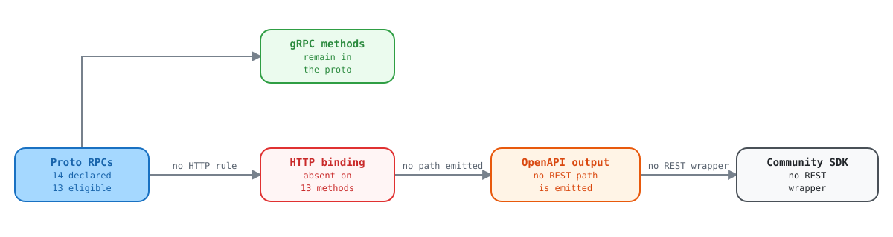

# kptr and deviceconf declare public gRPC services with no HTTP bindings, so they have no REST surface at all

Report for the Kentik API / schema team

13 RPCs across two `SERVICE_VISIBILITY_PUBLIC` services are unreachable over REST because their `google.api.http` annotations are absent.

| Field | Value |
| --- | --- |
| Filed by | Kentik Community Python SDK |
| Date | 2026-09-18 |
| Repo | `kentik/api-schema-public` |
| Revision | `89684ba`, 2026-09-24 (revalidated) |
| Affected RPCs | 13 (plus 3 excluded: 1 method-private, 2 likely intentional) |
| Severity | Functional gap, not a defect |

## The ask

> [!IMPORTANT]
> **Add `google.api.http` bindings to the 13 RPCs listed below, or tell us they are deliberately gRPC-only.**
>
> Either answer is actionable. What is hard to work with today is the ambiguity: these services
> are annotated `SERVICE_VISIBILITY_PUBLIC` and ship definitions into the public schema
> repo, which reads as "this is public API", yet they produce zero REST paths, which reads as
> "this is not exposed". One of those two signals is wrong.

## Summary

Every generated REST artifact in `api-schema-public` derives from
`google.api.http` annotations on RPC definitions. Where the annotation is present,
`protoc-gen-openapiv2` emits a swagger `path` and the gRPC gateway exposes an
HTTP route. Where it is absent, neither exists.

Auditing all 35 services that declare RPCs in the current schema shows the convention is close to
universal:

| Group | Services | RPCs | Annotation coverage |
| --- | --- | --- | --- |
| Fully annotated | 32 | 192 | 100%: every RPC carries a binding |
| **No annotations at all** | **3** | **16** | 0%: no swagger paths, no gateway routes |
| Partially annotated | 0 | 0 | No service mixes the two, which is why the three outliers look like an oversight |

There is no middle ground anywhere in the schema. A service either annotates every RPC or none of
them. That pattern is what makes us think these three were missed rather than excluded on purpose.

<picture>
  <source media="(prefers-color-scheme: dark)" srcset="assets/kptr-dark.svg">
  <source media="(prefers-color-scheme: light)" srcset="assets/kptr-light.svg">
  
</picture>

Open the [interactive explorer](upstream-kptr-missing-http-annotations.html) to select each part and see its evidence.

## Affected services

| Service | Version | RPCs | Declared visibility | Our read |
| --- | --- | --- | --- | --- |
| `kptr` | `v202602` | 4 | `SERVICE_VISIBILITY_PUBLIC` | Likely a gap: two of its four RPCs need only ordinary customer credentials |
| `deviceconf` | `v202511` | 10 | `SERVICE_VISIBILITY_PUBLIC` | Likely a gap: largest affected surface. `ExecuteCommand` is annotated `METHOD_VISIBILITY_PRIVATE`, so we do not ask for a binding on it. |
| `diagnostic` | `v202501` | 2 | `SERVICE_VISIBILITY_PUBLIC_KENTIK` | Probably intentional `Echo` and `Chat`, and the visibility differs from the other two. Listed for completeness only; we are not asking for changes here. |

## Why kptr matters to SDK consumers

`kptr` is the reverse-DNS (PTR) enrichment service. Its four RPCs split into two
planes, and the split is what makes the missing bindings consequential:

| RPC | Plane | Required metadata | Purpose |
| --- | --- | --- | --- |
| `GetNetworkRangeAssignments` | Agent | `x-kt-agentid`, `x-kt-sid` | Agent asks which IP prefixes it must resolve |
| `UpdateAddressNames` | Agent | `x-kt-agentid`, `x-kt-sid` | Agent submits resolved IP-to-hostname mappings |
| `ResolveAddresses` | **Customer** | Email plus API token only | Resolve a list of IP addresses to hostnames |
| `ListResolvedAddresses` | **Customer** | Email plus API token only | Pull the company's entire resolved-address table for local caching, instead of synchronous per-flow lookups |

The bottom two require nothing beyond a standard API key, per the service's own comments. "Give
me hostnames for these IPs" and "give me the whole PTR table" are ordinary customer-facing
capabilities, and today there is no way to invoke either over REST.

## Evidence

### 1. The annotation is absent on every affected RPC

```protobuf
// proto/kentik/kptr/v202602/kptr_service.proto:76
rpc ListResolvedAddresses(ListResolvedAddressesRequest) returns (ListResolvedAddressesResponse) {
  option (kentik.core.v202303.method_scope) = "kptr:read";
  // no option (google.api.http) = { ... }
}
```

Compare an RPC from `kmeta`, added to the schema in the same era, which is annotated
in the conventional way:

```protobuf
// proto/kentik/kmeta/v202607alpha1/kmeta.proto:110
rpc ListServiceNowConfigs(ListServiceNowConfigsRequest) returns (ListServiceNowConfigsResponse) {
  option (google.api.http) = {
    get: "/kmeta/v202607alpha1/{cid}/servicenow/config"
  };
  option (grpc.gateway.protoc_gen_openapiv2.options.openapiv2_operation) = {
    operation_id: "ListServiceNowConfigs"
    summary: "List ServiceNow Configs"
  };
}
```

### 2. Complete list of unannotated RPCs

```text
kptr (SERVICE_VISIBILITY_PUBLIC), 4 RPCs
  proto/kentik/kptr/v202602/kptr_service.proto:29   rpc GetNetworkRangeAssignments
  proto/kentik/kptr/v202602/kptr_service.proto:47   rpc UpdateAddressNames
  proto/kentik/kptr/v202602/kptr_service.proto:60   rpc ResolveAddresses
  proto/kentik/kptr/v202602/kptr_service.proto:76   rpc ListResolvedAddresses

deviceconf (SERVICE_VISIBILITY_PUBLIC), 10 RPCs
  .../deviceconf/v202511/device_configuration_service.proto:32    rpc GetDeviceAssignments
  .../deviceconf/v202511/device_configuration_service.proto:50    rpc UpdateDeviceConfiguration
  .../deviceconf/v202511/device_configuration_service.proto:64    rpc GetDeviceConfiguration
  .../deviceconf/v202511/device_configuration_service.proto:78    rpc GetLatestDeviceConfigurations
  .../deviceconf/v202511/device_configuration_service.proto:92    rpc ListDeviceConfigurationRevisions
  .../deviceconf/v202511/device_configuration_service.proto:107   rpc RequestDeviceConfigurationFetch
  .../deviceconf/v202511/device_configuration_service.proto:120   rpc ExecuteCommand   (METHOD_VISIBILITY_PRIVATE: not requested)
  .../deviceconf/v202511/device_configuration_service.proto:135   rpc GetCommandAcls
  .../deviceconf/v202511/device_configuration_service.proto:150   rpc UpdateCommandAcls
  .../deviceconf/v202511/device_configuration_service.proto:164   rpc DeleteDeviceConfiguration

diagnostic (SERVICE_VISIBILITY_PUBLIC_KENTIK), 2 RPCs: listed for completeness only
  proto/kentik/diagnostic/v202501/diagnostic.proto:37   rpc Echo
  proto/kentik/diagnostic/v202501/diagnostic.proto:41   rpc Chat
```

### 3. The generated swagger confirms the downstream effect

```console
$ python -c "import json;d=json.load(open('gen/openapiv2/kentik/kptr/v202602/kptr_service.swagger.json'));\
print('paths:',list(d.get('paths',{})));print('definitions:',len(d.get('definitions',{})))"

paths:       []          # no REST routes generated
definitions: 7           # message shapes generated normally
```

The message definitions generate correctly, so every downstream code generator produces the
request and response types and then has nothing to call them with. In our SDK that surfaces as a
package of models with no client methods attached.

### 4. Full audit output

```text
SERVICE               VERSION            RPCS  ANNOTATED  PATHS  VISIBILITY
--------------------------------------------------------------------------------
ai_advisor            v202511               3          3      2  PUBLIC
as_group              v202212               5          5      2  PUBLIC
asset_tags            v20260515beta1        9          9      6  PUBLIC
bgp_monitoring        v202210               8          8      5  PUBLIC
capacity_plan         v202212               4          4      4  PUBLIC
cloud_export          v202506               5          5      2  PUBLIC
connectivity_checker  v202410beta1          1          1      1  PUBLIC
cost                  v202308               3          3      3  PUBLIC
credential            v202407alpha1         2          2      2  PUBLIC
custom_application    v202501alpha1         5          5      2  PUBLIC
custom_dimension      v202411alpha1        10         10      6  PUBLIC
device                v202504beta2         10         10      7  PUBLIC
deviceconf            v202511              10          0      0  PUBLIC   <== NO REST SURFACE
diagnostic            v202501               2          0      0  PUBLIC_KENTIK <== NO REST SURFACE
dictionary            v20260604alpha1       1          1      1  PUBLIC
flow_tag              v202404alpha1         5          5      2  PUBLIC
interface             v202108alpha1         6          6      3  PUBLIC
journeys              v202406               1          1      1  PUBLIC
kagent                v202401              28         28     17  PRIVATE,PROTECTED,PUBLIC
kmeta                 v202607alpha1         5          5      2  PUBLIC
kmi                   v202212               5          5      5  PUBLIC
kptr                  v202602               4          0      0  PUBLIC   <== NO REST SURFACE
ktbgp                 v202501               3          3      3  PRIVATE
label                 v202210               4          4      2  PUBLIC
mkp                   v202407              14         14      6  PUBLIC
network_class         v202109alpha1         2          2      1  PUBLIC
notification_channel  v202210               3          3      3  PUBLIC
pathfinder            v202505beta1          1          1      1  PUBLIC
plan                  v202501alpha1         1          1      1  PUBLIC
rbux                  v202607alpha1         5          5      2  PUBLIC
saved_filter          v202501alpha1         6          6      4  PUBLIC
site                  v202509              10         10      4  PUBLIC
synthetics            v202309              18         18     10  PUBLIC
user                  v202211               7          7      4  PUBLIC
vault                 v202312alpha1         2          2      2  PRIVATE
```

### 5. Reproducing this

```bash
# From the community_sdk_python repo root, with ../api-schema-public checked out
uv run python reports/scripts/schema/annotation_audit.py
```

The audit script counts annotations per RPC block rather than per file, so an RPC
using `additional_bindings` is counted once.

## Suggested fix

For each affected RPC, add the binding the rest of the schema already uses. For the two
customer-plane kptr RPCs, something along these lines would be enough for the gateway and every
downstream generator to pick them up:

```diff
 rpc ResolveAddresses(ResolveAddressesRequest) returns (ResolveAddressesResponse) {
   option (kentik.core.v202303.method_scope) = "kptr:read";
+  option (google.api.http) = {
+    post: "/kptr/v202602/addresses/resolve"
+    body: "*"
+  };
 }

 rpc ListResolvedAddresses(ListResolvedAddressesRequest) returns (ListResolvedAddressesResponse) {
   option (kentik.core.v202303.method_scope) = "kptr:read";
+  option (google.api.http) = {
+    get: "/kptr/v202602/addresses"
+  };
 }
```

Path shapes are yours to choose. We have no requirement beyond the bindings existing. If the
agent-plane RPCs should stay gRPC-only because they depend on
`x-kt-agentid` and `x-kt-sid` metadata, annotating only the two customer-plane
RPCs would resolve the practical problem.

## Questions for the API team

1. Are `kptr` and `deviceconf` intended to be reachable over REST? If yes,
   the bindings are simply missing. If no, we will document them as gRPC-only.
2. If they are deliberately gRPC-only, should `SERVICE_VISIBILITY_PUBLIC` still apply?
   Today that annotation is the only public signal, and it currently points the opposite way from
   the absent bindings.
3. Is there a convention we should follow for distinguishing agent-plane RPCs (those requiring
   `x-kt-agentid` and `x-kt-sid`) from customer-plane RPCs? A machine-readable
   marker would let SDK generators omit agent-plane operations automatically.

## Copy-paste ticket body

```text
Title: Add google.api.http bindings to kptr and deviceconf RPCs (or confirm gRPC-only)

Repo: kentik/api-schema-public (89684ba, 2026-09-24)
Reported by: Kentik Community Python SDK

SUMMARY
Three services declare RPCs with no google.api.http annotation, so they produce
zero swagger paths and no gRPC gateway routes. Two of them are annotated
SERVICE_VISIBILITY_PUBLIC:

  kptr        v202602   4 RPCs    SERVICE_VISIBILITY_PUBLIC
  deviceconf  v202511  10 RPCs    SERVICE_VISIBILITY_PUBLIC
  diagnostic  v202501   2 RPCs    SERVICE_VISIBILITY_PUBLIC_KENTIK  (likely intentional)

Across the other 32 services that declare RPCs, all 192 RPCs carry the
annotation. No service anywhere in the schema partially annotates, which is why
these three look like an oversight rather than a deliberate exclusion.

IMPACT
Message definitions still generate, so downstream code generators emit request
and response types with no operation to call. The Python SDK currently ships a
kptr package containing 7 models and zero callable methods. There is also no
REST route at the gateway, so REST-only consumers cannot reach these services at
all.

kptr specifically is the reverse-DNS (PTR) enrichment service. Two of its four
RPCs require only ordinary customer credentials (email + API token) per the
service's own comments:

  ResolveAddresses       resolve a list of IPs to hostnames
  ListResolvedAddresses  pull the company's full resolved-address table

The other two are agent-plane and additionally require x-kt-agentid and x-kt-sid.

AFFECTED RPCs
kptr (4):
  proto/kentik/kptr/v202602/kptr_service.proto:29   GetNetworkRangeAssignments
  proto/kentik/kptr/v202602/kptr_service.proto:47   UpdateAddressNames
  proto/kentik/kptr/v202602/kptr_service.proto:60   ResolveAddresses
  proto/kentik/kptr/v202602/kptr_service.proto:76   ListResolvedAddresses

deviceconf (10), all in
proto/kentik/deviceconf/v202511/device_configuration_service.proto:
  :32 GetDeviceAssignments            :107 RequestDeviceConfigurationFetch
  :50 UpdateDeviceConfiguration       :120 ExecuteCommand
  :64 GetDeviceConfiguration          :135 GetCommandAcls
  :78 GetLatestDeviceConfigurations   :150 UpdateCommandAcls
  :92 ListDeviceConfigurationRevisions :164 DeleteDeviceConfiguration
ExecuteCommand (:120) is annotated METHOD_VISIBILITY_PRIVATE, so this ticket
does not ask for a binding on it. That leaves 13 RPCs: 4 in kptr, 9 in
deviceconf.

EVIDENCE
gen/openapiv2/kentik/kptr/v202602/kptr_service.swagger.json
  paths:       []   (no REST routes)
  definitions: 7    (message shapes generate normally)

ASK
1. Confirm whether kptr and deviceconf should be reachable over REST.
2. If yes, add google.api.http bindings. Annotating just the two customer-plane
   kptr RPCs would resolve the practical problem for SDK consumers.
3. If no, confirm whether SERVICE_VISIBILITY_PUBLIC still applies, since that
   annotation currently points the opposite way from the absent bindings.
4. Separately: is there a convention for marking agent-plane RPCs so SDK
   generators can omit them automatically?
```

Evidence gathered from `kentik/api-schema-public` at `master` on
2026-09-18, and revalidated at `89684ba` on 2026-09-24 with no change to the audit. Reproduce with `reports/scripts/schema/annotation_audit.py` in the
`community_sdk_python` repo.
