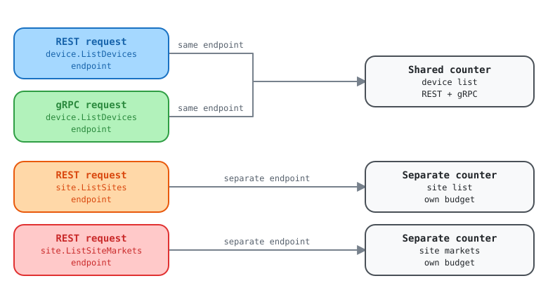

# Documented rate limits say per-customer; the advertised counter behaves per-endpoint

Report for the Kentik API team

The KB documents per-customer limits. The `x-ratelimit-*` headers on V6
responses advertise a counter that resets independently per endpoint.
Separately, three documented enforcement mechanisms are invisible in the
headers entirely.

| Field | Value |
| --- | --- |
| Filed by | Kentik Community Python SDK |
| Date | 2026-09-21 |
| Surface | `grpc.api.kentik.com` (REST and gRPC) |
| Observed limit | `60, 60;w=60` |
| Scope observed | Per endpoint |
| Severity | Doc/behavior conflict, not a defect |

## The ask

> [!IMPORTANT]
> **Confirm which is authoritative for V6: the documented per-customer limits, or the per-endpoint counter the headers advertise. We are not asking you to change the limit.**
>
> Per-endpoint rate limiting is a reasonable design and we are not claiming it is wrong. The
> problem is that the published documentation and the observed behavior describe different things,
> and a client cannot tell which to build against.

## Summary

While adding rate-limit support to the community Python SDK we needed to know what
`x-ratelimit-remaining` is counting down. The headers follow
[draft-polli-ratelimit-headers](https://datatracker.ietf.org/doc/id/draft-polli-ratelimit-headers-05.html),
which specifies the limit, the remaining count, the reset interval, and the window length. It does
not carry a scope or partition key, and neither do Kentik's responses.

We measured the scope empirically. It is **per endpoint**, and REST and gRPC draw on
the same per-endpoint budget. That is a more generous design than a single account-wide bucket, but a
client that assumes account-wide will back off globally the moment one endpoint saturates, needlessly
idling the other 59 budgets it still holds.

## The conflict

The KB publishes these under the heading **Per-customer limit**, framed around the V5
Query and V5 Admin APIs (which were discontinued in January 2025):

| Per-customer limit | Non-query APIs | Query API |
| --- | --- | --- |
| Maximum concurrent requests | **1** | 4 |
| Soft limit (per minute) | 20 | 30 |
| Server response delay past soft limit | 1.5s | 1s |
| Hard limit (per minute) | **60** | 100 |
| Hourly limit | 3750 | 1500 |

Measuring V6 at `grpc.api.kentik.com`, the advertised value is
`x-ratelimit-limit: 60, 60;w=60`. The **60 matches the documented non-query hard
limit exactly**, which suggests the same regime governs V6. But the counter does not behave
per customer. It resets independently per endpoint (Evidence 2).

> [!WARNING]
> **Two readings, and we cannot tell which is right**
>
> Either an Envoy per-route counter sits underneath a separate per-customer budget, and the
> headers advertise only the former, or the documentation predates the V6 gateway. A client
> implementing backoff has to guess, and guessing wrong in the conservative direction idles budget
> it actually holds.

## Three limits that no header reveals

Independent of the scope question, the documentation describes enforcement that a header-driven
client cannot see at all:

| Mechanism | Documented | In headers? | What a client experiences |
| --- | --- | --- | --- |
| Concurrency cap | 1 concurrent request (non-query) | No | Nothing announces it; a threaded or async client trips it silently |
| Soft limit plus response delay | 20/min, then +1.5s | No | Latency, not an error. Easily misread as a slow network or a hung call |
| Hourly limit | 3750/hour | No, headers carry only `w=60` | An unexplained `429` from a budget it never saw counting down |

The soft-limit delay is the most surprising of the three. A well-behaved client that ramps up
gradually gets slower rather than throttled, with no signal distinguishing that from a degraded
backend.

## What we observed

| Property | Observed | How |
| --- | --- | --- |
| Headers present | `x-ratelimit-limit`, `x-ratelimit-remaining`, `x-ratelimit-reset` | Every response, REST and gRPC |
| Limit value | `60, 60;w=60` (60 per 60s, one window) | Uniform across every endpoint tested |
| `Retry-After` | Absent | `x-ratelimit-reset` appears to serve that role |
| Scope | **Per endpoint** | Measured, see Evidence 2 |
| REST vs gRPC | One shared budget | Measured, see Evidence 1 |
| gRPC delivery | Initial metadata (trailing metadata empty) | Measured |
| Behavior on exceed | **Not observed** | Confirming it would mean deliberately exhausting a production quota |

<picture>
  <source media="(prefers-color-scheme: dark)" srcset="assets/rate-limit-dark.svg">
  <source media="(prefers-color-scheme: light)" srcset="assets/rate-limit-light.svg">
  
</picture>

Open the [interactive explorer](upstream-ratelimit-scope-undocumented.html) to select each part and see its evidence.

## Evidence

### 1. REST and gRPC share one budget

Alternating REST and gRPC calls to `device.ListDevices` produces a single unbroken sequence:

```text
REST call -> remaining=59
gRPC call -> remaining=58
REST call -> remaining=57
gRPC call -> remaining=56
REST call -> remaining=55
gRPC call -> remaining=54
```

### 2. The budget is per endpoint, not per service or per account

Two different endpoints inside the same service keep independent counters:

```text
/site/v202509/sites           remaining= 58
/site/v202509/sites           remaining= 57
/site/v202509/site_markets    remaining= 59   <- its own fresh budget
/site/v202509/sites           remaining= 56
```

A separate run across three services (`device`, `site`,
`label`) showed the same: each endpoint starts from its own 60.

### 3. Nothing in the response indicates the scope, and the hourly window is absent

A client receiving `x-ratelimit-remaining: 59` has no way to know whether that number
applies to the endpoint it just called, the service, the token, or the account. The draft the headers
follow has no field for it. The successor draft,
[draft-ietf-httpapi-ratelimit-headers](https://datatracker.ietf.org/doc/draft-ietf-httpapi-ratelimit-headers/),
adds a quota-policy and partition concept for exactly this reason.

The headers also advertise only one window, `w=60`. The documented rolling-hour budget
of 3750 is enforced but never transmitted, so a client cannot track it even in principle.

### 4. Reproducing this

Any two read-only calls to different endpoints, inspecting response headers, will
show it. We used `device.ListDevices`, `site.ListSites`,
`site.ListSiteMarkets`, and `label.ListLabels`. Read-only throughout; we did
not deliberately exhaust any quota.

## Why this matters to SDK consumers

An SDK that surfaces quota has to tell callers what the number means. With the scope
undocumented, we can only report what we measured, and record that it is unconfirmed. If the scope
ever changes, or differs by plan or by endpoint cost, every client that inferred it silently
becomes wrong with no signal.

The practical failure mode is not over-consumption. It is *under*-consumption: a client
that assumes an account-wide bucket will stop issuing all requests when one endpoint saturates.

## Questions for the API team

1. For V6, is the authoritative budget per customer (as documented) or per endpoint (as the
   headers behave)? If both exist, which one do the headers describe?
2. Does the V5-framed table still apply to V6 at all? V5 was discontinued in January 2025, yet
   the documented non-query hard limit of 60 matches what V6 advertises exactly.
3. Is the concurrency cap of 1 for non-query APIs still accurate for V6? It materially constrains
   any concurrent or async client, and nothing in the protocol surfaces it.
4. Can the hourly budget be advertised as a second window in `x-ratelimit-limit`? The
   draft the headers follow supports multiple windows, and clients currently cannot track it.
5. Is the soft-limit response delay still applied, and is there any way for a client to detect it
   rather than inferring it from latency?
6. Is the omission of `Retry-After` deliberate, with `x-ratelimit-reset` as
   the intended substitute?
7. Do the limits vary by endpoint cost, plan, or account? We sampled four endpoints and saw one
   value.

## Suggested fix

Mostly documentation. One optional protocol improvement:

1. State whether the V6 budget is per customer or per endpoint, and update the rate-limiting
   section so it is not framed around discontinued V5 API categories.
2. State that REST and gRPC share the budget. Clients cannot assume this.
3. Keep the concurrency cap, soft-limit delay, and hourly limit documented prominently, since no
   header reveals them.
4. *Optional:* advertise the hourly budget as a second window in
   `x-ratelimit-limit` (for example `60, 60;w=60, 3750;w=3600`). The draft
   already supports this, and it would let clients track the limit that currently blindsides
   them.

Optionally, and only if it is already on a roadmap, emitting the standardized
`RateLimit-Policy` field would make the scope machine-readable rather than documented
prose.

## Copy-paste ticket body

```text
TITLE
V6 rate limiting: docs say per-customer, headers behave per-endpoint; three
documented limits are invisible in the protocol

CONTEXT
While adding rate-limit support to the community Python SDK we compared the
published limits against measured V6 behavior. They do not agree.

DOCUMENTED (kb.kentik.com/docs/apis-overview#api-rate-limiting)
Headed "Per-customer limit", framed around V5 Query / V5 Admin APIs, which
were discontinued in January 2025:
  Max concurrent requests   non-query 1      query 4
  Soft limit (per minute)   non-query 20     query 30
  Response delay past soft  non-query 1.5s   query 1s
  Hard limit (per minute)   non-query 60     query 100
  Hourly limit              non-query 3750   query 1500

MEASURED (grpc.api.kentik.com, V6, read-only calls, 2026-09-21)
  x-ratelimit-limit: 60, 60;w=60
  x-ratelimit-remaining / x-ratelimit-reset present on every response
  No Retry-After

The 60 matches the documented non-query hard limit exactly. But the counter
does not behave per customer.

1. REST and gRPC share one budget. Alternating transports on one endpoint:
   59, 58, 57, 56, 55, 54 (unbroken sequence)

2. The budget resets per endpoint, not per service or per customer:
   /site/v202509/sites         remaining=58, 57, 56
   /site/v202509/site_markets  remaining=59  (independent counter)

3. gRPC delivers the same headers as initial metadata; trailing metadata is
   empty.

THREE LIMITS NO HEADER REVEALS
  - Concurrency cap of 1 (non-query). Nothing announces it. A threaded or
    async client trips it silently.
  - Soft limit at 20/min, then +1.5s server-side response delay. The client
    sees latency, not an error, indistinguishable from a degraded backend.
  - Hourly limit of 3750. Headers carry only w=60, so a client cannot track
    it even in principle, then gets a 429 it could not anticipate.

WHY IT MATTERS
A client cannot tell which model to build against. Assuming per-customer means
backing off globally when one endpoint saturates, idling budget it still holds.
Assuming per-endpoint risks the reverse if a per-customer ceiling also exists.
The soft-limit delay is the subtlest: well-behaved clients get slower with no
signal explaining why.

ASK
1. For V6, is the authoritative budget per customer or per endpoint? If both
   exist, which do the headers describe?
2. Does the V5-framed table still apply to V6? Please reframe it if so, since
   V5 was discontinued in January 2025.
3. Is the concurrency cap of 1 still accurate for V6?
4. Can the hourly budget be advertised as a second window, e.g.
   "60, 60;w=60, 3750;w=3600"? The draft the headers follow supports multiple
   windows.
5. Is the soft-limit response delay still applied, and can a client detect it
   other than by inferring from latency?
6. Is Retry-After intentionally omitted in favor of x-ratelimit-reset?
7. Do limits vary by endpoint cost, plan, or account? We sampled four
   endpoints and saw one value.

NOT A DEFECT REPORT
Per-endpoint rate limiting is a reasonable design, and more generous than a
single shared bucket. The gap is that documentation and observed behavior
describe different things, and three enforcement mechanisms are invisible to
clients.

All probing was read-only. We did not confirm the behavior on exceed, because
that would mean deliberately exhausting a production quota.
```

Documented limits rechecked against `kb.kentik.com/docs/apis-overview` on
2026-09-24: unchanged, and the page still states no V6-specific limits.

Measured against `grpc.api.kentik.com` on 2026-09-21 with read-only calls from the
`community_sdk_python` SDK. No quota was deliberately exhausted.
