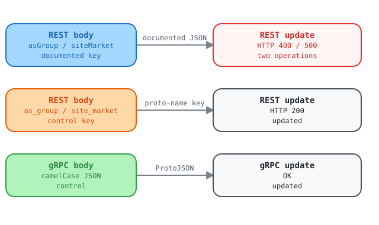

# REST update ignores the documented camelCase body when the URL sets a nested field

Report for the Kentik API team. Observed on 2026-10-21 against the live V6
API on a lab account. We used plain `curl` and `grpcurl`, and then the Kentik
community Python SDK. Schema: `api-schema-public` commit `9de9a68`, which
matches upstream HEAD `8ec5847` for these services.

> [!WARNING]
> This report contains lab resource IDs and API request IDs. Keep this branch
> local. Do not merge it into `main` or share it beyond the API team without
> removing those details.

## Summary

Two REST update operations reject the request body that the published
OpenAPI document describes: `ASGroupService.UpdateASGroup` and
`SiteService.UpdateSiteMarket`. The body wraps the object in its camelCase
JSON name (`asGroup`, `siteMarket`). The server reads the object only under
its proto name (`as_group`, `site_market`). That is the name the URL template
uses for the ID. The same request works over gRPC. A client that follows the
OpenAPI document cannot update an AS group or a site market over REST.

The defect does not depend on the SDK. Plain `curl` gives the same results.

| Operation | REST, documented body | REST, proto-name key | gRPC |
| --- | --- | --- | --- |
| `PUT /as_group/v202212/as_group/{asGroup.id}` | 400 `request.as_group.name ... received: undefined` | 200, updated | OK, updated |
| `PUT /site/v202509/site_markets/{siteMarket.id}` | 500 `internal error (name:TypeError)` | 200, updated | OK, updated |

<picture>
  <source media="(prefers-color-scheme: dark)" srcset="assets/body-merge-dark.svg">
  <source media="(prefers-color-scheme: light)" srcset="assets/body-merge-light.svg">
  
</picture>

Open the [interactive request-path explorer](archive/upstream-rest-update-body-merge.html)
to compare the documented REST body with the proto-name and gRPC controls.

## Follow-up validation, 2026-10-27

Direct REST tests reproduced both failures above. They returned the documented
missing-field error for AS groups and the `TypeError` response for site markets.

The documented camelCase body succeeded for `FlowTagService.UpdateFlowTag` on an
existing disposable tag. The test deleted that tag after the update. The separate
`CreateFlowTag` operation still returned HTTP 500. That create failure is a
separate API issue.

Current finding status and next actions live only in
[kentik-api-team-findings.md](kentik-api-team-findings.md). This report holds
the detailed body-merge evidence.

## What the contract says

The proto declares the rule with the proto field name in the path and
`body: "*"`:

```protobuf
// proto/kentik/as_group/v202212/as_group.proto, line 271
rpc UpdateASGroup(UpdateASGroupRequest) returns (UpdateASGroupResponse) {
  option (google.api.http) = {
    put: "/as_group/v202212/as_group/{as_group.id}"
    body: "*"
  };
}
```

The generated OpenAPI document
(`gen/openapiv2/kentik/as_group/v202212/as_group.swagger.json`) publishes the
path parameter as `asGroup.id`. It publishes the body as
`ASGroupServiceUpdateASGroupBody`, whose only property is `asGroup`:

```json
"parameters": [
  { "name": "asGroup.id", "in": "path", "required": true, "type": "string" },
  { "name": "body", "in": "body", "required": true,
    "schema": { "$ref": "#/definitions/ASGroupServiceUpdateASGroupBody" } }
],
"ASGroupServiceUpdateASGroupBody": {
  "type": "object",
  "properties": { "asGroup": { "type": "object", "properties": { "name": {}, "asn": {} } } }
}
```

`UpdateSiteMarket` has the same layout: `{site_market.id}`, `body: "*"`, and
the body property `siteMarket`.

## Why we think the defect is in the API

1. The client sends the body that the published OpenAPI document defines.
2. The proto3 JSON mapping requires every parser to accept both the
   lowerCamelCase JSON name and the proto field name
   ([ProtoJSON format](https://protobuf.dev/programming-guides/json/)).
   `asGroup` and `as_group` are two spellings of one field.
3. The 400 message names `request.as_group.name`. The server built
   `request.as_group` from the URL (`{as_group.id}`), and the body never
   reached that object.
4. A request with both spellings succeeds, and the server keeps `as_group`
   and drops `asGroup` without an error (steps A4 and B4).
5. The same service accepts camelCase on create, where the URL sets no field.
6. The same update over gRPC succeeds with the same data.
7. Routes where both spellings are the same word (`label`, `site`) work. The
  AutoAck request returned HTTP 500 `SyntaxError`, so it does not confirm
  whether that route has the body-merge defect. The confirmed failures are
  the AS group and site market routes. The wider cause remains unproven.

A likely cause: the REST layer turns `{as_group.id}` into
`{"as_group": {"id": "..."}}`, merges that object with the JSON body as plain
objects keyed by spelling, and then reads `as_group`. The fix is to normalize
the body to one spelling, or to decode it with a ProtoJSON parser, before the
layer sets the path value.

## Scope across the schema

We read the `google.api.http` rules of all services. 101 rules carry a body.
4 have this layout: `body: "*"`, and a path variable inside a top-level field
whose proto name differs from its JSON name.

| Rule | Path | Live result |
| --- | --- | --- |
| `ASGroupService.UpdateASGroup` | `PUT /as_group/v202212/as_group/{as_group.id}` | Affected |
| `SiteService.UpdateSiteMarket` | `PUT /site/v202509/site_markets/{site_market.id}` | Affected |
| `AlertAutoAckService.Replace` | `PATCH /v202505/alerts/ack/auto/{auto_ack.id}` | No body-merge failure seen: both spellings reached the same validation; real-record PATCH returned separate `SyntaxError` |
| `FlowTagService.UpdateFlowTag` | `PUT /flow_tag/v202404alpha1/tag/{flow_tag.id}` | No body-merge failure seen: documented body returned 200 on 2026-10-27 |

The other 97 rules cannot hit this defect:

| Group | Rules | Why |
| --- | --- | --- |
| No path variable | 55, including 31 of the 34 creates | The URL sets no field. |
| Flat path variable, `body: "*"` | 15 | The URL sets a top-level scalar. |
| Body is one field | 11 | The body is the object, with no wrapper key. |
| Same name in both spellings | 14 | For example `label`, `site`, `device`, `user`. |
| Only a nested leaf is renamed | 2 | `mkp` tenant users, `{user.tenant_id}`. Not checked live. |

## Ask

Make the `as_group` and `site` REST layers accept the body that the OpenAPI
document publishes. A body key in either spelling must reach the same field.
A value from the URL must be merged into that field, not replace it. The
FlowTag update returned HTTP 200. Investigate its separate create failure.
Investigate the AutoAck `SyntaxError` as a separate issue. Confirm the V5 batch
success status with the API team.

## Reproduce without the SDK

You need `curl` 8.3 or later, `jq`, `grpcurl`, and an `api-schema-public`
checkout next to the current directory. The responses below are real
responses from 2026-10-21 at 22:02 UTC. Your IDs and timestamps will differ.

### Step 0: set up the session

The helpers read the credentials from the environment, so the token never
appears on a command line.

```bash
export KENTIK_EMAIL='you@example.com'
export KENTIK_API_TOKEN='...'
BASE=https://grpc.api.kentik.com

AUTH=(--variable %KENTIK_EMAIL --variable %KENTIK_API_TOKEN
      --expand-header 'X-CH-Auth-Email: {{KENTIK_EMAIL}}'
      --expand-header 'X-CH-Auth-API-Token: {{KENTIK_API_TOKEN}}'
      -H 'Content-Type: application/json' -sS -w '\nHTTP %{http_code}\n')

GRPC=(grpcurl -expand-headers
      -H 'X-CH-Auth-Email: ${KENTIK_EMAIL}' -H 'X-CH-Auth-API-Token: ${KENTIK_API_TOKEN}'
      -import-path ../api-schema-public/proto
      -import-path ../api-schema-public/protovendor/github.com/googleapis/googleapis
      -import-path ../api-schema-public/protovendor/github.com/grpc-ecosystem/grpc-gateway)
```

### AS group

Step A1: create a test AS group with the camelCase key. This works.

```bash
curl -X POST "$BASE/as_group/v202212/as_group" "${AUTH[@]}" \
  -d '{"asGroup":{"name":"sdk-e2e-test-curl-e8d1082c","asn":["36459"]}}'
```

```text
{"asGroup":{"id":"9719305276","name":"sdk-e2e-test-curl-e8d1082c","asn":[{"asn":36459,"name":"Microsoft (GitHub),US"}],"createdDate":"2026-10-21T22:02:49.157Z","updatedDate":"2026-10-21T22:02:49.157Z"}}
HTTP 200
```

Step A2: update it with the documented body. This fails.

```bash
curl -X PUT "$BASE/as_group/v202212/as_group/9719305276" "${AUTH[@]}" \
  -d '{"asGroup":{"name":"sdk-e2e-test-curl-e8d1082c-camel","asn":["36459"]}}'
```

```text
{"code":3,"message":"At path: request.as_group.name -- Expected a string, but received: undefined (errxid dbckd2czked00d9jjnq0)","details":[]}
HTTP 400
```

Step A3: send the same update with the proto-name key. This works.

```bash
curl -X PUT "$BASE/as_group/v202212/as_group/9719305276" "${AUTH[@]}" \
  -d '{"as_group":{"name":"sdk-e2e-test-curl-e8d1082c-snake","asn":["36459"]}}'
```

```text
{"asGroup":{"id":"9719305276","name":"sdk-e2e-test-curl-e8d1082c-snake",...}}
HTTP 200
```

Step A4: send both spellings with different names. The server keeps
`as_group` (`-b`) and drops `asGroup` (`-a`) without an error.

```bash
curl -X PUT "$BASE/as_group/v202212/as_group/9719305276" "${AUTH[@]}" \
  -d '{"asGroup":{"name":"sdk-e2e-test-curl-e8d1082c-a","asn":["36459"]},
       "as_group":{"name":"sdk-e2e-test-curl-e8d1082c-b","asn":["36459"]}}'
curl -X GET "$BASE/as_group/v202212/as_group/9719305276" "${AUTH[@]}"
```

```text
{"asGroup":{"id":"9719305276","name":"sdk-e2e-test-curl-e8d1082c-b",...}}
HTTP 200
{"asGroup":{"id":"9719305276","name":"sdk-e2e-test-curl-e8d1082c-b",...}}
HTTP 200
```

Step A5: send the camelCase update over gRPC. `grpcurl` reads the JSON with
a ProtoJSON parser. This works, and a REST GET shows the change.

```bash
"${GRPC[@]}" -proto kentik/as_group/v202212/as_group.proto \
  -d '{"asGroup":{"id":"9719305276","name":"sdk-e2e-test-curl-e8d1082c-grpc","asn":["36459","46489"]}}' \
  grpc.api.kentik.com:443 kentik.as_group.v202212.ASGroupService/UpdateASGroup
```

```text
{"asGroup":{"id":"9719305276","name":"sdk-e2e-test-curl-e8d1082c-grpc","asn":[{"asn":36459,...},{"asn":46489,"name":"Twitch.tv (Amazon),US"}],...}}
```

### Site market

Step B1: create a test site market with the camelCase key. This works.

```bash
curl -X POST "$BASE/site/v202509/site_markets" "${AUTH[@]}" \
  -d '{"siteMarket":{"name":"sdk-e2e-test-curl-e8d1082c"}}'
```

```text
{"siteMarket":{"id":"1994","name":"sdk-e2e-test-curl-e8d1082c","description":"","numberOfSites":0,...}}
HTTP 200
```

Step B2: update it with the documented body. This fails.

```bash
curl -X PUT "$BASE/site/v202509/site_markets/1994" "${AUTH[@]}" \
  -d '{"siteMarket":{"name":"sdk-e2e-test-curl-e8d1082c","description":"camel"}}'
```

```text
{"code":13,"message":"internal error (name:TypeError type:object) (errxid dbckd2wsmfx00gt3td1g)","details":[]}
HTTP 500
```

Step B3: send the same update with `site_market`. This works.

```bash
curl -X PUT "$BASE/site/v202509/site_markets/1994" "${AUTH[@]}" \
  -d '{"site_market":{"name":"sdk-e2e-test-curl-e8d1082c","description":"snake"}}'
```

```text
{"siteMarket":{"id":"1994","name":"sdk-e2e-test-curl-e8d1082c","description":"snake",...}}
HTTP 200
```

Step B4: send both spellings. The server keeps `snake`.

```bash
curl -X PUT "$BASE/site/v202509/site_markets/1994" "${AUTH[@]}" \
  -d '{"siteMarket":{"name":"sdk-e2e-test-curl-e8d1082c","description":"camel"},
       "site_market":{"name":"sdk-e2e-test-curl-e8d1082c","description":"snake"}}'
```

```text
{"siteMarket":{"id":"1994",...,"description":"snake",...}}
HTTP 200
```

Step B5: send the camelCase update over gRPC. This works.

```bash
"${GRPC[@]}" -proto kentik/site/v202509/site.proto \
  -d '{"siteMarket":{"id":"1994","name":"sdk-e2e-test-curl-e8d1082c","description":"grpc"}}' \
  grpc.api.kentik.com:443 kentik.site.v202509.SiteService/UpdateSiteMarket
```

```text
{"siteMarket":{"id":"1994","name":"sdk-e2e-test-curl-e8d1082c","description":"grpc",...}}
```

### Control: label

The label body key is `label` in both spellings, and the update path sets
`{label.id}`. The documented body works.

```bash
curl -X POST "$BASE/label/v202210/labels" "${AUTH[@]}" \
  -d '{"label":{"name":"sdk-e2e-test-curl-e8d1082c","color":"#5289D9"}}'
curl -X POST "$BASE/label/v202210/labels/42057" "${AUTH[@]}" \
  -d '{"label":{"name":"sdk-e2e-test-curl-e8d1082c-updated","color":"#E35B5B"}}'
```

```text
{"label":{"id":"42057","name":"sdk-e2e-test-curl-e8d1082c",...}}
HTTP 200
{"label":{"id":"42057","name":"sdk-e2e-test-curl-e8d1082c-updated","color":"#E35B5B",...}}
HTTP 200
```

### Clean up

```bash
curl -X DELETE "$BASE/as_group/v202212/as_group/9719305276" "${AUTH[@]}"
curl -X DELETE "$BASE/site/v202509/site_markets/1994" "${AUTH[@]}"
curl -X DELETE "$BASE/label/v202210/labels/42057" "${AUTH[@]}"
```

## Request IDs

| Run | Call | Status | errxid |
| --- | --- | --- | --- |
| curl | UpdateASGroup | 400 | `dbckd2czked00d9jjnq0` |
| curl | UpdateSiteMarket | 500 | `dbckd2wsmfx00gt3td1g` |
| SDK | UpdateASGroup | 400 | `dbck70czked004gescz0` |
| SDK | UpdateSiteMarket | 500 | `dbck71msmfx0081rvfx0` |
| SDK | AutoAck Replace control | 400 | `dbck78dzked00d9jjmr0` |
| REST | AutoAck Replace documented body | 500 | `dbgge7gzked0089cpq20` |
| REST | CreateFlowTag | 500 | `dbgesketkfgg04rgdw1g` |
