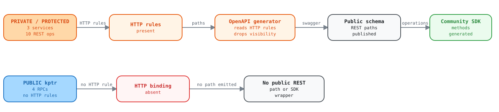

# Services annotated `SERVICE_VISIBILITY_PRIVATE` publish public REST paths and reach end users through the SDK

Report for the Kentik API / schema team

Three services marked private or protected emit 10 REST operations into the public schema repo. All of them are callable from the community Python SDK today, including `vault` secret reads.

| Field | Value |
| --- | --- |
| Filed by | Kentik Community Python SDK |
| Date | 2026-09-18 |
| Repo | `kentik/api-schema-public` |
| Revision | `89684ba`, 2026-09-24 (revalidated) |
| Services affected | 3 (`ktbgp`, `vault`, `kagent`) |
| Operations exposed | 10 |

## The ask

> [!IMPORTANT]
> **Tell us what `SERVICE_VISIBILITY_PRIVATE` is meant to mean, and whether these services should be reachable from a community SDK.**
>
> We are not asserting a security vulnerability. These endpoints enforce their own
> authentication and authorization, and we have not tested whether an ordinary customer token is
> accepted by them. What we are flagging is that **the only machine-readable visibility signal
> in the schema is currently being ignored by every downstream generator, including ours**,
> and we would rather honor it than guess.

| Count | What it counts |
| ---: | --- |
| 3 | Non-public services |
| 10 | REST operations published |
| 10 | Operations callable from the SDK |
| 0 | Generators that read visibility |

## Summary

The schema annotates service visibility with
`option (kentik.core.v202303.visibility)`. Across the current schema there are 67 such
service annotations, and five of them are non-public. Four of those five belong to three services,
and every one of those services also carries `google.api.http` bindings, so
`protoc-gen-openapiv2` publishes REST paths for them into
`gen/openapiv2/` in the public repo. The fifth,
`diagnostic` (`SERVICE_VISIBILITY_PUBLIC_KENTIK`), has no HTTP bindings and
publishes no paths.

Because the visibility annotation is a custom option that lives only in the proto layer, it does
not survive into the generated swagger. Downstream generators consume swagger, so the signal is lost
entirely. The Kentik Community Python SDK generates its client surface from those swagger files and
therefore mounts all three services without ever seeing the annotation.

<picture>
  <source media="(prefers-color-scheme: dark)" srcset="assets/visibility-dark.svg">
  <source media="(prefers-color-scheme: light)" srcset="assets/visibility-light.svg">
  
</picture>

Open the [interactive explorer](upstream-service-visibility-exposure.html) to select each part and see its evidence.

> [!WARNING]
> **The inverse case is also true, and it is what led us here**
>
> `kptr` is annotated `SERVICE_VISIBILITY_PUBLIC` and has
> **no** REST surface, because its RPCs lack HTTP bindings. So the SDK currently ships
> the exact opposite of what the annotations describe: it exposes three services marked non-public,
> and omits one marked public. That inversion is covered in a companion report,
> [kptr and deviceconf declare public gRPC services with no HTTP bindings](upstream-kptr-missing-http-annotations.md).

## Evidence

### 1. Non-public visibility annotations, with exact locations

| Service | Proto service | Annotation | Location |
| --- | --- | --- | --- |
| `ktbgp` | `RouteService` | `SERVICE_VISIBILITY_PRIVATE` | `proto/kentik/ktbgp/v202501/route_service.proto:14` |
| `vault` | `VaultService` | `SERVICE_VISIBILITY_PRIVATE` | `proto/kentik/vault/v202312alpha1/vault.proto:159` |
| `kagent` | `CapabilityAdminService` | `SERVICE_VISIBILITY_PRIVATE` | `proto/kentik/kagent/v202401/capability.proto:280` |
| `kagent` | `CapabilityReleaseService` | `SERVICE_VISIBILITY_PROTECTED` | `proto/kentik/kagent/v202401/capability.proto:230` |

```protobuf
// proto/kentik/ktbgp/v202501/route_service.proto:13-14
service RouteService {
  option (kentik.core.v202303.visibility) = SERVICE_VISIBILITY_PRIVATE;
```

### 2. Those services publish REST paths into the public schema repo

| Service | Method | Path | Operation ID |
| --- | --- | --- | --- |
| `ktbgp` | POST | `/routes/announce` | `RouteService_Announce` |
| `ktbgp` | POST | `/routes/list` | `RouteService_List` |
| `ktbgp` | POST | `/routes/withdraw` | `RouteService_Withdraw` |
| `vault` | GET | `/vault/v202312alpha1/secrets` | `ListSecret` |
| `vault` | GET | `/vault/v202312alpha1/secrets/{name}` | `GetSecret` |
| `kagent` | GET | `/kagent/v202401/capabilities` | `CapabilityAdminService_ListCapabilities` |
| `kagent` | POST | `/kagent/v202401/capabilities` | `CapabilityAdminService_CreateCapability` |
| `kagent` | PATCH | `/kagent/v202401/capabilities/{capability.name}` | `CapabilityAdminService_UpdateCapability` |
| `kagent` | GET | `/kagent/v202401/capabilities/{capability.name}` | `CapabilityAdminService_GetCapability` |
| `kagent` | DELETE | `/kagent/v202401/capabilities/{capability.name}` | `CapabilityAdminService_DeleteCapability` |

The three `CapabilityReleaseService` read paths
(`/kagent/v202401/releases` and two siblings) are also published. They are
`PROTECTED` rather than `PRIVATE`, so we have listed them separately in the
ticket body rather than counting them among the ten.

Worth a second look independently: `ktbgp`'s paths are
`/routes/announce`, `/routes/list`, and `/routes/withdraw`. They
carry no service prefix and no version segment, unlike every other service in the schema. If these
are ever meant to be public, the path shape looks unintentional.

### 3. The SDK generates callable methods for all of them

These are real methods on the public client object, generated automatically and shipped:

```python
# ktbgp, SERVICE_VISIBILITY_PRIVATE
client.ktbgp.route_announce()
client.ktbgp.route_list()
client.ktbgp.route_withdraw()

# vault, SERVICE_VISIBILITY_PRIVATE
client.vault.list_secret()
client.vault.get_secret()

# kagent CapabilityAdminService, SERVICE_VISIBILITY_PRIVATE
client.kagent.list_capabilities()
client.kagent.create_capability()
client.kagent.get_capability()
client.kagent.delete_capability()
client.kagent.update_capability()

# kagent CapabilityReleaseService, SERVICE_VISIBILITY_PROTECTED
client.kagent.get_capability_release()
client.kagent.get_capability_latest_releases()
client.kagent.get_capability_supported_distros()
```

> [!CAUTION]
> **The one we would most like a direct answer on**
>
> `client.vault.get_secret()` and `client.vault.list_secret()` are secret
> retrieval operations, on a service the schema marks `PRIVATE`, published as
> unauthenticated-looking `GET` routes in a public schema repo, and generated into a
> community SDK. Whatever the server-side authorization actually does, this combination is worth a
> deliberate confirmation rather than an assumption.

### 4. Visibility distribution across the whole schema

```console
$ grep -rhoE 'visibility\) = [A-Z_]+' proto/ | sort | uniq -c | sort -rn

  62 visibility) = SERVICE_VISIBILITY_PUBLIC
   3 visibility) = SERVICE_VISIBILITY_PRIVATE
   1 visibility) = SERVICE_VISIBILITY_PUBLIC_KENTIK
   1 visibility) = SERVICE_VISIBILITY_PROTECTED
   1 visibility) = METHOD_VISIBILITY_PRIVATE
```

Four distinct non-public values are in use and we have no documentation for any of them.
`PUBLIC_KENTIK` (on `diagnostic`) and `PROTECTED` (on
`CapabilityReleaseService`) are particularly opaque. There is also a single
`METHOD_VISIBILITY_PRIVATE`, on `deviceconf`'s `ExecuteCommand`
RPC, which shows that per-method granularity exists and that a per-service rule would miss it.

### 5. Reproducing this

```text
# From the community_sdk_python repo root, with ../api-schema-public checked out
uv run python reports/scripts/schema/annotation_audit.py

# Tail of output:
Services annotated non-public:

  diagnostic.DiagnosticService: SERVICE_VISIBILITY_PUBLIC_KENTIK  (REST paths published: 0)
  kagent.CapabilityAdminService: SERVICE_VISIBILITY_PRIVATE       (REST paths published: 17)
  kagent.CapabilityReleaseService: SERVICE_VISIBILITY_PROTECTED   (REST paths published: 17)
  ktbgp.RouteService: SERVICE_VISIBILITY_PRIVATE                  (REST paths published: 3)
  vault.VaultService: SERVICE_VISIBILITY_PRIVATE                  (REST paths published: 2)
```

The path counts for `kagent` are per service directory, not per proto
service. The per-service breakdown in section 2 above is the precise one.

## Why this is hard to resolve on our side

The SDK is generated end to end from the swagger files. It never reads the protos. Three options
exist and all of them need your input:

| Option | What it needs from the schema | Trade-off |
| --- | --- | --- |
| Propagate visibility into swagger | Emit the annotation as a vendor extension, for example `x-kentik-visibility`, on each operation or tag | Preferred: self-maintaining, works for every downstream generator, and supports per-method granularity |
| Stop publishing private services to the public repo | Exclude non-public services from `gen/openapiv2/` and `gen/openapiv3/` | Cleanest boundary, but may break internal consumers that rely on the published artifacts |
| SDK-side deny-list | Nothing | Last resort: hand-maintained, silently goes stale as the schema evolves, and duplicates a fact the schema already knows |

## Questions for the API team

1. What do `SERVICE_VISIBILITY_PRIVATE`, `PROTECTED`, and
   `PUBLIC_KENTIK` each mean? Is any of them intended to mean "do not expose in a
   customer-facing SDK"?
2. Should `ktbgp`, `vault`, and the two `kagent` capability
   services be reachable by customers holding an ordinary API token?
3. If not, can the visibility annotation be propagated into the generated swagger as a vendor
   extension so downstream generators can honor it without a hand-maintained list?
4. Should services marked non-public be published to `gen/openapiv2/` and
   `gen/openapiv3/` in the public repo at all?
5. Is `ktbgp`'s unversioned, unprefixed path shape (`/routes/announce`)
   intentional?

If the answer to question 2 is "no", removing these from the SDK is a breaking change
to its public surface, so we would want to coordinate timing and a deprecation note.

## Copy-paste ticket body

```text
Title: Clarify SERVICE_VISIBILITY_PRIVATE semantics; private services publish public REST paths

Repo: kentik/api-schema-public (89684ba, 2026-09-24)
Reported by: Kentik Community Python SDK

SUMMARY
Three services are annotated non-public in the protos but publish REST paths
into gen/openapiv2 and gen/openapiv3 in the public schema repo. The community
Python SDK generates from those swagger files and therefore exposes all of them
as callable client methods.

The visibility annotation is a proto-layer custom option and does not survive
into the generated swagger, so no downstream generator can see it.

NON-PUBLIC ANNOTATIONS
  proto/kentik/ktbgp/v202501/route_service.proto:14
      service RouteService             SERVICE_VISIBILITY_PRIVATE
  proto/kentik/vault/v202312alpha1/vault.proto:159
      service VaultService             SERVICE_VISIBILITY_PRIVATE
  proto/kentik/kagent/v202401/capability.proto:280
      service CapabilityAdminService   SERVICE_VISIBILITY_PRIVATE
  proto/kentik/kagent/v202401/capability.proto:230
      service CapabilityReleaseService SERVICE_VISIBILITY_PROTECTED

REST PATHS PUBLISHED FOR THEM
  POST   /routes/announce                                  (RouteService_Announce)
  POST   /routes/list                                      (RouteService_List)
  POST   /routes/withdraw                                  (RouteService_Withdraw)
  GET    /vault/v202312alpha1/secrets                      (ListSecret)
  GET    /vault/v202312alpha1/secrets/{name}               (GetSecret)
  GET    /kagent/v202401/capabilities                      (CapabilityAdminService_ListCapabilities)
  POST   /kagent/v202401/capabilities                      (CapabilityAdminService_CreateCapability)
  PATCH  /kagent/v202401/capabilities/{capability.name}    (CapabilityAdminService_UpdateCapability)
  GET    /kagent/v202401/capabilities/{capability.name}    (CapabilityAdminService_GetCapability)
  DELETE /kagent/v202401/capabilities/{capability.name}    (CapabilityAdminService_DeleteCapability)
  GET    /kagent/v202401/releases                          (CapabilityReleaseService_GetCapabilityRelease)
  GET    /kagent/v202401/releases/latest                   (CapabilityReleaseService_GetCapabilityLatestReleases)
  GET    /kagent/v202401/releases/supported_distros        (CapabilityReleaseService_GetCapabilitySupportedDistros)

ALL OF THESE ARE CALLABLE FROM THE SDK TODAY, e.g.
  client.vault.get_secret()
  client.vault.list_secret()
  client.ktbgp.route_announce()
  client.kagent.create_capability()

This is not a claimed vulnerability: these endpoints enforce their own authz and
we have not tested whether a customer token is accepted. The issue is that the
schema's only machine-readable visibility signal is being ignored downstream.

RELATED, AND THE INVERSE PROBLEM
kptr is SERVICE_VISIBILITY_PUBLIC and has zero REST paths, because its RPCs lack
google.api.http bindings. So the SDK currently exposes three services marked
non-public while omitting one marked public. Filed separately.

QUESTIONS
1. What do SERVICE_VISIBILITY_PRIVATE / PROTECTED / PUBLIC_KENTIK mean? Does any
   of them mean "do not expose in a customer-facing SDK"?
2. Should ktbgp, vault, and the kagent capability services be reachable by a
   customer holding an ordinary API token?
3. Can the visibility annotation be propagated into generated swagger as a vendor
   extension (e.g. x-kentik-visibility) so generators can honor it without a
   hand-maintained deny-list? Note a METHOD_VISIBILITY_PRIVATE also exists (deviceconf ExecuteCommand), so
   per-method granularity is needed.
4. Should non-public services be published to gen/openapiv2 and gen/openapiv3 in
   the public repo at all?
5. Is ktbgp's unversioned, unprefixed path shape (/routes/announce) intentional?

If the answer to (2) is no, removing these from the SDK is a breaking change to
its public surface, so we would want to coordinate timing and a deprecation note.
```

Evidence gathered from `kentik/api-schema-public` at `master` on
2026-09-18, and revalidated at `89684ba` on 2026-09-24 with no change. Reproduce with `reports/scripts/schema/annotation_audit.py` in the
`community_sdk_python` repo. Companion report:
[missing HTTP annotations on kptr and deviceconf](upstream-kptr-missing-http-annotations.md).
[missing HTTP annotations on kptr and
deviceconf](upstream-kptr-missing-http-annotations.html).
