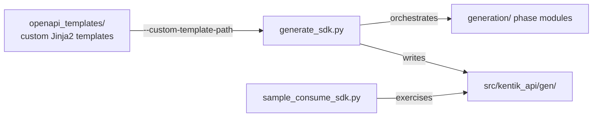

<!-- HAND-WRITTEN: not modified by [`uv run poe generate`](../pyproject.toml). Edit directly. -->

# Generation Scripts

This folder holds the SDK generator entrypoint, a sample consumer
script, three release and review tools (`release_notes.py`,
`impact_report.py`, and `check_spec_refs.py`), and `tasks.py`, which
holds the poe tasks that would otherwise need a POSIX shell. All are
hand-written and survive every [`uv run poe generate`](../pyproject.toml) run.

> [!NOTE]
> **[`uv run poe clean`](../pyproject.toml) removes [`src/kentik_api/gen/`](../src/kentik_api/gen/README.md)** (all generated service code)
> and the Sphinx build output, but never touches [`scripts/`](README.md), [`examples/`](../examples/README.md),
> or any other hand-written source. Re-run [`uv run poe generate`](../pyproject.toml) (or `uv run poe all`)
> to rebuild the generated code after a clean.

## Layout

| Path | Role |
| --- | --- |
| `generate_sdk.py` | Entrypoint. Orchestrates schema download, per-file generation, and every phase module. |
| `sample_consume_sdk.py` | Standalone demo of the generated SDK, in mock mode and real mode. |
| `release_notes.py` | Renders release notes by diffing `api_surface.json` against an earlier git revision. Also runs `uv run poe check-changelog`. |
| `impact_report.py` | Writes a regeneration impact report: what a `uv run poe generate` run changed. |
| `check_spec_refs.py` | Validates cross-artifact identifier references inside `specs/`. |
| `tasks.py` | The `clean`, `deep-clean`, and `check-drift` poe tasks, in Python so they run the same on every OS. |
| [`generation/`](generation/README.md) | The generator's phase modules. See [generation/README.md](generation/README.md). |
| [`openapi_templates/`](openapi_templates/README.md) | Custom Jinja2 templates fed into the OpenAPI generator. See [openapi_templates/README.md](openapi_templates/README.md). |



## Run the generator

```bash
# From the public schema repo, at the commit in schema.lock (default)
uv run python scripts/generate_sdk.py

# From the public schema repo, at another ref
uv run python scripts/generate_sdk.py --schema-ref HEAD

# From a local checkout of api-schema-public
uv run python scripts/generate_sdk.py --local-repo ../api-schema-public
```

[`uv run poe generate`](../pyproject.toml), `uv run poe sync-schema`, and `uv run poe generate --local` wrap these invocations.
See [`docs/sphinx/guides/generation.md`](../docs/sphinx/guides/generation.md) for
the full regeneration workflow.

## Project tasks

Every task is defined in `[tool.poe.tasks]` in [`pyproject.toml`](../pyproject.toml)
and runs the same on Windows, macOS, and Linux. Run `uv run poe` to list them.

| Command | Effect |
| --- | --- |
| `uv run poe all` | Generate services and run tests |
| `uv run poe generate` | Regenerate from the remote schema at the commit in `schema.lock` |
| `uv run poe sync-schema` | Regenerate from remote schema HEAD and move the pin |
| `uv run poe generate --local` | Regenerate from `../api-schema-public/` |
| `uv run poe generate --local-repo /path` | Regenerate from an arbitrary path |
| `uv run poe generate --schema-ref <ref>` | Regenerate from the remote schema at another ref |
| `uv run poe docs` | Regenerate the SDK, then build Sphinx HTML from [`docs/sphinx/`](../docs/sphinx/README.md) |
| `uv run poe docs-build` | Build Sphinx HTML from the committed tree, without regenerating |
| `uv run poe test` | Full mocked test suite |
| `uv run poe test-generated` / `test-runtime` / `test-smoke` / `test-generator` / `test-analytics` | One mocked test layer |
| `uv run poe test-e2e` | Live API tests, REST transport (opt-in, needs `.env`) |
| `uv run poe test-e2e-grpc` | Live API tests, gRPC transport (opt-in, needs `.env`) |
| `uv run poe lint` | Ruff check + format, rumdl Markdown check, with fixes |
| `uv run poe lint-check` | The same checks without changing files, as CI runs them |
| `uv run poe typecheck` | ty type-check on the whole repo: SDK, generated code, scripts, and tests |
| `uv run poe release-notes [--since <ref>] [--out <file>]` | List API surface changes since a ref |
| `uv run poe check-changelog [--since <ref>]` | Fail when `CHANGELOG.md` misses a breaking change |
| `uv run poe impact-report [--since <ref>] [--no-checks] [--out <file>]` | Write a regeneration impact report |
| `uv run poe check-specs` | Validate cross-references in `specs/` |
| `uv run poe check-drift` | Fail when the working tree differs from the commit, as after a stale regeneration |
| `uv run poe audit` | Audit locked dependencies for known vulnerabilities |
| `uv run poe clean` | Remove [`src/kentik_api/gen/`](../src/kentik_api/gen/README.md) and build artifacts |
| `uv run poe deep-clean` | `clean`, plus `.venv` and the pytest and ruff caches |

> [!NOTE]
> Generation runs `openapi-python-generator` and `grpcio-tools` at the
> versions `uv.lock` pins, from the project environment. To change either,
> edit its `==` pin in the `dev` group and regenerate.
> Two environment variables let you test a forked
> `openapi-python-generator` build without editing this script:
> `OPENAPI_GENERATOR_FROM` (a `uvx --from` source, for example
> `git+https://github.com/<org>/<repo>.git`) and
> `OPENAPI_GENERATOR_CMD` (the executable name, if it differs from
> `openapi-python-generator`).

## Run the sample consumer

```bash
# Mock mode: patches one generated REST call, makes no network request
uv run python scripts/sample_consume_sdk.py

# Real mode: calls the live Kentik API using .env credentials
uv run python scripts/sample_consume_sdk.py --real
```

`run_mock_demo()` proves the generated call path end-to-end without
credentials. `run_real_call()` tries `device.list()` first,
then falls back to `user.list()`, so the script still succeeds
against an account that lacks one of those permissions.

## Generator patches (internal)

If you modify [`scripts/generation/fixup.py`](generation/fixup.py), these
post-processing patches are the most likely areas to break:

| Patch | What it does |
| --- | --- |
| Wildcard patching | Replaces `from .MODULE import *` with explicit named imports |
| Ghost data fix | Removes `json=data.model_dump()` / `json_body=data.model_dump()` calls in functions where no `data` param was generated |
| Pydantic v2 construct | Injects `.model_construct()` for empty API responses to prevent validation crashes |

Swagger file selection (the newest version per service, namespace, and
filename, minus any file that newer files fully replace)
happens earlier, in [`parity.select_latest_swagger_files_by_service()`](generation/parity.py)
and [`parity.drop_superseded_swagger_files()`](generation/parity.py),
before any code is generated. See [`generation/README.md`](generation/README.md) for the phase module
breakdown and call order.
