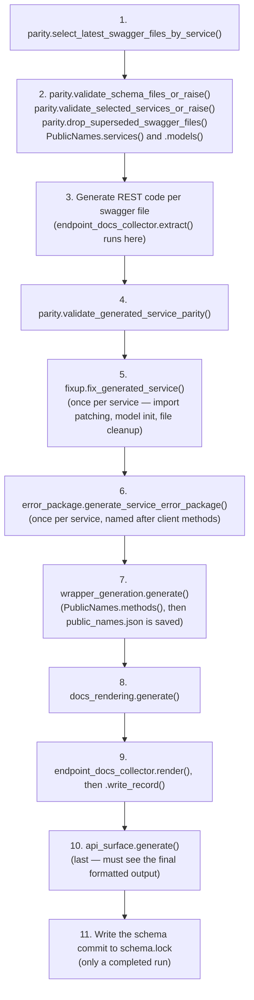

<!-- HAND-WRITTEN: not modified by [`uv run poe generate`](../../pyproject.toml). Edit directly. -->

# Generator Phase Modules

[`scripts/generate_sdk.py`](../generate_sdk.py) builds the SDK from Kentik's OpenAPI schema.
It handles CLI parsing and orchestration only. Each module in this
package owns one concern of SDK generation.

## Modules

| Module | Owns | Public interface |
| --- | --- | --- |
| [`parity.py`](parity.py) | Swagger file selection, joining the local schema base (`schema/openapi/`) to upstream, dropping files that newer files fully replace, schema structural validation, and directory parity checks | `select_latest_swagger_files_by_service()`, `merge_local_schema_base()`, `drop_superseded_swagger_files()`, `validate_schema_files_or_raise()`, `validate_selected_services_or_raise()`, `validate_generated_service_parity()` |
| [`error_package.py`](error_package.py) | Error class generation and error dispatch | `generate_service_error_package()`, `inject_service_error_handling()`, `collect_operation_error_responses()`, `merge_operation_error_responses()` |
| [`fixup.py`](fixup.py) | Generated-code post-processing: import patching, model init rebuild, file cleanup | `fix_generated_service()` |
| [`wrapper_generation.py`](wrapper_generation.py) | Service wrapper and client mixin generation. The mixin mounts a REST-only service (from the local schema base) on `_v5_transport` | `generate()`, `public_method_names()` |
| [`public_names.py`](public_names.py) | The public name of every Service, client method, and model, read from and added to `public_names.json`. Fails when an entry no longer matches the schema | `PublicNames`, `operation_key()`, `model_key()`, `NameDriftError` |
| [`docs_rendering.py`](docs_rendering.py) | The runtime architecture page (inline Mermaid), the `gen/` root README, service READMEs, and the `kentik-gen` blocks in `docs/sphinx/guides/*.md` and `docs/sphinx/README.md` | `generate()` |
| [`endpoint_docs.py`](endpoint_docs.py) | Per-endpoint Sphinx documentation, and `schema_operations.json`, the swagger-derived operation record | `EndpointDocsCollector` |
| [`api_surface.py`](api_surface.py) | Records the public API surface (operations with their client methods, gRPC routes, and error classes, model fields, enum values) to `api_surface.json`, and diffs two recordings into release notes | `generate()`, `capture()`, `diff()`, `breaking_changes()`, `render_markdown()`, `read()`, `recorded_at()`, `render_regeneration_alert()` |
| [`_shared.py`](_shared.py) | Constants and helpers shared by two or more phase modules | `PROJECT_ROOT`, `SDK_OUTPUT_DIR`, `REGENERATE_COMMAND`, `INTERNAL_GEN_DIRS`, `iter_service_dirs()`, `discover_service_model_classes()`, `service_to_pascal_case()`, `normalize_symbol()`, `RestOperation`, `parse_generated_rest_module()`, `WrapperMethod`, `parse_wrapper_methods()`, `GrpcCall`, `grpc_call()`, `grpc_stub_services()` |

Keep a helper in `_shared.py` only when two or more phase modules call
it. Put a single-consumer helper in the one module that calls it
instead.

## Call order

`generate_modular_sdk()` in [`scripts/generate_sdk.py`](../generate_sdk.py) calls the phase
modules in this order:



> [!WARNING]
> Call `endpoint_docs_collector.render()` only after
> `wrapper_generation.generate()` finishes. `render()` reads wrapper
> method signatures from the files that `wrapper_generation.generate()`
> writes.

## Import rules

[`scripts/generate_sdk.py`](../generate_sdk.py) runs as a direct script:
`uv run python scripts/generate_sdk.py`. Python puts [`scripts/`](../README.md) on
`sys.path` automatically for a direct script run. `generate_sdk.py`
imports this package as `from generation import ...`.

Tests import the same modules as `from scripts.generation import ...`.
The `pythonpath = ["."]` setting in `pyproject.toml` adds the repo root
to `sys.path` for tests.

Both import styles load the same files under different top-level
names. Use a relative import (`from ._shared import ...`) for every
import between files inside this package. A relative import resolves
correctly under either name. An absolute `scripts.generation.*` import
inside this package breaks `generate_sdk.py`'s import path.

## Add a new phase module

1. Create `scripts/generation/<name>.py`.
2. Give it one small public interface. A single `generate()` function
   is usually enough. Use more than one function only when the
   module's steps run at different points in the orchestration.
3. Import shared helpers from `._shared` with a relative import.
4. Call the new module from `generate_modular_sdk()` in
   [`scripts/generate_sdk.py`](../generate_sdk.py).
5. Add tests under `tests/generator/test_<name>.py`.

## Run the tests

```bash
uv run poe test-generator
```

This command runs only the tests in [`tests/generator/`](../../tests/generator/README.md). Most tests
build their own temporary swagger fragment or fake generated-file
fixture with `tmp_path` and need no schema checkout. One exception:
`test_the_real_alert_schema_keeps_acknowledgement_an_object` in
`test_generate_sdk.py` reads the real local `../api-schema-public`
checkout. It skips when that checkout is absent.
