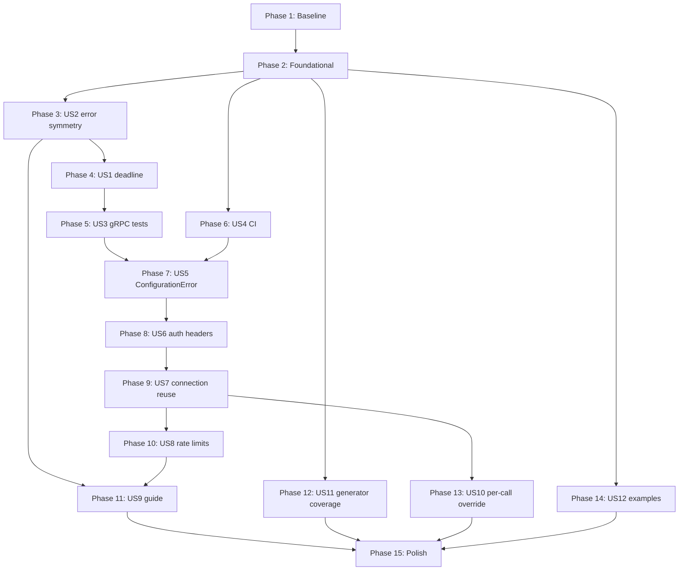

# Tasks: Harden the Shared Runtime, Retire Dead Code, Enforce CI

**Input**: Design documents from `/specs/003-harden-runtime-and-ci/`

**Prerequisites**: [plan.md](plan.md), [spec.md](spec.md), [research.md](research.md), [data-model.md](data-model.md), [contracts/runtime-api.md](contracts/runtime-api.md), [quickstart.md](quickstart.md)

**Tests are required**, not optional. The spec devotes an entire requirement
block to them (FR-038 through FR-045) and Constitution Principle IV makes
exhaustive coverage a standing rule.

## Story order deviates from priority order, deliberately

Phases follow [plan.md](plan.md)'s implementation sequence, not the numeric
order of user stories. Two dependencies drive it:

- **US2 runs before US1.** Adding a deadline before fixing the status mapping
  would make the *expected* timeout path report a fabricated HTTP 500, because
  `DEADLINE_EXCEEDED` currently falls through to it.
- **US7 runs before US8.** Both touch response handling in `request_json()`, and
  US8's capture point sits inside the client US7 introduces.

## Conventions

- `[P]` marks tasks that touch different files and have no incomplete
  dependency, so they can run in parallel.
- `[USn]` maps the task to its user story. Setup, Foundational, and Polish
  phases carry no story label.
- **Never renumber an existing task.** A task discovered mid-implementation
  gets a letter suffix on the task it follows (`T0NN` becomes `T0NNa`), the way
  features 001 and 002 already do it. Renumbering rewrites the key that pull
  requests, commits, and sibling artifacts point at, which is what left twelve
  stale requirement references in this file before implementation even began.
- Every task cites the requirement it satisfies. `make check-specs` fails when
  a requirement ends up cited by no task, which is how a shifted reference is
  caught: the reference still resolves, but the requirement it abandoned no
  longer has one.
- Every runtime change lands in `src/kentik_api/core/`, `errors/`,
  `transports/`, or `auth/`. Constitution Principle II forbids per-endpoint
  connection, auth, retry, or timeout code.
- **Only Phase 13 (US10) may change a file under `src/kentik_api/gen/`.** Every
  other phase ends with a zero-line `make generate local` diff.

---

## Phase 1: Setup and baseline capture

**Purpose**: record the "before" numbers the success criteria are measured
against. Doing this after the fact makes SC-004, SC-006, and SC-012
unverifiable.

- [x] T001 Confirm the baseline is green by running `make test`, `make typecheck`, `uv run ruff check .`, and `make generate local && git diff --exit-code`, recording each result in the pull request description
- [x] T002 [P] Capture before-coverage for `src/kentik_api/core`,
  `src/kentik_api/auth`, and `src/kentik_api/transports` with
  `uv run --with pytest-cov pytest -q --cov=src/kentik_api/core --cov=src/kentik_api/auth --cov=src/kentik_api/transports --cov-report=term-missing`
  and record the per-file percentages (expected: grpc_runtime 65%, credentials
  44%, grpc_client 50%)
- [x] T003 [P] Capture before-coverage for `scripts/generation` with
  `uv run --with pytest-cov pytest tests/generator/ -q --cov=scripts/generation --cov-report=term-missing`
  (expected: docs_rendering 18%, endpoint_docs 26%, wrapper_generation 54%)
- [x] T004 [P] Record the 85% per-module coverage threshold for
  `scripts/generation` that FR-043 fixes, and the current figures it must not
  regress below, in `specs/003-harden-runtime-and-ci/plan.md` under
  Implementation Phases

**Checkpoint**: baseline recorded; no source changed.

---

## Phase 2: Foundational (blocks US1, US2, US7, US8)

**Purpose**: extend the shared configuration and error objects that later
stories build on. Nothing here changes behaviour on its own.

- [x] T005 Add `timeout: float = 60.0`,
  `rest_timeout: httpx.Timeout | float | None = None`, and
  `grpc_deadline: float | None = None` to `APIConfig.__init__` in
  `src/kentik_api/core/api_config.py`, with the latter two deriving from
  `timeout` when `None` (FR-002, FR-015, FR-016)
- [x] T006 Add construction-time validation to `src/kentik_api/core/api_config.py` rejecting any non-positive phase bound or deadline with `ConfigurationError` naming the offending field and value (FR-017)
- [x] T007 [P] Add a `rate_limit: RateLimit | None = None` attribute to `KentikError` in `src/kentik_api/errors/__init__.py` so every subclass carries it (FR-029)
- [x] T008 [P] Add a `grpc_status_code: str | None = None` keyword argument to `HTTPException.__init__` in `src/kentik_api/errors/__init__.py` (FR-010)
- [x] T009 Add unit tests for timeout derivation, phase-bound handling, and non-positive rejection in `tests/runtime/test_api_config.py`
- [x] T010 Run `make generate local && git diff --exit-code` and confirm no generated file changed

**Checkpoint**: `make test` and `make typecheck` green; generated tree untouched.

---

## Phase 3: US2 - The same failure raises the same exception type on both transports (P1)

**Goal**: a caller's `except` clauses survive flipping `protocol` between
`"rest"` and `"grpc"`.

**Independent test**: drive the same failure over both transports and assert the
same exception type. Run `uv run python learn/ex04_errors.py` and confirm it
reports `same exception type on both transports? True`.

- [x] T011 [US2] Replace `_GRPC_STATUS_TO_HTTP` with an exhaustive
  classification of all 16 non-OK gRPC codes in
  `src/kentik_api/core/grpc_runtime.py`, following the table in
  `specs/003-harden-runtime-and-ci/contracts/runtime-api.md` section 3 (FR-006,
  FR-009)
- [x] T012 [US2] Route `CANCELLED`, `DEADLINE_EXCEEDED`, and `UNAVAILABLE` to
  `TransportError` in `src/kentik_api/core/grpc_runtime.py`, with no fabricated
  HTTP status, matching what REST already does for the same conditions (FR-008)
- [x] T013 [US2] Set `grpc_status_code` on every `HTTPException` raised from `src/kentik_api/core/grpc_runtime.py`, so the verbatim gRPC code survives the canonical HTTP mapping (FR-010)
- [x] T014 [US2] Add an explicit unrecognized-code fallback in
  `src/kentik_api/core/grpc_runtime.py` raising `TransportError` that names the
  code, never claiming an HTTP status the server did not send (FR-009)
- [x] T015 [US2] Raise `AuthenticationError` for HTTP 401 in `request_json()` in
  `src/kentik_api/core/rest_runtime.py`, before dispatch to the generated
  `error_cls`, leaving generated error packages untouched (FR-007, FR-011)
- [x] T016 [P] [US2] Add cross-transport symmetry tests in `tests/runtime/test_transport_symmetry.py` covering auth rejection, client-side timeout, and unreachable host over both transports (FR-040, SC-002)
- [x] T017 [US2] Update the 401 expectation for **every** discovered endpoint in `tests/generated/test_endpoint_schema_coverage.py`, without narrowing, skipping, or making the suite status-agnostic (FR-041)
- [x] T018 [US2] Temporarily revert T015, confirm
  `tests/generated/test_endpoint_schema_coverage.py` **fails**, restore T015,
  and record the outcome in the pull request (FR-042, Constitution Principle IV)
  - Recorded 2026-09-22: with the T015 lines removed, 233 of 699 cases failed (every endpoint's 401 case); restored, 699 passed.
- [x] T019 [P] [US2] Remove the "works identically for REST and gRPC" claim from
  `examples/common/error_handling.py`, unless T016 demonstrably covers every
  `except` branch it declares on both transports (FR-012)
- [x] T020 [US2] Run `make generate local && git diff --exit-code` and confirm no generated file changed (FR-005)

**Checkpoint**: the three measured asymmetries are gone; `make test` green.

---

## Phase 4: US1 - A gRPC call never hangs forever (P1)

**Goal**: an unresponsive endpoint fails within a bounded time instead of
blocking the calling thread for ever.

**Independent test**: `uv run python learn/ex06_timeouts.py` now terminates at
the deadline rather than reporting "STILL BLOCKED after 3s".

- [x] T021 [US1] Add a `UnaryUnaryClientInterceptor` in
  `src/kentik_api/transports/grpc_client.py` that fills in `timeout` from
  `APIConfig.grpc_deadline` only when the call did not set one (FR-001, FR-002,
  research D1a)
- [x] T022 [US1] Wrap the channel with `grpc.intercept_channel` in
  `GrpcTransport.__init__` in `src/kentik_api/transports/grpc_client.py`, so
  every stub inherits the deadline with no generated call site changing (FR-005,
  research D1a)
- [x] T023 [US1] Give `GrpcTransport.__init__` access to the `APIConfig` in `src/kentik_api/transports/grpc_client.py` and `src/kentik_api/client.py`, so the deadline is per-client rather than global
  - `client.py` needed no change: `GrpcTransport` builds its own `APIConfig` from the credentials, as `RestTransport` does, and accepts one via `api_config=`.
- [x] T023a [US1] Accept `timeout`, `rest_timeout`, and `grpc_deadline` as
  keyword-only arguments on `KentikAPI.__init__` in `src/kentik_api/client.py`,
  build one `APIConfig` from them, and hand it to either transport; make
  `request_json()` in `src/kentik_api/core/rest_runtime.py` honour
  `rest_timeout` instead of its hardcoded 60 seconds; test both in
  `tests/smoke/test_client_mounts_and_calls.py` and
  `tests/runtime/test_rest_runtime.py` (FR-015, FR-015a)
- [x] T024 [US1] Narrow the `except Exception` fallback in `call_grpc()` in `src/kentik_api/core/grpc_runtime.py` so a non-transport error raised by the stub is not reported as `TransportError` (FR-003)
- [x] T025 [US1] Move the `_method` label lookup out of the `except grpc.RpcError` body in `src/kentik_api/core/grpc_runtime.py`, so an unreadable label cannot destroy the original `RpcError` (FR-004)
- [x] T026 [P] [US1] Add tests in `tests/runtime/test_grpc_runtime.py` for deadline application, a non-`RpcError` stub failure, and `__cause__` preservation when the label cannot be read (SC-001)
  - Verified against a real `GrpcTransport` and a local black-hole socket in
    `tests/runtime/test_grpc_transport.py`. `learn/ex06_timeouts.py` step 3
    cannot show the fix: it builds its own raw channel, not the SDK transport.
- [x] T027 [US1] Run `make generate local && git diff --exit-code` and confirm no generated file changed (FR-005)

**Checkpoint**: no gRPC call can block indefinitely; generated tree untouched.

---

## Phase 5: US3 - The gRPC transport is covered by tests (P1)

**Goal**: the mocked suite fails when the gRPC call path breaks.

**Independent test**: coverage reaches 100% on all three modules, and breaking
the auth metadata tuple makes a test fail.

- [x] T028 [P] [US3] Add tests exercising `call_grpc()` end to end with a mock stub in `tests/runtime/test_grpc_runtime.py`, with no live network call (FR-038)
- [x] T029 [P] [US3] Add a test asserting the exact gRPC auth metadata keys and values emitted by `KentikCredentials.get_grpc_plugin()` in `tests/runtime/test_credentials.py` (FR-039)
- [x] T030 [P] [US3] Add tests covering `GrpcTransport.__init__` and `close()` in `tests/runtime/test_grpc_transport.py`, without opening a real channel (FR-038)
- [x] T031 [US3] Extend `tests/runtime/test_grpc_runtime.py` to assert the resulting SDK exception for each of the 16 non-OK gRPC status codes plus the unrecognized-code fallback (FR-040, SC-003)
- [x] T032 [US3] Verify 100% line coverage of
  `src/kentik_api/core/grpc_runtime.py`, `src/kentik_api/auth/credentials.py`,
  and `src/kentik_api/transports/grpc_client.py`, comparing against the T002
  baseline (SC-004)
  - Recorded 2026-09-22: grpc_runtime 65% to 100%, credentials 44% to 100%, grpc_client 50% to 100%, from `tests/runtime/` alone.
- [x] T033 [US3] Prove the new tests bite: change one character in the `x-ch-auth-email` metadata key in `src/kentik_api/auth/credentials.py`, confirm a test fails, restore, and record the outcome
  - Recorded 2026-09-22: `x-ch-auth-email` changed to `x-ch-auth-emai1`: 1 failed (`test_grpc_plugin_emits_exact_auth_metadata`); restored, 2310 passed.

**Checkpoint**: SC-004 met; no test needs network, credentials, or a schema checkout.

---

## Phase 6: US4 - CI enforces the properties that only hold by luck (P1)

**Goal**: every later phase is protected by determinism, lint, and docs gates.

**Independent test**: a formatting violation, a generator change, and a Sphinx
warning each fail CI on a throwaway branch.

- [x] T034 [US4] Fix the existing formatting violation by running `uv run ruff format scripts/generate_sdk.py` (FR-046, SC-006)
- [x] T035 [P] [US4] Add a lint job running `ruff check` and `ruff format --check` to `.github/workflows/tests.yml` (FR-046)
- [x] T036 [P] [US4] Add a generation-determinism job to
  `.github/workflows/tests.yml` running `make generate` then
  `git diff --exit-code`, reporting the differing paths on failure and relying
  on the generator's existing clone fallback for the schema (FR-047, research
  D7)
  - Uses `git status --porcelain`, not `git diff --exit-code`, so a newly generated untracked file also fails the gate. Verified locally against a fresh clone of schema HEAD `a7fd79e`: no differences.
- [x] T037 [P] [US4] Add a docs job to `.github/workflows/tests.yml` running Sphinx with `-W` (FR-048)
- [x] T037a [US4] Empty `suppress_warnings` in `docs/sphinx/conf.py` and fix
  every `myst.xref_missing` and `toc.not_included` warning it was masking at the
  source, so the `-W` gate from T037 can fail on a broken link (FR-048a)
  - Recorded 2026-09-22: 18 warnings were masked. 16 were links from Sphinx
    pages to `README.md` files outside the source tree, now GitHub URLs; 1 was
    `docs/sphinx/README.md` itself, now excluded; 1 was a link to the excluded
    `services/README.md`, now `services/index.md`. `make docs` also builds with
    `-W` now.
- [x] T037b [US4] Move every guide under `docs/guides/` into
  `docs/sphinx/guides/` and add them to the toctree. Update the marker-block
  paths in `_update_guide_snippets()` in `scripts/generation/docs_rendering.py`,
  the links in `scripts/README.md` and `CLAUDE.md`, and every later
  `docs/guides/` path in this file and in spec FR-057. Confirm
  `make generate local` rewrites the moved files in place and `make docs` builds
  clean under `-W`. This must land before any later phase edits a guide
  (FR-056a)
  - Verified the generator writes into the new location: a blanked `service-count` marker in `guides/generation.md` was restored by `make generate local`.
- [x] T038 [US4] Replace the hardcoded feature-branch name in `push.branches` in `.github/workflows/tests.yml` and `.github/workflows/build.yml` (FR-049)
- [x] T039 [US4] Confirm no CI job runs any `e2e` or `e2e_grpc` test by inspecting `.github/workflows/` (FR-050)
- [x] T040 [US4] Name the determinism job in `.github/workflows/tests.yml` so an upstream schema change is distinguishable from a generator regression in its failure output (research D7)
  - Job is named `generated-output-matches-schema-head`; the generator now logs `Schema commit: <sha>` when it clones, and the failure message names both causes.
- [x] T041 [US4] Verify each gate in `.github/workflows/tests.yml` fails as
  intended, by opening throwaway pull requests carrying a formatting violation,
  a generator output change, and a broken Sphinx reference (SC-005, SC-006)
  - Local stand-in, 2026-09-22 (no push per maintainer): a formatting violation
    fails `ruff format --check` (exit 1); a stale committed generated file makes
    regeneration dirty the tree; a broken link fails `sphinx-build -W` (exit 1).
    Still open: confirm the same on a real CI run.
  - 2026-10-16: three local branches off `feat/v6-sdk` hold one throwaway commit
    each, checked locally against its gate: `test/ci-gate-ruff-format` (`ruff
    format --check` exit 1, `ruff check` passes), `test/ci-gate-generated-drift`
    (`make generate` at the pinned commit rewrites `gen/site/services/site.py`),
    `test/ci-gate-sphinx-link` (`sphinx-build -W` exit 1, `myst.xref_missing`).
    To close: push each to the fork, open a pull request into `feat/v6-sdk`,
    record the failing job, then close the pull request and delete the branch.
  - Done 2026-10-17 on the fork (alexdearaujo/community_sdk_python pull requests
    1 to 3, into `feat/v6-sdk`). The first run also failed `test (3.12)`,
    `test (3.13)`, and `build` on all three: a `Dict[str]` test that only Python
    3.14 accepts, and a wheel check that imported `kentik_api.analytics` without
    its extra. Both are fixed on `feat/v6-sdk` (`fix/ci-wheel-and-py312`). The
    rerun failed exactly one job each: `lint` ("Would reformat:
    src/kentik_api/devices.py"), `generated-output-matches-schema-pin`, and
    `docs`. `build` and every other job passed. The pull requests are closed and
    the branches deleted.
- [x] T041a [US4] Add `make check-specs` to `.github/workflows/tests.yml`, so a
  stale or orphaned requirement reference fails CI rather than surviving to
  implementation, as twelve of them did in this file

**Checkpoint**: CI protects determinism, formatting, and docs.

---

## Phase 7: US5 - A caller who catches `KentikError` catches every SDK error (P2)

**Goal**: one exception hierarchy, with no configuration failure escaping it.

**Independent test**: constructing `KentikAPI` with no credentials and with a bad
region both raise something catchable as `KentikError`.

- [x] T042 [US5] Replace both `ValueError` raises with `ConfigurationError` in `KentikAPI.__init__` in `src/kentik_api/client.py`, keeping each message naming the missing or invalid value (FR-026)
  - There were three, not two: an unknown `protocol` also raised `ValueError`, and its message did not name the value. All three now raise `ConfigurationError` naming what was wrong.
- [x] T043 [US5] Confirm `ConfigurationError` in `src/kentik_api/errors/__init__.py` remains a plain `KentikError` subclass, with no `ValueError` base and no deprecation shim (FR-027)
- [x] T044 [P] [US5] Add tests for both configuration failures in `tests/smoke/test_client_mounts_and_calls.py`, asserting they are catchable as `KentikError`
- [x] T045 [P] [US5] Update `src/kentik_api/errors/README.md` and `docs/sphinx/guides/error_handling.md` so `ConfigurationError` is no longer described as never raised (FR-057)
  - Both docs also still described the error behaviour from before Phases 3 and 4 (REST 401, the gRPC status table, `TransportError` sources); updated in the same change.

**Checkpoint**: `except KentikError:` is a complete net.

---

## Phase 8: US6 - The auth header scheme exists in exactly one place (P2)

**Goal**: one definition of the Kentik auth headers, and it is the tested one.

**Independent test**: grepping the header names outside `gen/` returns exactly
one construction site.

- [x] T046 [US6] Make `request_json()` in `src/kentik_api/core/rest_runtime.py`
  call `KentikCredentials.get_rest_headers()` instead of rebuilding the header
  dict inline, or delete the unused method, so only one definition survives
  (FR-028)
  - Neither option as written: `get_rest_headers()` is deleted, and the key
    names move to `AUTH_EMAIL_KEY` / `AUTH_TOKEN_KEY` plus `auth_headers()` in
    `auth/credentials.py`. `request_json()` and the gRPC plugin both derive from
    them, so the gRPC metadata is no longer a second spelling. Also removed
    `fixup._fix_auth_header`, a third copy that rewrote `Authorization: Bearer`
    headers no template emits; regeneration with it gone changed no generated
    file.
- [x] T047 [US6] Confirm the surviving definition is exercised by the existing REST auth assertions in `tests/runtime/test_rest_runtime.py`
  - Recorded 2026-09-22: changing `AUTH_EMAIL_KEY` by one character fails 3 tests across both transports (gRPC metadata, REST headers, `request_json`); restored, all pass.
- [x] T048 [P] [US6] Update `src/kentik_api/auth/README.md`, which currently documents `get_rest_headers()` as unused (FR-057)

**Checkpoint**: `grep -rn "X-CH-Auth-Email" src/ | grep -v "/gen/"` returns one line.

---

## Phase 9: US7 - Repeat calls reuse one connection (P2)

**Goal**: N calls on one client open one connection instead of N.

**Independent test**: several calls share one `httpx.Client`, and `close()`
releases it.

- [x] T049 [US7] Add a lazily-created, reused `client` property to `APIConfig` in `src/kentik_api/core/api_config.py`, honouring `rest_timeout` and `verify` (FR-013, research D2)
- [x] T050 [US7] Replace the per-request `with httpx.Client(...)` block in `request_json()` in `src/kentik_api/core/rest_runtime.py` with the shared client from `APIConfig` (FR-013)
  - `request_json()`'s fallback `APIConfig()` (no override passed) now closes the client it creates after its one call, including on failure; otherwise each such call would leak a connection pool.
- [x] T051 [US7] Add `close()` to `APIConfig` in `src/kentik_api/core/api_config.py`, idempotent and safe to call twice
- [x] T052 [US7] Make `RestTransport.close()` in `src/kentik_api/transports/rest_client.py` delegate to `APIConfig.close()` instead of being a no-op (FR-014)
- [x] T053 [US7] Raise `ConfigurationError` naming `close()` as the cause when a closed client is reused, in `src/kentik_api/core/rest_runtime.py` (research D2)
  - Raised from the `APIConfig.client` property rather than `rest_runtime.py`, so every path to the closed client gets the same error.
- [x] T054 [P] [US7] Add tests in `tests/runtime/test_rest_runtime.py` for client reuse across N calls, resource release on close, timeout honouring, and use-after-close
- [x] T055 [P] [US7] Document the concurrency cap of 1 for non-query APIs in
  `src/kentik_api/core/README.md`, since sharing a client across threads is
  limited by the API and not by httpx (FR-036, research D2)
- [x] T056 [US7] Run `make generate local && git diff --exit-code` and confirm no generated file changed

**Checkpoint**: SC-009 met; `RestTransport.close()` does something.

---

## Phase 10: US8 - Rate-limit information is surfaced (P2)

**Goal**: a caller reads remaining quota without parsing raw headers.

**Independent test**: quota is readable off a result and off an error, on both
transports, and two endpoints report separate budgets.

- [x] T057 [US8] Create the frozen `RateLimit` value object in `src/kentik_api/core/rate_limit.py` with `limit`, `remaining`, `reset_seconds`, `window_seconds`, and `raw` (FR-029, data-model.md)
- [x] T058 [US8] Add `RateLimit.from_headers()` and `RateLimit.from_metadata()`
  in `src/kentik_api/core/rate_limit.py`, tolerating `w=60` and `window=60`,
  multiple windows, and returning `None` for absent or malformed input rather
  than raising (FR-030)
- [x] T059 [P] [US8] Add parser tests in `tests/runtime/test_rate_limit.py` covering `60, 60;w=60`, `100;window=60`, multiple windows, absent header, and malformed header
- [x] T060 [US8] Capture quota from REST response headers in `request_json()` in `src/kentik_api/core/rest_runtime.py` (FR-030)
- [x] T061 [US8] Capture quota from gRPC **initial** metadata in `call_grpc()` in `src/kentik_api/core/grpc_runtime.py`, noting trailing metadata was measured empty (FR-030)
  - Captured in two places, both outside generated code: `GrpcTransport`'s
    interceptor records quota per method from every call's initial metadata (a
    failed outcome's `RpcError` carries it), and `call_grpc()` reads it off the
    `RpcError` for `error.rate_limit`.
- [x] T062 [US8] Track quota per endpoint in a `rate_limits` mapping on both transports in `src/kentik_api/transports/rest_client.py` and `src/kentik_api/transports/grpc_client.py` (FR-031)
  - The mapping lives on `APIConfig.rate_limits`, which `request_json()` and the
    gRPC interceptor both reach; each transport exposes it as a `rate_limits`
    property. Keys are REST paths as sent, or gRPC method names.
- [x] T063 [US8] Attach quota to the returned model via `object.__setattr__` and expose a `rate_limit_of(result)` accessor from `src/kentik_api/__init__.py` (FR-029, research D5a)
  - **Deferred to Phase 13.** The returned model is built in generated code
    (`<Model>(**body)` in each REST function, `model_validate(...)` in each gRPC
    wrapper branch); the shared runtime only ever sees a dict or proto.
    Attaching quota to the result therefore needs a generated-code change, which
    only Phase 13 may make. Quota is already readable on every error and per
    endpoint.
  - Done in Phase 13 as deferred: the REST function template and the gRPC
    wrapper branch call `attach_rate_limit()`; `request_json()` returns a dict
    subclass carrying the quota so the template can hand it on.
    `kentik_api.rate_limit_of` is exported.
- [x] T064 [US8] Populate `rate_limit` on every SDK error raised from `src/kentik_api/core/rest_runtime.py` and `src/kentik_api/core/grpc_runtime.py` (FR-029)
- [x] T065 [P] [US8] Add tests in `tests/runtime/test_rate_limit.py` asserting `model_dump()` keys and model equality are unaffected by attachment (research D5a)
  - **Deferred to Phase 13** with T063, which it tests.
- [x] T066 [US8] Enable connection-establishment retries with `httpx.HTTPTransport(retries=N)` in `src/kentik_api/core/api_config.py`, which never replay a request the server received (FR-032)
  - `httpx.HTTPTransport(retries=2)`; `verify` moved onto the transport, since a `Client` given a transport ignores its own `verify`.
- [x] T067 [US8] Confirm no automatic retry of a completed request and none for mutating operations exists anywhere in `src/kentik_api/core/` (FR-032, FR-033)
  - Recorded 2026-09-22: the only retry in `core/` and `transports/` is `_CONNECT_RETRIES` for connection establishment.
- [x] T067a [P] [US8] Record the retry-eligibility rule in
  `tests/generated/test_retry_eligibility.py`: derive each discovered
  operation's eligibility from its HTTP verb via `tests/_discovery.py`, never
  from a hand-kept list, and assert GET, PUT, and DELETE are eligible (161
  operations) while POST and PATCH are not (72). State the rule in
  `docs/sphinx/guides/rate_limiting.md` (FR-032a)
- [x] T068 [P] [US8] Document the three limits no header reveals, the per-endpoint granularity, and the documented-versus-measured conflict in `docs/sphinx/guides/rate_limiting.md` (FR-034, FR-035, FR-036)
- [x] T069 [US8] Confirm the default in `src/kentik_api/core/api_config.py`
  still tolerates the documented 1.5s soft-limit response delay, with a test in
  `tests/runtime/test_rest_runtime.py` proving a delayed response is not
  converted into a `TransportError` (FR-037)
  - Real local HTTP server delaying 1.6s; the call returns normally under the
    default. Surfaced that a config with no credentials sends `None` header
    values and httpx raises a raw `TypeError`; that is T084's case.
- [x] T070 [US8] Run `make generate local && git diff --exit-code` and confirm no generated file changed

**Checkpoint**: SC-014 met; quota readable three ways.

---

## Phase 11: US9 - The REST vs gRPC guide (P2)

**Goal**: a reader can choose a transport and name the trade-offs.

**Independent test**: someone unfamiliar with gRPC reads the guide once and can
state which transport suits their workload and why.

**Depends on Phase 3**, because the guide documents the corrected error
behaviour.

- [x] T071 [US9] Work through `learn/ex01_same_call.py` through `learn/ex07_rate_limits.py` and complete `learn/findings.md`, marking each line measured, confirmed-in-source, or assumed (FR-051, FR-052)
  - **Maintainer's own task.** The exercises are run by hand, not by an agent.
    On 2026-09-22 the exercises were updated (locally, untracked) so their code
    and prompts match Phases 3 to 10, each naming the commit that changed the
    behavior it once demonstrated.
  - 2026-09-24: maintainer ran all seven. Claude filled the remaining blanks in
    `learn/findings.md` from source, mocked tests, and local scans (no live
    call), and fixed stale per-call deadline text in ex02, ex03, and ex06. Still
    open: re-run ex02 (now prints the protobuf size) and ex06 to turn their
    `[A]`/`[C]` rows into `[M]`.
- [x] T072 [US9] Write `docs/sphinx/guides/rest-vs-grpc.md` covering mechanism, when to choose each, and trade-offs, grounding every claim in a recorded finding (FR-053, FR-054)
  - Written 2026-09-24 from `learn/findings.md`. Payload size, general speed, and proxy behavior stay out: none was recorded as measured.
  - Waits on T071: the guide is written from the maintainer's `learn/findings.md`.
- [x] T073 [US9] State the measured coverage limits in
  `docs/sphinx/guides/rest-vs-grpc.md`: 35 services with a wrapper, 6 without,
  198 of 233 operations with a gRPC translation, plus the two distinct
  `NotImplementedError` cases (FR-054)
  - Re-measured 2026-09-23 by an AST scan of the generated wrappers: 35/6 services, 198 of 233 operations, 35 REST only, with a per-service table. The page is `orphan: true` until T075.
- [x] T074 [US9] State in `docs/sphinx/guides/rest-vs-grpc.md` that Kentik's
  REST API is an Envoy transcoding layer over the same gRPC services, evidenced
  by `grpc-status`, `grpc-message`, and `server: envoy` on REST responses, and
  that both draw on one shared per-endpoint quota (FR-055)
  - Drafted 2026-09-23 from the research.md evidence table (headers, and the shared quota run 59 to 54).
- [x] T075 [US9] Add `docs/sphinx/guides/rest-vs-grpc.md` to the documentation navigation and confirm `make docs` builds clean under `-W` (FR-056)
  - Added to the `index.md` toctree after `guides/rate_limiting`; `make docs` builds clean under `-W`.
- [x] T076 [P] [US9] Update `docs/sphinx/guides/rest.md` and `docs/sphinx/guides/grpc.md` for the corrected error behaviour (FR-057)
  - The REST and gRPC call-flow diagrams are partly generated; fixed in `docs_rendering.py` and regenerated, plus the hand-written REST diagram and the gRPC guide's stale status table.
  - The per-service pages' sequence diagrams were missed here and fixed later in `3c86cb7`, found while writing T079.
- [x] T077 [US9] Confirm `git status` reports nothing under `learn/` (SC-016, FR-052)
  - Recorded 2026-09-22: `git status --ignored` shows `learn/` as ignored only; nothing tracked.

**Checkpoint**: SC-015 met; docs build clean.

---

## Phase 12: US11 - The generator's own phase modules are tested (P3)

**Goal**: generator unit tests catch a defect the determinism gate cannot.

**Independent test**: coverage of `scripts/generation/` from `tests/generator/`
alone clears the T004 threshold.

- [x] T078 [P] [US11] Raise coverage of `scripts/generation/docs_rendering.py` with `tmp_path` fixtures in `tests/generator/test_docs_rendering.py` (FR-043)
- [x] T079 [P] [US11] Raise coverage of `scripts/generation/endpoint_docs.py` with `tmp_path` fixtures in `tests/generator/test_endpoint_docs.py` (FR-043)
- [x] T080 [P] [US11] Raise coverage of `scripts/generation/wrapper_generation.py` with `tmp_path` fixtures in `tests/generator/test_wrapper_generation.py` (FR-043)
  - Includes golden tests: `device` and `alerting` wrappers are deleted from a
    sandbox copy, regenerated by the real phase function, post-processed as
    `generate_sdk.py` does, and must equal the committed files byte for byte.
    Writing them exposed that ruff was not a project dependency (fixed in
    `d2b7b16`).
- [x] T081 [US11] Confirm each module under `scripts/generation/` meets the T004
  threshold by running
  `uv run --with pytest-cov pytest tests/generator/ -q --cov=scripts/generation --cov-report=term-missing`,
  and that no new test needs a schema checkout or network (FR-045, FR-043,
  SC-012)
  - Recorded 2026-09-23 from `tests/generator/` alone: docs_rendering 18% to
    92%, endpoint_docs 26% to 91%, wrapper_generation 54% to 94%. The rest held
    their floors: parity 91%, error_package 94%, _shared 95%, fixup 95%,
    api_surface 97%. No test needs a schema checkout or network.
- [x] T082 [US11] Prove the new tests bite by introducing a deliberate defect in one covered phase module, confirming `make test-generator` fails, and restoring
  - Recorded 2026-09-23: three injected defects, each in code these tests newly
    cover, each failed the suite and was restored: path normalization made a
    no-op (1 failure), the mixin mounting `self.{title}` (2 failures), the guide
    service count off by one (1 failure).

**Checkpoint**: SC-012 met.

---

## Phase 13: US10 - A caller can override client-wide defaults for one call (P3)

**Goal**: one slow operation gets a longer timeout without a second client.

**This is the only phase that changes generated output.** It lands in its own
commit with a regenerated `api_surface.json`.

**Independent test**: one call with an overridden timeout and another without,
on the same client, each use their own value.

- [x] T083 [US10] Add a `with_timeout()` derivation helper to `APIConfig` in
  `src/kentik_api/core/api_config.py` that can vary only timeout-related fields
  and cannot change `base_path`, `auth_email`, `auth_token`, or `verify`
  (FR-022, research D6)
  - Accepts a scalar (both transports) or `rest_timeout` / `grpc_deadline`
    separately (FR-022). The copy shares the origin's connection, since
    `request_json()` now passes the timeout per request; closing a copy is a
    no-op.
- [x] T083a [US10] Expose the client's `APIConfig` through a public, read-only
  `KentikAPI.api_config` property in `src/kentik_api/client.py`, so building an
  override never needs `client._transport.api_config`, and cover it in
  `tests/smoke/test_client_mounts_and_calls.py` (FR-018a)
- [x] T084 [US10] Raise `ConfigurationError` before sending when an override carries no credentials, in `src/kentik_api/core/rest_runtime.py` (FR-023)
  - Today that case escapes as a raw httpx `TypeError` (header value `None`), found while writing T069.
  - With the check in place, `request_json()`'s fallback `APIConfig()` can never send, so Phase 9's close-after-one-call handling for it was removed.
- [x] T085 [US10] Stop stripping `api_config_override` from wrapper method signatures in `scripts/generation/wrapper_generation.py` (FR-018)
- [x] T086 [US10] Thread the override into the gRPC branch in `scripts/generation/wrapper_generation.py` so the deadline applies there too, taking precedence over the D1a interceptor default (FR-019)
  - `call_grpc()` takes `api_config=` and passes its `grpc_deadline` as the call
    timeout, which the channel interceptor then leaves alone. Channel
    credentials are fixed per channel, so an override's credentials do not apply
    on gRPC; documented on `call_grpc()`.
- [x] T087 [US10] Regenerate with `make generate local` and review the diff, confirming it contains only the signature change and its call-site plumbing (FR-025)
  - Reviewed 2026-09-23: 86 generated files, all under `services/`. Wrappers
    gain the parameter, `api_config_override or rest_transport.api_config`, the
    `call_grpc(..., api_config=...)` tuple, and `attach_rate_limit(...)`; REST
    modules gain `attach_rate_limit(..., rate_limit_of(body))`. Nothing else.
- [x] T088 [US10] Update `tests/generated/test_wrapper_contracts.py` to account for the new parameter rather than being weakened to ignore it (FR-018, Constitution Principle IV)
- [x] T089 [US10] Add tests in `tests/runtime/test_api_config.py` asserting `with_timeout()` cannot alter the four security-relevant fields, and that no fixture sets `verify=False` (FR-024)
- [x] T090 [US10] Assert in `tests/runtime/test_api_config.py` that a supplied
  override **replaces** the client-wide configuration wholesale, with no
  field-by-field merge, so an override that changes `base_path` cannot inherit
  credentials the caller did not restate (FR-021)
- [x] T091 [US10] Assert in `tests/runtime/test_api_config.py` that omitting the override leaves behaviour byte-identical to the client-wide defaults (FR-020)
- [x] T092 [US10] Commit the generated diff together with a regenerated `api_surface.json`, separate from any hand-written change (FR-025)
  - `api_surface.json` regenerated and unchanged: it records required parameters only, and the new one is optional. The runtime and generator changes are separate commits (`a9fe50c`, `6df01ca`).

**Checkpoint**: SC-010 met; generated diff reviewed on its own.

---

## Phase 14: US12 - Examples cannot silently rot (P3)

**Goal**: a regeneration that renames a wrapper method breaks a test, not a user.

**Independent test**: every example module imports with no network and no
credentials, and renaming a referenced wrapper method causes a failure.

- [x] T093 [P] [US12] Add `tests/smoke/test_examples_import.py` importing every module under `examples/` with no network call and no credentials (FR-044)
  - Import alone could not satisfy T096, since importing only defines `main()`.
    The test also resolves every `client.<service>.<method>(...)` call in each
    example against a real client, keyword arguments included, and asserts each
    transport example makes at least one such call so the check cannot pass
    vacuously.
- [x] T094 [US12] Either make `pretty_print` in `examples/common/utils.py` genuinely used by an example, or delete it (SC-011)
  - Deleted: no example used it.
- [x] T095 [US12] Correct `examples/README.md`, which describes
  `examples/common/` as "Shared helpers" although `error_handling.py` is a
  standalone runnable example and `pretty_print` is imported by nothing (FR-057)
- [x] T096 [US12] Prove the suite bites by renaming a wrapper method that `examples/device/rest.py` calls, confirming `tests/smoke/test_examples_import.py` fails, and restoring
  - Recorded 2026-09-23: renaming `list_devices` in the device wrapper failed 3 cases (`device.rest`, `device.grpc`, `common.error_handling`); restored, all pass.

**Checkpoint**: SC-013 met.

---

## Phase 15: Polish and cross-cutting concerns

- [x] T097 Run
  `uvx vulture --min-confidence 60 scripts/ src/kentik_api/core src/kentik_api/errors src/kentik_api/transports src/kentik_api/auth src/kentik_api/client.py examples/`
  and confirm no unused function remains (SC-011)
  - Recorded 2026-09-23: one genuine finding, an unused unpacked `resp_class` in
    `wrapper_generation.py`, removed. The remaining four function or method
    findings are false positives: `request_json`, `call_grpc`, and
    `with_timeout` are called from generated code or by users, outside the
    scanned paths, and `intercept_unary_unary` is a grpc interceptor hook.
- [x] T098 [P] Write release notes via `scripts/release_notes.py` naming every
  caller-visible change: `ConfigurationError` replacing `ValueError`, REST
  raising `AuthenticationError`, gRPC timeouts becoming `TransportError`,
  connection reuse, timeouts, and the per-call override (FR-058)
  - `scripts/release_notes.py` diffs the generated surface and cannot express
    behavior changes, so they are in a new `CHANGELOG.md`, each breaking change
    paired with what a caller changes. `make release-notes` still renders the
    surface diff.
- [x] T099 [P] Update `CLAUDE.md` for the shared-runtime changes, so it does not drift from the constitution (FR-057)
- [x] T100 Run the full definition of done from
  `specs/003-harden-runtime-and-ci/quickstart.md`: `make test`,
  `make typecheck`, `make lint`, `make docs`, and
  `make generate local && git diff --exit-code` (SC-007, SC-008)
  - Recorded 2026-09-23: `make test` 2443 passed; `make typecheck`, `make lint`, `make docs` (with `-W`) clean; `make generate local` left the tree unchanged; `make check-specs` passed.
- [x] T101 Confirm `make test` still needs no network and no credentials, and that no `e2e` or `e2e_grpc` test runs in CI (FR-045, FR-050)
  - Recorded 2026-09-23: the full suite passes under pytest-socket with sockets
    disabled except localhost, and with `KENTIK_EMAIL` and `KENTIK_API_TOKEN`
    forced empty. `.github/workflows/` runs no e2e test.
- [ ] T102 Send `reports/upstream-ratelimit-scope-undocumented.html` to the Kentik API team and record the response, particularly the answer to the per-customer versus per-endpoint question
  - **Maintainer's own task**: sending a report to Kentik is an outward-facing action.
  - 2026-09-24: ticket opened with the Kentik API team; awaiting the response. The kptr/deviceconf HTTP-bindings ticket is open too.

---

## Dependencies

**Hard orderings**, everything else is a preference:

| Before | After | Why |
| --- | --- | --- |
| US2 | US1 | A deadline added first would report `DEADLINE_EXCEEDED` as a fabricated HTTP 500 |
| US7 | US8 | US8's capture point sits inside the client US7 introduces |
| US7 | US10 | The override is only useful once `APIConfig` owns the client and timeouts |
| Phase 2 | US1, US2, US7, US8 | All four need the extended `APIConfig` and error attributes |
| Phase 1 | everything | Baseline numbers cannot be captured after the fact |

## Parallel opportunities

- **Phase 1**: T002, T003, T004 together
- **Phase 3**: T016 and T019 alongside T011 through T015
- **Phase 5**: T028, T029, T030 together, three separate test files
- **Phase 6**: T035, T036, T037 together, three independent CI jobs
- **Phase 12**: T078, T079, T080 together, three separate test files
- **Phase 6 runs alongside Phases 3 to 5**, since CI wiring touches no runtime file

## Implementation strategy

**MVP is Phases 1 to 6** (the four P1 stories plus baseline and foundations).
That delivers the two real defects fixed, the untested path covered, and CI
protecting all of it. Everything after is correctness and polish on a system
that already works.

**Ship in four increments**, each leaving the tree green:

1. **Phases 1 to 2** foundations, no behaviour change
2. **Phases 3 to 5** correctness and coverage (the reviewable core)
3. **Phase 6** CI enforcement
4. **Phases 7 to 15** runtime polish, docs, and the generated-output change last

**Note on Phase 13**: its generated diff must be committed alone. Mixing it with
a hand-written change makes the diff unreviewable, which is the whole reason it
is sequenced last.
