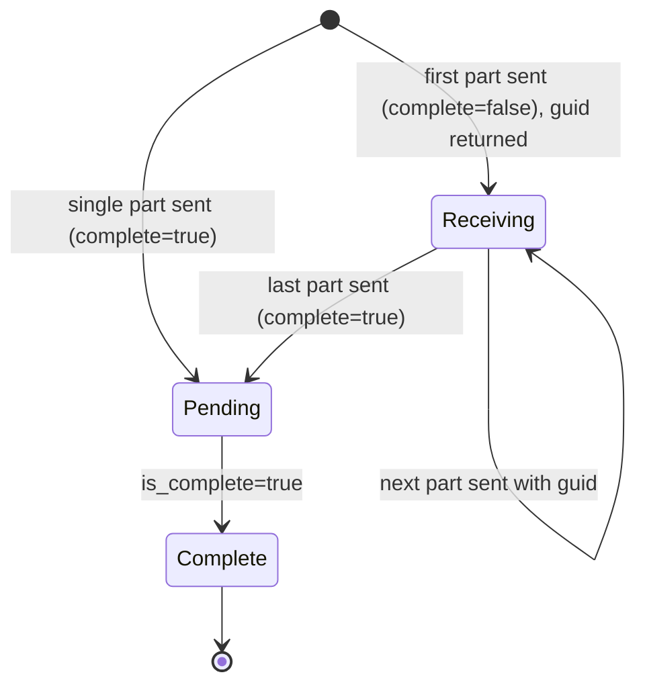

# Data Model: V5 Query and Batch Support

**Feature**: [spec.md](spec.md) | **Plan**: [plan.md](plan.md) | **Date**: 2026-10-16

This file lists the models that the V5 description file
(`schema/openapi/v5/v5/v5.swagger.json`) declares, and the hand-written
helper types. The generator makes the wire models from the description file.
Field names are the wire names, as in every other 2.x model. Sources: the
Kentik Knowledge Base Query API and Customization API pages, the V5 SDK on
`origin/main`, and the live check on 2026-10-16.

Rules for every wire model:

- No field uses the OpenAPI `enum` keyword (research R4). Each field
  description lists the known values.
- Every field is optional unless the API rejects a request without it.

## Query models (generated)

### QueryRequest

The request body of `top_x_data` and `query_url`.

| Field | Type | Notes |
| --- | --- | --- |
| `queries` | list of `QueryItem` | Required. One item for each series. |

### ChartRequest

The request body of `top_x_chart`. It has the fields of `QueryRequest` and
also:

| Field | Type | Notes |
| --- | --- | --- |
| `imageType` | string | Required. `svg` (default in the API), `png`, `jpg`, or `pdf`. |

### QueryItem

| Field | Type | Notes |
| --- | --- | --- |
| `query` | `Query` | Required. |
| `bucket` | string | Name of the series. The response groups rows by it. |
| `bucketIndex` | integer | 0 or more. |
| `isOverlay` | boolean | Chart and URL only. |

### Query

The model types the fields that the Kentik Query API documentation lists,
and keeps every other field it gets (`additionalProperties: true`, research
R5a). So every field of the V5 SDK's `Query`, and query JSON copied from
Data Explorer, reaches the API unchanged. `QueryItem` keeps unknown fields
in the same way.

| Field | Type | Notes |
| --- | --- | --- |
| `metric` | string | Required. For example `bytes`, `packets`, `fps`, `unique_src_ip`. |
| `dimension` | list of string | Required. Group-by dimensions, for example `Proto`, `AS_src`, `Traffic`. |
| `device_name` | string | Required in practice: the API returns 400 without it, even with `all_selected`. Comma-separated names. |
| `all_selected` | boolean | |
| `device_labels` | list of integer | Label IDs, not names. |
| `lookback_seconds` | integer | Overrides `starting_time` and `ending_time` unless 0. |
| `starting_time`, `ending_time` | string | `YYYY-MM-DD HH:mm:00`. Used when `lookback_seconds` is 0. |
| `time_format` | string | `UTC` or `Local`. URL only. |
| `topx` | integer | 1 to 40. |
| `depth` | integer | 25 to 250. |
| `outsort` | string | Aggregate name to sort by. |
| `fastData` | string | `Auto`, `Fast`, or `Full`. |
| `hostname_lookup` | boolean | |
| `cidr`, `cidr6` | integer | 0 to 32, 0 to 128. |
| `pps_threshold` | integer | |
| `filters_obj` | `QueryFilters` | |
| `saved_filters` | list of `SavedFilterRef` | |
| `aggregates` | list of `Aggregate` | |
| `matrixBy` | list of string | |
| `minsPolling`, `forceMinsPolling` | integer, boolean | |
| `reAggInterval`, `reAggFn` | integer, string | |
| `viz_type`, `show_overlay`, `overlay_day`, `sync_axes`, `query_title`, `descriptor` | various | Chart and URL options. |

### QueryFilters, FilterGroup, Filter, SavedFilterRef, Aggregate

| Model | Fields |
| --- | --- |
| `QueryFilters` | `connector` (string), `filterGroups` (list of `FilterGroup`) |
| `FilterGroup` | `connector` (string), `not` (boolean), `filters` (list of `Filter`) |
| `Filter` | `filterField` (string), `operator` (string), `filterValue` (string) |
| `SavedFilterRef` | `filter_id` (integer), `is_not` (boolean) |
| `Aggregate` | `name`, `column`, `fn` (string), `rank` (integer), `sample_rate` (number), `raw` (boolean) |

### TopXDataResponse and ResultBucket

| Model | Field | Type | Notes |
| --- | --- | --- | --- |
| `TopXDataResponse` | `results` | list of `ResultBucket` | |
| `ResultBucket` | `bucket` | string | |
| `ResultBucket` | `data` | list of `Dict[str, Any]` | One row per item. The keys depend on the query: the dimension columns, `key`, the aggregate columns, and `timeSeries` for top-X rows (research R5). |

### ChartResponse

| Field | Type | Notes |
| --- | --- | --- |
| `dataUri` | string | `data:<mime>;base64,<data>`. Decode it with `decode_chart()`. |

### Query URL response

A JSON string with a Data Explorer link. The wrapper returns `str`
(research R6).

## Batch models (generated)

### BatchPart

The request body of `batch_tags` and `batch_populators`.

| Field | Type | Notes |
| --- | --- | --- |
| `replace_all` | boolean | Required. If true, the API deletes every item that is not in `upserts`. |
| `complete` | boolean | Required. True on the last part only. |
| `upserts` | list of `BatchUpsert` | |
| `deletes` | list of `BatchDelete` | |
| `guid` | string | Empty on the first part. The `guid` from the first response on every later part. |

| Model | Fields |
| --- | --- |
| `BatchUpsert` | `value` (string, required), `criteria` (list of `BatchCriterion`) |
| `BatchCriterion` | `direction` (string: `src`, `dst`, or `either`; populators only) and `addr` (list of string, as in the Kentik sample). Every other match field passes through as given (`additionalProperties: true`, research R5a). The description text lists the known match fields: `port`, `protocol`, `tcp_flags`, `asn`, `lasthop_as_name`, `nexthop_asn`, `nexthop_as_name`, `nexthop`, `bgp_aspath`, `bgp_community`, `mac`, `country`, `vlans`, `device_name`, `device_type`, `site`, `interface_name`. |
| `BatchDelete` | `value` (string, required) |

Validation: one serialized part is at most 4 MB (Knowledge Base limit).
`split_batch()` enforces this. The generated model does not.

### BatchResponse

Status 202.

| Field | Type |
| --- | --- |
| `message` | string |
| `guid` | string |

### BatchStatus

The response of `batch_status`.

| Field | Type | Notes |
| --- | --- | --- |
| `guid` | string | |
| `custom_dimension` | `{id: integer, name: string}` | Populator batches only. |
| `is_multipart`, `is_complete`, `is_pending` | boolean | |
| `number_of_parts` | integer | Parts received so far. |
| `user` | `{id: integer, email: string}` | |
| `upserts` | `{total, applied, invalid, unchanged, over_limit}` (integers) | |
| `deletes` | `{total, applied, unchanged, invalid}` (integers) | |
| `replace_all` | `{requested: boolean, deletes_performed: integer, successful: boolean}` | |
| `batch_date` | string | |

### Batch state transitions

## Hand-written helper types

Module: `kentik_api.v5_tools` (base install).

| Type | Fields or signature | Notes |
| --- | --- | --- |
| `ChartImage` | `image_type: str`, `data: bytes` | From `decode_chart(response)`. |
| `BatchSendError(KentikError)` | `guid: str or None`, `sent: int`, `cause` | Raised by `send_batch()` when a part fails. Nothing is resent. |
| `BatchWaitTimeout(KentikError)` | `guid: str`, `last_status: BatchStatus or None` | Raised by `wait_for_batch()` when the time limit expires. |

Module: `kentik_api.devices` (base install).

| Type | Fields | Notes |
| --- | --- | --- |
| `DeviceLookup` | devices by ID and by name; interfaces by device and by SNMP ID or name | Built from V6 `device.list_devices` and `interface.list_interface`. `link_name(device, interface)` gives `device:interface`. `link_speed(...)` gives the speed in bits per second. `save(path)` and `load(path)` use JSON. |

Package: `kentik_api.analytics` (extra `analytics`).

| Type | Fields | Notes |
| --- | --- | --- |
| `QueryDefinition` | `query: QueryRequest`, `mapping: dict[str, ColumnMapping]` | Built from a dict or a YAML file (`yaml.safe_load`). `{start}` and `{end}` placeholders are filled at run time. A SQL definition or an `@fixup:` mapping raises `ValueError`. |
| `ColumnMapping` | `source: str`, `type: str`, `index: bool` | Column renames and types, as in the V5 mapping. |
| `DataFrameCache` | `directory: Path`, `step: timedelta` | One Parquet file for each query and time step. Fetches only missing steps, removes duplicate rows, and ignores files it did not write. |
| `flatness_analysis(...)` | same inputs and outputs as V5 | Uses `DeviceLookup` for link speeds. |
