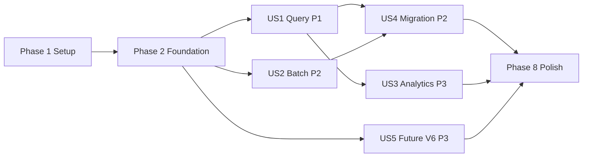

# Tasks: V5 Query and Batch Support in the Generated SDK

**Input**: Design documents from `/specs/005-v5-query-batch/`

**Prerequisites**: [plan.md](plan.md), [spec.md](spec.md), [research.md](research.md), [data-model.md](data-model.md), [contracts/](contracts/), [quickstart.md](quickstart.md)

**Tests**: Tests are required. FR-027 and FR-028 ask for them, and
constitution Principle IV requires exhaustive coverage of every generated
endpoint.

**Organization**: Tasks are grouped by user story so each story can be built
and checked on its own.

## Format: `[ID] [P?] [Story] Description`

- [P] marks tasks that can run in parallel (different files, no open
  dependency).
- [Story] maps a task to a user story (US1 to US5).
- Every task names a file path. Requirement IDs are in parentheses.
- Never hand-edit `src/kentik_api/gen/` or `src/kentik_api/client_mixin.py`.
  Change the generator, a template, or `schema/openapi/`, then run
  `make generate local`.

---

## Phase 1: Setup (Shared Infrastructure)

**Purpose**: Confirm the three open generator behaviors before any design
depends on them.

- [ ] T001 Write a throwaway OpenAPI 3 file in $TMPDIR with one dict-row response (`additionalProperties: true`), one string response, and one 202 response, run `openapi-python-generator` on it with `scripts/openapi_templates/`, and record in specs/005-v5-query-batch/research.md (R5, R6) whether the output is usable (FR-003)
- [ ] T002 Add a runtime test in tests/runtime/test_rest_runtime.py that a response with no `X-RateLimit-*` headers gives an empty `RateLimit` on the result and on an error, and record the result under R14 in specs/005-v5-query-batch/research.md (FR-006)
- [ ] T003 If T001 shows a gap, fix the template in scripts/openapi_templates/ or the post-processing in scripts/generation/fixup.py, with a generator test in tests/generator/test_fixup.py, so dict rows and a string body generate correctly (FR-003)
- [ ] T004 [P] Add the `analytics` optional extra (pandas>=2.3, pyarrow>=21, pyyaml>=6.0.2) to pyproject.toml, add it to the dev dependency group so `make test` can run analytics tests, and run `uv lock` to update uv.lock (FR-015)

---

## Phase 2: Foundational (Blocking Prerequisites)

**Purpose**: Teach the generator a second, repo-local schema base, mount its
services on a V5 REST transport, and give the client a V5 host. US1 and US2
both need this.

**Critical**: No user story work starts before this phase is complete.

### Tests for the foundation

- [ ] T005 [P] Add generator tests in tests/generator/test_parity.py: two bases with different services give the union and pass the parity check, the same service in both bases raises `RuntimeError`, and a broken local file fails `validate_schema_files_or_raise()` (FR-007)
- [ ] T006 [P] Add generator tests in tests/generator/test_wrapper_generation.py: a local service gets no gRPC branch and the mixin mounts it as `V5ServiceWrapper(self._v5_transport)` (FR-005, FR-007)
- [ ] T007 [P] Add generator tests in tests/generator/test_api_surface.py: `rest_only` is written for a local service, `SCHEMA_VERSION` is 8, and a version 7 record reads as `rest_only: false` (FR-008)
- [ ] T008 [P] Add client tests in tests/runtime/test_client_v5.py: region `us` and `eu` give the V5 base URLs, `v5_base_url` overrides them, a non-`https` URL raises `ConfigurationError`, `v5_api_config` shares credentials and timeouts, `close()` closes both transports, and httpx joins `https://api.kentik.com/api/v5` with `/query/topXdata` correctly (FR-006, FR-006a)

### Implementation for the foundation

- [ ] T009 Read a second OpenAPI base, `PROJECT_ROOT / "schema" / "openapi"`, in scripts/generate_sdk.py: validate it, select its files, take the union of services, raise on a duplicate service, skip proto lookup for it, and pass the local service set on (contracts/generator.md; FR-007)
- [ ] T010 Accept a list of bases in scripts/generation/parity.py where selection and validation need it, with relative imports only (FR-007)
- [ ] T011 Mount local services on `self._v5_transport` in the generated mixin in scripts/generation/wrapper_generation.py (FR-005)
- [ ] T012 [P] Record `rest_only` and bump `SCHEMA_VERSION` to 8 in scripts/generation/api_surface.py, reading older records as `rest_only: false` (FR-008)
- [ ] T013 [P] Write the REST-only example text for local services in scripts/generation/endpoint_docs.py, and mark them REST-only and name the local schema source in scripts/generation/docs_rendering.py, with tests in tests/generator/test_endpoint_docs.py and tests/generator/test_docs_rendering.py (FR-005)
- [ ] T014 Add `v5_base_url`, the V5 `APIConfig`, `self._v5_transport` (a `RestTransport` for every `protocol`), the `v5_api_config` property, and closing of both transports to src/kentik_api/client.py, with a regional V5 URL table next to `_REGION_ENDPOINTS` (contracts/client-config.md; FR-006, FR-006a)
- [ ] T015 Exempt `rest_only` services in tests/generated/test_grpc_stub_wiring.py by reading the flag from api_surface.json, not by a hard-coded name (FR-027)

**Checkpoint**: The generator and client accept a REST-only V5 service. Run
`make test-generator` and `make test-runtime`.

---

## Phase 3: User Story 1 - Query flow data from a V6 client (Priority: P1) 🎯 MVP

**Goal**: `client.v5.top_x_data`, `top_x_chart`, and `query_url` work on REST
and gRPC clients, with typed models and the 2.x errors.

**Independent Test**: Against a mocked API, a user runs a top-X data query, a
chart query, and a URL query, and gets result rows, image bytes, and a link.
A client created with `protocol="grpc"` gets the same results.

### Tests for User Story 1

- [ ] T016 [P] [US1] Add tests for `decode_chart()` in tests/runtime/test_v5_tools.py: SVG and PNG data URIs decode to bytes and type, and an invalid data URI raises `HTTPException` with status 502 and a clear message (FR-004)
- [ ] T017 [P] [US1] Add a smoke test in tests/smoke/test_client_mounts_and_calls.py that `client.v5` is mounted on REST and gRPC clients, uses a `RestTransport` on both, and sends a mocked `top_x_data` call to `https://api.kentik.com/api/v5/query/topXdata` (FR-005)
- [ ] T018 [P] [US1] Add a test in tests/generator/test_v5_description.py that schema/openapi/v5/v5/v5.swagger.json declares exactly the six operations in contracts/v5-service.md, uses no `enum` keyword, and declares no SQL path (FR-001, FR-010, FR-010a)

### Implementation for User Story 1

- [ ] T019 [US1] Write the query part of schema/openapi/v5/v5/v5.swagger.json: tag `QueryService`, operations for `POST /query/topXdata`, `POST /query/topXchart`, and `POST /query/url`, the models `QueryRequest`, `ChartRequest`, `QueryItem`, `Query`, `QueryFilters`, `FilterGroup`, `Filter`, `SavedFilterRef`, `Aggregate`, `TopXDataResponse`, `ResultBucket`, and `ChartResponse` from data-model.md, plain strings with documented values instead of enums, dict rows, and the statuses 400, 401, 403, 404, 429, and 500 on each operation (FR-001, FR-002, FR-003, FR-010)
- [ ] T020 [US1] Run `make generate local`, then check that src/kentik_api/gen/v5/ exists and that the new public_names.json entries name the service `v5` and the methods `top_x_data`, `top_x_chart`, and `query_url`; set the keys by hand in public_names.json if the naming rule gave other names, and regenerate (FR-008, FR-009)
- [ ] T021 [US1] Implement `ChartImage` and `decode_chart()` in src/kentik_api/v5_tools.py (contracts/helpers.md; FR-004)
- [ ] T022 [US1] Run `make test-generated` and confirm that tests/generated/test_wrapper_contracts.py, tests/generated/test_endpoint_schema_coverage.py, and tests/generated/test_schema_operations.py cover every query operation, field, and declared status; fix gaps in the generator or tests/_discovery.py, never by narrowing a suite (FR-027, SC-007)
- [ ] T023 [US1] Add tests/e2e/test_v5_query_e2e.py (marker `e2e`): `top_x_data` and `query_url` with the first device name from `device.list_devices`, and `top_x_chart` as `xfail(raises=TransportError, strict=False)` with a short timeout from `client.v5_api_config.with_timeout()` (FR-028)
- [ ] T024 [US1] Commit public_names.json, api_surface.json, schema_operations.json, and the regenerated tree, and add an Unreleased entry for the new `v5` service to CHANGELOG.md, naming each change as the `API SURFACE CHANGED` alert does (FR-008)

**Checkpoint**: US1 works on its own. Run quickstart steps 1 to 3 and 5.

---

## Phase 4: User Story 2 - Bulk-sync flow tags and populators (Priority: P2)

**Goal**: Send a batch of flow tags or populators, split by size, wait for
the result, and never resend.

**Independent Test**: Against a mocked API, a user splits a set, sends the
parts, waits for completion, and reads the final status.

### Tests for User Story 2

- [ ] T025 [P] [US2] Add tests for `split_batch()` in tests/runtime/test_v5_tools.py: every part is at most `max_bytes`, only the last part is `complete`, deletes go in the last part, and one upsert larger than `max_bytes` raises `ValueError`; include 10,000 upserts in no more than 100 parts (FR-013, SC-004)
- [ ] T026 [P] [US2] Add tests for `send_batch()` in tests/runtime/test_v5_tools.py: the first `guid` is copied into later parts, a failure in part 2 raises `BatchSendError` with `sent == 1` and the `guid`, and no part is sent twice (FR-014)
- [ ] T027 [P] [US2] Add tests for `wait_for_batch()` in tests/runtime/test_v5_tools.py with a fake clock: it returns the status when `is_complete` becomes true, raises `BatchWaitTimeout` with the last status after `timeout`, and raises a status-call error at once (FR-012, FR-014)

### Implementation for User Story 2

- [ ] T028 [US2] Add the batch part of schema/openapi/v5/v5/v5.swagger.json: tag `BatchService`, operations for `POST /batch/tags` (202), `POST /batch/customdimensions/{dimensionName}/populators` (202), and `GET /batch/{guid}/status` (200), the models `BatchPart`, `BatchUpsert`, `BatchCriterion`, `BatchDelete`, `BatchResponse`, and `BatchStatus` with its nested counts from data-model.md, and the error statuses as in T019 (FR-011)
- [ ] T029 [US2] Run `make generate local`, confirm the method names `batch_tags`, `batch_populators`, and `batch_status` in public_names.json, and rerun `make test-generated` for full coverage of the batch operations (FR-008, FR-027)
- [ ] T030 [US2] Implement `split_batch()`, `send_batch()`, `wait_for_batch()`, `BatchSendError`, and `BatchWaitTimeout` in src/kentik_api/v5_tools.py (contracts/helpers.md; FR-012, FR-013, FR-014)
- [ ] T031 [US2] Add tests/e2e/test_v5_batch_e2e.py (marker `e2e`, mutating): upsert one disposable flow tag value, wait, then delete it in a second batch inside `finally`, and assert both statuses; call it out as mutating coverage in the pull request description (FR-028)
- [ ] T032 [US2] Add the batch service to the CHANGELOG.md Unreleased entry and commit the regenerated tree with public_names.json and api_surface.json (FR-008)

**Checkpoint**: US1 and US2 work on their own.

---

## Phase 5: User Story 4 - Migrate a V5 script with little friction (Priority: P2)

**Goal**: Every V5 call has a documented 2.x equivalent, and the ported
examples run.

**Independent Test**: A reviewer ports each V5 query, batch, and analytics
example from `origin/main` with only the migration guide and the 2.x
examples.

### Tests for User Story 4

- [ ] T033 [P] [US4] Add tests/smoke/test_examples_v5.py that imports each script in examples/v5/ and runs it against a mocked API, so the test fails when an example no longer matches the SDK (FR-024)

### Implementation for User Story 4

- [ ] T034 [P] [US4] Write the V5 to 2.x map in docs/sphinx/guides/migrating-from-1x.md: every V5 call from reports/v5-feature-parity-audit.md (including the endpoints that already have a V6 equivalent), old and new field names, and a reason for each call with no equivalent, such as the retired SQL endpoint (FR-023, SC-001)
- [ ] T035 [P] [US4] Write docs/sphinx/guides/v5.md: what `client.v5` covers, that it is a bridge until the V6 query service ships, the V5 host and `v5_base_url`, the chart call marked as not verified, and a section "Test the chart call by hand" with the steps, the timeout, and how to report the result; add it to the toctree in docs/sphinx/index.md (FR-004, FR-004a, FR-025, SC-008)
- [ ] T036 [P] [US4] Update docs/sphinx/guides/rate_limiting.md: V5 calls report no quota, and a 429 retry recipe with a fixed backoff that does not need quota headers (FR-026)
- [ ] T037 [US4] Port examples/queries_example.py and examples/batch_example.py from origin/main to examples/v5/query.py and examples/v5/batch.py, and list them in examples/README.md (FR-024, SC-002)

**Checkpoint**: The migration path is documented and the ported examples
pass their test.

---

## Phase 6: User Story 3 - Analyze query results with pandas (Priority: P3)

**Goal**: The `analytics` extra gives back the V5 DataFrame, definition,
cache, and flat-traffic features, safely.

**Independent Test**: With the extra installed, a user loads a V5 YAML
definition, gets a DataFrame for a time range from a mocked API, caches it,
and runs the flat-traffic analysis.

### Tests for User Story 3

- [ ] T038 [P] [US3] Add tests in tests/analytics/test_definitions.py: a V5 dict and YAML definition load and fill `{start}` and `{end}`, a top-X result becomes one DataFrame for each bucket with typed columns and a time index, an empty result gives an empty DataFrame with the expected columns, a SQL definition raises the retirement error, and an `@fixup:` mapping raises `ValueError` without running code (FR-016, FR-017, FR-018, SC-005)
- [ ] T039 [P] [US3] Add tests in tests/analytics/test_cache.py: only missing time steps are fetched, duplicate rows are removed, a file the cache did not write is ignored, and the files are Parquet (FR-019, SC-005)
- [ ] T040 [P] [US3] Add tests in tests/analytics/test_flatness.py that compare the output with the V5 `flatness_analysis` on the same input DataFrame (FR-020, SC-003)
- [ ] T041 [P] [US3] Add tests in tests/runtime/test_device_lookup.py: lookup by ID and by name, link names, link speeds, and a JSON round trip with `save()` and `load()` (FR-021, SC-005)
- [ ] T042 [P] [US3] Add a test in tests/smoke/test_analytics_extra.py that, with pandas hidden, `import kentik_api.analytics` raises `ImportError` naming `kentik-api[analytics]` and `import kentik_api` still works (FR-022)

### Implementation for User Story 3

- [ ] T043 [P] [US3] Implement `DeviceLookup` in src/kentik_api/devices.py on the V6 `device` and `interface` services, with JSON `save()` and `load()` (contracts/helpers.md; FR-021)
- [ ] T044 [US3] Create src/kentik_api/analytics/__init__.py with the import guard that names the extra (FR-022)
- [ ] T045 [US3] Implement `QueryDefinition` and `ColumnMapping` in src/kentik_api/analytics/definitions.py with `yaml.safe_load`, the placeholder fill, the SQL and `@fixup:` errors, and `get_data()` on `client.v5.top_x_data` (FR-016, FR-017, FR-018)
- [ ] T046 [US3] Implement `DataFrameCache` in src/kentik_api/analytics/cache.py with Parquet files through pyarrow (FR-019)
- [ ] T047 [US3] Port `flatness_analysis` to src/kentik_api/analytics/flatness.py on `DeviceLookup` (FR-020)
- [ ] T048 [US3] Port examples/analytics_example_topx.py from origin/main to examples/v5/analytics_topx.py, add it to tests/smoke/test_examples_v5.py, and document the extra and the helpers in docs/sphinx/guides/v5.md (FR-024, SC-002)

**Checkpoint**: US3 works with the extra and fails cleanly without it.

---

## Phase 7: User Story 5 - Move to the V6 query service when it ships (Priority: P3)

**Goal**: A future V6 query service arrives from a schema update with no
change to a `v5` public name.

**Independent Test**: A reviewer adds a fake V6 query service to a test
schema, regenerates, and sees both services with no public name change.

- [ ] T049 [US5] Add a generator test in tests/generator/test_public_names.py that adds a fake upstream `query` service next to the local `v5` service and asserts that both resolve, that no `v5` entry changes, and that no `NameDriftError` is raised (SC-006)
- [ ] T050 [US5] Add to docs/sphinx/guides/v5.md a "When the V6 query service ships" section that says the `v5` calls keep working until Kentik retires the endpoints and that this guide will name the V6 replacement of each call (FR-025)

**Checkpoint**: All user stories work on their own.

---

## Phase 8: Polish & Cross-Cutting Concerns

**Purpose**: Gates, project docs, and the audit trail.

- [ ] T051 [P] Describe the second schema base, `rest_only` services, and `_v5_transport` in CLAUDE.md, docs/sphinx/guides/generation.md, scripts/generation/README.md, and tests/README.md (FR-007)
- [ ] T052 [P] Mark follow-up item 1 and the query and batch rows as done in reports/v5-feature-parity-audit.md
- [ ] T053 Check that the mocked suites still catch a regression: break the V5 host in src/kentik_api/client.py, confirm that `make test` fails, restore it, and record the result for the pull request (Principle IV; FR-027)
- [ ] T054 Run `make lint`, `make typecheck`, `make check-specs`, `make check-changelog SINCE=HEAD`, `make test`, and `uv run sphinx-build -W --keep-going -b html docs/sphinx docs/build/html`, and fix every failure (SC-007, SC-008)
- [ ] T055 Run quickstart.md steps 1 to 5 and record the results in specs/005-v5-query-batch/quickstart.md (SC-001)

---

## Dependencies & Execution Order

### Phase dependencies

- Phase 1 (Setup): no dependency. T003 depends on T001.
- Phase 2 (Foundational): depends on Phase 1. It blocks every user story.
- Phase 3 (US1): depends on Phase 2.
- Phase 4 (US2): depends on Phase 2. T028 edits the same file as T019, so do
  it after T019.
- Phase 5 (US4): T034 and T036 can start after Phase 2. T035 needs US1 for the
  chart facts. T037 needs US1 and US2.
- Phase 6 (US3): T043 needs only Phase 2. T045 to T048 need US1.
- Phase 7 (US5): T049 needs Phase 2. T050 needs T035.
- Phase 8: after the stories that you deliver.

### Story completion order



### Within each story

- Write the tests first and see them fail.
- The description file comes before `make generate local`. Regeneration
  comes before helper code that imports generated models.

## Parallel Opportunities

- Phase 1: T004 runs next to T001 to T003.
- Phase 2: T005 to T008 run together. T012 and T013 run next to T009 to T011.
- US1: T016, T017, and T018 run together.
- US2: T025, T026, and T027 run together (one file, separate test
  functions; merge with care).
- US4: T034, T035, and T036 run together.
- US3: T038 to T042 run together. T043 runs next to T044.

### Parallel example: User Story 1

```text
T016 tests for decode_chart in tests/runtime/test_v5_tools.py
T017 smoke test for client.v5 in tests/smoke/test_client_mounts_and_calls.py
T018 description file test in tests/generator/test_v5_description.py
```

### Parallel example: User Story 3

```text
T038 tests/analytics/test_definitions.py
T039 tests/analytics/test_cache.py
T040 tests/analytics/test_flatness.py
T041 tests/runtime/test_device_lookup.py
T042 tests/smoke/test_analytics_extra.py
```

## Implementation Strategy

### MVP first (User Story 1 only)

1. Complete Phase 1 and Phase 2.
2. Complete Phase 3 (US1).
3. Stop and check: quickstart steps 1 to 3 and 5. The V5 query users can
   upgrade at this point.

### Incremental delivery

1. Foundation, then US1: queries (MVP).
2. US2: batches.
3. US4: migration guide and examples. Release notes are complete here.
4. US3: analytics extra.
5. US5: future-proofing test and docs.
6. Polish.

Each step leaves `make test` green and can merge into `feat/v6-sdk` on its
own with `git merge --no-ff`.
