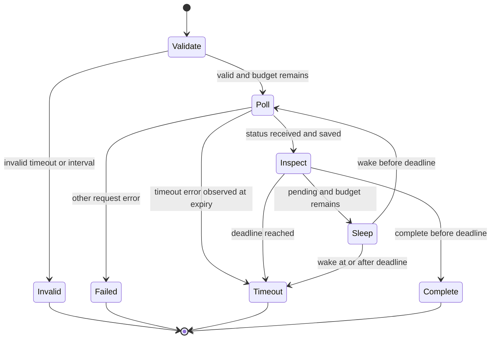

# Data Model: Runtime Boundary Fixes

This design adds no persistent model or public class.
It refines state owned by the existing configuration, batch helper, and
cache. See [the plan](plan.md) for module ownership.

## Configuration State

| State | Type | Ownership And Meaning |
| --- | --- | --- |
| Private timeout snapshot | `httpx.Timeout` | Validated, owned by one configuration |
| Public `rest_timeout` | `httpx.Timeout` | Detached snapshot on each read |
| Existing `rest_deadline` | `float` or `None` | Relative scalar duration, not an instant |
| Private wait deadline | `float` or `None` | Absolute monotonic instant, local to a copy |
| Existing pool owner | `APIConfig` or `None` | Root connection owner, shared by copies |
| Existing quota map | `dict` | Shared with the root configuration |

The constructor distinguishes scalar from per-phase input before copying.
Every phase must be finite and positive, as existing validation requires.
The private snapshot never aliases the caller's input or a getter result.
Two configurations built from one input still own separate snapshots.

A public timeout-only copy owns independent timeout values but borrows
the root connection. Closing it remains a no-op for pool ownership.
Security fields and the gRPC limit keep their existing derivation rules.
Read-only public assignment retains its existing `AttributeError` message.

The private wait-deadline derivation method uses the same ownership path.
Further copies retain the earlier attached wait deadline. No copy can
extend the wait by resetting a relative duration.

## Effective Request Limits

The configuration computes effective values for one request, not new
persistent settings. It does so after request preparation and lazy client
resolution, immediately before dispatch inside the runtime's error guard.

The calculation follows these rules:

1. Read fresh monotonic time after client setup.
2. Convert the scalar duration from the original request-start instant.
3. Choose the earlier of that instant and the attached wait deadline.
4. If the attached deadline is exhausted, fail before HTTP dispatch.
5. If a total deadline exists, cap each phase at its remaining duration.
6. Otherwise, retain the existing per-phase limits.
7. Put the chosen absolute instant in the existing deadline extension.

Absent limits do not participate in the comparison. A tighter phase
limit remains tighter. No calculation writes back into the origin.
The call's effective values and total instant do not alter the stored
scalar-versus-per-phase meaning of its public configuration.

## Batch Wait State

| State | Type | Meaning |
| --- | --- | --- |
| Batch ID | `str` | The submitted batch, never resent by this helper |
| Wait deadline | `float` | One monotonic instant for the whole wait |
| Poll interval | `float` | Finite, positive maximum time between polls |
| Latest status | `BatchStatus` or `None` | Last received status, including a late one |
| Deadline copy | `APIConfig` | Borrows the V5 pool and carries the same instant |

Validate timeout and interval before accessing the transport or sleeping.
Expiry means that current monotonic time equals or exceeds the deadline.
Remaining budget must be positive before a poll or sleep begins.

The diagram describes control flow, not a promise of forced interruption.
Blocking work can return after the deadline. The next execution point
rejects late success. A request timeout observed at expiry becomes
`BatchWaitTimeout`. The original `TransportError` remains its cause,
which in turn retains the HTTPX timeout cause.

All non-timeout errors keep their identity. A timeout observed before
the deadline also keeps its identity. No exception text determines type.

## Cache Refresh State

The cache keeps its existing Parquet layout and timestamp format.
The refresh compares the newest cached time against the current UTC time
rounded to a minute. This is separate from the monotonic batch clock.

| Cache State | Refresh Interval | Outcome |
| --- | --- | --- |
| Empty | Existing initial range | Query and return the existing result |
| Behind current time | Newest cached time to current minute | Query only that range |
| Current | Empty | Return `None` without query or file change |
| Ahead of current time | Reversed | Return `None` without query or file change |

No-op refreshes do not read and return earlier cached data implicitly.
Callers can still use `get()` for that purpose. Explicit invalid ranges
retain their validation errors. Query results with no data keep their
existing handling, distinct from a missing positive interval.
