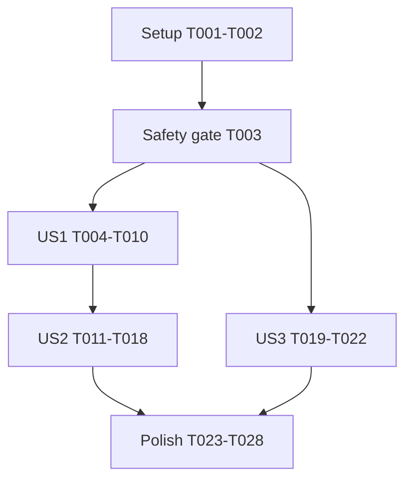

# Tasks: Runtime Boundary Fixes

Input: [Specification](spec.md), [plan](plan.md), [research](research.md),
[data model](data-model.md), [runtime contract](contracts/runtime-behavior.md),
and [validation guide](quickstart.md).

Branch: `fix/008-runtime-boundaries`.

Tests are required by FR-017. Write each story's regression tests before
its fix. Record a failure that matches the original defect, not merely
a missing private method. Keep every task unchecked until its work and
required evidence are complete.

## Format And Paths

Each task has a checkbox, sequential ID, optional `[P]`, story label when
applicable, and exact file paths. `[P]` identifies independent file work
within a stated dependency barrier. It does not bypass that barrier.
Paths in task descriptions are relative to the repository root.
Keep new IDs stable once implementation starts. Use letter suffixes for
later insertions rather than renumbering existing tasks.

## Phase 1: Setup

Purpose: Use the existing project environment without changing tooling.

- [X] T001 Confirm the feature branch, run `uv sync --locked`, and list
  existing poe tasks from [pyproject.toml](../../pyproject.toml). Do not
  update dependencies, the lockfile, or credentials.
- [X] T002 Run the existing mocked suite, type check, and lint check.
  Record commands, interpreter, platform, and baseline results in
  [specs/008-runtime-boundaries/quickstart.md](quickstart.md). Keep the
  existing warnings in completed specs distinct from new failures.

## Phase 2: Foundational Safety Gate

Purpose: Establish compatibility and safe test boundaries before editing.
No new infrastructure is needed. Complete this gate before any story.

- [X] T003 Confirm current signatures, defaults, timeout types, V5
  configuration ownership, and the helper import guard against
  [specs/008-runtime-boundaries/contracts/runtime-behavior.md](contracts/runtime-behavior.md)
  and [tests/smoke/test_helpers_no_direct_http.py](../../tests/smoke/test_helpers_no_direct_http.py).
  Record the signature baseline in the contract. Keep every HTTP call on
  generated operations and shared runtimes, with no generated changes,
  new dependencies, credential-file access, or live tests
  (FR-015, FR-016).

Checkpoint: Existing boundaries and baseline are known. US1 and US3 can
start. US2 waits for US1 because both change configuration ownership.

## Phase 3: US1 - Stable Timeout Settings (P1, MVP)

Goal: External timeout objects cannot mutate accepted request settings.

Independent test: Mutate supplied and returned objects across all four
phases. Actual mocked requests retain their accepted values and existing
deadline meaning, while timeout copies retain the same pool owner.

### Tests Before The Fix

- [X] T004 [P] [US1] Add isolation tests to
  [tests/runtime/test_api_config.py](../../tests/runtime/test_api_config.py).
  Cover connect, read, write, and pool with unequal initial values.
  Mutate constructor inputs, getter results, explicit refinement inputs,
  parents, children, siblings, and further copies. Include another
  positive value, `None`, zero, negative values, NaN, and both infinities.
  Keep validation, scalar-versus-object semantics, and read-only errors
  asserted (FR-001, FR-002, FR-003, FR-004).
- [X] T005 [P] [US1] Extend
  [tests/runtime/test_rest_runtime.py](../../tests/runtime/test_rest_runtime.py)
  to capture effective phase values and deadline extensions before and
  after lazy client creation. Replace request-forwarding identity
  assertions with equal values and detached snapshots. Make the original
  input-mutation defect fail through the real request runtime
  (FR-001, FR-002, FR-004, FR-017).
- [X] T006 [P] [US1] Extend
  [tests/smoke/test_client_mounts_and_calls.py](../../tests/smoke/test_client_mounts_and_calls.py)
  for V5 and V6 configurations constructed from one timeout object.
  Replace the old timeout identity assertion with value equality and
  isolation. Assert unchanged public types and transport defaults
  (FR-001, FR-002, FR-015).
- [X] T007 [P] [US1] Extend
  [tests/runtime/test_connection_reuse.py](../../tests/runtime/test_connection_reuse.py)
  to retain pool ownership, quota identity, borrower close behavior,
  host, credentials, and TLS settings across isolated timeout copies.
  Include mixed REST and gRPC refinements (FR-003, FR-004).
- [X] T008 [US1] Run the US1 focused commands from
  [specs/008-runtime-boundaries/quickstart.md](quickstart.md) before
  implementation. Record exact failing test IDs and assertion output
  for supplied and returned-object mutation. Keep unrelated existing
  failures separate and do not weaken assertions (FR-017, SC-004).

### Implementation And Acceptance

- [X] T009 [US1] Update
  [src/kentik_api/core/api_config.py](../../src/kentik_api/core/api_config.py)
  to copy timeout input before validation, own a private snapshot, and
  return a fresh `httpx.Timeout` from the existing property. Preserve
  scalar deadlines, per-phase values, signatures, the read-only assignment
  error, independent copies, and shared resource ownership. Replace both
  constructor and refinement identity assertions in
  [tests/runtime/test_api_config.py](../../tests/runtime/test_api_config.py)
  with value equality and explicit isolation (FR-001 to FR-004, FR-015).
- [X] T010 [US1] Rerun the US1 focused suites twice and the existing
  scalar deadline cases. Record green results after the red evidence in
  [specs/008-runtime-boundaries/quickstart.md](quickstart.md). Make sure
  that the original mutation no longer changes a real request and that
  pool ownership remains unchanged (SC-001, SC-004).

Checkpoint: US1 is independently usable and is the suggested MVP.
Do not begin US2 source changes until this checkpoint passes.

## Phase 4: US2 - Whole Batch Wait Deadline (P1)

Goal: One cooperative deadline governs polling, request limits, results,
and sleeps without relaxing tighter client settings.

Independent test: A controlled clock proves that no poll starts at
expiry, late completion never succeeds, and generated requests receive
the same absolute deadline with every tighter phase limit preserved.

### Tests Before The Fix

- [X] T011 [P] [US2] Extend
  [tests/runtime/test_v5_batch_wait.py](../../tests/runtime/test_v5_batch_wait.py)
  with one controlled clock and no real sleeps. Cover zero, negative,
  NaN, and infinite parameters, completion before/equal/after expiry,
  exhausted sleeps, interval capping, first and later request timeouts,
  late native timeouts,
  non-timeout errors delivered late, latest status, full cause chains,
  and no retries or batch resends. Include a client timeout that expires
  at 0.5 seconds but is delivered at 1.2 seconds against a one-second
  batch deadline. Expect `BatchWaitTimeout` with the full cause chain.
  If delivered at 0.5 seconds, expect the original error unchanged.
  Update fake clients to accept overrides
  while asserting their values. Invalid parameters must fail before
  configuration access, requests, or sleeps (FR-005, FR-006, FR-007,
  FR-009, FR-010, FR-011).
- [X] T012 [P] [US2] Add offline integration cases in
  [tests/runtime/test_rest_deadline.py](../../tests/runtime/test_rest_deadline.py)
  through `wait_for_batch`, the generated status operation, and the real
  REST runtime. Capture shrinking budgets, the absolute extension,
  tighter scalar and unequal phase limits, original scalar start time,
  and lazy setup that exhausts the budget before HTTP dispatch.
  Share the fake monotonic clock across all three modules. Include a
  controlled response stream and unchanged non-batch deadline behavior
  (FR-004, FR-006, FR-008, FR-016, FR-017).
- [X] T013 [P] [US2] Extend
  [tests/runtime/test_connection_reuse.py](../../tests/runtime/test_connection_reuse.py)
  to inspect status-call configuration overrides. Assert V5 origin,
  unchanged persistent settings, shared pool and quota ownership, and
  preserved absolute deadlines through further timeout-only copies,
  including explicit relative timeout resets (FR-003, FR-008, FR-015).
- [X] T014 [US2] Run the batch and generated-path regression cases before
  implementing US2. Record late success, an extra expired poll, and
  missing request-budget failures in
  [specs/008-runtime-boundaries/quickstart.md](quickstart.md).
  Missing private APIs alone are not acceptable red evidence
  (FR-017, SC-004).

### Implementation And Acceptance

- [X] T015 [US2] Extend
  [src/kentik_api/core/api_config.py](../../src/kentik_api/core/api_config.py)
  with private absolute wait-deadline state and timeout-only derivation.
  Add private effective-limit calculation that preserves all tighter
  phases, the original scalar request-start instant, inherited absolute
  bounds, and pool ownership. Keep HTTPX timeout-cause recognition in
  core without exception-text matching or new public arguments
  (FR-003, FR-004, FR-006, FR-008, FR-010, FR-015).
- [X] T016 [US2] Update
  [src/kentik_api/core/rest_runtime.py](../../src/kentik_api/core/rest_runtime.py)
  to retain the original scalar start point, resolve lazy client setup,
  and then calculate fresh effective limits inside the existing
  request-error guard. Reject exhausted wait budgets before dispatch and
  forward the selected absolute extension without restarting it. Keep
  calls without a wait override unchanged (FR-004, FR-006, FR-008, FR-016).
- [X] T017 [US2] Update `wait_for_batch` in
  [src/kentik_api/v5_tools.py](../../src/kentik_api/v5_tools.py).
  Validate finite positive parameters first, derive the V5 deadline copy,
  guard every poll and sleep, save received status before the expiry
  test, and accept completion only before the deadline. Translate only
  timeout-caused `TransportError` observed at or after expiry, with its
  cause intact. Preserve earlier timeouts and every non-timeout error.
  Add no HTTPX/runtime import or helper retry (FR-005 to FR-011, FR-016).
- [X] T018 [US2] Run the US2 focused commands twice, the configuration
  ownership cases, and the helper import guard. Record exact green test
  IDs and generated-path limit observations in
  [specs/008-runtime-boundaries/quickstart.md](quickstart.md).
  Make sure that all deadline-equality, error-identity, and no-dispatch
  assertions pass without claiming hard cancellation (SC-002, SC-004).

Checkpoint: US1 and US2 pass together. The generated status operation
still uses the same shared connection path and public signature.

## Phase 5: US3 - Current Cache Refresh (P2)

Goal: A refresh with no positive time interval returns `None` without
querying or changing files. US3 does not depend on US1 or US2.

Independent test: With a fixed UTC clock, two same-minute refreshes make
one query. The second returns `None`, existing files remain readable,
and advancing one minute queries exactly the new interval.

### Tests Before The Fix

- [X] T019 [P] [US3] Extend
  [tests/analytics/test_cache.py](../../tests/analytics/test_cache.py)
  with a fixed clock and temporary Parquet files. Cover the initial
  range, same-minute and future-end no-ops, query counts, file names and
  bytes, later `get()` reads, and next-minute advancement. Retain explicit
  range validation, empty-query results, stepping, deduplication, and
  keyword forwarding (FR-012, FR-013, FR-014, FR-017).
- [X] T020 [US3] Run the new cache regressions on the original cache
  implementation. Record the same-minute `ValueError` and future-range
  failure in [specs/008-runtime-boundaries/quickstart.md](quickstart.md).
  Serialize this evidence edit with other story evidence edits
  (FR-017, SC-004).

### Implementation And Acceptance

- [X] T021 [US3] Add the no-positive-range guard to `fetch_latest` in
  [src/kentik_api/analytics/cache.py](../../src/kentik_api/analytics/cache.py).
  Return `None` when the newest cache time equals or exceeds the current
  rounded minute, before delegating to `fetch()`. Keep initial ranges,
  explicit validation, formats, stepping, and deduplication unchanged
  (FR-012, FR-013, FR-014, FR-015).
- [X] T022 [US3] Run the cache-focused suite twice and record green
  results in [specs/008-runtime-boundaries/quickstart.md](quickstart.md).
  Make sure that same-minute refreshes total one query, no-op file bytes
  stay unchanged, and the next refresh queries exactly the missing minute
  (SC-003, SC-004).

Checkpoint: All three original defects have red and green evidence.

## Phase 6: Polish And Cross-Cutting Checks

Purpose: Document corrections and validate the complete change.
Start after all story checkpoints. Parallel documentation tasks edit
different files. Finish them before the final checks.

- [X] T023 [P] Document detached timeout reads, unchanged public types,
  scalar versus per-phase semantics, and cooperative timing in the
  hand-written prose of [docs/sphinx/guides/rest.md](../../docs/sphinx/guides/rest.md)
  and [docs/sphinx/guides/quickstart.md](../../docs/sphinx/guides/quickstart.md).
  Leave generated marker blocks unchanged (FR-018).
- [X] T024 [P] Update [docs/sphinx/guides/v5.md](../../docs/sphinx/guides/v5.md)
  with the batch deadline, invalid parameter errors, observation-time
  classification, retained error causes, and `fetch_latest()` returning
  `None` for current or future cache times. Preserve existing examples
  unless a corrected contract requires a change (FR-018).
- [X] T025 [P] Add Unreleased entries to [CHANGELOG.md](../../CHANGELOG.md)
  for timeout isolation, batch wait limits and invalid parameter handling,
  and no-op cache refreshes. Call out behavior corrections without
  claiming a new public signature or a hard timing guarantee (FR-018).
- [X] T026 Compare final signatures, defaults, types, and exception
  attributes with the baseline in
  [specs/008-runtime-boundaries/contracts/runtime-behavior.md](contracts/runtime-behavior.md).
  Review the complete diff for generated or schema changes, dependency
  churn, direct HTTP, credential handling, or debug artifacts. Confirm
  that only the four planned source modules changed (FR-015, FR-016).
- [X] T027 Run `uv run poe test`, `uv run poe typecheck`,
  `uv run poe lint-check`, `uv run poe check-specs`,
  `uv run poe docs-build`, and `git diff --check`. Record results and
  existing-only spec warnings in
  [specs/008-runtime-boundaries/quickstart.md](quickstart.md).
  Retain all generated operation and option coverage. Make sure that
  the evidence edit itself passes lint (SC-005).
- [X] T028 Summarize red/green evidence, local Python and OS coverage,
  available CI results, and any unverified platform gates in
  [specs/008-runtime-boundaries/quickstart.md](quickstart.md). Do not
  claim an unavailable platform result. Confirm the absence of new real
  sleeps, live API calls, credential-file access, persistent debug files,
  and dependency changes. Do not commit, push, or open a PR automatically
  (FR-016, FR-017, SC-004, SC-005).

## Dependencies And Execution Order

The default execution order is T001 through T028. Exceptions are limited
to the independent work groups below. Tests precede fixes in every story.
No task is complete merely because a command was proposed.

The source dependency is US1 before US2. The cache has no source overlap.
Shared evidence edits to the validation guide must be serialized even
when story code or tests run in parallel.

Within US1, complete T004-T007 before T008, then T009 and T010.
Within US2, complete T011-T013 before T014, then T015, T016, T017,
and T018 in order. Within US3, follow T019 through T022.
Finish T023-T025 before T026, T027, and T028 in order.

## Parallel Execution Examples

### US1

After T003, write T004, T005, T006, and T007 together. Each owns a
different existing test file. Join at T008 before implementing T009.
Do not run overlapping edits to the same test file.

### US2

After T010, write T011, T012, and T013 together. These own batch wait,
deadline integration, and connection ownership test files respectively.
Join at T014. Keep the three source implementation tasks sequential.

### US3

After T003, T019 can run beside the US1 test group. T021 can run beside
US2 source work after its own red evidence in T020. There is no useful
within-story file parallelism because this story has one test file and
one source file. Serialize validation-guide edits.

### Documentation

After all story checkpoints, T023, T024, and T025 can run together.
They own different guide and release-note files. Join before final gates.

## Implementation Strategy

The MVP is US1: finish setup, the safety gate, and T004-T010.
Demonstrate timeout isolation without waiting for either helper fix.
Then complete US2 for bounded polling and US3 for safe refreshes.
US3 can proceed independently when file ownership permits.

Deliver each story only after its original failure is captured and its
focused checks pass twice. Keep deadline policy and no-op return values
consistent with the runtime contract. Finish documentation, full offline
gates, and an honest coverage summary before declaring the work complete.

This command generates tasks only. It does not execute implementation,
run live tests, change source, or authorize remote actions.

## Phase 7: Convergence

Assessment date: 2026-10-21. F1 is a medium-severity evidence gap.
The current implementation and offline quality gates pass. Existing task
markers remain unchanged. Only the documentation work below remains.

- [X] T029 Complete the regression evidence in
  [specs/008-runtime-boundaries/quickstart.md](quickstart.md) per
  T008, T014, T018, FR-017, and SC-004 (partial). Record exact pytest
  node IDs and representative observed assertion output for each original
  timeout-isolation, batch-deadline, and cache-refresh failure. Include
  the corresponding passing test IDs, commands, and results. Use actual
  captured output or a clearly labeled isolated reproduction, not invented
  historical results. Preserve the implementation and existing evidence.
  Run `uv run poe lint-check` and `uv run poe check-specs` afterward.
