<!-- HAND-WRITTEN: not modified by [`uv run poe generate`](../../pyproject.toml). Edit directly. -->

# `kentik_api` Package

The top-level package for the Kentik Community Python SDK. See the
repository root [README.md](../../README.md) for installation and
usage, and [AGENTS.md](../../AGENTS.md) for the full
hand-written-vs-generated architecture.

## Layout

| Path | Role |
| --- | --- |
| [`client.py`](client.py) | Hand-written. `KentikAPI`, the SDK's entrypoint: loads credentials, picks a transport, mounts every generated service. |
| [`client_mixin.py`](client_mixin.py) | Generated. Mounts every service wrapper onto `KentikAPI` as a typed attribute (`client.device`, `client.user`, and so on). |
| [`auth/`](auth/README.md) | Hand-written. See [auth/README.md](auth/README.md). |
| [`core/`](core/README.md) | Hand-written. The shared REST and gRPC runtimes every generated call routes through. See [core/README.md](core/README.md). |
| [`errors/`](errors/README.md) | Hand-written. The base exception hierarchy every generated error class builds on. See [errors/README.md](errors/README.md). |
| [`transports/`](transports/README.md) | Hand-written. REST/gRPC transport selection. See [transports/README.md](transports/README.md). |
| [`gen/`](gen/README.md) | Fully generated, one directory per Kentik API service. See [gen/README.md](gen/README.md). |

## Request flow

The diagram below traces one API call through these pieces, from
`KentikAPI()` construction to a successful response or a raised
error.

```mermaid
%%{init: {"fontFamily": "ui-monospace, SFMono-Regular, Menlo, monospace", "flowchart": {"curve": "step", "nodeSpacing": 30, "rankSpacing": 70, "wrappingWidth": 400}}}%%
flowchart LR
  kapi("KentikAPI()<br/>credentials: args, env vars, .env<br/>REST or gRPC transport"):::blueSrc
  cfg("APIConfig<br/>host, credentials, timeouts"):::blue
  mixin("client_mixin.py<br/>mounts service wrappers"):::blue
  wrap("Service wrapper<br/>gen/{service}, e.g. client.device"):::blue

  subgraph core["core/ · shared runtimes"]
    rj("request_json()<br/>rest_runtime.py"):::green
    cg("call_grpc()<br/>grpc_runtime.py<br/>gen/{service}/pb stubs"):::violet
  end

  restApi("Kentik API, REST<br/>outside the SDK"):::redSrc
  err("Raised errors<br/>errors/ KentikError hierarchy<br/>gen/{service}/error/ classes"):::orange
  grpcApi("Kentik API, gRPC<br/>outside the SDK"):::redSrc

  kapi --> cfg
  kapi --> mixin
  cfg -->|"api_config, via the transport"| wrap
  mixin -->|"transport"| wrap
  wrap -->|"REST call<br/>+ api_config_override"| rj
  rj -->|"parsed JSON"| wrap
  wrap -->|"proto request"| cg
  cg -->|"proto response + quota"| wrap
  rj -->|"HTTPS request"| restApi
  restApi -->|"JSON response"| rj
  rj -->|"failure"| err
  cg -->|"failure"| err
  cg -->|"gRPC call"| grpcApi
  grpcApi -->|"proto response"| cg

  click kapi "client.py"
  click cfg "core/api_config.py"
  click mixin "client_mixin.py"
  click wrap "gen/README.md"
  click rj "core/rest_runtime.py"
  click cg "core/grpc_runtime.py"
  click err "errors/README.md"

  classDef blueSrc fill:#a5d8ff,stroke:#1971c2,color:#1864ab
  classDef blue fill:#e7f5ff,stroke:#1971c2,color:#1864ab
  classDef green fill:#ebfbee,stroke:#2f9e44,color:#2b8a3e
  classDef violet fill:#f3f0ff,stroke:#7048e8,color:#5f3dc4
  classDef orange fill:#fff4e6,stroke:#e8590c,color:#d9480f
  classDef redSrc fill:#ffc9c9,stroke:#e03131,color:#c92a2a
  classDef blueSrc,blue,green,violet,orange,redSrc stroke-width:2px,rx:10px
  style core fill:none,stroke:#868e96,stroke-width:2px
  linkStyle default stroke-width:2px,stroke-linecap:round,stroke-linejoin:round
```



Every generated REST operation, in every service, calls
[`core/rest_runtime.py`](core/rest_runtime.py) the same way, and every gRPC
operation calls [`core/grpc_runtime.py`](core/grpc_runtime.py) the same way. No
service wrapper implements its own HTTP, auth, or error-parsing logic.

## Using the client

```python
from kentik_api.client import KentikAPI

# KENTIK_EMAIL/KENTIK_API_TOKEN from the environment or .env
client = KentikAPI(protocol="rest")
devices = client.device.list()
```

`KentikAPI` never implements per-service logic itself. It wires
together the hand-written pieces above with whatever [`gen/`](gen/README.md) produces,
so extending SDK behavior always means changing one of those pieces,
never `client.py` itself.
