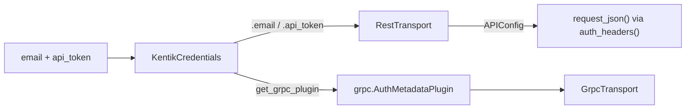

<!-- HAND-WRITTEN: not modified by [`uv run poe generate`](../../../pyproject.toml). Edit directly. -->

# Credentials (`kentik_api.auth`)

Hand-written. Not touched by [`uv run poe generate`](../../../pyproject.toml).

This module is the one definition of Kentik's auth scheme: the
`X-CH-Auth-Email` and `X-CH-Auth-API-Token` keys. REST sends them as
headers and gRPC as call metadata (lowercased, as gRPC requires). Nothing
else in the SDK spells those names.

## `KentikCredentials`

```python
from kentik_api.auth.credentials import KentikCredentials

creds = KentikCredentials(email="you@example.com", api_token="...")
```

| Name | Returns | Used by |
| --- | --- | --- |
| `auth_headers(email, api_token)` | A `dict` with `X-CH-Auth-Email` and `X-CH-Auth-API-Token`. | [`request_json()`](../core/rest_runtime.py), on every REST call |
| `KentikCredentials.get_grpc_plugin()` | A `grpc.AuthMetadataPlugin` that sends the same two keys, lowercased, as call metadata. | [`GrpcTransport`](../transports/grpc_client.py) |

## Shape

One credential pair becomes the two transport-specific auth shapes:



## Where credentials actually get read

`KentikCredentials` only holds and formats values passed to it.
[`KentikAPI`](../client.py), the SDK's public entrypoint, resolves them:
explicit constructor arguments first, then the `KENTIK_EMAIL` /
`KENTIK_API_TOKEN` environment variables, then the `env_file` argument
(`.env` by default, `None` to skip). The file is read into memory, never
into `os.environ`. An explicit argument that is empty or only whitespace
raises `ConfigurationError`. The SDK does not fall back to the environment for
it. `KentikCredentials` is read-only. See
[Authentication](../../../docs/sphinx/authentication.md) for the full rules.
