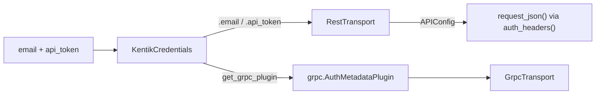

<!-- HAND-WRITTEN: not modified by [`make generate`](../../../Makefile). Edit directly. -->

# Credentials (`kentik_api.auth`)

Hand-written. Not touched by [`make generate`](../../../Makefile).

This module is the one definition of Kentik's auth scheme: the
`X-CH-Auth-Email` and `X-CH-Auth-API-Token` keys. REST sends them as
headers and gRPC as call metadata (lowercased, as gRPC requires). Nothing
else in the SDK spells those names.

## `KentikCredentials`

```python
from kentik_api.auth.credentials import KentikCredentials

creds = KentikCredentials(email="you@example.com", api_token="...")
```

| Name | Returns | Used by |
| --- | --- | --- |
| `auth_headers(email, api_token)` | A `dict` with `X-CH-Auth-Email` and `X-CH-Auth-API-Token`. | [`request_json()`](../core/rest_runtime.py), on every REST call |
| `KentikCredentials.get_grpc_plugin()` | A `grpc.AuthMetadataPlugin` that sends the same two keys, lowercased, as call metadata. | [`GrpcTransport`](../transports/grpc_client.py) |

## Shape

One credential pair becomes the two transport-specific auth shapes:



## Where credentials actually get read

`KentikCredentials` only holds and formats values passed to it. Loading
`KENTIK_EMAIL` / `KENTIK_API_TOKEN` from a project-root `.env` file
happens in [`KentikAPI`](../client.py), the SDK's public entrypoint, not
here. See "Auth/config" in the repository root
[CLAUDE.md](../../../CLAUDE.md) for the full precedence rules (explicit
constructor args win over `.env`).
