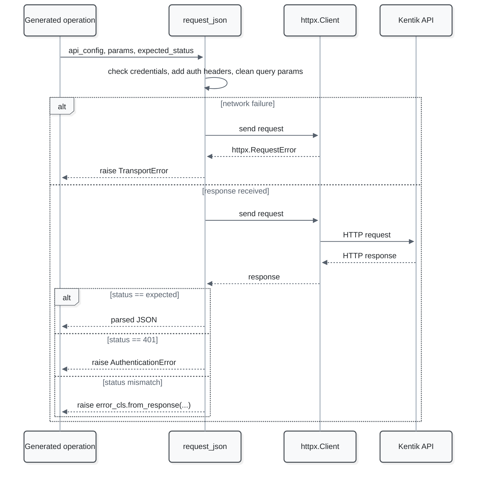
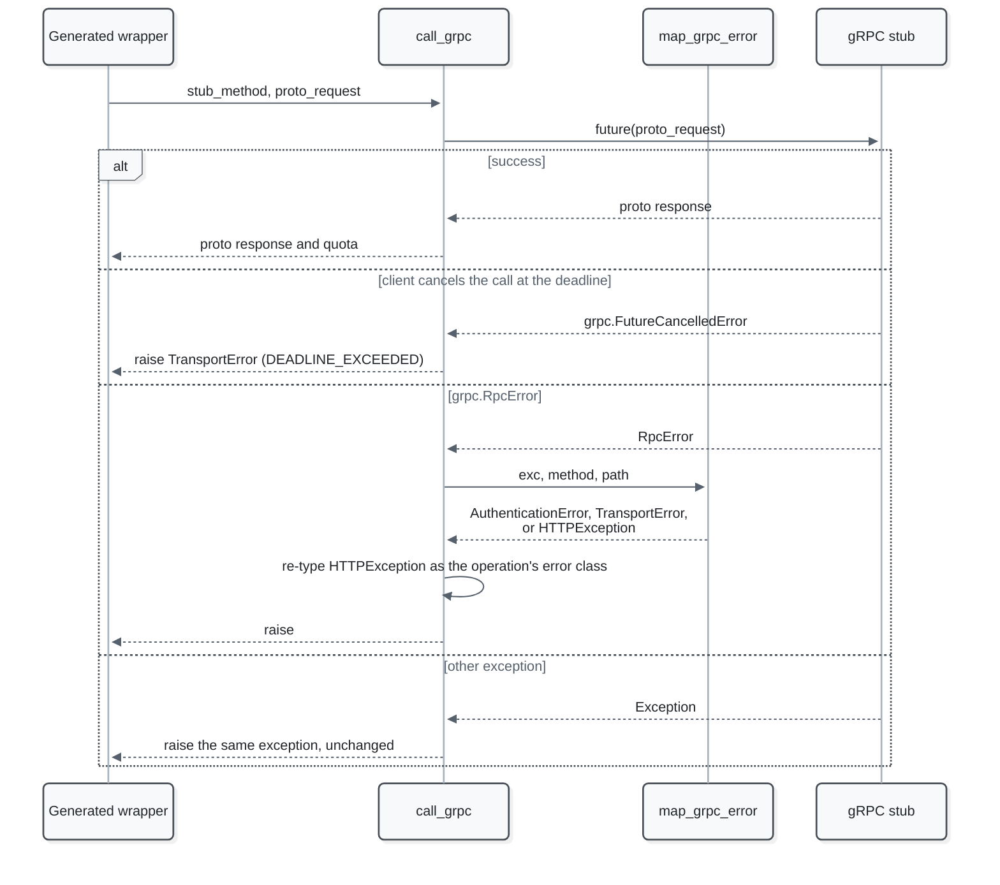

<!-- HAND-WRITTEN: not modified by [`uv run poe generate`](../../../pyproject.toml). Edit directly. -->

# Shared Runtime (`kentik_api.core`)

This folder is hand-written. [`uv run poe generate`](../../../pyproject.toml) does not touch it.
It holds the most significant hand-written engineering in the SDK. Every generated
operation, in every service, goes through one function in this
folder: [`request_json()`](rest_runtime.py) for REST, and
[`call_grpc()`](grpc_runtime.py) for gRPC.

## `APIConfig`

`APIConfig` (in [`api_config.py`](api_config.py)) is the shared configuration object that
every generated call receives: base URL, auth email, auth token, TLS `verify`,
`timeout`, `rest_timeout`, `grpc_deadline`, the per-endpoint quota, and the
shared HTTP client. [`KentikAPI`](../client.py) builds one and gives it to the
transport. Its values are read-only. `with_timeout()` gives a copy with
different timeouts.
Generated wrapper methods read `api_config` off the transport and
forward it as `api_config_override`.

## `request_json()`

`request_json()` (in [`rest_runtime.py`](rest_runtime.py)) is the only function that
calls `httpx` for REST traffic in this SDK. Every generated operation,
in every one of the 36 services mounted on the client, under
[`src/kentik_api/gen/`](../gen/README.md), calls this same function through the
`httpx.jinja2` template. See
[`scripts/openapi_templates/`](../../../scripts/openapi_templates/README.md).

`request_json()` centralizes:

- Kentik's auth headers, built by `auth_headers()` in
  [`auth/credentials.py`](../auth/credentials.py), the scheme's single
  definition
- Query-param cleaning: drops `None` values, sends enum values, and encodes a
  space as `%20`
- A check that the call's `APIConfig` has credentials
- The request itself, through the one `httpx.Client` that its `APIConfig` owns. So
  every call through a `KentikAPI` reuses a pooled connection, and does not
  open a new TLS session each time. `KentikAPI.close()` releases it, and
  a call after that raises `ConfigurationError`.
- Transport-failure wrapping into `TransportError`
- Quota capture into `RateLimit`, keyed by HTTP method and path template
- Status-code checking against each operation's `expected_status`
- JSON error-body parsing (`code`, `message`, `details`)
- Dispatch into the operation's generated error class via
  `error_cls.from_response`
- A 502 `HTTPException` for a success status with a body that is not JSON

## `map_grpc_error()` and `call_grpc()`

`map_grpc_error()` (in [`grpc_runtime.py`](grpc_runtime.py)) is a pure function:
no I/O, no side effects, testable without a gRPC channel. It maps a
`grpc.RpcError` status code to the SDK exception hierarchy (`AuthenticationError`,
`HTTPException`, or `TransportError`). It classifies every non-OK code explicitly. `call_grpc()` is the thin caller that invokes the gRPC stub
and delegates all error mapping to `map_grpc_error()`.

## Concurrency

`httpx.Client` is thread-safe, so threads can share one `KentikAPI`.
That does not make parallel calls useful. Kentik allows one
concurrent request for non-query APIs. A request counts as concurrent
if it arrives before the API answers the previous one. No response header reports
this limit. The API caps throughput, not this client, so calls
from several threads mostly wait in a queue on the server.

After `os.fork()`, the child opens its own connection on first use. It does
not use the connection of the parent.

A caller that invokes a generated REST function directly with no
`api_config_override` gets `ConfigurationError`, because a default
`APIConfig` has no credentials. The mounted `KentikAPI` wrappers always pass
their shared config.

## Extending this layer

Fix or extend `request_json()` or `APIConfig` here. Never add
per-endpoint HTTP, auth, or retry code to a generated service wrapper,
and never inline request logic to "simplify" one call site. See "The
shared connection handler" in the repository root
[AGENTS.md](../../../AGENTS.md) for the full rationale and the commits
that shaped this design.
