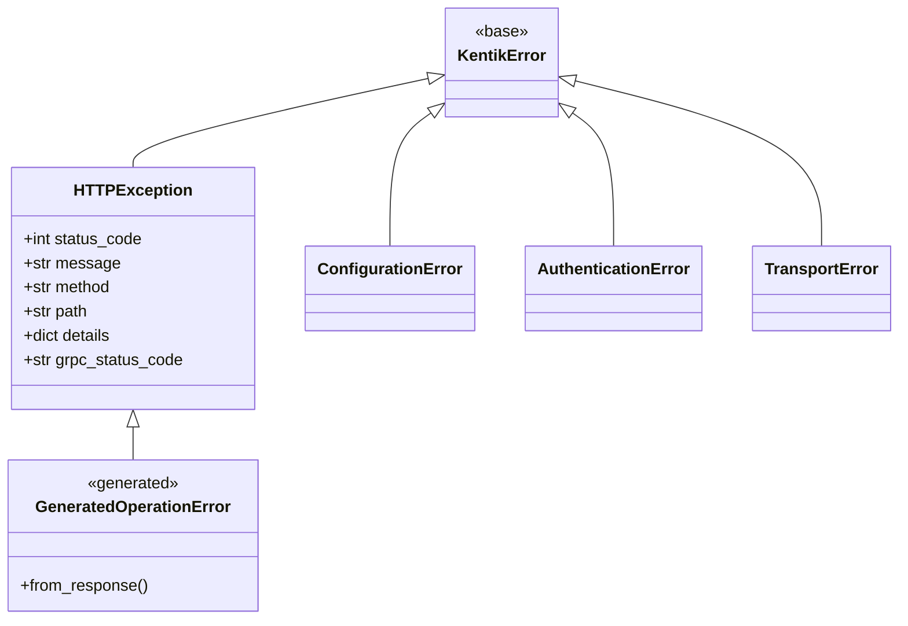

<!-- HAND-WRITTEN: not modified by [`make generate`](../../../Makefile). Edit directly. -->

# Errors (`kentik_api.errors`)

Hand-written. Not touched by [`make generate`](../../../Makefile). This is the one shared
exception hierarchy every generated per-service error class builds on.

## Hierarchy

`GeneratedOperationError` stands in for the per-operation classes each
service generates under `gen/<service>/error/`.

| Class | Raised when |
| --- | --- |
| `KentikError` | Base class for every SDK-specific error. Catch this to handle any SDK failure. |
| `ConfigurationError` | `KentikAPI(...)` or `APIConfig(...)` gets missing credentials, an unknown region or protocol, or a non-positive timeout. |
| `AuthenticationError` | Credentials are rejected on either transport: [`request_json()`](../core/rest_runtime.py) raises it for a REST 401, ahead of the generated error class, and `map_grpc_error()` for a gRPC `UNAUTHENTICATED` status. |
| `TransportError` | No response arrived: `request_json()` on an `httpx.RequestError`, or `map_grpc_error()` for `CANCELLED`, `DEADLINE_EXCEEDED`, `UNAVAILABLE`, or an unrecognized code. |
| `HTTPException` | The API responded with a fault. Carries `status_code`, `message`, `method`, `path`, a `details` dict (parsed from the response body when possible), and on gRPC the verbatim `grpc_status_code`. |

Every class inherits a `rate_limit` attribute from `KentikError`. The shared
runtimes set it to the quota the API reported on the failing call, or leave it
`None` when no response arrived.

## Generated per-operation error classes

Each service's generated `error/__init__.py` declares one `HTTPException`
subclass per operation, plus a `response_error_map` from status code to
class. [`request_json()`](../core/rest_runtime.py) calls `error_cls.from_response(...)` to build
the right one. See
[`tests/generated/test_endpoint_schema_coverage.py`](../../../tests/generated/test_endpoint_schema_coverage.py)
for how every declared status code gets exercised against this
mapping.

## Adding a new base error

Add it here, alongside the existing four, and export it from
`__all__`. Never add a new error type inside a generated
`gen/<service>/error/` file; that file is fully regenerated on every
[`make generate`](../../../Makefile) run.
