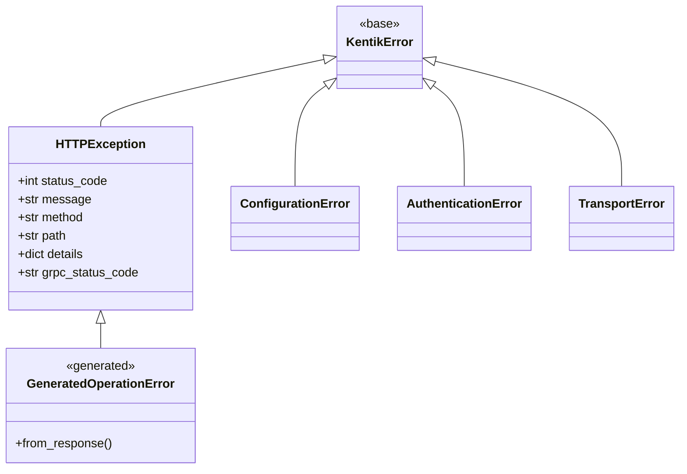

<!-- HAND-WRITTEN: not modified by [`make generate`](../../../Makefile). Edit directly. -->

# Errors (`kentik_api.errors`)

Hand-written. Not touched by [`make generate`](../../../Makefile). This is the one shared
exception hierarchy every generated per-service error class builds on.

## Hierarchy

`GeneratedOperationError` stands in for the per-operation classes each
service generates under `gen/<service>/error/`.

| Class | Raised when |
| --- | --- |
| `KentikError` | Base class for every SDK-specific error. Catch this to handle any SDK failure. |
| `ConfigurationError` | `KentikAPI(...)` gets missing or empty credentials, an unknown region or protocol, or a timeout that is not a positive number. `APIConfig(...)` gets a timeout that is not a positive number. A gRPC call gets an unknown body key or enum name, or an `api_config_override` that `with_timeout()` did not build. A call runs after `close()`. |
| `AuthenticationError` | Credentials are rejected on either transport: [`request_json()`](../core/rest_runtime.py) raises it for a REST 401, ahead of the generated error class, and `map_grpc_error()` for a gRPC `UNAUTHENTICATED` status. |
| `TransportError` | No response arrived: `request_json()` on an `httpx.RequestError`, or `map_grpc_error()` for `CANCELLED`, `DEADLINE_EXCEEDED`, `UNAVAILABLE`, an unrecognized code, or a gRPC response over the receive limit. |
| `HTTPException` | The API responded with a fault. Carries `status_code`, `message`, `method`, `path`, a `details` dict (parsed from the response body when possible), and on gRPC the verbatim `grpc_status_code`. A success status with an unusable body raises a plain `HTTPException` with status 502. `details["rpc_status"]` holds the server's `google.rpc.Status` on either transport. |

Every class inherits a `rate_limit` attribute from `KentikError`. The shared
runtimes set it to the quota the API reported on the failing call, or leave it
`None` when no response arrived.

## Generated per-operation error classes

Each service's generated `error/__init__.py` declares a service base class,
such as `DeviceError`. It declares one class for each operation, named after
the client method, such as `ListError` for `device.list`. It also declares a subclass for
each status that the schema declares for that operation. Each operation class
has a `response_error_map` from status code to subclass. `ERROR_BY_METHOD`
maps each client method name to its class.
[`request_json()`](../core/rest_runtime.py) calls `error_cls.from_response(...)`.
[`call_grpc()`](../core/grpc_runtime.py) reads the same map, so both
transports raise the same class. See
[`tests/generated/test_endpoint_schema_coverage.py`](../../../tests/generated/test_endpoint_schema_coverage.py)
for how every declared status code gets exercised against this
mapping.

## Adding a new base error

Add it here, alongside the existing four, and export it from
`__all__`. Never add a new error type inside a generated
`gen/<service>/error/` file; that file is fully regenerated on every
[`make generate`](../../../Makefile) run.
