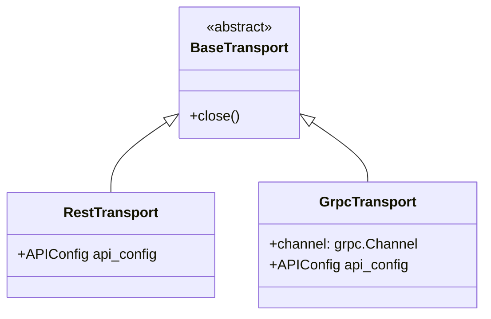

<!-- HAND-WRITTEN: not modified by [`uv run poe generate`](../../../pyproject.toml). Edit directly. -->

# Transports (`kentik_api.transports`)

Hand-written. Not touched by [`uv run poe generate`](../../../pyproject.toml). Thin transport-selection
code, not per-endpoint logic. Each transport takes one
[`APIConfig`](../core/api_config.py), the single source of the host,
credentials, timeouts, and quota record. [`KentikAPI`](../client.py) builds it.

## Classes

| Class | File | Role |
| --- | --- | --- |
| `BaseTransport` | [`base.py`](base.py) | Abstract base. Declares `close()`. |
| `RestTransport` | [`rest_client.py`](rest_client.py) | `RestTransport(api_config)`. Generated wrappers read `api_config` off this object. |
| `GrpcTransport` | [`grpc_client.py`](grpc_client.py) | `GrpcTransport(api_config, target, options)`. Opens a `grpc.secure_channel` with an auth plugin built from the config's credentials, and raises `ConfigurationError` when they are missing. Every call gets the `grpc_deadline` default, and the receive limit is 40 MiB. It records quota per gRPC method in `api_config.rate_limits`. |



## gRPC

`GrpcTransport` opens a TLS channel to a per-region gRPC endpoint
(`grpc.api.kentik.com:443` for `region="us"`, the default;
`grpc.api.kentik.eu:443` for `region="eu"`), and each service wrapper
routes calls through the compiled proto stubs in `gen/<service>/pb/`.
The `gen/pb_companions/` registry loads all shared proto descriptors
before the stubs are imported. `call_grpc()` in
[`core/grpc_runtime.py`](../core/grpc_runtime.py) normalizes gRPC errors to the same exception
hierarchy as REST.

```python
client = KentikAPI(protocol="grpc")
response = client.device.list()  # works the same as REST
```

## Adding a transport

Add a new `BaseTransport` subclass here, and wire its selection logic
into [`KentikAPI`](../client.py). Keep per-endpoint request logic out
of this folder; that belongs in
[`core/rest_runtime.py`](../core/rest_runtime.py) and
[`core/grpc_runtime.py`](../core/grpc_runtime.py).
